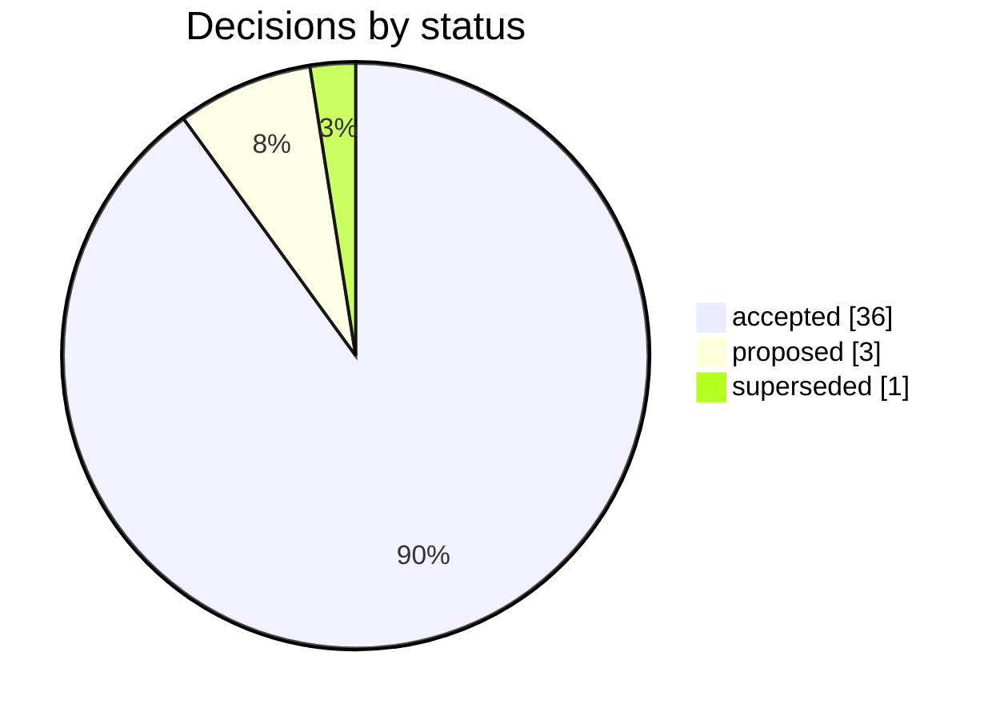

# Architecture decisions

Accepted, durable decisions about how this repository is built, one file each, with the
context, the decision, the alternatives rejected and the consequences. Nothing here is
generated and nothing is promoted here automatically: a decision recorded while working
(`majordomus decision add`) stays in the checkout's local state until a person judges it
durable enough to write down here.

## Index

Generated from each decision's front matter by `tools/surfaces/surfaces sync`; the decisions
themselves stay hand-written.

<!-- surfaces:begin ai-adrs as=pie -->

<!-- surfaces:end ai-adrs -->

<!-- surfaces:begin ai-adrs -->
| Decision | Status | Title |
|---|---|---|
| [adr-0001](0001-this-fork-is-a-private-research-target-and-never-interacts-w.md) | accepted | This fork is a private research target and never interacts with upstream |
| [adr-0002](0002-validation-runs-in-three-cost-tiers-behind-one-gate-script-a.md) | accepted | Validation runs in three cost tiers behind one gate script, and a report never claims a step that did not run |
| [adr-0003](0003-principles-are-adapted-from-prismatic-into-this-fork-one-way.md) | accepted | Principles are adapted from Prismatic into this fork one way, and nothing flows back automatically |
| [adr-0004](0004-research-access-to-internals-is-permitted-and-research-code-.md) | accepted | Research access to internals is permitted, and research code is compile-gated, labelled and removable |
| [adr-0005](0005-an-experiment-is-driven-by-the-research-cli-and-its-build-pr.md) | accepted | An experiment is driven by the research CLI and its build profile, runtime flags and evidence are recorded in a versioned manifest |
| [adr-0006](0006-the-research-cli-keeps-the-system-compiler-when-it-supports-.md) | accepted | The research CLI keeps the system compiler when it supports source_location and falls back to Homebrew LLVM only when it does not |
| [adr-0007](0007-prismatic-steers-a-company-through-a-standalone-bridge-that-.md) | accepted | Prismatic steers a company through a standalone bridge that drives a Company AI over rcon, not through a Game Script relay |
| [adr-0008](0008-an-agent-reaches-the-game-through-an-embedded-loopback-mcp-s.md) | accepted | An agent reaches the game through an embedded loopback MCP server whose mutations pass a digest-bound human approval and the command system |
| [adr-0009](0009-the-fork-s-site-is-a-zola-project-published-to-github-pages-.md) | superseded | The fork's site is a Zola project published to GitHub Pages from a fork-only workflow |
| [adr-0010](0010-majordomus-supervises-this-fork-and-the-ai-layer-is-its-trac.md) | accepted | Majordomus supervises this fork and the .ai/ layer is its tracked governance record |
| [adr-0011](0011-the-fork-follows-upstream-by-rebasing-its-commits-onto-upstr.md) | accepted | The fork follows upstream by rebasing its commits onto upstream master, and upstream is a fetch-only remote |
| [adr-0012](0012-every-published-surface-is-derived-from-tracked-markdown-git.md) | accepted | Every published surface is derived from tracked Markdown, git and the .ai layer by one generic generator |
| [adr-0013](0013-every-openttd-process-may-run-its-own-mcp-server-and-its-vie.md) | accepted | Every OpenTTD process may run its own MCP server, and its view tools act on the local viewport only, with no command and no approval |
| [adr-0014](0014-interface-input-from-an-agent-is-armed-per-process-by-the-ow.md) | accepted | Interface input from an agent is armed per process by the owner and yields to the owner's mouse, and every action it causes is an ordinary client command |
| [adr-0015](0015-the-fork-does-not-run-upstream-s-ci-workflows-on-push-pages-.md) | accepted | The fork does not run upstream's CI workflows on push; Pages deploys from Surfaces alone |
| [adr-0016](0016-multiplayer-is-deterministic-lockstep-every-peer-runs-the-sa.md) | accepted | Multiplayer is deterministic lockstep: every peer runs the same command stream and only commands cross the wire |
| [adr-0017](0017-game-objects-live-in-typed-pools-addressed-by-strong-ids-nev.md) | accepted | Game objects live in typed pools addressed by strong IDs, never by persistent pointers |
| [adr-0018](0018-every-savegame-ever-written-stays-loadable-saved-fields-are-.md) | accepted | Every savegame ever written stays loadable: saved fields are gated by SaveLoadVersion and old layouts are converted after load |
| [adr-0019](0019-settings-are-declared-once-in-ini-tables-that-settingsgen-co.md) | accepted | Settings are declared once in ini tables that settingsgen compiles into the tables used by the config file, the savegame, the GUI and network sync |
| [adr-0020](0020-player-facing-text-is-compiled-from-english-txt-by-strgen-an.md) | accepted | Player-facing text is compiled from english.txt by strgen, and translations arrive from eints and are never edited by hand |
| [adr-0021](0021-ai-and-game-scripts-run-in-embedded-squirrel-against-a-gener.md) | accepted | AI and Game Scripts run in embedded Squirrel against a generated API, and old API versions are kept through compatibility scripts |
| [adr-0022](0022-platform-backends-are-drivers-registered-in-factories-and-ch.md) | accepted | Platform backends are drivers registered in factories and chosen at runtime, so one binary can run with a window, headless or silent |
| [adr-0023](0023-the-map-is-a-flat-array-of-tiles-whose-behaviour-is-dispatch.md) | accepted | The map is a flat array of tiles whose behaviour is dispatched by tile type through a table of tile procedures |
| [adr-0024](0024-the-cargodist-link-graph-is-computed-in-background-threads-a.md) | accepted | The cargodist link graph is computed in background threads and joined at a fixed economy date, pausing the game rather than joining late |
| [adr-0025](0025-game-time-runs-on-separate-tick-calendar-economy-and-real-ti.md) | accepted | Game time runs on separate tick, calendar, economy and real-time timers, and periodic work subscribes to the one that matches its meaning |
| [adr-0026](0026-pathfinding-is-yapf-an-a-framework-composed-at-compile-time-.md) | accepted | Pathfinding is YAPF, an A* framework composed at compile time from policy templates and specialised per vehicle type |
| [adr-0027](0027-cmake-is-the-only-build-system-and-every-directory-declares-.md) | accepted | CMake is the only build system, and every directory declares its sources with add_files under explicit conditions |
| [adr-0028](0028-graphics-sounds-and-music-come-from-replaceable-base-sets-an.md) | accepted | Graphics, sounds and music come from replaceable base sets and NewGRFs, and the engine ships no proprietary data |
| [adr-0029](0029-a-research-gated-local-only-override-accepts-a-mismatched-pee.md) | accepted | A research-gated, local-only override accepts a mismatched peer revision for a loopback R&D game, without spoofing the build's own revision |
| [adr-0030](0030-public-servers-are-played-with-an-unmodified-official-client.md) | accepted | Public servers are played with an unmodified official client; fork features run only on the owner's own servers, on a client built on the same release |
| [adr-0032](0032-the-bridge-s-admin-protocol-client-is-a-native-rust-service-.md) | accepted | The bridge's admin-protocol client is a native Rust service (axum + tokio), not the Python/FastAPI bridge |
| [adr-0033](0033-every-panel-event-goes-out-on-zeromq-and-into-a-duckdb-store.md) | accepted | Every panel event goes out on a ZeroMQ PUB socket and into a DuckDB store, per instance, from one tap on the bus |
| [adr-0034](0034-planning-decisions-read-recorded-history-and-emit-structured.md) | accepted | Planning decisions read recorded history from the store and publish each choice as a structured event |
| [adr-0035](0035-company-ais-are-ranked-in-headless-null-driver-matches-on-ever.md) | accepted | Company AIs are ranked in headless null-driver matches on every reachable LAN machine, and the ranking is a derived record |
| [adr-0036](0036-prismatic-ai-settings-are-tuned-by-a-deterministic-genetic-algorith.md) | accepted | PrismaticAI's settings are tuned by a deterministic genetic algorithm over the LAN battle, and a tuned setting reaches a default only through held-start duels |
| [adr-0037](0037-battlebrain-in-this-fork-is-the-one-authority-for-the-freigh.md) | accepted | Battlebrain in this fork is the one authority for the freight-line decision; planner and AlgoGlyph only produce candidates, the executor only applies |
| [adr-0038](0038-one-approval-core-plans-not-settings-every-channel-an-adapter.md) | accepted | One approval core on the game server: a plan is approved as a whole and executes on approval, and every channel (web, console, game command, chat) is an adapter to it |
| [adr-0039](0039-algoglyph-is-a-git-submodule-pinned-at-one-commit-and-its-ru.md) | proposed | AlgoGlyph is a git submodule pinned at one commit, and its Rust kernels run in-process as native-rust catalogue entries |
| [adr-0041](0041-bulk-consent-and-standing-approval-rules.md) | proposed | The owner's bulk consent and standing approval rules: approve or deny all over a filter, and always-allow or always-deny rules of a tool glob and a JSON matcher, applied in the one approval core |
| [adr-0042](0042-a-strategy-review-cycle-runs-on-the-game-s-month-quarter-and.md) | proposed | A strategy review cycle runs on the game's month, quarter and week, judges every company against the leader from recorded data, and turns a lasting gap into a replan request, an approval-gated plan, labelled learning rows and an owner digest |
<!-- surfaces:end ai-adrs -->
