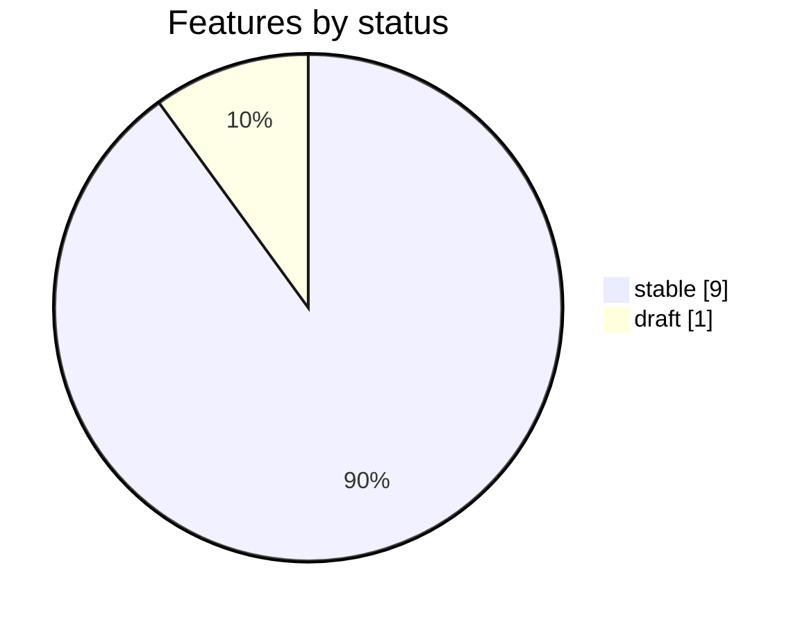

# Product features

A **feature** is one thing this repository's product does for a person, stated once, in one
Markdown file here (`schema: feature/v1`). The front matter names what the feature is made
of — capability modules, commands, object kinds, rules, documents, decisions, claims, use
cases — each a typed reference the tool validates, and the presentation decisions nothing
can infer: the headline, the order, whether it is featured. Everything else a page or an
API says about a feature is derived from those references and never written here.

The contract is `share/schemas/majordomus/feature/feature.v1.schema.json` of the tool
distribution; a key it does not declare is an error, and a `schema:` version the tool does
not know is refused rather than guessed. The file name is the `id` is the route.

## Discovery

Nothing registers a feature. Declare the source class in `../knowledge/sources.yaml` and
every file here is discovered through the version-control index:

```yaml
  - id: feature
    kind: feature
    discovery: vcs
    pathspec: ':(glob).ai/repo/features/*.md'
    required: false
```

From then on, adding a file is the whole act: `majordomus product list` shows it,
`/api/v1/product/features` returns it, `majordomus://feature/<id>` serves it.

## Checking it

```bash
majordomus product validate     # schema, references with the nearest candidate, floors
```

An empty section is a valid one. This section starts empty on purpose.

## What a status means

The `status` values are the three of the tool's schema (`feature.v1.schema.json`): `stable`
(complete and public, held to the content floors), `draft` (written and not yet complete) and
`deprecated` (kept because its route exists, listed nowhere). This repository adds the evidence
each value needs, defined here once (issue I0112). A feature carries a value only when it meets
that value's criterion, and its `## Maturity` section says which evidence meets it.

**stable** needs all five of these:

1. **Complete on master.** Every part the headline and summary promise is merged, and every path
   they name exists. A part that is still on a branch, in another repository or only proposed
   keeps the feature at draft.
2. **A check of its own.** The `## Maturity` section names at least one check that runs this
   feature's code. A general gate pass or a check of derived records alone does not count. It
   also says whether CI (`.github/workflows/`), a `tools/gate.sh` tier or an installed hook runs
   that check, or whether someone has to run it by hand. A check run by hand counts, but the
   Maturity section has to say so, because nothing would notice if it broke.
3. **A recorded pass on a master commit.** The section gives the commit of the check's last
   recorded pass, and that commit is in master's history. The record can be a plan record's
   evidence, a pull request's verification, a CI run or a committed result. To see what changed
   since that pass, run `git log <commit>..master -- <paths>`.
4. **A body that describes master today.** What it does and what it does not do are true at the
   commit the section names. Each open limit that work could close names the open issue that owns
   it.
5. **No error from `majordomus product validate`.** The floor warning "a stable feature names at
   least one mechanism: a module, a command or a kind" is allowed. Those registries are the
   tool's own, and this repository adds nothing to them, so no feature here can name one.

**draft**: at least one of the five is not met. The `## Maturity` section says which one, in one
line, with the path, command or issue that shows it. A draft feature moves to stable once the
missing item is delivered and the section is rewritten.

**deprecated**: the feature has been removed or replaced. Its file stays only because its route
(`majordomus://feature/<id>`, `/api/v1/product/features/<id>`) is still linked from somewhere. Its
`## Maturity` section names the commit that removed or replaced the feature.

A stable feature goes back to draft as soon as one of the five stops holding, for example when
its check fails on master or a body claim turns out false. Nothing re-grades a feature
automatically. The tool's schema has only the enum, `majordomus product validate` checks references
and floors but not this criterion, and its front matter refuses any key it does not declare.
Re-grading is therefore manual: each record's `## Maturity` section has to be checked against this
list whenever the feature's code changes.

## In this repository

Generated by `tools/surfaces/surfaces sync`; on the site each slice opens the table below filtered to that status.

<!-- surfaces:begin ai-features as=pie -->

<!-- surfaces:end ai-features -->

<!-- surfaces:begin ai-features -->
| Feature | Status | What it gives |
|---|---|---|
| [Validation gate](layered-validation-gate.md) | stable | One script checks a change at the cost its size needs, and a report can only say what actually ran. |
| [Instrumentation](research-instrumentation.md) | stable | Internal state becomes observable in research builds and provably absent from every other build. |
| [Research CLI](research-experiment-cli.md) | stable | An experiment records its own build profile, toolchain, commands and results, and its report is generated from that record. |
| [Bridge](prismatic-bridge.md) | draft | Prismatic decides, a standalone bridge relays over the admin network, and a normal Company AI acts in the game. |
| [AI battle](lan-ai-battle.md) | stable | Every SSH-reachable machine runs headless free-for-all matches between PrismaticAI and BaNaNaS AIs, the leaderboard is a derived record, and a browser dashboard shows the run live. |
| [Battle post-mortem](battle-postmortem.md) | stable | After each round, a Rust tool analyses every finished match in parallel, names why each contestant lost against fixed thresholds, counts PrismaticAI's last places, and proposes settings for the next edition. |
| [MCP server](embedded-mcp-server.md) | stable | An agent reads live game state over MCP and changes it only with an operator's approval of the exact arguments, through the command system. |
| [Event bus and store](event-bus-and-store.md) | stable | Any process on the machine follows a game live over ZeroMQ, and every decision can query what earlier games recorded. |
| [Surfaces](published-surfaces.md) | stable | The site, the wiki and the Markdown index tables, all generated from what git tracks and the .ai/ layer, and checked on every commit. |
| [AI layer](supervised-ai-layer.md) | stable | Decisions, rules, plan, intents and knowledge live in tracked records that every agent and provider reads the same way. |
<!-- surfaces:end ai-features -->
