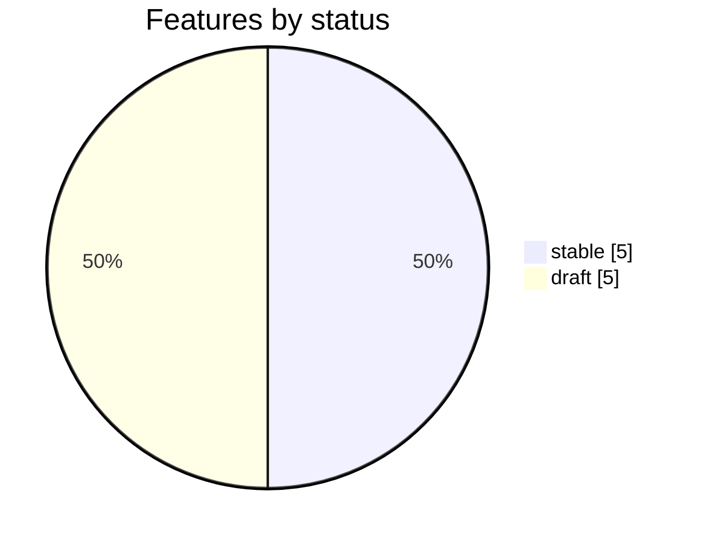

# Product features

A **feature** is one thing this repository's product does for a person, stated once, in one
Markdown file here (`schema: feature/v1`). The front matter names what the feature is made
of — capability modules, commands, object kinds, rules, documents, decisions, claims, use
cases — each a typed reference the tool validates, and the presentation decisions nothing
can infer: the headline, the order, whether it is featured. Everything else a page or an
API says about a feature is derived from those references and never written here.

The contract is `share/schemas/majordomus/feature/feature.v1.schema.json` of the tool
distribution; a key it does not declare is an error, and a `schema:` version the tool does
not know is refused rather than guessed. The file name is the `id` is the route.

## Discovery

Nothing registers a feature. Declare the source class in `../knowledge/sources.yaml` and
every file here is discovered through the version-control index:

```yaml
  - id: feature
    kind: feature
    discovery: vcs
    pathspec: ':(glob).ai/repo/features/*.md'
    required: false
```

From then on, adding a file is the whole act: `majordomus product list` shows it,
`/api/v1/product/features` returns it, `majordomus://feature/<id>` serves it.

## Checking it

```bash
majordomus product validate     # schema, references with the nearest candidate, floors
```

An empty section is a valid one. This section starts empty on purpose.

## In this repository

Generated by `tools/surfaces/surfaces sync`; on the site each slice opens the table below filtered to that status.

<!-- surfaces:begin ai-features as=pie -->

<!-- surfaces:end ai-features -->

<!-- surfaces:begin ai-features -->
| Feature | Status | What it gives |
|---|---|---|
| [Validation gate](layered-validation-gate.md) | stable | One script checks a change at the cost its size needs, and a report can only say what actually ran. |
| [Instrumentation](research-instrumentation.md) | stable | Internal state becomes observable in research builds and provably absent from every other build. |
| [Research CLI](research-experiment-cli.md) | stable | An experiment records its own build profile, toolchain, commands and results, and its report is generated from that record. |
| [Bridge](prismatic-bridge.md) | draft | Prismatic decides, a standalone bridge relays over the admin network, and a normal Company AI acts in the game. |
| [AI battle](lan-ai-battle.md) | draft | Every SSH-reachable machine runs headless free-for-all matches between PrismaticAI and BaNaNaS AIs, the leaderboard is a derived record, and a browser dashboard shows the run live. |
| [Battle post-mortem](battle-postmortem.md) | draft | After each round, a Rust tool analyses every finished match in parallel, names why each contestant lost against fixed thresholds, counts PrismaticAI's last places, and proposes settings for the next edition. |
| [MCP server](embedded-mcp-server.md) | draft | An agent reads live game state over MCP and changes it only with an operator's approval of the exact arguments, through the command system. |
| [Event bus and store](event-bus-and-store.md) | draft | Any process on the machine follows a game live over ZeroMQ, and every decision can query what earlier games recorded. |
| [Surfaces](published-surfaces.md) | stable | The site, the wiki and the Markdown index tables, all generated from what git tracks and the .ai/ layer, and checked on every commit. |
| [AI layer](supervised-ai-layer.md) | stable | Decisions, rules, plan, intents and knowledge live in tracked records that every agent and provider reads the same way. |
<!-- surfaces:end ai-features -->
