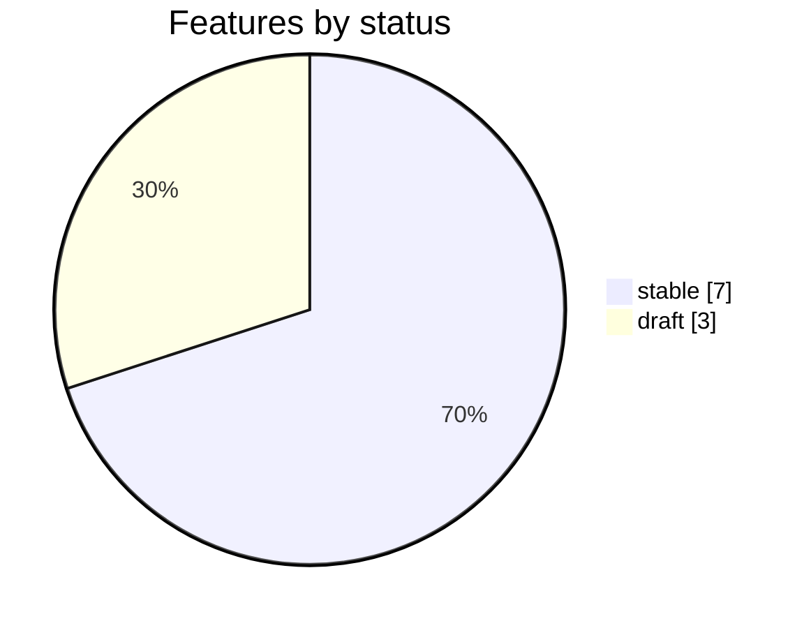

# Product features

A **feature** is one thing this repository's product does for a person, stated once, in one
Markdown file here (`schema: feature/v1`). The front matter names what the feature is made
of — capability modules, commands, object kinds, rules, documents, decisions, claims, use
cases — each a typed reference the tool validates, and the presentation decisions nothing
can infer: the headline, the order, whether it is featured. Everything else a page or an
API says about a feature is derived from those references and never written here.

The contract is `share/schemas/majordomus/feature/feature.v1.schema.json` of the tool
distribution; a key it does not declare is an error, and a `schema:` version the tool does
not know is refused rather than guessed. The file name is the `id` is the route.

## Discovery

Nothing registers a feature. Declare the source class in `../knowledge/sources.yaml` and
every file here is discovered through the version-control index:

```yaml
  - id: feature
    kind: feature
    discovery: vcs
    pathspec: ':(glob).ai/repo/features/*.md'
    required: false
```

From then on, adding a file is the whole act: `majordomus product list` shows it,
`/api/v1/product/features` returns it, `majordomus://feature/<id>` serves it.

## Checking it

```bash
majordomus product validate     # schema, references with the nearest candidate, floors
```

An empty section is a valid one.

`majordomus product validate` refuses a `status` outside the schema's three values. It also holds a
stable feature to the tool's floors: a document it explains itself in, and the body headings
`## What it does` and `## What it does not do`. Its "names at least one mechanism" warning counts
the Majordomus executable's own modules, commands and kinds, which a feature made of this fork's
code cannot name; that warning stays. `majordomus doctor` does not run the product validation, and
the schema declares no evidence key and refuses unknown ones. The evidence a level needs therefore
lives in each record's body, and `tools/surfaces/surfaces check` enforces it (below).

## Maturity levels

A record's `status` is its maturity. The three values are the feature schema's
(`share/schemas/majordomus/feature/feature.v1.schema.json` of the tool distribution); what each one
means here, and what evidence moves a record into it, is defined only in this section. There is no
`active` level: a feature that ships on master and is tested and gated is `stable`.

Every record carries a `## Maturity` section. Its first line names the level and the date it was
graded. Below it comes one list item per piece of evidence, `- **label**: text`. Each item cites at
least one thing this repository resolves: a tracked path in a code span (`path`, `path/`, or
`path:line:Symbol` for a line), an issue record (I0123) or a pull request (PR #123). A command in a
code span does not count by itself; cite the file and line that runs it.

| Level | Means | Evidence lines it requires |
|---|---|---|
| `stable` | Complete. Every promise of the headline and of `## What it does` holds on master. | `shipped`, `tested`, `gated`, `documented` |
| `draft` | Written, not complete: at least one `stable` line cannot be cited. Listed as a draft, never counted, never featured. | `missing`; it may also carry the `stable` lines it already meets |
| `deprecated` | Kept only because its route exists. Listed nowhere. | `replaced` |

What each line must cite, and how to check it:

- **shipped**: the code that does what the record says is on master. Cite `path:line:Symbol` of
  it. Check: `tools/knowledge/refs check --pathspec ':(glob).ai/repo/features/*.md' --strict-lines`
  proves the line still holds the symbol.
- **tested**: an automated test or check exercises that code. Cite the test case
  (`path:line:Symbol`) or the check. A live check run once by hand, or a recorded result, is
  evidence for the record's prose. It is not `tested`.
- **gated**: that test or check runs without anyone remembering to run it. That means a step of
  `tools/gate.sh change` or of a tier the change tier names for the change (the research tier for
  research-gated code), a step of a `.github/workflows/` job, or an `enforcement` entry of
  `.ai/repo/policy.yaml` (a git hook). Cite the line that invokes it. Check: read the cited line.
  It must name the test or check of the `tested` line.
- **documented**: the front matter's `docs:` names a document the index holds, and the body has
  `## What it does` and `## What it does not do`. Cite the document. Check:
  `majordomus product validate` reports no `missing_content` for the record.
- **missing** (draft): which `stable` line cannot be cited yet, and what would supply it, with a
  path, an issue or a pull request.
- **replaced** (deprecated): what replaced the feature or why it was withdrawn.

Promotion and demotion follow the evidence, not the calendar. A draft is promoted to `stable` in
the change that makes its last `missing` citable: the `missing` line goes and the four `stable`
lines take its place. A stable record whose cited evidence stops holding is demoted to `draft` in
the change that breaks it, with a `missing` line saying what broke: a file moved, a symbol went,
a gate step was dropped. A draft may not be `featured` (`majordomus product validate` refuses
it). Promoting one does not feature it; that is an editorial choice.

`tools/surfaces/surfaces check` runs in the pre-commit hook (`.ai/repo/policy.yaml`,
`surfaces-on-commit`), in `tools/gate.sh change` and in CI. It refuses a record whose status is
not one of these levels, a record without `## Maturity`, a required line that is absent, a label
the level does not carry, and a line that cites nothing this repository resolves
(`tools/surfaces/maturity.py`; the levels are declared under `[features]` in `surfaces.toml`).
The same `check` runs the `feature-maturity-refs` generator, which fails on a cited file, symbol
or anchored line that is gone; `surfaces sync` moves an anchored line whose symbol moved.

## In this repository

Generated by `tools/surfaces/surfaces sync`; on the site each slice opens the table below filtered to that status.

<!-- surfaces:begin ai-features as=pie -->

<!-- surfaces:end ai-features -->

<!-- surfaces:begin ai-features -->
| Feature | Status | What it gives |
|---|---|---|
| [Validation gate](layered-validation-gate.md) | draft | One script checks a change at the cost its size needs, and a report can only say what actually ran. |
| [Instrumentation](research-instrumentation.md) | stable | Internal state becomes observable in research builds and provably absent from every other build. |
| [Research CLI](research-experiment-cli.md) | draft | An experiment records its own build profile, toolchain, commands and results, and its report is generated from that record. |
| [Bridge](prismatic-bridge.md) | draft | Prismatic decides, a standalone bridge relays over the admin network, and a normal Company AI acts in the game. |
| [AI battle](lan-ai-battle.md) | stable | Every SSH-reachable machine runs headless free-for-all matches between PrismaticAI and BaNaNaS AIs, the leaderboard is a derived record, and a browser dashboard shows the run live. |
| [Battle post-mortem](battle-postmortem.md) | stable | After each round, a Rust tool analyses every finished match in parallel, names why each contestant lost against fixed thresholds, counts PrismaticAI's last places, and proposes settings for the next edition. |
| [MCP server](embedded-mcp-server.md) | stable | An agent reads live game state over MCP and changes it only with an operator's approval of the exact arguments, through the command system. |
| [Event bus and store](event-bus-and-store.md) | stable | Any process on the machine follows a game live over ZeroMQ, and every decision can query what earlier games recorded. |
| [Surfaces](published-surfaces.md) | stable | The site, the wiki and the Markdown index tables, all generated from what git tracks and the .ai/ layer, and checked on every commit. |
| [AI layer](supervised-ai-layer.md) | stable | Decisions, rules, plan, intents and knowledge live in tracked records that every agent and provider reads the same way. |
<!-- surfaces:end ai-features -->
