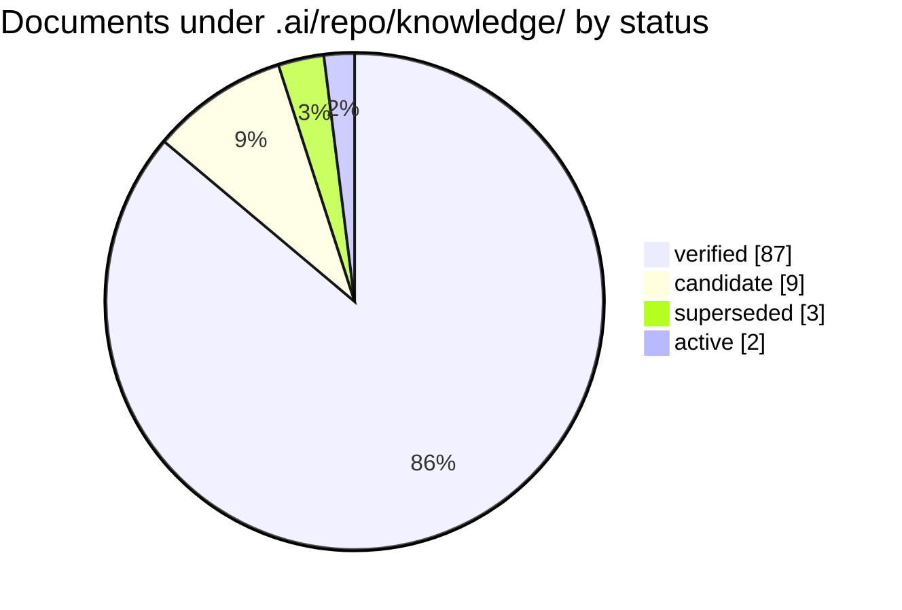
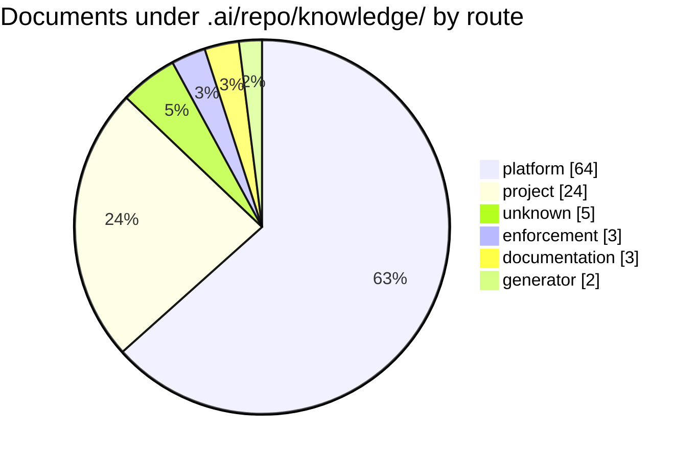
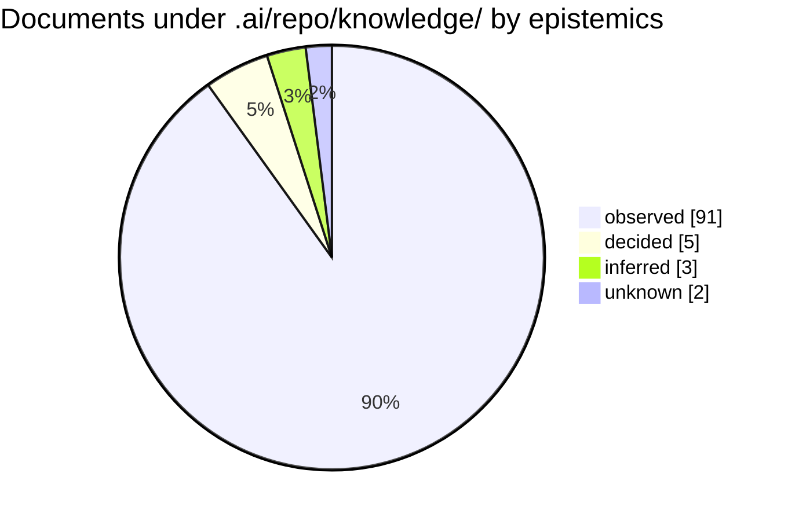

# Knowledge

Knowledge is declared, not collected. `sources.yaml` names the classes of repository
files that carry knowledge and the version-control pathspec each class is discovered
through. Discovery reads the Git index, never the filesystem: an untracked file, build
output or a vendored tree is not a source, and two machines discover the same list in the
same order.

`curated/` holds notes this repository chose to write about itself. It is not a copy of
the documentation, the source or the tests; those are referenced by the sources file and
read where they live. Anything compiled from the sources — an index, a graph — is a
rebuildable local product and belongs under `../../local/cache/`.

## Records (generated)

Every record under this directory with its status, route and epistemics, read from its front
matter by `tools/surfaces/surfaces sync`. On the site each slice opens the table filtered to that
value.

<!-- surfaces:begin docs-index dir=.ai/repo/knowledge as=pie by=status -->

<!-- surfaces:end docs-index -->

<!-- surfaces:begin docs-index dir=.ai/repo/knowledge as=pie by=route -->

<!-- surfaces:end docs-index -->

<!-- surfaces:begin docs-index dir=.ai/repo/knowledge as=pie by=epistemics -->

<!-- surfaces:end docs-index -->

Every record (generated)

<!-- surfaces:begin docs-index dir=.ai/repo/knowledge fields=status,route,epistemics -->
| Document | Status | Route | Epistemics | What it is |
|---|---|---|---|---|
| [Candidate records](candidates/README.md) | active |  |  | What the tool derived from the ledger and git at an episode boundary and nobody has reviewed yet, discovered as a knowledge source class. |
| [Resource reads of a running game span ticks; a planner capture is at one tick only through openttd.resources.read_many](candidates/a-planner-capture-is-coherent-only-through-read-many.md) | candidate | project | observed | Before treating a planner capture or a snapshot of a running game as one state, or deciding live from one. |
| [AlgoGlyph's track-planning kernel answers found, unreachable or budget, never ok; only found prices a line](candidates/algoglyph-track-planning-answers-found-unreachable-or-budget.md) | candidate | project | observed | Before reading a track-planning answer, or writing a check, fixture or policy that tests its status. |
| [One openttd.ai.set_settings approval covers several AI settings and expires at its expires_tick; any other approval lives 100000 ticks (~3.7 game years)](candidates/an-ai-set-settings-approval-expires-at-the-actions-own-stale-date.md) | candidate | platform | observed | Before applying several AI settings through the MCP server, or relying on an approval's lifetime to keep a decision from going stale. |
| [Majordomus refuses an accepted ADR whose origin is extracted; the person adopting it makes it origin authored with an acceptance note](candidates/an-extracted-adr-is-accepted-by-the-person-who-adopts-it.md) | candidate | platform | observed | Before marking an ADR that Majordomus extracted as accepted. |
| [Held-start duel pairs on three seeds did not confirm air_add_waiting=10 with catchment_stops=8, which won the paired battle](candidates/held-start-duel-pairs-did-not-confirm-the-air-and-catchment-defaults.md) | superseded | project | observed | Before claiming a bot default from duels, or reading the battle's paired win of air_add_waiting/catchment_stops; ten-year held-start pairs were inconclusive while 36 paired battle seeds favoured the change. |
| [majordomus start finds an issue only once its file is staged, and refuses one whose YAML has a multi-line plain scalar with '- ' lines](candidates/majordomus-start-binds-an-issue-only-from-the-git-index.md) | candidate | platform | observed | Before running majordomus start --issue for an issue file just written. |
| [MCP approvals outlive a server stop, a token rotation and a new world; only their tick TTL and use retire them](candidates/mcp-approvals-survive-stop-rotation-and-a-new-world.md) | superseded | platform | observed | Before treating a token rotation or a restart of the MCP server as revoking what was approved. |
| [Planner v4 chooses its portfolio against difficulty.max_loan, not what the company can spend now; on the co-play game its pick was over budget or unpriced in two of three shadow runs](candidates/planner-v4-budgets-against-max-loan-not-money-now.md) | candidate | project | observed | Before taking planner v4's chosen line as affordable or priced, or using it as the Battlebrain baseline. |
| [Planner v4 names industries by world-graph id ("industry:41"), not by number; battlebrain_contract::graph_number is the one normalisation](candidates/planner-v4-ids-are-world-graph-ids-read-through-graph-number.md) | candidate | project | observed | Before comparing, storing or passing on a producer or acceptor id taken from mcp-plan, the world graph or a Battlebrain record. |
| [PrismaticAI trails AAAHogEx on network breadth; raising its caps or growing its stations does not close the gap](candidates/prismatic-ai-falls-behind-aaahogex-on-breadth-not-caps.md) | candidate | project | observed | Before tuning PrismaticAI caps, station growth or feeders to catch AAAHogEx; replayed A/Bs on 2026-11-22 show which levers move value and which do not. |
| [Rhai's default expression and call depth limits are half as deep in a debug build, so a deep script can parse in release and fail in debug](candidates/rhai-expression-depth-is-halved-in-a-debug-build.md) | candidate | project | inferred | Before running the mcp-rhai tests in a debug build, or reading an ExprTooDeep / 'Expression exceeds maximum complexity' failure of a script that passes in release. |
| [openttd://vehicles reports the front vehicle's cargo capacity only, so a train led by an engine shows 0](candidates/vehicles-resource-gives-the-front-vehicles-capacity-only.md) | superseded | platform | observed | Before computing a fleet's or a route's capacity from openttd://vehicles. |
| [Curated notes](curated/README.md) | active |  |  | What this repository chose to write about itself, discovered as a knowledge source class. |
| [A PrismaticAI change that moves a few units of money in every game sends exact replays down other paths](curated/a-bot-change-that-moves-money-in-every-game-replays-as-chaos.md) | verified | project | observed | Before reading an ablate --match A/B of a PrismaticAI change: replays are exact, so any game-state difference, even a few units of interest, diverges the whole game, and a few replays then measure chaos, not the change. |
| [A binary built from a modified work tree carries -m and is refused by a server of the same commit built clean (-g)](curated/a-build-from-a-modified-tree-cannot-join-a-clean-build.md) | verified | platform | observed | Before a multiplayer experiment, or when a client fails the version check against a server built from the same commit. |
| [A command handler draws Random() only in its execute pass; a draw in the test pass shifts the shared stream and desyncs](curated/a-command-test-pass-must-not-draw-random.md) | verified | platform | observed | When writing or reviewing any Cmd handler that uses randomness. |
| [Changing a setting from the console in a research run rewrites the user's openttd.cfg unless the run was started with -x](curated/a-console-setting-change-rewrites-the-users-config.md) | verified | platform | observed | Before scripting setting changes in an experiment, the bridge or an MCP flow. |
| [A disaster vehicle's dest_tile holds an IndustryID (airplane, helicopter) or a VehicleID (small UFO) once it has a target](curated/a-disaster-dest-tile-can-hold-an-industry-or-vehicle-id.md) | verified | platform | observed | When reading, drawing, exporting or validating dest_tile of a DisasterVehicle. |
| [A dragged rail or road build reports success when any piece was built; with the GUI's arguments it stops silently at the first obstacle after that](curated/a-dragged-build-succeeds-when-any-piece-was-built.md) | verified | platform | observed | When a caller (GUI, the fork's mcp-human player, research code) builds track or road with BuildRailLong or BuildRoadLong and treats success as 'the whole run exists'. |
| [A heightmap is scaled and padded into the map size from the settings, and its borders decide freeform_edges](curated/a-heightmap-is-scaled-into-the-configured-map-and-sets-freeform-edges.md) | verified | platform | observed | When starting a game from a heightmap headlessly (-g ) and expecting the map size or edge behaviour to follow the image. |
| [Rewriting history under an active task leaves finish nothing to accept](curated/a-history-rewrite-strands-the-active-task.md) | verified | project | observed | Before rewriting fork history while a Majordomus task is open, or when finish refuses with 'diverged from recorded head'. |
| [A .lng file built from a different english.txt is skipped without an error; with none valid the game refuses to start](curated/a-language-pack-must-match-the-binarys-english-txt.md) | verified | platform | observed | When running a binary away from its build directory, mixing lang/ directories, or diagnosing "No available language packs". |
| [A setting a savegame does not carry keeps the loading machine's openttd.cfg value, so the same save can load differently on two machines](curated/a-loaded-game-takes-missing-settings-from-the-loaders-config.md) | verified | platform | observed | When reproducing an experiment from an older save, or comparing runs across machines. |
| [A savegame whose rail or road type label no loaded NewGRF provides loads that track as plain rail, road or tram, without an error](curated/a-missing-type-label-loads-as-the-base-type.md) | verified | platform | observed | When loading a savegame with a different NewGRF set, or reasoning about rail/road types read from a loaded map. |
| [Each news type finds its display setting by a string name at the time an item is shown; a mismatch with the ini var is an assert or a crash, not a build error](curated/a-news-type-binds-its-display-setting-by-name.md) | verified | platform | observed | When adding a news type or renaming a news_display setting. |
| [A panel announces itself before its game's MCP server is up, so a catalogue read once at discovery lacks every resource route](curated/a-panel-registers-before-its-game-is-up.md) | verified | platform | observed | When a client caches what an instance offers (hub, Rhai, a bot): read it again, never only at discovery. |
| [In the shared checkout a peer's commit rides every push; whether it goes out is the owner's call](curated/a-peer-commit-rides-every-push-of-a-shared-checkout.md) | verified | project | observed | When local master holds a commit by another session whose own session refused to push it, and you are about to push your own work. |
| [Every PoolItem::Create must follow a CanAllocateItem for that pool; an assert build checks it, a release build dies with a FatalError when the pool is full](curated/a-pool-create-needs-can-allocate-item-first.md) | verified | platform | observed | When creating a pooled object (vehicle, town, sign, station, company, ...) in a command handler, the game loop or research code. |
| [Game timers with the same period and priority run in pointer order, so a timer that draws Random() needs a Priority value of its own](curated/a-random-timer-needs-its-own-priority.md) | verified | platform | observed | Before adding an IntervalTimer on TimerGameEconomy or TimerGameCalendar. |
| [A regression case fails on any standard output and on any normalised stderr line that differs from its result.txt](curated/a-regression-case-fails-on-any-stdout-or-changed-stderr-line.md) | verified | platform | observed | When adding or changing a Script API call that the regression suite covers, or debugging a red regression case. |
| [A table chunk field whose key is renamed without a version gate is skipped on load with only an sl warning; the value is lost](curated/a-renamed-table-key-loses-its-value-silently.md) | verified | platform | observed | Before renaming a member that a table-based chunk saves. |
| [A research-instrumented build and a default build of the same commit are network-compatible, so they join one game](curated/a-research-build-and-a-default-build-join-the-same-game.md) | verified | platform | observed | Before running a multiplayer experiment that mixes binaries built with different CMake options. |
| [Bash reads a running script by byte offset: edit it only by appending](curated/a-running-bash-script-is-read-by-offset.md) | verified | project | observed | Before editing a tools/research shell script (mcp-duel, mcp-e2e, gate.sh ...) while a run of it may be in progress. |
| [While a panel runs, no other process can open its DuckDB store, not even read-only](curated/a-running-panels-duckdb-store-is-locked-to-other-processes.md) | verified |  | observed | When a tool, agent or the duckdb CLI wants a panel's store (~/.local/state/prismatic-mcp/store/.duckdb) during a run. |
| [When this Mac is over its build limits, mcp-rhai is built and tested on lundra, with the owner's libduckdb in user space](curated/a-rust-build-goes-to-lundra-when-this-mac-is-over-its-limits.md) | verified | project | observed | Before a cargo build or test of tools/research/mcp-rhai while disk is under 35 GiB free or load is far above the core count; how the build is offloaded and what it can and cannot prove. |
| [A script that issues a command from its constructor, Save, Load or a valuator dies with a fatal error](curated/a-script-command-outside-a-suspendable-context-is-fatal.md) | verified | platform | observed | When generating or bridging an AI or Game Script (PrismaticAI and similar). |
| [A path search in an AI script spends game time: raise the opcode budget and weight the heuristic](curated/a-script-path-search-spends-game-time.md) | verified | platform | observed | When a Squirrel AI (PrismaticAI) plans long rail or road lines, or an A/B run shows a bot idle for months. |
| [A command flagged CommandFlag::Server, posted from a network client, gets that client kicked, and nothing on the client stops it being sent](curated/a-server-only-command-from-a-network-client-kicks-it.md) | verified | platform | inferred | Before an MCP tool, a bot or injected input posts a command from a GUI client's process. |
| [A station's name sign takes a click on the tiles beside the station](curated/a-station-name-sign-takes-the-click-beside-it.md) | verified | project | observed | When a person-like player (mcp-human) clicks a tile next to an existing station (a second platform, a depot) and nothing happens and the game says nothing. |
| [A task's scope must cover every path its commits touch; finish and the pre-push hook refuse anything outside it](curated/a-task-scope-must-cover-every-path-its-commit-touches.md) | verified | platform | observed | When starting a Majordomus task for work that spans C++, tools/research, docs and the .ai layer. |
| [An MCP controller with armed input can type into the in-game console, so it can approve its own pending decisions](curated/armed-input-can-approve-its-own-decisions.md) | verified | platform | inferred | Before relying on operator approval in a process started with PRISMATIC_MCP_INPUT=1. |
| [Auto-approve of MCP decisions is switched on only by the owner, never inferred by an agent](curated/auto-approve-is-the-owners-switch.md) | verified | enforcement | decided | When launching tools/research/mcp-e2e, scripting the panel, or building an agent loop over the MCP approval flow. |
| [rcon reaches only server console commands, so the bridge steers a company by restarting its AI with new settings](curated/bridge-control-is-coarse-ai-restart.md) | verified | documentation | observed | When designing a new control path from an external agent into a running game. |
| [Income per delivery is distance times a time factor; ground vehicles cover about 0.036 tiles a day per km/h](curated/cargo-payment-and-vehicle-speed.md) | verified | platform | observed | When a planner, bot or script estimates what a route earns, how long cargo is in transit, or which mode of transport pays. |
| [Classic cheats leave no gamelog entry; a savegame records them only as been_used flags in the CHTS chunk](curated/cheats-are-not-recorded-in-the-gamelog.md) | verified | platform | observed | When reconstructing a savegame's history for research provenance, or adding a cheat. |
| [A check run against :8800 can test an old panel: mcp-e2e moves a new stack to a free port when 8800 is held](curated/checks-can-test-an-old-panel-when-a-stack-moves-port.md) | verified | platform | observed | When restarting the main stack and then running mcp-panel-check, mcp-route-check or mcp-view-check against the default address. |
| [The panel parses console output, so a reworded console line in src/ can stop every stack; run mcp-e2e after changing one](curated/console-lines-the-panel-parses-are-an-interface.md) | verified | platform | observed | Before changing the text of a console line that tools/research parses (the token-file line, the MCP endpoint, approvals). |
| [src/core string files, utf8 and getoptdata also compile into the host tools strgen and settingsgen, where game headers are not available](curated/core-string-files-also-build-into-strgen-and-settingsgen.md) | verified | platform | observed | When adding an include, a Debug() call or a game dependency to src/core/string.cpp, src/core/utf8.cpp or src/misc/getoptdata.cpp. |
| [A dedicated server's console runs one line per select(): lines written together wait in the stream buffer](curated/dedicated-console-reads-one-buffered-line-per-select.md) | verified | platform | observed | When a tool writes several console commands to a dedicated server's stdin in quick succession (the panel, a script, a ~ plan answer). |
| [The headless research run feeds console commands on stdin after a fixed delay, and a loaded machine can lose them](curated/dedicated-server-stdin-startup-race.md) | verified | generator | observed | When a research run passes but its research_status line is missing, or when scheduling a run next to a heavy build. |
| [Cargo delivery income reaches company money when the vehicle leaves the station, not when it unloads](curated/delivery-income-is-booked-when-the-vehicle-leaves.md) | verified | platform | observed | When an experiment or a bot measures income per delivery. |
| [-d desync=2 recomputes caches every tick and runs the rail pathfinder twice, so never time an experiment with it on](curated/desync-debug-level-two-changes-what-it-measures.md) | verified | platform | observed | When choosing debug flags for a measured run; record them as an observer effect. |
| [Duels run side by side on a loaded machine differ by 10% or more for the same bot](curated/duels-run-side-by-side-are-noisy.md) | verified | project | observed | Before reading an A/B duel result, or before running several duels at once; the 1% spread measured on a quiet machine does not hold under load. |
| [Effect vehicles (smoke, sparks, explosions, bubbles) are lockstep game state, not client-side decoration](curated/effect-vehicles-are-game-state.md) | verified | platform | observed | When adding, removing or gating the creation of an effect vehicle, or treating smoke as purely visual. |
| [In a condition chain, the Random() draw comes before any settings_client test, or a local option changes the shared random stream](curated/evaluate-random-before-client-settings.md) | verified | platform | observed | When combining randomness with a client-side setting (sound, GUI) in simulation code. |
| [PauseModes is an 8-bit set whose bits are all used and it is saved as one byte, so a new pause reason needs a wider, version-gated field](curated/every-pause-bit-is-taken.md) | verified | platform | observed | Before adding a pause reason (for example a research or MCP pause). |
| [A fixed loopback port can belong to another local service; a listener that binds only IPv6 then sends clients elsewhere](curated/fixed-loopback-ports-collide.md) | verified | platform | observed | When starting an MCP server in an OpenTTD process, or picking a port for any local research service. |
| [Every fork commit names the issue it served in a Refs trailer](curated/fork-history-carries-issue-trailers.md) | verified | project | decided | When writing a commit on this fork, or tracing a commit to the plan. |
| [On threaded GUI drivers the game loop runs on the ottd:game thread under game_state_mutex; 'main thread' in fork records means that thread](curated/game-state-is-owned-by-the-game-thread-not-the-main-thread.md) | verified | platform | observed | When reasoning about which thread may read pools (MCP handlers, hooks, screenshots). |
| [A default build and its 98/98 tests say nothing about research code; verify with the option ON](curated/gated-code-is-invisible-to-a-default-build.md) | verified | enforcement | decided | When rebasing onto upstream, merging, or changing a header the gated code includes. |
| [GfxLoadSprites is the NewGRF load path, not only graphics: it runs LoadNewGRF on every peer, dedicated servers included](curated/gfxloadsprites-loads-every-newgrf.md) | verified | platform | observed | When moving, skipping or guarding a GfxLoadSprites call (headless runs, null blitter, research hooks), or when looking for where NewGRF game data is (re)built. |
| [Under set -o pipefail, producer \| grep -q reports a match as a failure](curated/grep-q-under-pipefail-is-a-false-negative.md) | verified | enforcement | observed | When a gate or research script checks a binary or a log with strings/cat piped into grep -q. |
| [-g loads a heightmap, savegame or scenario headlessly; -G is the map-generation random seed](curated/heightmap-flag-is-lowercase-g.md) | verified | documentation | observed | When seeding a world from real elevation data, or reading a command line that passes -G. |
| [Levelling an airport site clears its tree tiles, each costs town rating, and neither a guard nor replanting paid off](curated/levelling-an-airport-site-clears-trees-and-costs-town-rating.md) | verified | project | observed | Before changing how PrismaticAI levels airport sites: why a levelled site can be refused with ERR_LOCAL_AUTHORITY_REFUSES, and the measured result of skipping such sites. |
| [A link's capacity in the game's link graph is the capacity of the trips run over it, not of the vehicles assigned to it](curated/link-graph-capacity-counts-trips-not-vehicles.md) | verified | platform | observed | Before judging a route's fleet from cargo_link capacity and usage (openttd://world/graph), or sizing a fleet from it. |
| [Link graph component handlers run on worker threads and may read only their LinkGraphJob, never pools, settings or Random()](curated/link-graph-handlers-read-only-their-job.md) | verified | platform | observed | Before changing cargo distribution (src/linkgraph/) or anything a link graph job reads. |
| [On macOS a missing base graphics set hangs every headless run instead of failing it](curated/macos-missing-baseset-hangs-headless-runs.md) | verified | documentation | observed | When a regression ctest case times out at 120 s, or a research run exits 124 with no research_status line. |
| [Every MCP tool is exposed, but about 2% are ever called, and a call counts as covered before its arguments are checked](curated/mcp-exercise-coverage-is-two-percent.md) | verified | project | observed | Before claiming MCP coverage, reading openttd://mcp/coverage, or extending tools/research/mcp-coverage-check; the measured gap and the smallest generic way to close it. |
| [A NewgameOnly setting is refused by the console in a running game: put it in openttd.cfg before the world is made, and read it back](curated/newgame-only-settings-are-refused-by-the-console-in-a-running-game.md) | verified | platform | observed | When a tool (panel, duel, test stack) changes a game setting with the console's setting after the server started, or when a measurement depends on a server setting. |
| [own_lines derived from stored duel outcomes did not beat the constant 8 on three held-start ten-year pairs](curated/own-lines-derived-from-stored-duels-did-not-beat-the-constant.md) | verified | platform | observed | Before turning PRISMATIC_BOT_FROM_DUELS on by default, changing the rule own-lines-by-handed-v1, or tuning own_lines again from duels. |
| [In a network game Command<>::Post returns once the command is sent; it executes frames later, on every peer](curated/post-in-a-network-game-only-sends.md) | verified | platform | observed | Before reading game state right after a Post to decide whether a command worked (GUI, MCP, bots). |
| [PrismaticAI run without the panel keeps one train per rail line and hoards its earnings, so its fleet shrinks](curated/prismatic-ai-without-a-steward-keeps-one-train-per-line.md) | verified | project | observed | Before reading any result of PrismaticAI started without the MCP panel (the LAN AI battle, a plain start_ai): its rail lines never grow and fleet.nut sells loss-making road vehicles without replacing them. |
| [A rail line holds no 90-degree turn, anywhere: pf.forbid_90_deg is on by default and a train meeting one is lost](curated/rail-lines-a-train-can-turn-on.md) | verified | platform | observed | When building, re-planning or checking rail track for a bot, or reading why a bot's trains are lost or a rail line earns nothing. |
| [A console command reached over rcon or the admin port passes server-only hooks, so a new command restricts remote callers itself](curated/rcon-and-admin-console-commands-pass-server-only-hooks.md) | verified | platform | observed | Before adding a console command (research_status, prismatic_mcp, ...) that must not be reachable remotely. |
| [Forcing Homebrew LLVM on a current Xcode breaks the build; probe the system compiler first](curated/research-cli-keeps-the-system-compiler.md) | verified | generator | observed | When a research-profile configure fails with hundreds of 'unknown type name size_t' errors, or when choosing a toolchain on macOS. |
| [A road depot or bay stop faces its front tile but is not connected to it; drive-through stops run along the road's axis](curated/road-stops-and-depots-need-their-entrance-road.md) | verified | platform | observed | When a bot, a Rhai script or an MCP caller builds a road station, a road depot, a rail depot or a train station. |
| [AIs and the Game Script run only on the server, and the Game Script keeps ticking while the game is paused](curated/scripts-run-only-on-the-server-and-the-game-script-runs-while-paused.md) | verified | platform | observed | Before designing a bridge, MCP or experiment flow that pauses the game or expects script activity on clients. |
| [A TextEffectID stored in a game object is per-client view state; game logic must never branch on it](curated/text-effect-ids-are-client-local.md) | verified | platform | observed | When reading or adding a TextEffectID (loading indicators, income text) in a vehicle, station or other pooled object. |
| [The AI-battle arena runs the repository's current BattleReferee, so its matches log what the fitness rules judge (owner, 2026-11-25)](curated/the-arena-follows-the-repositorys-referee.md) | verified |  | decided | When provisioning or updating the ttd-battle arena, calibrating a fitness rule on arena matches, or wondering why arena match logs lack a field the referee logs. |
| [PrismaticAI's rail pathfinder: land, level crossings, bridges and tunnels, each taken only as the game allows it](curated/the-bots-rail-pathfinder-lays-plain-track-only.md) | verified | platform | observed | When choosing which planned rail line the owner's bot builds, or reading why a bot company has no trains. |
| [-c makes the file's folder the working-dir search path, the config directory and the personal directory](curated/the-config-flag-moves-the-personal-directory.md) | verified | platform | observed | When starting OpenTTD with -c for an experiment, a test or a second instance, and looking for its saves, logs, crash files or downloaded content. |
| [Multiplayer desync detection compares only random.state[0] at sync frames; a divergence that never feeds Random() goes unseen](curated/the-desync-check-compares-only-the-game-random-state.md) | verified | platform | observed | When using 'no desync reported' as evidence that a hook or experiment left clients in step. |
| [The Majordomus blackboard has no write of its own: a process reaches it by announcing on a board as an MCP peer or through the mesh journal](curated/the-majordomus-blackboard-is-written-by-announcing-on-a-board.md) | verified | project | observed | Before forwarding anything (a bus digest, a status, a result) to the Majordomus blackboard so that other agent sessions see it. |
| [The fork's openttd://map tile codes index a fixed string by TileType's numeric value; an upstream reorder mislabels tiles silently](curated/the-mcp-map-encoding-follows-tiletype-order.md) | verified | platform | observed | When rebasing onto an upstream change to src/tile_type.h. |
| [Under the null sound driver no mixer channel is ever freed, so after eight effects every StartSound returns early](curated/the-null-sound-driver-never-frees-a-mixer-channel.md) | verified | platform | observed | When instrumenting or counting sound effects in a headless (-s null) research or regression run. |
| [Under -v null, work queued with VideoDriver::QueueOnMainThread never runs, so an MCP screenshot writes no file](curated/the-null-video-driver-never-drains-the-main-thread-queue.md) | verified | platform | observed | Before using a capture or any queued main-thread work in a null-video (regression or headless) run. |
| [The owner auto-answers the bot's questions with openttd.view.ask.auto, so no 'Your bot asks' dialog interrupts play](curated/the-owner-can-auto-answer-the-bots-questions.md) | verified | platform | observed | When the bot asks yes/no questions through openttd.view.ask and the owner does not want to click each red dialog. |
| [The owner's answers of 2026-11-25: Majordomus learns this session's four lessons generically, and the live game on :8800 is left as it is](curated/the-owners-answers-of-2026-11-25-on-majordomus-and-the-live-game.md) | verified | project | decided | When a session asks whether the live game's stack may be redeployed with merged PrismaticAI fixes, or which of this repository's lessons were handed to prismatic-majordomus and on whose word. |
| [The panel's bus carries game, company, decision, console, news, panel and plan events from one declared table; the hub's own audit and derived game events go to the hub's bus and store](curated/the-panel-bus-carries-these-event-kinds.md) | verified | project | observed | Before subscribing to a panel's or the hub's bus, its ZeroMQ socket or its DuckDB store (ADR 0033), or before a decision reads recorded history (ADR 0034): which event kinds exist (the table src/panel_events.rs declares, GET /api/bus kinds of each), who publishes each, what each carries, how often, what the plan. events carry, where the hub's events are stored, and what is not on any bus at all. |
| [The planner predicts more profit per vehicle than the running lines earn](curated/the-planner-overpredicts-what-a-line-earns.md) | verified | project | observed | Before trusting a plan's monthly_profit or score, or when choosing params for a new plan; read the game's own calibration first. |
| [Selecting an engine in the purchase window with a cargo filter builds, refits and sells a real vehicle on the local client](curated/the-purchase-window-cost-query-builds-a-real-vehicle.md) | verified | platform | observed | When changing BuildVehicleWindow::SelectEngine, CmdBuildVehicle's refit path, or anything a vehicle build triggers (pool, group statistics, events). |
| [The YAPF rail segment cost cache is unsaved process state, flushed only through YapfNotifyTrackLayoutChange](curated/the-rail-segment-cost-cache-is-a-process-static.md) | verified | platform | observed | Before adding any command or hook that changes rail layout or signals. |
| [The network revision check is one function both roles run, so a local override is local: a stock server still rejects a mismatched client](curated/the-revision-check-is-one-function-both-roles-run.md) | verified | platform | observed | When reasoning about connecting a research build across a revision mismatch, or about what the research_net_compat override can and cannot do. |
| [Strings in english.txt's ##id 0x6000 region are saved by number; inserting or moving a line there breaks savegames](curated/the-savegame-string-range-never-gets-new-ids.md) | verified | platform | observed | When adding, removing or reordering strings in src/lang/english.txt, especially near STR_SV. |
| [The main toolbar's click and menu tables and its tooltips are indexed by widget id, so a new WID_TN value must be added at the same position everywhere](curated/toolbar-dispatch-tables-are-indexed-by-widget-id.md) | verified | platform | observed | When adding, removing or reordering a main or scenario-editor toolbar button. |
| [Town-authority rules (ratings, gates, actions) are derived from src/ into one model; read it, do not copy numbers](curated/town-authority-rules-are-derived-from-the-engine.md) | verified | project | observed | Before writing bot, script or panel logic about town ratings: where the derived model is, what it holds, and the rules a company most often trips over. |
| [A town's generated name is not saved; it is regenerated from townnameparts and the compiled name tables on every read](curated/town-names-are-regenerated-from-the-name-tables.md) | verified | platform | observed | When editing src/table/townname.h or a town-name generator, or comparing town names across builds or saves. |
| [AlgoGlyph track-planning refuses openttd://map/terrain read on other land than openttd://map; one terraform between the two reads leaves every rail line of a plan without a price](curated/track-planning-refuses-a-map-and-terrain-read-at-different-moments.md) | verified | project | observed | When building a track-planning input from a running game (mcp-plan --track, yards, algoglyph.track_plan), or reading why a planner round priced none of its rail lines. |
| [On 2026-11-15 the fork moved from 317 commits behind upstream to a linear series on top of it](curated/upstream-rebase-2026-11-15.md) | verified |  | observed | When the next upstream sync needs a baseline, or when a hash from before 2026-11-15 does not resolve. |
| [The widget enums in src/widgets/widget.h are generated into the ScriptWindow API, so widgets are appended, never inserted](curated/widget-enums-are-part-of-the-script-api.md) | verified | platform | observed | Before adding, renaming or reordering a widget. |
<!-- surfaces:end docs-index -->

