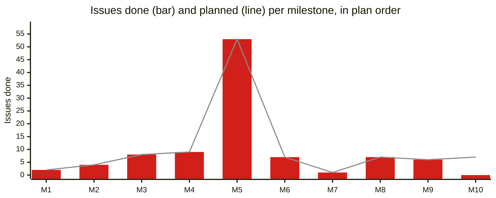

# Project model

The canonical plan: `project.yaml` for the project itself, `milestones/` for the outcomes,
`issues/` for the execution contracts that reach them, and the dependency edges between
issues for the order they may be executed in. Nothing here is generated; everything
downstream is. The ready set, the diagrams and the projections all come from
`majordomus plan`, which reads these files and nothing else.

No status is stored. An issue records what happened to it — when it started, when it was
verified, when it completed, and its evidence — and the state is derived from those facts
and from its dependencies. A status field would be a second source of truth that drifts
the moment a dependency changes.

The directories below hold instances of these kinds rather than sections of their own, so
they owe no contract until this repository decides to describe them
(`children.require_contract: false`).

```bash
majordomus plan next          # the issues whose dependencies are satisfied
majordomus plan validate      # the graph: acyclic, every edge resolves
```

## Milestones

Generated by `tools/surfaces/surfaces sync` from the milestone records and the stamps of their
issues, the same derivation `majordomus plan` makes.

<!-- surfaces:begin ai-plan -->
| # | Milestone | Issues done | Open issues |
|---|---|---|---|
| M1 | [The fork states what it is, and one set of ground rules binds every agent](milestones/the-fork-is-a-governed-research-target.yaml) | 2/2 | — |
| M2 | [A change is validated at the tier its size needs, and the report cannot round up](milestones/a-change-is-validated-in-cost-tiers.yaml) | 4/4 | — |
| M3 | [Internal state is observable through gated instrumentation, and every experiment records how it ran](milestones/internals-are-observable-with-recorded-provenance.yaml) | 8/8 | — |
| M4 | [Prismatic steers a company in a live game through the standalone bridge](milestones/prismatic-steers-a-company-through-the-bridge.yaml) | 9/9 | — |
| M5 | [An agent reads and, with approval, changes the game over an embedded MCP server](milestones/an-agent-reaches-the-game-over-mcp.yaml) | 53/53 | — |
| M6 | [The fork is published, supervised by Majordomus, and current with upstream](milestones/the-fork-is-published-supervised-and-current.yaml) | 7/7 | — |
| M7 | [NoirGFX: the game in the owner's SIG NIHL noir, from OpenGFX and Kenney models](milestones/the-game-wears-the-owners-noir-style.yaml) | 1/1 | — |
| M8 | [Planning decisions read recorded history from the store and publish what they chose as data](milestones/planning-is-generated-from-recorded-history.yaml) | 7/7 | — |
| M9 | [Rhai is a live IDE: edited, run, debugged and inspected in the panel, and it reaches Prismatic's models and blackboard](milestones/rhai-is-a-live-ide.yaml) | 6/6 | — |
| M10 | [Every status surface and record says what the code does today, and a capability matrix proves it](milestones/records-and-status-tell-the-truth.yaml) | 0/7 | I0110, I0111, I0112, I0113, I0114, I0115, I0116 |
<!-- surfaces:end ai-plan -->

The same derivation as a chart; each bar opens its milestone on the site:

<!-- surfaces:begin ai-plan as=bar -->

<!-- surfaces:end ai-plan -->
