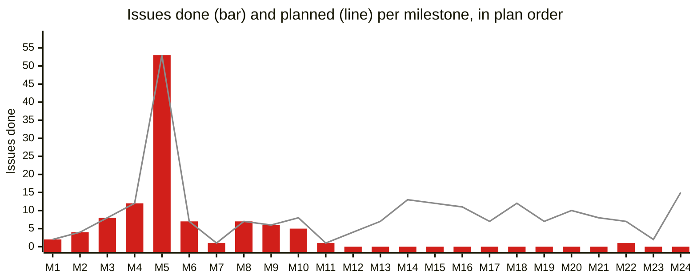

# Project model

The canonical plan: `project.yaml` for the project itself, `milestones/` for the outcomes,
`issues/` for the execution contracts that reach them, and the dependency edges between
issues for the order they may be executed in. Nothing here is generated; everything
downstream is. The ready set, the diagrams and the projections all come from
`majordomus plan`, which reads these files and nothing else.

No status is stored. An issue records what happened to it — when it started, when it was
verified, when it completed, and its evidence — and the state is derived from those facts
and from its dependencies. A status field would be a second source of truth that drifts
the moment a dependency changes.

The directories below hold instances of these kinds rather than sections of their own, so
they owe no contract until this repository decides to describe them
(`children.require_contract: false`).

```bash
majordomus plan next          # the issues whose dependencies are satisfied
majordomus plan validate      # the graph: acyclic, every edge resolves
```

## Milestones

Generated by `tools/surfaces/surfaces sync` from the milestone records and the stamps of their
issues, the same derivation `majordomus plan` makes.

<!-- surfaces:begin ai-plan -->
| # | Milestone | Issues done | Open issues |
|---|---|---|---|
| M1 | [The fork states what it is, and one set of ground rules binds every agent](milestones/the-fork-is-a-governed-research-target.yaml) | 2/2 | — |
| M2 | [A change is validated at the tier its size needs, and the report cannot round up](milestones/a-change-is-validated-in-cost-tiers.yaml) | 4/4 | — |
| M3 | [Internal state is observable through gated instrumentation, and every experiment records how it ran](milestones/internals-are-observable-with-recorded-provenance.yaml) | 8/8 | — |
| M4 | [Prismatic steers a company in a live game through the standalone bridge](milestones/prismatic-steers-a-company-through-the-bridge.yaml) | 12/12 | — |
| M5 | [An agent reads and, with approval, changes the game over an embedded MCP server](milestones/an-agent-reaches-the-game-over-mcp.yaml) | 53/53 | — |
| M6 | [The fork is published, supervised by Majordomus, and current with upstream](milestones/the-fork-is-published-supervised-and-current.yaml) | 7/7 | — |
| M7 | [NoirGFX: the game in the owner's SIG NIHL noir, from OpenGFX and Kenney models](milestones/the-game-wears-the-owners-noir-style.yaml) | 1/1 | — |
| M8 | [Planning decisions read recorded history from the store and publish what they chose as data](milestones/planning-is-generated-from-recorded-history.yaml) | 7/7 | — |
| M9 | [Rhai is a live IDE: edited, run, debugged and inspected in the panel, and it reaches Prismatic's models and blackboard](milestones/rhai-is-a-live-ide.yaml) | 6/6 | — |
| M10 | [Every status surface and record says what the code does today, and a capability matrix proves it](milestones/records-and-status-tell-the-truth.yaml) | 5/8 | I0113, I0115, I0116 |
| M11 | [The fork's own toolchain carries no open dependency vulnerability, and new alerts are seen and triaged](milestones/the-toolchain-carries-no-known-vulnerability.yaml) | 1/1 | — |
| M12 | [Every changed line is run by a test, and a coverage gate refuses a change whose new lines no test ran](milestones/every-changed-line-is-tested.yaml) | 0/4 | I0180, I0181, I0189, I0190 |
| M13 | [Every AI battle match records why each company won or lost, with the settings it actually ran under, and replays identically on another arena](milestones/every-battle-match-explains-itself.yaml) | 0/7 | I0118, I0119, I0120, I0121, I0122, I0123, I0124 |
| M14 | [PrismaticAI grows its fleet and survives its own failures](milestones/prismatic-ai-grows-its-fleet-and-survives-its-own-failures.yaml) | 0/13 | I0125, I0126, I0127, I0128, I0129, I0130, I0131, I0132, I0133, I0134, I0135, I0136, I0137 |
| M15 | [The planner reads one coherent world and prices it from the game](milestones/the-planner-reads-one-coherent-priced-world.yaml) | 0/12 | I0138, I0139, I0140, I0141, I0142, I0143, I0144, I0145, I0146, I0147, I0148, I0149 |
| M16 | [Battlebrain owns the freight-line decision live, behind gates and a rollback switch](milestones/battlebrain-decides-live-with-rollback.yaml) | 0/11 | I0150, I0151, I0152, I0153, I0154, I0155, I0156, I0157, I0158, I0159, I0160 |
| M17 | [Evaluations are fair, pre-registered and paired: every claim about the bot, the planner, AlgoGlyph or Prismatic rests on a protocol fixed before its first run](milestones/evaluations-are-fair-pre-registered-and-paired.yaml) | 0/7 | I0161, I0162, I0163, I0164, I0165, I0166, I0167 |
| M18 | [Prismatic closes one real loop: retrieve, coordinate, decide, act, observe, in one recorded run against live services](milestones/prismatic-closes-one-real-loop.yaml) | 0/12 | I0168, I0169, I0170, I0171, I0172, I0173, I0174, I0175, I0176, I0177, I0178, I0179 |
| M19 | [Governed access is authenticated, and every capability is derived onto every surface and exercised live](milestones/governed-access-is-authenticated-and-every-capability-reaches-every-surface.yaml) | 0/7 | I0182, I0183, I0184, I0185, I0186, I0187, I0188 |
| M20 | [The live agent workbench: in-game commands, Rhai revisions with rollback, AlgoGlyph flows](milestones/the-live-agent-workbench.yaml) | 0/10 | I0192, I0193, I0194, I0195, I0196, I0197, I0198, I0199, I0200, I0201 |
| M21 | [The panel has integrity: every control works, every view is derived](milestones/the-panel-has-integrity.yaml) | 0/8 | I0203, I0204, I0205, I0206, I0207, I0208, I0209, I0211 |
| M22 | [AlgoGlyph is accountable: cost fixtures, plan receipts, predicted versus actual, fault injection](milestones/algoglyph-is-accountable.yaml) | 1/7 | I0212, I0213, I0214, I0215, I0216, I0217 |
| M23 | [A remote human plays the bot over the internet](milestones/a-remote-human-plays-the-bot.yaml) | 0/2 | I0218, I0219 |
| M24 | [The strategy is reviewed on the game's week, month and quarter, and a gap to the leader becomes a proposal, a learning row and an owner digest](milestones/the-strategy-is-reviewed-on-a-cadence.yaml) | 0/15 | I0270, I0271, I0272, I0273, I0274, I0275, I0276, I0277, I0278, I0279, I0280, I0281, I0282, I0283, I0284 |
<!-- surfaces:end ai-plan -->

The same derivation as a chart; each bar opens its milestone on the site:

<!-- surfaces:begin ai-plan as=bar -->

<!-- surfaces:end ai-plan -->
