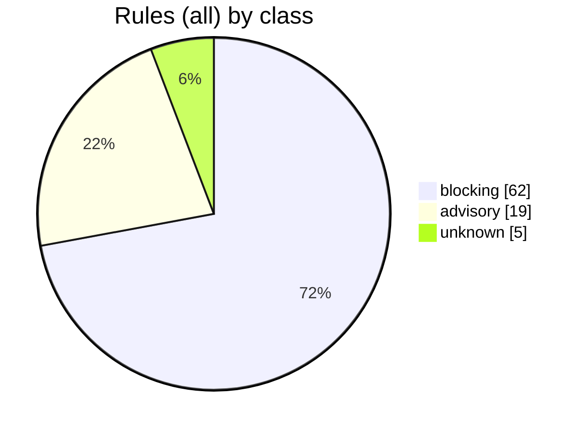

# Repository rules

A rule is a Markdown document with YAML front matter. The front matter is the machine
side: identity, class, dependencies, and how the tool enforces it. The body is the human
side: rationale, required behaviour, failure behaviour, verification.


The vendored package is installed here, not authored here, so it owes no context
document: this contract exempts it by name (`children.exempt`). Every directory the
repository writes itself still owes one.

## Locations

```text
project/                  rules this repository wrote
vendor/majordomus/        the pinned Majordomus baseline; do not edit, upgrade explicitly
vendor/fleet/             the owner's fleet pack, when one applies: rules/, kits/ and MANIFEST
```

The vendored package carries `manifest.yaml` naming every rule file with its identity and
content hash. A hand edit under `vendor/` is detected against that manifest and refused.

The fleet pack is the owner's own package, kept outside every repository
(`MAJORDOMUS_FLEET_PACK`, else `$XDG_CONFIG_HOME/majordomus/fleet`, else
`~/.config/majordomus/fleet`). `init`, `migrate`, `rules vendor update` and `update` install
only the files its manifest lists, and only where its `applies_to` matches: rules and kit
profiles under `vendor/fleet/`, skills as `skills/fleet-<id>/`. `vendor/fleet/MANIFEST` is the
stamp — an `# ai-fleet-stamp/v1` line and a `# version: <n>` line, then one
`<sha256><TAB><installed path><TAB><kind><TAB><pack path>` row per installed file — so a hand
edit is a doctor FAIL and an older copy than the pack a WARN. A row is read only where it names
a place the fleet installs into (`skills/fleet-<id>/SKILL.md`, `vendor/fleet/rules/<id>.v<n>.md`,
`vendor/fleet/kits/<kit>.yaml`); any other row is a doctor FAIL and is never moved or
loaded. The effective set reads the fleet's rules between the baseline and `project/`, and a
fleet rule may not claim the `majordomus` or `project` namespace. Into a public tree
(`ui.visibility` in the policy) an entry marked `visibility: private` is skipped, and a file
that matches the kit's licence evidence or names a home or absolute path refuses the install.
A home path is `/Users/`, `/home/`, `$HOME`, `${HOME}` or `~/` before a non-space, anywhere on
a line; an absolute path is `/root/`, `/opt/`, `/Volumes/`, `/private/`, `/mnt/`, `/srv/`,
`/var/`, `/tmp/`, `/etc/`, `/usr/` or a drive such as `C:\`, at the start of a line or after a
space, quote, parenthesis, `=`, `:` or backtick, so that the path of a URL is not one. A kit in
play (the policy's, or a kit entry the tree would receive) with no evidence on this machine or
in `MAJORDOMUS_KIT_EVIDENCE_<KIT>` refuses the install as not judged.

## Front matter

```yaml
---
id: project.example-rule        # identity; namespaced by origin
version: 1                       # an exact integer
kind: rule
title: One line
description: What the rule requires, in one sentence.
statement: The normative sentence a worker follows.
status: active                   # active | deprecated
class: blocking                  # blocking | advisory
depends_on: []                   # exact references: id@version
tags: []
x-majordomus:                    # present only on a rule the tool enforces
  validator: example             # the function mj_validate_<validator>
  category: example              # the finding category the validator reports under
  enforced_by: [check]           # the commands that dispatch it
  exit_code: 10
  claims: []                     # ids in docs/CLAIMS.yaml
  tests: []                      # the behavioural cases that prove it
---
```

Identity comes from `id` and `version`, never from the file name. A rule without an
`x-majordomus` block is normative for whoever reads it and enforced by nobody; the class
still says what a violation means.

## Loading

Resolve `depends_on` as a graph, deterministically: a missing dependency, a cycle, or two
rules claiming one identity at the same scope is an error, and a set that does not resolve
is not applied at all.

## Composition

The effective set is additive: every active vendored rule plus every active project rule.
A project rule may add a constraint. There is no override mechanism: nothing here disables
or weakens a vendored rule, and a project rule may not reuse a vendored identity.

## In this repository

Generated by `tools/surfaces/surfaces sync`; on the site each slice opens the table below filtered to that class.

<!-- surfaces:begin ai-rules origin=all as=pie -->

<!-- surfaces:end ai-rules -->

<!-- surfaces:begin ai-rules origin=all -->
| Rule | Class | Statement |
|---|---|---|
| [project.a-tuning-claim-needs-held-start-pairs](project/a-tuning-claim-needs-held-start-pairs.v1.md) | advisory | Change a default of the bot or the planner on the strength of a measurement only when held-start duel pairs on three seeds favour it beyond the rival's spread, and record the pairs; report anything less as inconclusive. |
| [project.battle-records-are-reproducible](project/battle-records-are-reproducible.v1.md) | blocking | Publish AI-battle results only as records written by battle.py report from a committed edition, never edit a record or its derived Markdown by hand, and keep battle.py check passing. |
| [project.decision-authority-boundaries](project/decision-authority-boundaries.v1.md) | blocking | Do not add a second writer of an executable decision, a path from a kernel output to a game, a command path from the blackboard, a hand copy of the MCP or kernel catalogue, or a fallback labelled as the kernel; keep cargo test --bin battlebrain and tools/gate.sh change passing, and when a boundary must move, edit its named list, this rule and ADR 0037 in the same change. |
| [project.docs-are-derived-and-current](project/docs-are-derived-and-current.v1.md) | blocking | Derive every number, table, list and chart from the sources; infer what can be inferred instead of declaring it; keep code generic (no instance named where data can give it); draw every Markdown diagram in Mermaid; and keep the gates that prove this, surfaces check, e2e-coverage, readme-scoreboard and diagrams-check, passing on every change. |
| [project.extend-and-integrate-before-adding](project/extend-and-integrate-before-adding.v1.md) | blocking | Extend the existing piece before writing a parallel one, integrate with what exists (the store and its views, the Rhai library, AlgoGlyph through the hub, the MCP catalogue, the blackboard and the mesh), and leave no second implementation behind. |
| [project.game-state-mutates-only-through-commands](project/game-state-mutates-only-through-commands.v1.md) | blocking | Change vehicles, companies, map tiles or any other persistent game state only through a registered command issued with Command<>::Post, never by writing a pool from a research hook, the MCP server or any other side channel. |
| [project.long-runs-are-owned-bounded-and-stoppable](project/long-runs-are-owned-bounded-and-stoppable.v1.md) | blocking | Before a job runs unattended or on another machine, make it write who owns it and how to stop it on every host, refuse new work over the host's load ceiling or under its 35 GiB disk floor, and honour a PAUSED file on the host and a STOP file beside it. |
| [project.mcp-surfaces-are-derived](project/mcp-surfaces-are-derived.v1.md) | blocking | Derive every surface of the MCP integration from the live catalogue and the one route table; do not hand-list tools, routes, functions or settings in a second place. |
| [project.never-report-unrun-validation-as-pass](project/never-report-unrun-validation-as-pass.v1.md) | blocking | Report every validation layer with the command that ran and its exit status, mark a layer that did not run as NOT RUN, and never round PARTIAL or ambiguous up to PASS. |
| [project.new-code-is-covered](project/new-code-is-covered.v1.md) | blocking | Ship tests that run every line you add or modify; for a file of COVERAGE_TABLE, let tools/gate.sh change run cargo llvm-cov and refuse any counted line of its criterion no test ran, restructure a line a test cannot reach so its logic is testable, and exempt only what still cannot run, in COVERAGE_EXEMPT, with its written reason. |
| [project.new-code-tested](project/new-code-tested.v1.md) | blocking | Ship every change with tests that run every line it adds or modifies; keep tools/coverage/changed-lines passing, which refuses any changed Python line no test runs (file:line) and accepts an untestable one only through an exemption with a written reason that every run prints; until the other languages are measured, cover their changed lines with tests anyway and say in the report that no gate measured them. |
| [project.no-commit-without-current-instruction](project/no-commit-without-current-instruction.v1.md) | blocking | Commit, push, rewrite history or force-push only on an explicit, current instruction from the owner that covers this change. |
| [project.no-upstream-interaction](project/no-upstream-interaction.v1.md) | blocking | Never push to, open an issue against, or open a pull request against OpenTTD/OpenTTD; keep every commit, branch and experiment in korczis/OpenTTD, and keep the upstream remote fetch-only. |
| [project.panel-charts-go-through-one-layer](project/panel-charts-go-through-one-layer.v1.md) | blocking | Create a panel chart only through components.js ecInit, register it with its parameters and drill target, keep its parameters in the address, make its card maximizable, and commit a static/app.css rebuilt from input.css and the current markup. |
| [project.panel-items-are-routable-pages](project/panel-items-are-routable-pages.v1.md) | blocking | Give every panel item its own stable page with a server-side title and description, link every mention of it, keep filters and views in the address, back every button by a declared panel route, and derive every grouping from the catalogue itself. |
| [project.personal-tooling-stays-uncommitted](project/personal-tooling-stays-uncommitted.v1.md) | blocking | Never commit .claude/, .aiad/, .agents/ or .codex/; exclude them through .git/info/exclude, and write any principle worth keeping from them once into AGENTS.md or .ai/. |
| [project.prismatic-ai-is-never-last](project/prismatic-ai-is-never-last.v1.md) | blocking | Keep every contestant in battle.json never_last above last place, in the newest battle record and in the fitness match. Fix the bot when it falls there, and never drop a contestant from the list to make a check pass. |
| [project.prismatic-ai-passes-the-headless-fitness-check](project/prismatic-ai-passes-the-headless-fitness-check.v1.md) | blocking | Do not commit a change under tools/research/prismatic-ai or tools/research/ai-battle unless battle.py fitness passes, or says NOT RUN because no arena cache exists on this machine and you say so. |
| [project.public-api-is-exposed](project/public-api-is-exposed.v1.md) | blocking | Expose every Commands enum entry as openttd.cmd.<Name> (<Name> its Cmd* function without the prefix, as its DEF_CMD_TRAIT declares), every Script API static function as openttd.api.<Class>.<Function>, and every console command through the derived console surface, each with its OpenAPI route; keep mcp-api-coverage at 100% in every dimension. |
| [project.published-surfaces-are-derived](project/published-surfaces-are-derived.v1.md) | blocking | Publish documentation only through tools/surfaces, edit the source document and never a generated region, page or wiki entry, and keep tools/surfaces/surfaces check passing (no stale region, no relative link or anchor to nothing). |
| [project.research-code-is-gated-and-labelled](project/research-code-is-gated-and-labelled.v1.md) | blocking | Put research-only code behind a default-OFF CMake option, label it RESEARCH-ONLY, UNSTABLE or DEBUG-ONLY where it is written, keep it to what the experiment needs, and keep default and release builds free of it. |
| [project.research-net-compat-is-local-and-non-spoofing](project/research-net-compat-is-local-and-non-spoofing.v1.md) | blocking | The research override of the network revision check may only make IsNetworkCompatibleVersion accept more peers; it must never alter GetNetworkRevisionString or the revision this build sends, must stay compile-gated and default-off, and must never be used to connect to a server the owner does not run. |
| [project.savegame-fields-are-version-gated](project/savegame-fields-are-version-gated.v1.md) | blocking | Never remove, reorder or renumber an existing saved field or chunk; give an obsolete field a version-gated load-and-discard path and add a new field behind a SaveLoadVersion check. |
| [project.tooling-language-preference](project/tooling-language-preference.v1.md) | advisory | Write new extension logic in Rhai, new hosts and tools in Rust, change OpenTTD itself in C++, and reach for C only where OpenTTD requires it; do not grow new capability in Python or shell. |
| [project.web-ui-is-covered-end-to-end](project/web-ui-is-covered-end-to-end.v2.md) | blocking | Drive every page and every control of the web UI in a real browser against a live stack (the generic crawl plus the page checks), let no control be dead or fail silently, and give every page script the shell's one kit ($, esc, api, notify) instead of a copy; a page, control or flow no browser check drives is treated as not built. |
| [majordomus.adr-integrity](vendor/majordomus/rules/adr-integrity.v1.md) | blocking | A decision is canonical data under the adrs section; it is valid against the decision schema, its identity is unique and fixes its file name, supersession is reciprocal, every reference it makes resolves in both directions of the graph, and a record the tool derived is proposed rather than accepted. |
| [ai-layout-integrity.v1](vendor/majordomus/rules/ai-layout-integrity.v1.md) |  | ai-layout-integrity.v1 |
| [majordomus.blocker-resolution](vendor/majordomus/rules/blocker-resolution.v1.md) | blocking | No task is accepted as completed while any question on the branch is unresolved. |
| [majordomus.bootstrap-integrity](vendor/majordomus/rules/bootstrap-integrity.v1.md) | blocking | A person reaches the AI layer through README.md and AGENTS.md, every generated instruction file points at .ai/README.md, and none of them carries a rule of its own. |
| [majordomus.candidates-reviewed](vendor/majordomus/rules/candidates-reviewed.v1.md) | advisory | Candidates are reviewed, not accumulated. More records with status candidate than knowledge.candidates_max_files, a candidate whose review age exceeds knowledge.candidate_max_age_minutes, or a candidate under candidates/ that version control does not track, is a finding that names them; both numbers are declared once in the policy. |
| [majordomus.catalogue-integrity](vendor/majordomus/rules/catalogue-integrity.v1.md) | blocking | Every use case and application names only commands, rules and claims that exist, and the two catalogues reference each other in both directions. |
| [majordomus.checkpoint-freshness](vendor/majordomus/rules/checkpoint-freshness.v1.md) | advisory | A task whose newest checkpoint is older than its profile's interval is reported as stale, and the report does not stop the work. |
| [majordomus.command-coverage](vendor/majordomus/rules/command-coverage.v1.md) | blocking | Coverage is owed to every public command from the moment it is registered; a case declares which commands it exercises and which failure modes it asserts, and a public command that no case declares in both layers is a failure. |
| [majordomus.command-surface](vendor/majordomus/rules/command-surface.v1.md) | blocking | The command registry is authority for what a command means and the dispatcher for what runs; neither derives from the other, and doctor refuses a command present in one and absent from the other, in either direction. |
| [majordomus.completion-gates](vendor/majordomus/rules/completion-gates.v1.md) | blocking | The gates a change must pass are derived from the repository's CI model and the change's own paths; a gate known to be failing, or whose recorded run no longer describes the tree, refuses the outcome completed; a gate that has never reported is recorded as unverified and never as passing; and no surface may reach that judgement a second time. |
| [majordomus.context-budget](vendor/majordomus/rules/context-budget.v1.md) | blocking | The always-loaded projection stays within its budget, every reference in it resolves, it states no count that will go stale, and the assembled context fits its own budget. |
| [majordomus.context-integrity](vendor/majordomus/rules/context-integrity.v1.md) | blocking | Every directory of the layer carries a context document unless the contract governing it exempts its children, every document carries the contract with a unique identity, every reference resolves within its ancestor chain, no final document is superseded, no descendant weakens what an ancestor requires, and the effective context for any path is computed from the tree root down in one deterministic order. |
| [majordomus.dag-integrity](vendor/majordomus/rules/dag-integrity.v1.md) | blocking | The issue dependency graph is acyclic, every edge names an issue that exists, and no issue executes ahead of a dependency that is not done. |
| [majordomus.decision-records](vendor/majordomus/rules/decision-records.v1.md) | advisory | Every recorded decision carries the task, the head and the reason, so the worker who needs it can find it. |
| [majordomus.decision-threshold](vendor/majordomus/rules/decision-threshold.v1.md) | blocking | A change that alters an architecture, a durable contract, a data or storage semantic, a trust boundary, or the repository's own governance records a decision before it lands, and names in that record the rule, claim, document, implementation or case it put in force; nothing else needs one. |
| [majordomus.deployment-contract](vendor/majordomus/rules/deployment-contract.v2.md) | blocking | A deployment is one object of the layer, valid against the deployment contract and carrying no credential; it names no provider unless it names one the contract knows, at an https address; the container image definition, its ignore file and every file of its provider are generated from it and are never authoritative. |
| [majordomus.doctrine-wiring-integrity](vendor/majordomus/rules/doctrine-wiring-integrity.v1.md) | blocking | Every enforced rule resolves to a validator that exists, is reached from every command it names, propagates failure, is proved by a test that CI runs; and every validator is declared by a rule. |
| [majordomus.enforcement-wiring](vendor/majordomus/rules/enforcement-wiring.v1.md) | blocking | Every enforcement the policy declares is invoked by the hook it names, from a file the dispatcher executes, without a swallowed exit code. |
| [majordomus.handover-integrity](vendor/majordomus/rules/handover-integrity.v1.md) | blocking | The record resolver reports the handover for this worktree and branch or its clean absence; a malformed record is never skipped silently. |
| [majordomus.knowledge-graph](vendor/majordomus/rules/knowledge-graph.v1.md) | advisory | No two sources claim one node id; every edge Majordomus derives from a structured field names an existing node at both ends and the line it was observed on; every declared path and every tracked source exists in the working tree. A link written in prose that resolves to nothing is reported and never fails. |
| [majordomus.knowledge-integrity](vendor/majordomus/rules/knowledge-integrity.v1.md) | blocking | Every knowledge record under candidates/ and curated/ is valid against knowledge/v1 with no unknown key; ids are unique across both directories and equal the file name; verified carries provenance and an extracted origin names evidence; every derived_from and relations target resolves; superseded names superseded_by or records its rejection; no record under candidates/ claims verified; no title, description or body carries a conversation. |
| [majordomus.knowledge-observed](vendor/majordomus/rules/knowledge-observed.v1.md) | blocking | While episodes keep closing, every closed episode must be followed by a knowledge derivation. The newest session.closed line must name an episode a knowledge.derived line names, or be younger than session.freshness.stale_minutes; and while session.knowledge_on_end is on, the lifecycle source that closes an episode must call the deriver. |
| [majordomus.layout-integrity](vendor/majordomus/rules/layout-integrity.v1.md) | advisory | The directories the durable commands write into are installed rather than created on first use. |
| [majordomus.ledger-integrity](vendor/majordomus/rules/ledger-integrity.v1.md) | blocking | Every line of the append-only ledger is a well-formed event. |
| [majordomus.lifecycle-observed](vendor/majordomus/rules/lifecycle-observed.v1.md) | blocking | While episodes keep opening, the newest checkpoint and the newest handover for this worktree and branch must be within the policy's freshness thresholds; every provider lifecycle event received must be recorded before any guard runs; and an open episode older than the stale threshold is a finding. |
| [majordomus.note-integrity](vendor/majordomus/rules/note-integrity.v1.md) | blocking | Every outcome needs a note carrying the sections that outcome requires, and never a transcript. |
| [majordomus.obligation-closure](vendor/majordomus/rules/obligation-closure.v1.md) | blocking | A task owes what its `requires` declares; an obligation whose fact the tool can establish is settled live at HEAD and neither needs nor accepts a recorded line, every other obligation is discharged by a recorded piece of evidence naming the command that produced it, and evidence taken over inputs that have since changed, or at a commit the branch has since left, no longer discharges anything. |
| [majordomus.policy-completeness](vendor/majordomus/rules/policy-completeness.v1.md) | blocking | Every policy value the code reads is declared in the skeleton policy, and no reader carries a default of its own. |
| [majordomus.policy-integrity](vendor/majordomus/rules/policy-integrity.v1.md) | blocking | The policy and every profile parse, declare a supported version, and carry no key the schema does not define. |
| [majordomus.sessions-are-workers](vendor/majordomus/rules/principle-01-sessions-are-workers.v1.md) | advisory | Treat every session as a worker that reads state from records and writes state to records; nothing that only a conversation remembers is state. |
| [majordomus.minimum-sufficient-context](vendor/majordomus/rules/principle-02-minimum-sufficient-context.v1.md) | advisory | Orient from the assembled context and the registered sections the task needs, never by reading the whole repository or pasting every file into the prompt. |
| [majordomus.externalise-decisions](vendor/majordomus/rules/principle-03-externalise-decisions.v1.md) | advisory | Record every choice between real alternatives with its reason, and every blocker that waits on a person, in the stores the commands read; never leave either in prose only you can find. |
| [majordomus.one-worker-one-scope](vendor/majordomus/rules/principle-04-one-worker-one-scope.v1.md) | advisory | Claim the paths a task needs when it starts; if the fix is elsewhere, stop and record it rather than widening the scope silently. |
| [majordomus.justified-escalation](vendor/majordomus/rules/principle-05-justified-escalation.v1.md) | advisory | Run at the profile's capability class and effort, and when you raise either, record that you did and why. |
| [majordomus.depth-is-not-verbosity](vendor/majordomus/rules/principle-06-depth-is-not-verbosity.v1.md) | advisory | Keep the depth of work and the length of its report as two separate settings, each taken from the profile. |
| [majordomus.define-done-first](vendor/majordomus/rules/principle-07-define-done-first.v1.md) | advisory | Know the contract a task must meet before starting it, and let the contract, not the worker's word, decide whether it is finished. |
| [majordomus.verify-outcomes](vendor/majordomus/rules/principle-08-verify-outcomes.v1.md) | advisory | Accept a verification command's recorded exit code as evidence of completion, and accept nothing that merely describes verification. |
| [majordomus.isolated-parallelism](vendor/majordomus/rules/principle-09-isolated-parallelism.v1.md) | advisory | Keep one active task per checkout, and treat a scope claimed by another worktree as a boundary to report, not to cross. |
| [majordomus.handovers-carry-state](vendor/majordomus/rules/principle-10-handovers-carry-state.v1.md) | advisory | Write a handover as the current state and the next action, with computed front matter, and never paste a transcript, a diff or a narrative of the session into any record. |
| [majordomus.profile-requirements](vendor/majordomus/rules/profile-requirements.v1.md) | blocking | A profile may require more than the shared contract, and finish refuses a completed outcome that lacks it. |
| [majordomus.project-integrity](vendor/majordomus/rules/project-integrity.v1.md) | blocking | Every milestone and issue file parses, carries the id its filename claims, and contains no key nobody reads. |
| [majordomus.projection-integrity](vendor/majordomus/rules/projection-integrity.v1.md) | blocking | Every generated instruction file exists, matches the content it declares, and is never silently overwritten after a hand edit. |
| [majordomus.prompt-capture](vendor/majordomus/rules/prompt-capture.v1.md) | blocking | Prompt capture is either wired below the model and proven by execution, or reported as unavailable; the archive is never committed, every prompt is present as both a JSON record and its Markdown rendering, and the schema every record names resolves to the file that describes it. |
| [majordomus.prompt-continuity](vendor/majordomus/rules/prompt-continuity.v1.md) | blocking | A prompt record carries the canonical episode, provider session, repository and worktree it was captured in, or records explicitly that no episode could be resolved; the archive is mode 0600, bounded by prompts.retention_max_days and prompts.retention_max_bytes, and obvious credential material is replaced before it is persisted. |
| [majordomus.prompt-integrity](vendor/majordomus/rules/prompt-integrity.v1.md) | blocking | Every reusable prompt asset renders, and every token in it is one the renderer knows. |
| [publication-currency.v1](vendor/majordomus/rules/publication-currency.v1.md) |  | publication-currency.v1 |
| [majordomus.questions-store-integrity](vendor/majordomus/rules/questions-store-integrity.v1.md) | blocking | Every entry in the questions store parses, because a gate that cannot read an entry can be bypassed by mistyping one. |
| [majordomus.record-changed-files](vendor/majordomus/rules/record-changed-files.v1.md) | advisory | A record's changed_files is the working tree classified against the declarations that say what is derived — the scope file's generated and never-read sets, the policy's projection targets, the merge driver's derived trees, and the record stores themselves — never git status verbatim. |
| [majordomus.retention-caps](vendor/majordomus/rules/retention-caps.v1.md) | blocking | The ledger, the handovers, the checkpoints and the session records stay under the caps the policy sets, and a cap is met by moving records aside, never by deleting one. |
| [majordomus.roadmap-integrity](vendor/majordomus/rules/roadmap-integrity.v1.md) | blocking | No document is a second authority for the roadmap; a milestone's release is inferred from the release records, never typed, and a hand-written table can neither list a release no milestone was released in nor hide one that carried a milestone. |
| [rule-package-integrity.v1](vendor/majordomus/rules/rule-package-integrity.v1.md) |  | rule-package-integrity.v1 |
| [majordomus.schema-integrity](vendor/majordomus/rules/schema-integrity.v1.md) | blocking | The effective rule set resolves in one deterministic order — the vendored baseline in manifest order, then the project's own, as a dependency graph — and every object kind declares a schema, every schema is named by a kind, and every path under .ai/repo/ is claimed by a source mapping. |
| [majordomus.scope-integrity](vendor/majordomus/rules/scope-integrity.v1.md) | blocking | Work outside the paths a task claimed is not accepted as that task's work. |
| [majordomus.session-lifecycle](vendor/majordomus/rules/session-lifecycle.v1.md) | blocking | An episode boundary a provider can observe is drawn by that provider's hook, proven by driving a payload through it; the start event hands the worker a briefing bounded by the policy and the other events write nothing to standard output; every open episode has a working context, and the store of working contexts is ignored, untracked, contract-shaped and free of transcripts. |
| [session-records.v1](vendor/majordomus/rules/session-records.v1.md) |  | session-records.v1 |
| [majordomus.skill-integrity](vendor/majordomus/rules/skill-integrity.v1.md) | blocking | A skill is canonical data under the skills section; it is valid against the skill schema, its id is its directory, its body carries the sections a reader relies on, its description tells it apart from every other skill, and every reference it makes resolves. |
| [state-consistency.v1](vendor/majordomus/rules/state-consistency.v1.md) |  | state-consistency.v1 |
| [majordomus.task-continuity](vendor/majordomus/rules/task-continuity.v1.md) | advisory | A task finished as partial or blocked leaves a handover record, not only a note section. |
| [majordomus.task-on-the-mesh](vendor/majordomus/rules/task-on-the-mesh.v1.md) | blocking | On a repository whose tracked mesh declaration is enabled, a task is not completed until its scope has been claimed on the mesh as the session task-<id>; partial, blocked, no_match and failed are never refused for it. |
| [majordomus.use-case-coverage](vendor/majordomus/rules/use-case-coverage.v1.md) | blocking | A capability the policy requires coverage for is demonstrated by an executable use case, and a capability without one is a named gap. |
| [majordomus.verification-integrity](vendor/majordomus/rules/verification-integrity.v1.md) | blocking | A completed outcome requires a verification command that ran and exited zero over a working tree that was the same before and after the run, with its exit code, duration and that tree's git id recorded. |
<!-- surfaces:end ai-rules -->
