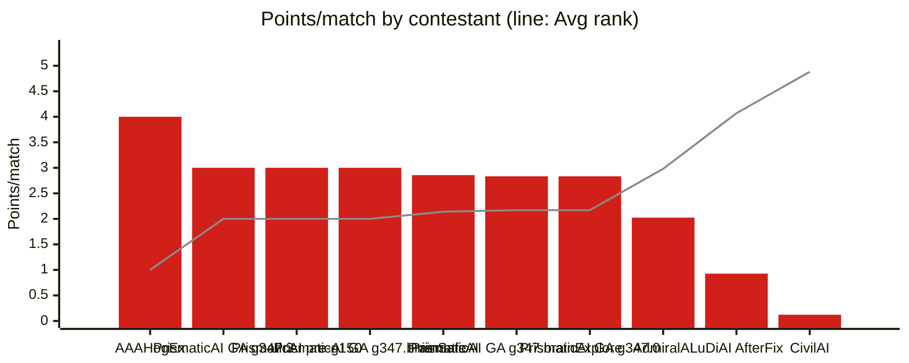
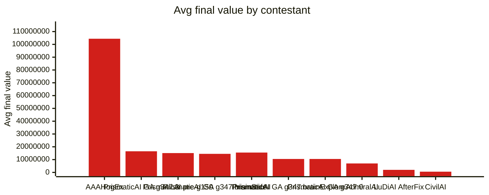
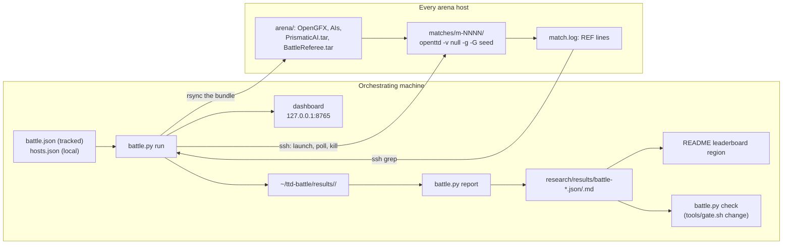

# LAN AI battle

**RESEARCH-ONLY.** A tournament between company AIs that never stops. Every machine on the local
network that answers SSH and has an OpenTTD build becomes an arena. The contestants are PrismaticAI
from this repository, in three configurations, and four AIs from BaNaNaS. The orchestrator replays an occasional match on a
second arena to keep checking that a result does not depend on the machine. A live dashboard shows
the run.
Nothing under `src/` changes. The tournament uses existing interfaces only: the null video driver,
the per-game console script, the Game Script API and the BaNaNaS content client.

Decision: ADR 0035. Feature: `lan-ai-battle`. Rule: `project.battle-records-are-reproducible`.
Skill: `run-the-lan-ai-battle`. All are under `.ai/repo/`.

The visible counterpart is [`research/live-arena.md`](../live-arena.md): the same contestants in
one live game that the MCP panel and Rhai scripts drive, in the browser. It makes no ranking
claim.

## Leaderboard

The table below is derived from the newest record under `research/results/battle-*.json`, by
`battle.py report`. `battle.py check`, which `tools/gate.sh change` runs, fails when the table
is stale.

Every record's own page (`research/results/battle-*.md`) adds charts derived from its JSON alone,
between `<!-- battle-charts:begin -->` and `<!-- battle-charts:end -->`: points per match and
average final company value per contestant, the winner's final value against the best PrismaticAI
in each scored match, match wins by contestant, and scored matches per arena with how many
PrismaticAI won. "PrismaticAI" there is the AI the edition exported (`provenance.prismatic_path`),
every variant of it. Each bar or slice links to the row it summarises (the site filters the
page's table to it). `battle.py render` rewrites every tracked page and this leaderboard from the
records; `tools/surfaces/surfaces sync` runs it, so a change of the page layout reaches all
records in one commit, and `battle.py check` fails while any page is stale.

An ablation's page (`research/results/ablation-*.md`, written by `battle.py ablate --write`) is
derived the same way, its charts between `<!-- ablation-charts:begin -->` and
`<!-- ablation-charts:end -->`: each variant's final company value with the best opponent in the
same match, its change against the baseline (the first variant) in per cent, its share of that
best opponent, and its rail, road and air fleet at the end, under a line that names the highest and
the lowest variant and the spread between them. An ablation record holds one seed, so the charts
show the spread between variants on that seed, not between seeds; the seeds of one comparison are
separate records. Each bar links to its variant's row. `battle.py render` re-derives every tracked
ablation page as well, and `battle.py check` validates each ablation record (schema, id, one row
per variant, `vs_first` derived from the values) and fails while its page is stale.

<!-- battle:begin -->
<!-- derived from research/results/battle-20261122T045411-a80cc94a.json by `battle.py report`; `battle.py check` fails when it is stale -->
Latest record: [`battle-20261122T045411-a80cc94a`](../results/battle-20261122T045411-a80cc94a.md) (0/4 replays identical).

- Edition `a80cc94a275dbec1`: PrismaticAI and referee at `8c8d025388e85261a60027d9983d8588d720a2e9`, base set `opengfx-8.0.tar`
- 20-year free-for-all from 1960, map 256x256 temperate, breakdowns 1
- 41 scored match(es) on `imac` (20261119-master-gdf1e05e7d8), `mbp` (20261120-master-m17653b726e), `ubuntu` (20261119-master-gdf1e05e7d8)
- Replays: 0 of 4 identical to their original on another arena

| # | Contestant | Played | Wins | Points | Points/match | Avg rank | Avg final value | Squirrel errors | Matches with anomalies |
|---|---|---|---|---|---|---|---|---|---|
| 1 | AAAHogEx | 41 | 41 | 164 | 4.0 | 1.0 | 104.4 M | 0 | 0 |
| 2 | PrismaticAI GA g347.3 | 6 | 0 | 18 | 3.0 | 2.0 | 16.5 M | 0 | 0 |
| 3 | PrismaticAI pre-g150 | 8 | 0 | 24 | 3.0 | 2.0 | 15.1 M | 0 | 0 |
| 4 | PrismaticAI GA g347.brainSafe | 8 | 0 | 24 | 3.0 | 2.0 | 14.5 M | 0 | 0 |
| 5 | PrismaticAI | 7 | 0 | 20 | 2.857 | 2.14 | 15.5 M | 0 | 0 |
| 6 | PrismaticAI GA g347.brainExplore | 6 | 0 | 17 | 2.833 | 2.17 | 10.5 M | 0 | 0 |
| 7 | PrismaticAI GA g347.0 | 6 | 0 | 17 | 2.833 | 2.17 | 10.5 M | 0 | 0 |
| 8 | AdmiralAI | 41 | 0 | 83 | 2.024 | 2.98 | 7.0 M | 47 | 3 |
| 9 | LuDiAI AfterFix | 41 | 0 | 38 | 0.927 | 4.07 | 2.0 M | 0 | 1 |
| 10 | CivilAI | 41 | 0 | 5 | 0.122 | 4.88 | 572.0 k | 0 | 8 |

| Seed | Original | Replay | Arenas | Identical |
|---|---|---|---|---|
| 155420217 | m-0012 | m-0040 | imac / mbp | NO |
| 422264390 | m-0010 | m-0048 | imac / mbp | NO |
| 422264390 | m-0011 | m-0056 | imac / mbp | NO |
| 167540501 | m-0030 | m-0064 | ubuntu / mbp | NO |
<!-- battle:end -->

The same record as charts (generated by `tools/surfaces/surfaces sync`):

<!-- surfaces:begin table-chart src=research/ai-battle/README.md region=battle label=Contestant value=Points/match line=Avg_rank -->

<!-- surfaces:end table-chart -->

<!-- surfaces:begin table-chart src=research/ai-battle/README.md region=battle label=Contestant value=Avg_final_value -->

<!-- surfaces:end table-chart -->

## How it fits together



| Piece | Path | Role |
|---|---|---|
| Orchestrator | `tools/research/ai-battle/battle.py` | discover, fetch, prepare, run, report, render, check |
| Config | `tools/research/ai-battle/battle.json` | contestants, match parameters, paths; no host names or addresses |
| Hosts | `~/ttd-battle/hosts.json` (local, untracked) | written by `discover`; names, SSH targets, slots |
| Referee | `tools/research/ai-battle/referee/BattleReferee/` | read-only Game Script: one `REF` line per company per quarter |
| Dashboard | `tools/research/ai-battle/dashboard/index.html` | polls `/api/state` every 3 s |
| Tests | `tools/research/test_ai_battle.py` | offline; found by `tools/gate.sh change` |

## Running it

```bash
B=tools/research/ai-battle/battle.py
python3 $B discover   # scan the local /24 for SSH, probe each machine, write ~/ttd-battle/hosts.json
python3 $B fetch      # BaNaNaS contestants into ~/ttd-battle/content (loopback-only -D server)
python3 $B prepare    # arena bundle from HEAD; refuses uncommitted PrismaticAI or referee
python3 $B prepare --referee-only   # only the referee, to the repository's (run does it on start)
python3 $B probe      # which arenas are usable now
python3 $B run        # tournament + dashboard on http://127.0.0.1:8765/ (SIGTERM / Ctrl-C stops)
python3 $B status     # leaderboard and replays of the current edition
python3 $B report     # research/results/battle-<utc>-<edition>.{json,md} + README leaderboard
python3 $B render     # every tracked battle and ablation page (tables, charts) and the leaderboard
python3 $B check      # every record valid, every derived file current (exit 10 / 11 otherwise)
python3 $B fitness    # the working tree's PrismaticAI in one short local match (gate, on change)
python3 $B ablate --variant "base=..." --variant "x=setting=v" --years 10 --seed S --write
                      # one deterministic local match per settings variant, recorded in research/results
python3 $B ablate --live-like   # the live world's arms (unplanned, planned) on seed 15805
python3 $B replay [--rev R] [--save F] [--years N] [--binary B] [--log-dir D]
                      # a live save loaded headless with this tree's (or R's) PrismaticAI, judged
python3 $B reap       # stop running matches of older editions on every arena (run does it on start)
```

`run` never stops on its own. It re-probes online hosts every `schedule_every_s` and offline ones
every `offline_probe_every_s`, so a machine that comes up joins without a restart. A machine
that fails stays out until a later probe. After `run` stops, matches already running keep going
on their hosts, and the next `run` of the same edition picks them up again.

Guards (rule `project.long-runs-are-owned-bounded-and-stoppable`, after
[the 2026-11-19 incident](../incident-2026-11-19-ai-battle-overload.md)):

- **Pause a machine**: create `~/ttd-battle/PAUSED` on it, with the reason on its first line. The
  probe reports the host `paused` and nothing new starts there. Any session may do this.
- **Stop the tournament**: create `~/ttd-battle/STOP` beside the orchestrator. Scheduling stops
  everywhere until the file is removed. SIGTERM on the orchestrator also stops it.
- **Floors**: before adding matches, each host's load per core, used swap and free disk are read
  (`resource_floor` in `battle.json`, overridable per host in `hosts.json`; defaults 1.0 load per
  core, 16 GiB swap, 35 GiB free). A host over a ceiling or under the floor is `busy`.
- **Owner on every arena**: `~/ttd-battle/ORCHESTRATOR` names the orchestrator's host, pid,
  commit and how to stop it. Every match carries `TTD_BATTLE_ORCHESTRATOR=<host:pid>` and shows
  as `ttd-battle[<host:pid>]` in `ps`.

Pause and stop stop new matches only. Running matches finish on their own, or stop through
their pid files (`kill $(cat <match dir>/pid)`). Killing matches by name does not stop the
tournament, because their slots are refilled on the next pass.

Prerequisites. The orchestrating machine needs Python 3.9 or newer, `rsync`, a local build
(`fetch` uses it), and OpenGFX at the `baseset` path. Each arena needs SSH key access, `rsync`,
and an OpenTTD binary at `$HOME/dev/OpenTTD/build/openttd`. A headless `-DOPTION_DEDICATED=ON`
build is enough, so a Linux box without GUI libraries can be an arena. Arenas need no Python.

## Editions

The **edition** is a content hash of two things. The first is the arena bundle: the base set,
every AI tar, PrismaticAI and the referee. The second is everything else that decides a match:
the contestants with their settings, and the match parameters (`edition_of`). Matches, the
leaderboard, replays and records all belong to exactly one edition, and nothing is compared
across editions. A new PrismaticAI commit, AI version, referee, contestant, setting or match
parameter is a new edition.

`prepare` exports PrismaticAI (`tools/research/prismatic-ai/PrismaticAI`) and the referee with
`git archive`. It strips the parent directories, so each tar has its script folder at the top.
PrismaticAI comes from `prismatic.rev` and the referee from `referee.rev` in `battle.json`, both
`HEAD` by default. `PROVENANCE.json` records the first as `rev` and the second as `referee_rev`,
and a record page names both when they differ. `--allow-dirty` exports the working tree instead
and marks the edition dirty. `check` refuses every record from a dirty edition.

**The arena follows the repository's referee (2026-11-25).** The arena prepared on 2026-11-21
kept a referee that logged no `loan=`, so none of the arena's match logs had it.
The referee gains fields over time (`loan=`, `REF S`, `REF T`) without changing the score, so it
follows the repository on its own. `prepare --referee-only`
(`tools/research/ai-battle/battle.py:1079:refresh_referee`) exports the
referee at `referee.rev` and leaves PrismaticAI, the AIs and `rev` as they are. It writes the new
tar beside the old one and renames it over the old one, so a running match keeps the file it
opened. It then records `referee_rev` and `referee_prepared_at`. When the files are unchanged it
does nothing, so the edition stays the same. `run` does the same on start
(`tools/research/ai-battle/battle.py:1110:follow_referee`;
`referee.follow: false` turns it off). A different referee is a new edition, like any other
change to the bundle. An arena host gets the new tar on the orchestrator's next sync of the
arena. The orchestrator therefore needs a checkout that has this change, and then a restart of
`run`.

## How a match runs

1. **Isolation.** Each match runs in its own `$HOME/ttd-battle/matches/<edition>/<id>/` with its own `HOME`.
   OpenTTD's personal directory is therefore `<match>/home/Documents/OpenTTD`, and it symlinks to
   the shared arena. The user's real `~/Documents/OpenTTD` is never touched; macOS TCC blocks it
   for SSH sessions anyway. With `-c battle.cfg`, the config directory is the match directory.
2. **Start.** The command is `openttd -c battle.cfg -x -v null:ticks=N -s null -m null -g -G <seed>
   -d script=1`. The per-match `scripts/game_start.scr` contains one `start_ai "<name>" [settings]`
   per contestant. Names go in double quotes, the only quoting the console tokenizer understands.
   The start order rotates every match. A `-g` game has no human company, so company id equals
   start order. That is how the orchestrator maps lines to contestants, and the company names in
   the referee's lines confirm it.
3. **Referee.** It uses `GSLog.Error` so it shows at `-d script=1` above the AIs' info chatter. It
   reports the last completed quarter's value, income and performance rating, and the current
   cash, vehicle count and station count. It never issues a command, so it cannot change a result.
4. **End.** `N = (years × 365.25 + 6) × 74`, so the final year's January report is printed.
   A match is `done` only when the binary exited 0 **and** that report exists. Otherwise it is
   `incomplete` and does not score.
5. **Watchdog.** A match with no new referee line for `stall_s` is killed through its `pid`.
   This catches, for example, the blocking error dialog macOS shows when the base set is missing.
6. **Replays.** Every `replay_every`-th match replays an earlier finished match that was not yet
   replayed, on a different arena, with the same seed, start order and length. The record lists
   each pair and whether the standings are identical. Replays do not score.

**Scoring.** Matches are ranked by final company value, which is OpenTTD's own figure: assets plus
cash minus loan, with a floor of 1. Last place gets 0 points and each place above gets one more.
Ties are broken by average final value. The leaderboard also counts Squirrel errors (`[S]` lines,
i.e. a script crashing).

## PrismaticAI as a contestant

PrismaticAI enters three times, under three labels, so each set of settings is its own contestant.
They share `"group": "PrismaticAI"`, and a group plays **one member per match**, in turn
(`lineup_for`). Two copies of the same bot on one map take each other's best airport towns and
industries, and in the fitness match the second autopilot starved. Everyone else plays every match:

- `PrismaticAI`: no settings, the way a bot started without the panel runs. Since 2026-11-19 its
  `autopilot` (default 1) engages: in-bot steward, own lines, intercity roads, 30 routes, and its
  own **air routes first** (up to 6, between big towns 60-260 tiles apart, up to 8 planes each;
  `autopilot.nut`). The winner's lead opens in the first quarters, carried by aircraft.
- `PrismaticAI solo-max`: `aggressiveness=100,max_routes=30,intercity=1,own_lines=8,cash_reserve=5000,autopilot=0`,
  the control without any steward.
  It plans its own freight rail lines and intercity roads without the panel's planner.
- `PrismaticAI self-steward`: solo-max plus `self_steward=1`, the in-bot steward (see below).

Both go through the same control path the bridge uses: settings handed to `start_ai`
(feature `prismatic-bridge`). Neither gets the planner's lines. The battle therefore measures the
bot on its own, not the panel's plan, and its results are not duels in the sense of rule
`project.a-tuning-claim-needs-held-start-pairs`. A default changes on duels, not on this.

## Why PrismaticAI lost, and what changed

The first editions showed two failures. The battle now catches both by itself.

- **PrismaticAI with default settings stays small.** That is by design. Without the panel, the
  bot plans no rail lines (`own_lines` is 0) and runs a few bus routes (`max_routes`). It is
  built to be steered by the panel's planner and the Rhai steward.
- **`PrismaticAI solo-max` drops.** It plans its own rail lines and grows faster than everyone but
  AAAHogEx for two or three years. Then its fleet shrinks by a third to a half while its bank
  balance climbs. The cause is in the bot's design. A rail line runs what the Rhai steward sets
  (`line<N>_trains`, `line<N>_wagons`; `lines.nut`), and without the panel there is no steward, so
  every line keeps the one train it was built with. Once `own_lines` lines are planned, the
  earnings have nowhere to go. Meanwhile `fleet.nut` sells road vehicles that lose money and buys
  no replacements.
- **The fix is opt-in, so no default changes** (rule
  `project.a-tuning-claim-needs-held-start-pairs`). With `self_steward=1`, the bot applies the Rhai
  steward's policy (`rail_lib.rhai::target`) itself to every line without an external target:
  lengthen, add a train, shrink, or close. It also funds own lines beyond `own_lines` from money in
  the bank (`tools/research/prismatic-ai/PrismaticAI/steward.nut`). The contestant
  `PrismaticAI self-steward` is solo-max plus `self_steward=1`, in the same matches on the same
  seeds, so each record compares the two directly.

**Why no test caught it, and what catches it now:**

- `battle.py fitness` runs the working tree's PrismaticAI for six years on a fixed seed, against
  solo-max and AAAHogEx. It fails on a Squirrel error from any PrismaticAI, on an unfinished
  match, or on a collapsing, empty or hoarding (`hoards`, below) contestant named in
  `fitness.must_be_healthy`. The null
  driver is deterministic, so the verdict is stable. `tools/gate.sh change` runs it whenever
  `tools/research/prismatic-ai` or `tools/research/ai-battle` changes. Without an arena cache it
  says NOT RUN. It also fails on a failure regime of a healthy PrismaticAI
  (`regime:no_expansion`, `regime:widening_gap`), judged against the non-PrismaticAI contestants
  of the same match, and prints every regime of every contestant
  ([failure regimes](../failure-regimes.md)).
- **Self-monitoring while the battle runs.** The orchestrator attaches `anomalies` to every
  contestant of every match, live:
  - `fleet_drop:<peak>-><now>`: the fleet fell below `anomaly_rules.fleet_keep` of a peak of at
    least `fleet_min_peak` vehicles,
  - `squirrel_errors:<n>`,
  - `no_vehicles`,
  - `hoards:<t0>..<t1>:<money0>-><money1>@<vehicles>v`: over `anomaly_rules.hoard_window`
    quarterly samples (default 8, two game years) the fleet stayed flat or shrank (its maximum at
    most `hoard_fleet_slack`, default 0.1, above the count at the window's start), its stations did
    too (a company laying lines is spending, not hoarding), while its money net of the loan (the
    referee's `money`, the bank balance, less its `loan`) rose at least `hoard_factor`-fold
    (default 2) and ended at or above `hoard_floor` (default 500000). Every window is judged, so
    the fitness check also sees a hoard the bot later spent its way out of. The window is the
    first one that matched, and the money it shows is net of the loan. The bank balance alone
    counted borrowed money as hoarded: on the fitness seed (930967890, 2026-11-23,
    fix/prismatic-steward-capital) the self-steward contestant held 36-42 vehicles from 1964-04,
    and its last sample (1966-01) came while a new rail line was being built on the whole 300k
    loan, so the balance read 348k in 1965-10 and 795k then, and the check called 321k -> 795k a
    hoard (about 1.5-fold net of the loan). A log or record from before the referee logged
    `loan=` reads it as 0 (`parse_log`; test `test_money_borrowed_to_build_is_not_hoarded`). A
    window whose net money starts at or below 0 is not judged. Any rise from there passes the
    factor, so only the floor would decide, and a company paying back its loan (100k on a 300k
    loan, then 520k with none) read as a hoard. A company that goes on holding its money is caught
    by the next window that starts above 0 (test `test_a_window_that_starts_in_debt_is_not_judged`).
    For a company holding the same loan L throughout, judging net money makes the factor test
    looser in bank terms (bank_1 >= factor * bank_0 - (factor - 1) * L) and the floor stricter
    (bank_1 >= floor + L). Both judge what the company owns.

  A new anomaly goes to the event log as an `ALERT` and onto the dashboard's alert panel. Records
  keep each standing's anomalies, and the leaderboard counts each contestant's anomalous matches.
  The same check flagged CivilAI crashing (thousands of Squirrel errors in one match).
- **Two PrismaticAI companies on one map (2026-11-22).** The fitness check's fifth lineup plays
  `PrismaticAI sibling A` and `PrismaticAI sibling B` against AAAHogEx and LuDiAI AfterFix. The
  referee prints a `REF S date=<y>-<m> ind=<id> cargo=<cargo id> owners=<cid>,... name=<industry>`
  line for every producer and cargo that rail stations of two or more companies pick up (since
  2026-11-23 per cargo: two companies taking a farm's grain and its livestock split nothing).
  `battle.py fitness` prints each such producer and fails with `shared_producer:<industry>
  (industry <id>, cargo <cargo id>, from <quarter>): <key> + <key>` when two owners of one cargo are
  PrismaticAI. Four PrismaticAI companies of the owner's
  live game had stalled on exactly this
  ([incident 2026-11-22](../incident-2026-11-22-sibling-industries.md)).
- **Rail stations without a train (2026-11-23).** Each quarter the referee prints
  `REF T date=<y>-<m> cid=<n> rail_stations=<n> trainless=<n> ids=<station id>,...` for every
  company with a rail station: the ones no train of its own has orders to, read in deity mode. They
  are the termini of lines that never got a train or were given up half laid. `battle.py fitness`
  prints each PrismaticAI's count. It fails with `trainless_stations:<n> rail station(s) without a
  train from <quarter> to <quarter> (stations ...; max <trainless_max>)` when the same stations
  stayed trainless through the last `trainless_reports` (4) reports, so a line still being laid
  does not count. The sixth lineup, `PrismaticAI trainless test` (setting `test_trainless=2`),
  refuses every new line's first train and forgets the line a month later. It is in
  `must_run_trains` and fails with `no_trains` when it ends without a train, so every run of the
  check proves the bot's recovery (KeepTrainlessLine, KeepDepotlessLine, AdoptTrainlessLines,
  KeepLinesServed). It is in `rules.trainless_skip`, because it keeps stations trainless on purpose. On
  the fitness seed master failed `trainless_stations` in all five PrismaticAI lineups, with 1 to 6
  stations kept a year
  ([incident 2026-11-23](../incident-2026-11-23-trainless-lines.md)).
- **The claim race (2026-11-23).** The seventh lineup, `PrismaticAI claim race A` and
  `PrismaticAI claim race B` against AAAHogEx and LuDiAI AfterFix, is the sibling lineup with
  `test_claim_race=20` on company 0. Both choose the same mine first. Company 0 waits 20 days after
  its claim check, so company 1 builds and checks its source station first. Only the second claim
  check (`ClaimBlocks` in `rail.nut`, after the destination station) can then settle the race. The
  lineup is judged by `shared_producer` like every other one. With that check removed, it fails
  ([incident 2026-11-22](../incident-2026-11-22-sibling-industries.md)).

- **The growth funnel (2026-11-24).** Each PrismaticAI logs one
  `FUNNEL year=<y> mode=<mode> <stage>=<n> ...` line per mode once a game year
  (`PrismaticAI/funnel.nut`, [growth funnel](../growth-funnel.md)). `battle.py fitness` prints each
  of them with `most lost:`, the stage of each population (discovery, build, run) that lost the
  largest share, and the post-mortem of an arena match carries each mode's last line
  (`parse_funnel`). It fails with `no_funnel: no FUNNEL rail line for <years>` for a contestant
  in `fitness.must_funnel` whose rail line is missing for a year the match played whole.

**A planned bot that hoards (2026-11-22).** In the owner's live co-play game, company 0 was a
planned PrismaticAI (`b.planned` in `main.nut`: the panel had set its rail pair). It kept 35-37
vehicles from 1955 to 1960 while its bank balance grew from 0.6M to 3.77M: five game years of
idle money, nothing built. No detector fired, for two reasons:

- the anomalies only knew a crash, a falling fleet and an empty one; a fleet that merely stops
  growing on a rising balance is none of them. `hoards` now catches it, live and in fitness;
- every fitness lineup was unplanned (default, self-steward, solo-max), so the planned code path
  never ran in a gate. The fourth lineup, `PrismaticAI planned` (`rail_a=0,rail_b=1`: town ids 0
  and 1 exist on every map with two towns), runs it, and is held in `fitness.must_be_healthy`.
  It is not in `never_last` yet: a planned bot builds the panel's rail pair before it grows, and
  no six-year fitness run has yet shown where it ends.

What `hoards` found at once on the fitness seed (930967890), with the bot's rich growth in place:

- `PrismaticAI planned` kept 9 vehicles while its money rose from 283k to 697k (1962-64), but it
  was laying a rail line per heartbeat, months each. Building is spending, so a window whose
  station count grows is not a hoard (`hoarding`, test `test_a_company_that_builds_stations_is_not_hoarding`).
- `PrismaticAI self-steward` held 27 vehicles and built nothing while its money rose from 485k to
  1.1M (1963-65). That was a tree of the rich growth before it merged (`4c1dc9c355`): its route
  builds failed (air routes "not built", own lines "no freight route built"), and `InvestSurplus`
  found no route earning enough per vehicle. `fitness.must_not_hoard` was therefore first left
  without self-steward.

**Self-steward is held to spend (2026-11-22).** The merged bot does not hoard on the fitness seed.
At `2301e263c1` its fitness value is 1,328,890 with 33 vehicles. `battle.py ablate` with the same
seed, field and settings gives the same value and logs every quarter. From 1963-07 to 1966-01 its
money rose from 0.54M to 1.03M. In every two-year window its fleet grew by 17% or more (24 to 33
vehicles) and its stations grew too (29 to 37), so no window is a hoard. In the windows where its
money doubled (1960-62), its fleet grew by half or more. The lineup is now in
`fitness.must_not_hoard`, and the fitness check passes with it there. No line of the bot changed
(test `test_the_merged_self_steward_bot_spends_on_the_fitness_seed`). On seed 31337 with the same
field and years, neither self-steward (58 vehicles, 2.61M) nor the default (46 vehicles, 2.31M)
has a `hoards` window.
With the lost-vehicle checks merged (`9aaa7beed8`), self-steward's fitness value is 1,435,024
with 42 vehicles, again with no `hoards` window.

The money is still not fully at work: every lineup ends the six years with 0.88M to 2.27M in
the bank. The cause is the heartbeat's rhythm. From 1963 on, a heartbeat lasts about a game year,
because one own freight line takes that long: finding and laying 120 to 240 tiles of track, and
twice the search when no double-track path exists. The self-steward bot had 9 heartbeats in six
years. Its sinks run once a heartbeat: `InvestSurplus` (at most `rich_invest_rounds` purchases,
4, and it used all 4 in 1965), `SelfSteward` (meant to run once a game month; it made two changes
in the whole match), twins and platforms. A fix would spend between heartbeats, and it would
change every lineup: all four are self-steward (`autopilot` sets it) and rich on this seed. So it
needs held start pairs (rule `project.a-tuning-claim-needs-held-start-pairs`), not this check.

## Self-tuning (genetic algorithm)

`tuning` in `battle.json` (ADR 0036) evolves PrismaticAI's settings inside the running battle:

- **Population and anchors.** `population` variants named `PrismaticAI GA g<gen>.<i>` (settings
  = `fixed` + the genes) play in the PrismaticAI group, beside the anchors `PrismaticAI` and
  `PrismaticAI solo-max`. The group's members take turns on the same seed, so each variant meets
  the same maps.
- **Gene space, derived from the bot.** Every gene is an `AddSetting` of
  `tools/research/prismatic-ai/PrismaticAI/info.nut`, and its `[min, max, step]` comes from that
  setting's `min_value`, `max_value` and `step_size` (1 when absent). `battle.py` reads them
  (`info_settings`, counted loops such as `fr2_*`..`fr16_*` expanded) whenever it loads the
  configuration, and `/api/tuning` serves the resulting `space`. `battle.json` declares only what
  the data cannot give:
  - `genes`: which settings the GA drives, in order (the mutation's RNG walks them in that order);
  - `narrow`: `{"gene": [min, max, step]}` for a gene the GA searches inside a deliberately
    smaller range or coarser step than info.nut allows. Each entry kept on migrating from the
    hand-listed `space` is one whose old bounds differed from info.nut, so the search space of the
    existing genes did not change (rule `project.battle-records-are-reproducible`);
  - `fixed`: settings pinned for every variant. On/off bug-fix switches (`air_keep_last`,
    `rich_growth`, `modernize`, `compete`, `upgrade_track`) are pinned on here, never genes;
  - `start`: the first generation's genes; a gene without one starts at info.nut's
    `custom_value`.

  A new bot setting becomes a gene by adding its name to `genes`; its bounds follow info.nut.
  `battle.py check` (the gate) fails when a gene, a `fixed` or a `start` setting is not a setting
  of info.nut, when a gene is pinned in `fixed` too, or when a `narrow` range is not
  `[min, max, step > 0]` inside info.nut's bounds. An older configuration with a hand-listed
  `space` is still read as it is.
- **Fitness** = points per match (1 for a win, 0 for last) + 0.1 x log10(value / winner's value).
- **Generations.** Once every variant has `matches_per_variant` matches, the orchestrator:
  1. writes the round's record,
  2. keeps the best variant,
  3. breeds the rest (tournament selection, uniform crossover, step mutation; the RNG is seeded
     by the generation number),
  4. stops the generation's unfinished matches through their pid files,
  5. restarts itself into the next edition.
- **State and display.** `~/ttd-battle/tuning/state.json` holds the current variants and every
  past generation's genes, parents and fitness. `/api/tuning` serves it, and the dashboard's
  *Self-tuning* panel shows it.
- **Model-guided offspring.** Each new generation also takes the top `brain_offspring` proposals
  of `tools/research/battle-brain` (`~/ttd-battle/results/brain.json`, schema `battle-brain/v1`):
  an Axon/EXLA ensemble trained on every PrismaticAI result, scoring the gene space by UCB.
  Proposals join as `g<gen>.brainSafe` (best lower confidence bound) or `g<gen>.brainExplore`
  (best upper bound), clamped into the space. A missing, stale (older than
  `brain_max_age_s`) or invalid file adds nothing.
- **Candidates under test.** `PrismaticAI air10+catch` (`air_add_waiting=10,catchment_stops=8`,
  mechanisms learned from AAAHogEx) played in the group as an anchor. Paired on 36 common seeds
  over 20 years, it beat the default by +14.8% mean value and won 27 of 36. Its settings became
  the default, and the anchor was retired.
- **`PrismaticAI double-track`** (`rail_double=1`) played as an anchor, paired on 74 common seeds over
  20 years: +14.8% mean value, better in 56 of 74. Double track became the default and the anchor
  was retired; `solo-max` keeps single track. Its add rule now fills a
  free source platform (it used to wait until no train was loading, which almost never held under
  a full load). On 3 seeds at 10 years it gave -28.8%, +47.5% and +11.6%: too chaotic for a single
  seed to decide, so the battle pairs it over 20 years.
- **Champion to default.** The GA's elite g14.0/g15.0 (a brain proposal) beat the default on
  20 of 20 common seeds (+30.9%), and its genes became the bot's defaults. A paired comparison
  against the default decides this; a variant's GA score over 6-7 matches can rank wrongly.
- **`PrismaticAI pre-champion`** (the defaults before the champion, as settings) played as an
  anchor until the champion had beaten it on new maps (it won 27 of 92 pairs, mean ratio 0.94).
- **Elite to default (2026-11-19, later).** The GA's elite (g54.0, g57.0, g58.0: one
  configuration under three labels) was paired with the default on 40 new maps:
  - geometric mean ratio 1.12, with a 95% bootstrap interval of 1.03-1.21,
  - 25 wins (62%), so the 80% win share never fired; the interval rule above did.

  It plays roads harder and borrows less: aggressiveness 50, max_routes 30, no cash reserve, no
  borrowing for investment, catchment rings of 2, at most 6 planes and 14 road vehicles a
  route. Its genes are the defaults now and the GA starts from them. **`PrismaticAI
  pre-elite`** plays the former defaults as settings and is an anchor in place of pre-champion.
- **`PrismaticAI solo-max` retires from the tournament (2026-11-20).** With autopilot 0 it never
  flies under the current code. It lost all 13 of its pairs with the default (mean ratio 0.38)
  and caused most of the remaining PrismaticAI last places. It stays in the fitness check, which
  covers the autopilot-off code path.
- **A near-promotion that left the GA played on as a trial, and became the default (2026-11-20).**
  GA g150.0 left the population at 24 pairs with the default and could never reach the 30 pairs
  the interval rule needs. **`PrismaticAI trial g150.0`** played its exact settings string, and its
  new matches pooled with its GA pairs, because pairs are keyed by settings. At 36 pairs the rule
  fired:
  - geometric mean ratio 1.154, with a 95% bootstrap interval starting at 1.046,
  - 23 wins.

  Its genes are now the defaults, and the GA starts from them. It plays fewer and bigger air
  routes: up to 15 autopilot routes, plus one more per 2.5M of idle money, shallow levelling
  (10k at most, height range 8). On the ground it keeps a 25k reserve, 18 own lines on a 50k
  budget, catchment rings of 8, at most 6 road vehicles a route, and up to 6 twin rail lines.
  **`PrismaticAI pre-g150`** plays the former defaults as settings. It replaces pre-elite as an
  anchor, after pre-elite ended at a ratio of 0.946 over 112 pairs.
- **GA g185.0 played a trial and retired (2026-11-20 to 21).** It left the population at 11 pairs
  with the g150.0 default (geometric mean ratio 1.165, interval low end 0.969). As **`PrismaticAI
  trial g185.0`** it fell to 1.053 at 38 pairs (22 wins, low end 0.96). That is regression to the
  mean, not a gain the interval rule could confirm, so the trial ended. A strong start on a dozen
  pairs is not evidence on its own.
- **One start slot per seed (2026-11-21).** The start order used to rotate with every match, so
  the PrismaticAI configurations that share a seed each started from a different company slot.
  On seed 371319927 the same genes scored 11.8M from slot 0 and 2.9M from slot 2. The order now
  rotates once per seed, so every configuration on a seed starts from the same slot, and slots
  still rotate across seeds. Earlier pairs are not biased, since every slot was equally likely for
  both sides of a pair across seeds. They are noisier, and the bootstrap interval already
  reflects that noise.
- **`own_fail_pause` starts at 1 (2026-11-21).** With 0, a variant retries failing own lines
  without a pause, and its stations rise while its vehicles fall. That was behind three of the
  last four non-default last places since g150, including g227.0's bankruptcy. The GA range is
  now 1 to 6, and every bred configuration is clamped into the current range.
- **Rail station sites are levelled when none is flat (2026-11-21).** On hilly maps the own lines
  found no flat terminus site and were dropped, and the bot then banked its money. A bounded
  levelling fallback (1 height step, 40k estimate, 60k kept) raised the default by about +32%
  geometric on three replayed seeds (A/B against the previous bot).
- **Vehicles are added only to judged, earning routes (2026-11-21).** The invest loop re-added
  to a route whose profit per vehicle counted only year-old vehicles, which once put 50 buses on
  one route. It now keeps unjudged vehicles below the judged ones, and the waiting-cargo path
  skips routes that lost money last year. Default about +7% geometric on four replayed seeds.
- **Statues are out of the GA (2026-11-21).** With `statue_money` set, a variant buys a statue
  (about 110k in the 1970s) whenever its bank reaches the threshold, which holds the bank below
  what its next line needs. g279.3 ended last on seed 853334149 at 0.66M after 22 statues, and
  3.19M with statues off. Over 1,140 GA variants, those with statues averaged 14% less value at
  every threshold. The range is now 0 to 0, so the clamp turns statues off in every bred
  configuration.
- **Replays use the match's whole lineup (2026-11-21).** `ablate --lineup <game_start.scr>`
  takes the field, slot and settings from the match. With only `--seed` and `--slot`, the replay
  plays two opponents instead of four, which is another game.
- **Locomotives must have power on the line's rail (2026-11-21).** The bot picked the fastest
  locomotive that could run on plain rail, which includes electric ones once they appear. Those
  cannot be built in a plain depot (ERR_UNKNOWN), so a finished line got no train and the
  replacement loop failed every heartbeat. Over 7 replays in the arena's lineups the default
  changed by +27.5%, -5.2%, -4.2%, -5.7%, 0, 0 and 0 (about +1.3% geometric). g288.brainSafe's
  genes went from 1.02M to 1.89M on its last-place game.
- **No own freight lines from oil rigs (2026-11-21).** An industry built on water has no land for a
  rail station, but an oil rig's large output put it first among the bot's own freight plans.
  Every such plan failed at "no rail station site" and still counted against `own_lines` and
  `own_fail_pause`. The own-line planner now skips industries on water. Over 8 replays of edition
  5e5b9f93-799899b1 matches (GA configurations and the default, in their lineups) the bot's value
  changed by +8.8%, +9.1%, +9.5%, 0, +4.8%, +2.3%, +2.4% and +6.4% (about +5.3% geometric); the
  committed bot made 45 oil-rig plans in those games, the fixed one none.
- **Airport levelling keeps the money for the plane (2026-11-21).** LevelTiles' test pass prices
  each step on the unchanged map, so a steep site can cost several times its estimate: g304.brainExplore
  (512c95be m-0052, seed 1383023900) levelled a site estimated at 42101 for about 220k, had no money
  left for the plane and went bankrupt in 1961. For a site estimated above 30000 the bot now pays
  its loan down while levelling, so the real pass stops before the airports' and the plane's
  reserve. That game ended at 2.91M instead of 1; the 8 replays of the oil-rig A/B came out
  identical. A first version that moved the loan for every levelling changed those 8 games by
  -57% to +56% (a few units of interest, then chaos), which is why the threshold exists.
- **Levelling clears trees, and the town may then refuse (2026-11-22).** Levelling an airport site
  clears its tree tiles at -35 town rating each, and below -200 the town refuses the airport just
  paid for (52 of 146 levelled-and-refused sites in the replay logs). A guard that skipped such
  sites lost in all 4 of the 12 replays it changed (-5% to -66%), and replanting trees after the
  refusal won the airports back but came out -6.4% over the 12 and 0.0% over 30 more; neither was committed. See
  [the knowledge record](../../.ai/repo/knowledge/curated/levelling-an-airport-site-clears-trees-and-costs-town-rating.md).
  The levelling log lines now carry the real cost again (from 8c8d025388 they said "for 0").
- **Four-tile platforms by default (2026-11-22).** A new rail line's platform length was derived
  from supply at build time, which gave 2-3 tiles and short trains. `rail_len` now defaults to 4.
  In 9 replayed default matches, 4 tiles beat the derived length in all 9 (+13.5% geometric, at
  least +1.4%); 5 and 7 did worse. Measured by openttd-1e.
- **New maps every generation.** A match's seed includes its edition, so each GA generation meets
  new maps. Before, every generation was judged, and tuned, on the same handful of seeds.
- **Promotion, detected automatically.** The orchestrator pairs every configuration (its settings, not
  its label: the GA's elite takes a new label each generation) with the default on common seeds,
  pooled over every edition of the same arena revision (`edition.json`) (`/api/promotions`, the dashboard's *Paired with the default* panel). A PrismaticAI
  configuration that beats it on at least `promotion.min_pairs` seeds, winning at least
  `min_win_share` of them, with a mean ratio above `min_ratio`, is announced as a `PROMOTE` event.
  So is one with at least `min_pairs_ci` pairs whose geometric mean ratio has a 95% bootstrap
  interval starting above `min_ci_low`. In a field of five AIs a steady +10-15% configuration
  wins only about 60% of its pairs, so the win share alone never promoted one. Each pair's log
  ratio carries how much it won or lost by.
  It is a proposal: the default changes through a commit that passes the gate.
- **Last places cost.** The score subtracts `last_penalty` x the share of matches a variant
  ended last, so explorers that end last are culled fast.
- **Defaults.** A tuned variant is a candidate. It becomes a default only through held-start duel
  pairs (rule `project.a-tuning-claim-needs-held-start-pairs`).

## Live outcomes

The arena is not the owner's game: its maps, opponents and length differ. The GA's best arena
variant (g347.3) was started live and came last of four PrismaticAI configurations in game 2927.
So live games feed back into the tuning. There are three steps, and each reads only tracked files:

1. **Record.** `battle.py live-export --game-seed <seed> --panel <url>` reads one game from the
   panel's DuckDB store, read-only. It sends SELECTs through `/api/db/query`, or with `--db <copy>`
   it reads a copy of the store through the duckdb CLI, never the live file. It writes
   `research/results/live-<seed>-<run_ms>.json` (schema `ai-live-outcome/v1`). The record has:
   - the game's runs (a `--load` under a new run seed is followed while company 0 keeps its name);
   - the planner's revision;
   - each company's AI, its start settings, and the setting changes requested for it, each with the
     date the approval server enacted it (`decision.recorded`, succeeded) or null;
   - each company's value, money, loan and fleet at every year end;
   - each company's last mode mix (the watchdog's train, road, ship and aircraft counts);
   - the outcome;
   - a SHA-256 of the store rows it was made from.

   The map's own settings (`fr*_`, `line*_`, `rail_a/b`, `air_a/b`) are left out because they name
   industries, not a strategy. `check` refuses a record whose outcome is not derived from its series.
2. **Judge.** Each PrismaticAI company is judged on one configuration. Its end is the last year end
   before its first applied setting change. A game that mixed configurations proves none of them,
   but a request that was never enacted (unanswered, expired or denied) changed nothing. In game
   15805, replan's `rail_after=7` of 1952-05-08 was never enacted, so that game is judged at 1953-12
   and not at 1951-12. The end is at most `tuning.live.horizon_years` game years in and at least
   `min_years`. The PrismaticAI companies of one game are compared at the earliest of their ends.
   When one game has several, a configuration worth less than `paired_margin` times the game's best
   has lost. A configuration alone in its game has lost to the rival itself when it is worth less
   than `loss_ratio` times the reference AI (`reference`, AAAHogEx).
3. **Act.** A variant whose genes are within a lost configuration's radius is never the GA's elite
   or a parent again, and the orchestrator logs a `TUNING ... vetoed` event for it. The radius is
   `veto_genes` differing genes for a paired loss and `loss_veto_genes` for a loss to the reference.
   The best configuration of a paired live comparison joins the next generation as child
   `g<n>.live` if it did not lose and no variant has had its genes yet: live play suggests it, and
   the arena measures it. `battle.py live-settings` derives the next live start,
   `research/results/live-start.json`. It chooses only a configuration with live evidence: the one
   a live game judged and found not lost with the best ratio to the reference, unless another
   game's loss vetoes it. The newest battle record's PrismaticAI configurations are listed beside it
   with their arena ratio and their veto, but none is chosen on arena evidence alone. When nothing
   qualifies, `settings` is null and `live-settings` exits 10, so a start never falls back to
   info.nut's defaults unseen. `render` (and so `surfaces sync`) keeps the file current, and `check`
   refuses it when it is stale. A live start sets `PRISMATIC_BOT_SETTINGS` from
   `jq -r .settings research/results/live-start.json`, and does not start when it is null.

There is no score term. With a handful of live games, a kernel prior over the gene space would
turn one map into a verdict on the neighbours of the configuration that played it (a codex review,
2026-11-23, kept with `majordomus reasoning record`). The veto reaches only a lost configuration's
radius, and the seed only adds matches. The battle brain (`tools/research/battle-brain`, an Axon
ensemble) does not train on live rows yet. Its label is a value share relative to the default
PrismaticAI on the same seed, and a live game has no such pair.

## Config evolution

`battle.py evolve` turns a detected gap into a measured settings proposal
([config-evolution-loop.md](../config-evolution-loop.md)). It has three triggers: a lost live game
(`live_entries` above), the gap watch's `gap.<company>`, or the strategy review's
`review.<company>.month`. It attributes the gap to transport modes from the referee's fleet and
profit per mode. It derives candidates from the GA's genes of those modes and of capital, directed
by their recorded correlation with the ratio to AAAHogEx; the live veto and the live seed apply.
It plays them in paired null-driver matches against battle.json `evolve.field` and confirms the
best one on fresh seeds. The result is a record under `<cache>/evolve/` and, with `--propose`, the
blackboard key `evolve.proposal.<company>`. It applies and approves nothing. It is bounded by
`evolve.budget` and `max_minutes`, stopped by `STOP` or `PAUSED`, and runs one at a time under
`<cache>/evolve/lock`. `ablate` rows now carry `standings`: every company's value, fleet and
profit per mode.

## Double track

AAAHogEx's rail scales by double track; PrismaticAI's single-track line holds two trains. The
opt-in setting `rail_double=1` builds the bot's own freight lines with one one-way track each way
and path signals (`tools/research/prismatic-ai/README.md`, section *Double track*). It is off by
default. Recorded 10-year ablations against AAAHogEx and AdmiralAI, one per seed:
[`seed930967890`](../results/ablation-20261119T083455-seed930967890.md),
[`seed1814625749`](../results/ablation-20261119T083459-seed1814625749.md),
[`seed1251879686`](../results/ablation-20261119T083502-seed1251879686.md).

- **Value.** Lower on two seeds and higher on one.
- **Train count.** Rail trains did not grow. The steward adds a train only while half a trainload
  waits and no train loads at the source. With full load at the source and short trains (the
  platform follows demand), a train is nearly always loading, so the extra track is paid for and
  carries no extra trains.
- **Noise.** A bot edit that changes no decision still moves a 10-year result by a few percent.
  HEAD with one no-op expression added to `LineRecord` matched the edited tree's `rail_double=0`
  value exactly, and both differed from HEAD. A shift of a few Squirrel opcodes moves an action by
  one tick, and the match diverges from there. Read a single-seed difference of that size as noise.

## Never last

By the owner's order, `PrismaticAI` and `PrismaticAI self-steward` are never last
(`never_last` in `battle.json`, rule `project.prismatic-ai-is-never-last`). `battle.py check`
fails when one of them is last on the newest record's leaderboard. `battle.py fitness` fails
when one is last by final value on its seed. It runs one match per PrismaticAI
configuration (default, self-steward, solo-max, planned), in parallel, each against AAAHogEx,
LuDiAI AfterFix and AdmiralAI.

## The live-like arena and the 15805 replay

The arena's world is not the owner's live game: the arena starts in 1960 with four rivals and an
unplanned bot; live games start in 1950 with seven rivals, and the bot is sometimes planned. In
live game 15805, PrismaticAI ran one train from 1950-04 to 1958-06. In 5,927 arena matches, it had
at most one train at year 10 in 0.2% of them
([incident](../incident-2026-11-23-live-game-15805.md)). Two additions bring the live world into
the battle.

**`live_like` in `battle.json`** declares the live world once:

- Match settings: 1950, 256x256, temperate, reduced breakdowns. These are the engine's defaults,
  and the live stack keeps them: its `openttd.cfg`
  (`tools/research/mcp-rhai/src/panel.rs:start`, `Panel::start`) sets no world setting.
- The script budget: `script_max_opcode_till_suspend = 250000`, the panel's `SCRIPT_OPCODES`.
  The engine default is 10000. `battle_cfg_text` writes it only for a match that sets
  `script_opcodes`, so the arena's editions keep their configuration.
- The seven rivals with the versions the live game runs: AAAHogEx 115, LuDiAI AfterFix v27,
  CivilAI 37, AdmiralAI 25, NoCAB 2.1.4, DictatorAI 183, SimpleAI 14. They were read on
  2026-11-24 from `GET /api/bots` `running` and `~/Documents/OpenTTD/ai`.
- PrismaticAI in company slot 0, as live.
- Seed 15805, the live game's seed.
- Two arms. `unplanned` is game 15805's genome without planner slots. `planned` is the settings
  its planner started the bot with on 1950-02-08 (store event `bot.settings`), with its `fr_*`
  and `rail_*` slots.

Seed 15805 does not give game 15805's map here. In the live-like match, none of the live map's
towns appears (no Lenhill City, Minnbridge, Flardingham or Dontford in the log). The planned arm
is therefore a fixed slot set: its ids name other industries and towns on this map, and it is not
the live plan. Why the same seed gives another map is not known yet. Candidates are a setting the
live server sets, or the difference between a dedicated server and the null driver. A paired run
of the planned bot needs a plan made on each map it plays.

`fetch` also downloads the live rivals and names any version it lacks. `ablate --live-like`
plays the arms through the ordinary `ablate` path: same seed, same field, PrismaticAI's slot.
`--variant` and `--seed` replace the arms and the seed. It warns when the arena's tars are not
the live versions.

`ablate --live-like` on lundra, 2026-11-24, gave the following on seed 15805 at 1956-01, after six
years. All eight companies played. Each arm is one match on one seed, so this is no comparison
between the arms.

| Arm | PrismaticAI value | Trains | AAAHogEx value | Trains | Ratio |
|---|---|---|---|---|---|
| `unplanned` | 1,183,752 | 15 | 4,217,785 | 60 | 0.281 |
| `planned` | 1,107,319 | 8 | 3,136,655 | 63 | 0.353 |

AAAHogEx grows about as fast as it did live (4.34M at the end of 1955). PrismaticAI does not
repeat its live failure here: live it was worth 238k at the end of 1955, a ratio of 0.055. A fresh
live-like start with the same genome therefore does not reproduce game 15805. Several things
differ from the live game: the map, the approvals, the reloads and the deploys. The save replay
below is what reproduces the failure.

**`replay`** loads a copy of a live save headless. It uses a scratch HOME, the null drivers, the
working tree's PrismaticAI (or the one at `--rev`) and the arena's rival tars, and runs for
`years` game years. The live save is never written. A loaded save keeps its own Game Script, and
the live game runs none, so the referee cannot report. The console reports instead.
`game_start.scr` opens a console log (`script`), prints `getdate` and `companies`, and schedules
`monthly.scr` with `schedule on-next-calendar-month`. `monthly.scr` prints them again and
schedules itself. The result is one report a month, with every company's money, loan, value and
train, road, air and ship counts.

An lzma save is unpacked to an uncompressed one (tag `OTTX` to `OTTN`, the same chunks), because a
binary built without liblzma, such as lundra's, cannot load it. A replay is invalid, and fails, in
two cases:

- an AI the save names is not available, so the game loads a random one in its place;
- it reports fewer months than its years.

`battle.json` `replay` judges company 0. It fails when, after `years` (4), any of these holds:

- the bot has fewer than `min_trains` (2) trains;
- it ran at most one train in every month of the last `one_train_years` (3);
- its value is under `min_leader_ratio` (0.05) of the best other company.

The thresholds come from the live record. Live, the bot had one train from 1950-04 to 1958-06,
and at the end of 1956 it was worth 317k against AAAHogEx's 6,302k, a ratio of 0.050. The save
is game 15805's earliest, `deploy-225.sav`, written at the load of 1952-10-23 that deployed #225.
The gate does not run `replay`: the save exists only on the owner's machine.

<!-- open-finding kind=failed -->
`-G 15805` with the live-like match settings does not regenerate live game 15805's map: none of
its towns appears in the headless log (2026-11-24, lundra, `20261122-master-g2a6a616221`). The
planned arm is a fixed slot set, not the live plan, and the start of 15805 cannot be replayed from
its seed. Only its saves can be replayed.

Measured on lundra, 2026-11-24. The binary was `20261122-master-g2a6a616221` (dedicated, without
liblzma). The rivals were exactly the live versions. Each run took about 380 s.

| PrismaticAI | Trains (end of 1953, 1954, 1955, 1956-10) | Value at 1956-10 | Leader (AAAHogEx) | Ratio | Verdict |
|---|---|---|---|---|---|
| `ff03ebb639` (#225, what ran live after that load) | 1, 1, 1, 1 | 309,015 | 5,765,661 (86 trains) | 0.054 | **FAIL**: 1 train at the end; at most one train from 1953-11 to 1956-10 |
| master `eb0d839ce0` | 2, 2, 3, 3 | 151,321 | 5,172,451 (80 trains) | 0.029 | **FAIL**: value 0.029 of the leader |

The old code reproduces the live failure headless. It ran one train for the whole replay, and its
value is within 3% of the live one at the same horizon (309k vs 317k at the end of 1956). The
replay therefore fails on the code path that failed live.

Master no longer runs one train. It equips two more lines by 1955, but it ends worth half as much
as the old code: 151k against 309k, 0.029 of the leader. The train clauses pass and the value
clause fails. On this save, master's extra lines cost more than they return within four years.
That is an open finding, not a pass.

<!-- open-finding kind=failed -->
On the 15805 save, master's PrismaticAI runs 3 trains instead of 1. Its value after four years is
151k against the old code's 309k, and 0.029 of AAAHogEx, under the live ratio of 0.050. More lines
do not yet mean more value on this map.

## Where we lose: post-mortems, store, throughput

- **Telemetry.** The referee (v3) adds these fields to each company's quarterly line:
  - vehicle counts by transport mode (`rail`, `road`, `air`, `water`),
  - each mode's profit last year (`prail` ... `pwater`),
  - cargo delivered and expenses.
- **Post-mortem after every match.** Every contestant that did not win gets:
  - `gap`: the winner's value divided by its own,
  - `behind_since`: the first quarter in which the winner was worth twice as much,
  - `findings`: fleet size, income per vehicle, cargo delivered, the profit deficit per transport
    mode, and anomalies.

  A post-mortem of a PrismaticAI contestant is also a `POSTMORTEM` line in the event log and on
  the dashboard. A cross-match layer (causes, last-place counts, settings proposals) is
  `tools/research/mcp-rhai`'s `battle-postmortem` (documented in `research/battle-postmortem.md`).
- **Store.** Everything is written to `~/ttd-battle/results/battle.sqlite`:
  - tables `matches` (with the lineup as `{key, ai, settings}`), `samples`, `standings`,
    `postmortems`, `host_perf` and `events`,
  - column names are only ever added, never renamed, and a store made before a column existed gets
    it added when it opens; its older rows read NULL there ("not recorded"). The sample's `loan`
    was added on 2026-11-25: before that the store dropped it, so stored `money` from earlier
    matches cannot be judged net of the loan,
  - DuckDB reads it with `ATTACH '<file>' (TYPE sqlite)`,
  - `GET /api/query?sql=` runs one read-only `SELECT`/`WITH` on it.
- **Throughput.** `host_perf` and `/api/perf` give game years per wall-clock minute per arena.
  Every match is one single-threaded OpenTTD process, so the parallelism that pays is slots per
  core. Each arena runs about one match per core and keeps a few cores free on the machine the
  owner works at. A match takes about 90 MB, so memory is not the limit.

## API and dashboard

`battle.py run` serves a read-only HTTP API on loopback. The dashboard uses it, and so can any
other client (`curl`, the panel, a notebook):

| Path | What |
|---|---|
| `/` | the dashboard |
| `/docs` | Swagger UI over `/api/openapi.json` |
| `/api/stream` | server-sent events (`event: state`), the whole state every `stream_every_s` |
| `/api/state` | the same state, once |
| `/api/leaderboard`, `/api/hosts`, `/api/matches`, `/api/matches/{id}` | parts of it; a match with its full quarterly series |
| `/api/postmortems`, `/api/perf` | where each contestant lost, per finished match; throughput per arena |
| `/api/query?sql=` | one read-only SQL statement over the store |

The dashboard has these features:

- It follows `/api/stream` and falls back to polling. The connection indicator turns red after
  ten seconds without an update.
- Each live match draws every contestant's quarterly series. The metric is value, vehicles,
  income or rating, on a log or linear scale; the choice is kept per browser. Hovering or
  touching a chart shows every contestant's figures at that quarter.
- Contestants with an anomaly are drawn dashed and carry a badge.
- There are panels for the leaderboard (with points bars), alerts, recent results, replays and
  the event log.

## What the battle can and cannot claim

- **Within an edition, a match is a pure function of its seed, start order, length and the arena's
  OpenTTD build.** The null driver runs on ticks, not wall-clock time, so the load on a machine
  changes how long a match takes, not how it ends. The replays test this between arenas with
  different builds. Their outcome is in each record; it is not restated here. Duels driven in
  wall-clock time do not have this property (knowledge `duels-run-side-by-side-are-noisy`).
- The arenas run different OpenTTD builds, and each match names its own (`host_version`). A
  replay that is not identical points at the builds, and the record shows which pair it was.
- Company value says nothing about how good a route is. Each contestant runs with its own
  defaults unless `settings` says otherwise.
- The map, climate, length and start year are the same for every match of an edition. A ranking
  holds for those parameters only.

## Files

| Path | Content |
|---|---|
| `~/ttd-battle/content/` | `fetch`'s download home (`content_download/ai`) |
| `~/ttd-battle/arena/` | the bundle and `PROVENANCE.json`, rsynced to every arena's `$HOME/ttd-battle/arena` |
| `$HOME/ttd-battle/matches/<edition>/<id>/` (each arena) | `match.log`, `battle.cfg`, `pid`, `exit_code`, the isolated `home/` |
| `~/ttd-battle/results/<edition>/matches/<id>.json` | each match: arena, build, seed, lineup, quarterly series, standings |
| `research/results/battle-*.json` / `.md` | the tracked records; the `.md` (tables and charts) is derived from the `.json` by `render` |
| `research/results/ablation-*.json` / `.md` | the tracked ablations (`ablate --write`); the `.md` (table and charts) is derived from the `.json` by `render` |
| `research/results/live-*.json` | the tracked live game records (`live-export`), one per game |
| `research/results/live-start.json` | the next live start's settings and their evidence, derived by `render` (`live-settings`) |

Removing `~/ttd-battle` on every machine removes everything the battle wrote outside this
repository.
