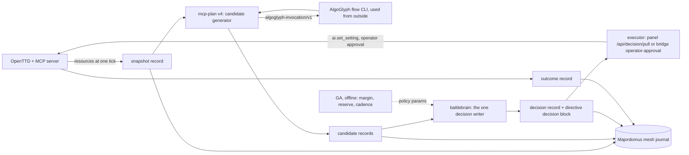

# Battlebrain: one authority for the freight-line decision

RESEARCH-ONLY. Status:
- **Phase 02 (contracts, I0095):** done.
- **Phase 03 (shadow mode, I0096):** done, with one shadow run on a real capture.
- **Live gates (I0097):** built and tested on three real captures.
- **Phase 05 (capabilities, I0098):** done. Battlebrain resolves each computation it needs to a
  kernel of the discovered AlgoGlyph catalogue.
- **The live cutover itself:** not run. Nothing here has reached a game.

## Decided so far (owner, 2026-11-22)

- **First decision type: the freight-line hybrid.** Every ~90 game days: *next freight line (one
  `fr_*` slot) or HOLD*. Candidates come from planner v4 and AlgoGlyph kernels on one coherent
  snapshot. The policy adopts a line only above an ROI margin and a cash reserve, and the genetic
  algorithm tunes those offline. PrismaticAI builds. A bounded forked-simulation evaluation of
  the top-k candidates is stage 2. The pick came after a consultation of a peer session, Fable and
  Codex; Gemini did not run.
- **The authority lives in this fork** (`tools/research/mcp-rhai/src/bin/battlebrain.rs`).
  prismatic-platform and algoglyph are used from outside only: Prismatic's existing
  `GET /api/openttd/decision`, and AlgoGlyph's `npm run --silent flow -- kernels|kernel|serve`.
  Neither repository is edited for this work.
- **The canonical bridge executor** is openttd-prismatic-bridge `feature/operator-approval`. The
  bridge never approves its own request.
- **The blackboard is the Majordomus mesh journal**, by the owner's answer of 2026-11-20
  ([`../agent-loop.md`](../agent-loop.md)). Its kinds are closed: observation, hypothesis, plan,
  decision, blocker, handoff, outcome.

## Dataflow of the slice (target, not yet wired)



## Authority matrix

Current state from the read-only audit of 2026-11-22. The target owner is the one component
allowed to turn a candidate into an executable choice.

| Decision | Chosen today by (audit) | Target owner |
|---|---|---|
| which freight lines the bot is handed (`fr_*`) | `cargo.rs` knapsack + `panel_bot.rs` slot order, once at `start_ai` | **battlebrain** (decision record) |
| who may propose a company's `fr_*` slots | the writer the shared key `planner.<company>` names; unset, every writer as before | that writer only. The others say why and propose no `fr_*` slot for that company: the Rhai writers propose nothing for it at all, since their guard names no slot (B2): `replan.rhai` (holds the round), `build_plan.rhai` `apply_as` (the write path of `ask_relay.rhai` and `replan.rhai`), `prismatic_tune.rhai` (also genes from `/api/tuning`). The Rust writers withhold only the slots: `intent.rs` build answers (`build.held`), `panel_bot.rs` planned settings and planned start (`plan.bot_settings` `held`). One check per language: `src/fr_author.rs`, `rhai/fr_author.rhai` |
| which freight line the bot builds by itself | PrismaticAI `rail.nut` own-lines score | PrismaticAI only when the governed company's own freight pick is off (a default-OFF setting, Phase 03) |
| pricing a rail line | `linecost.rs` via AlgoGlyph track-planning | AlgoGlyph track-planning, output domain-checked; a candidate input, never a choice |
| portfolio within a budget | `cargo.rs` knapsack-dp **or a built-in copy** | AlgoGlyph knapsack-dp as candidate evidence; the built-in copy is a separate, named solver |
| aggressiveness | Prismatic `OpenttdController` Monte Carlo | unchanged (outside this slice) |
| GA settings | `battle.py` offline, `prismatic_tune.rhai` live | offline only; it feeds the policy parameters |
| approval | the operator; a live decision (`openttd.ai.set_settings`) only at the game's console, never through the panel, auto-approve or Rhai, and the panel's other approvals need its owner secret ([mcp-control](../mcp-control.md#approval-is-bound-to-the-owner)); armed UI input remains | the operator (auto-approve is outside this slice) |

## Contracts (I0095)

There is one source of truth: `tools/research/mcp-rhai/src/battlebrain_contract.rs`. The schemas
below are generated by `battlebrain schema <name>`, and `cargo test --bin battlebrain` refuses a
committed schema that differs from the generated one.

| Contract | File | What it carries |
|---|---|---|
| `battlebrain-record/v1` | [`../../tools/research/schema/battlebrain-record.v1.schema.json`](../../tools/research/schema/battlebrain-record.v1.schema.json) | One mesh record body. Types: snapshot, inference, candidate, decision, outcome (mesh kinds: observation, hypothesis, plan, decision, outcome). Each carries scope (instance, company), game tick and date, producer and version, `derived_from`, and the id (the digest of the body). The legal transitions are its `x-transitions`. |
| `algoglyph-invocation/v1` | [`../../tools/research/schema/algoglyph-invocation.v1.schema.json`](../../tools/research/schema/algoglyph-invocation.v1.schema.json) | One kernel call: the kernel, the digest and commit of the catalogue the runner reported, the input digest and units, the budget, the status, and the output digest or errors. |
| `battlebrain-decision/v1` | `$defs.battlebrainDecision` in [`../prismatic-bridge/decision-contract.schema.json`](../prismatic-bridge/decision-contract.schema.json) | The block a directive carries: the decision record, snapshot digest, idempotency key, policy and stale date. |

**Fails closed.** The validators refuse each of these with a stable code; each has an invalid
fixture under `tools/research/schema/fixtures/battlebrain/`:

| Refused input | Code |
|---|---|
| an unknown schema version | `unknown_schema` |
| an unknown type or status | `invalid_field` |
| a record without provenance, or a decision not derived from its snapshot | `missing_provenance` |
| a decision written by anyone but `battlebrain`, or an outcome or snapshot written by it | `writer_not_allowed` |
| an edited body under its old id | `id_mismatch` |
| an amount in an unknown unit | `unknown_unit` |
| a kernel absent from the discovered catalogue | `unknown_kernel` |
| an envelope from another catalogue or checkout | `stale_catalogue` |
| an illegal transition | `illegal_transition` |
| a knapsack answer without items, over capacity or with a wrong best | `invalid_output` (domain check) |
| a kernel with no domain check used to price or select | `no_domain_check` |

**Discovery.** The catalogue is whatever the runner answers at that checkout. The fixture
`catalogue.json` is the real answer of algoglyph `1b8e009` (53 kernels). There is no built-in
kernel list. Per-kernel domain checks exist only for `knapsack-dp` and `track-planning`. They
belong to the adapters of the capability registry ([below](#capabilities-i0098)), which sit at a
protocol boundary because the runner's outputs carry no schema.

## Capabilities (I0098)

Battlebrain declares what it needs computed as **capabilities**: a goal with typed inputs and
outputs, and units on its amounts. `CAPABILITIES` in `battlebrain_contract.rs` is the only place
they are declared. A **matcher** (`match_capability`) picks the kernel of the discovered catalogue
that satisfies a capability. It reads three things: what the catalogue says (id, engine, the
runner's input shape), the **derived kernel contracts** ([below](#derived-kernel-contracts-i0228)),
and the **adapter registry** (`ADAPTERS`).

An adapter states, for one kernel id, only what no AlgoGlyph source states (`ADAPTER_HAND_KEPT`
gives each field's reason, and every match record repeats it):

- the capability it satisfies;
- how each requirement field maps to the kernel's input and output, with the conversion;
- whether the answer is exact, and why, citing the AlgoGlyph test that holds it to a reference;
- the domain check its output must pass (`domain_check` dispatches through the registry).

The engine, the input keys and their JSON types, and the output keys come from the derived
contract, so the adapter no longer restates the engine.

It is the only explicit kernel list in the contract layer. **Owner:** battlebrain (this file and
`battlebrain_contract.rs`). **Retirement:** when AlgoGlyph publishes a versioned input and output
schema with units and exactness for each kernel ([proposal](algoglyph-contract-proposal.md)). Its
keys and types are already derived from the source, so an adapter then shrinks to its mapping and
domain check, or is deleted.

**Matcher rules.** Every kernel of the catalogue is considered. A kernel with no adapter for the
capability is listed as `unadapted` and is never chosen. A kernel with an adapter is compatible
only when all of these hold:

- the kernel is in the catalogue;
- the catalogue lists it with the engine its derived contract states;
- the adapter maps every requirement field exactly once, and no field the requirement lacks;
- the derived contract of the catalogue's own commit declares every input key the adapter maps
  (`input_shape_drift`) and every output key (`output_shape_drift`), and no key's derived JSON
  type contradicts the requirement field's kind (`type_mismatch`). The shape is then `verified`.
- without a contract of the catalogue's commit (a catalogue read from another AlgoGlyph
  checkout), the catalogue's input shape must still declare every mapped key. A shape the runner
  writes as prose counts as `opaque`, and that is recorded with `contract: null`.

The source states no units, so the record says that the adapter asserts them.

**Ranking** among compatible kernels:

1. exact before heuristic;
2. a verified shape before an opaque one;
3. a tie after both rules is refused as `ambiguous_capability`, and a kernel id never breaks a
   tie.

| Refused | Code |
|---|---|
| a capability nobody declared | `unknown_capability` |
| a capability that no adapter serves | `no_adapter` |
| every adapted kernel is absent from the catalogue (expired) | `kernel_expired` |
| adapted kernels present but none compatible (`engine_mismatch`, `input_shape_drift`, `output_shape_drift`, `type_mismatch`, `unmapped_field`, `unknown_field`) | `no_match` |
| a tie after the ranking | `ambiguous_capability` |

**Records.** A match is written as an inference record: method `capability-match`, with params
the `capability-match/v1` decision
([schema](../../tools/research/schema/capability-match.v1.schema.json), generated by
`battlebrain schema match`). The decision holds the requirement, the catalogue's digest and
commit, every candidate with its mapping, its evidence and why it was rejected, the unadapted
kernels, the chosen kernel and why, or the refusal. `validate_record` refuses a capability match
that contradicts itself, for example a chosen kernel that is not a compatible candidate.

`battlebrain shadow|live --catalogue <file>` writes one such record per capability. Each is
derived from the run's snapshot and goes stale with the decision, and the decision's own records
do not change. A **live** run with the catalogue is refused in two cases:

- a capability resolves to no kernel (`capability_unmatched`);
- the planner computed it with another kernel, or with its built-in fallback
  (`capability_mismatch`; the planner's answer names its portfolio kernel at
  `/portfolio/kernel/id`).

Shadow records the same disagreement without refusing. Nothing here executes a kernel: the
matcher only chooses, and a test checks that the contract, the policy and the binary spawn no
process.

`battlebrain capabilities --catalogue tools/research/schema/fixtures/battlebrain/catalogue.json`
prints the table below, and a test refuses a README that differs from it:

<!-- battlebrain capabilities:begin -->
| capability | goal | inputs | outputs |
|---|---|---|---|
| `portfolio-within-budget` | the set of items with the highest total value whose total cost fits a budget | `costs`: amount[] (money), `values`: number[], `budget`: amount (money) | `chosen`: index[], `total_value`: number |
| `rail-line-price` | what a rail line between two station tiles costs to build on this map, or that it has no route | `from`: tile, `to`: tile, `map`: resource, `prices`: resource | `status`: status, `price`: amount (money), `pieces`: list |

Catalogue `sha256:97e08572418b44db62dd546959a396dceddb555aa5a49d12ad54a9bd7a455c8d` at AlgoGlyph `1b8e009059`: 53 kernels (`npm run --silent flow -- kernels`).

| capability | kernel | engine | input shape | exact | verdict |
|---|---|---|---|---|---|
| `portfolio-within-budget` | `knapsack-dp` | grid | verified | yes | **chosen**: the only compatible kernel |
| `rail-line-price` | `track-planning` | custom | verified | yes | **chosen**: the only compatible kernel |

Every other kernel of the catalogue was considered and has no adapter for that capability (`portfolio-within-budget`: 52, `rail-line-price`: 52).
<!-- battlebrain capabilities:end -->

## Derived kernel contracts (I0228)

AlgoGlyph publishes no typed kernel schema yet, and this fork never edits it. What its source
already states is derived instead, by `algoglyph-contracts`
(`tools/research/mcp-rhai/src/algoglyph_contracts.rs`), into
[`tools/research/schema/derived/algoglyph-contracts.json`](../../tools/research/schema/derived/algoglyph-contracts.json):
one contract per kernel of the catalogue fixture, in the shape the
[proposal](algoglyph-contract-proposal.md) defines (`algoglyph-kernel-contract/v1`). Each field
names the source line or the test it comes from (`x-from`, `x-exercised`), and `absent` lists
what no source states. The generator reads:

- each kernel's own input text (a data form's `input`, or the graph form's doc comment in
  `src/flow/cli.ts`), or the interface a grid kernel's `fromData` reads, for keys, required keys,
  enums and descriptions;
- the predicates its parser applies (`integer`, `finite`, `Array.isArray`, `record`, `typeof`,
  `every`, `includes`, `length`), its local helpers and its destructuring defaults, for JSON
  types and defaults. A predicate in a refusal (`if (...) return 'message'`) counts only when it
  is negated, so `Array.isArray(params)` there says what params is not;
- the result interface of a grid kernel, or the record a `solve` returns (literals,
  `Number.isFinite(v) ? v : null`, a field of a typed call's result, a typed spread), for output
  keys and types;
- `test/flow-cli.test.ts`, which AlgoGlyph requires to run every data form, for the keys its tests
  run each kernel on and read from the answer.

The source is read from git at one commit, never from a working tree. Its root is a parameter:
`--algoglyph DIR`, else `$ALGOGLYPH_ROOT`, else the submodule `.gitmodules` declares for
AlgoGlyph, else the transitional checkout `~/dev/algoglyph-wt/main` until that submodule lands.
The derivation refuses a catalogue of another commit than the source.

```sh
cargo run --release --offline --no-default-features --manifest-path tools/research/mcp-rhai/Cargo.toml --bin algoglyph-contracts            # regenerate
cargo run --release --offline --no-default-features --manifest-path tools/research/mcp-rhai/Cargo.toml --bin algoglyph-contracts -- --check # exit 1 while stale
```

`tools/gate.sh change` runs the check. Without an AlgoGlyph checkout the tool reports NOT RUN and
exits 3, and the tier is PARTIAL rather than PASS (`--source-optional` makes that exit 0 for a
caller that only wants the NOT RUN line). Like the battle post-mortems, it needs cargo, which the Surfaces
CI does not have, so it is not a `surfaces.toml` generator. `cargo test --bin algoglyph-contracts`
also fails while the artifact differs from what the pinned source derives. `cargo test --bin
battlebrain` fails while the artifact's commit is not the catalogue fixture's.

## Shadow mode (I0096)

The shadow run goes in four steps, and nothing in them reaches a game:

1. `mcp-plan --capture <dir>` writes every `openttd://` read with its sha256 and game tick, plus
   `openttd://companies`. It only reads. When the server lists `openttd.resources.read_many` as
   read-only, every read comes from one call of that tool, so the capture is one game tick and
   `window.coherent` is true. The set of resources that call reads is not written down anywhere:
   the plan runs on what one call returned, and every name it asked for that was missing is added
   for the next call, until a run asks for nothing outside its set. That run's answer is the one
   captured. When the tool is absent, not read-only or refused, or the plan reads more resources
   than one call accepts (at most 32), the capture reads each resource on its own as before.
   `capture.json`'s `coherence` field then says why, for example `read_many not offered: ...`.
2. `mcp-plan --snapshot <dir>` replays the capture and refuses any file whose digest changed.
3. `battlebrain snapshot` turns the capture into a snapshot record. The record carries the tick
   window and states whether the capture is coherent.
4. `battlebrain shadow` applies `freight-margin@1` (`battlebrain_policy.rs`). It writes three
   records: the planner's candidate, battlebrain's own candidate, and a decision in mode
   `shadow`. It also writes a comparison that classifies any divergence as one of `same`,
   `intended_policy_difference`, `input_model_discrepancy` or `tie_order`. The comparison's
   metrics report a fallback solver, a missing kernel, unpriced and unroutable lines, and
   whether the snapshot was coherent.

The policy is a pure function with a documented tie-break: higher annual return, then lower
investment, then lower cargo, producer and acceptor ids.

The executor refuses any directive whose decision block is invalid (422) or in mode `shadow`
(409). It refuses before any step, whoever submits it (`panel_decision.rs` `decision_gate`).

**Evidence on one real capture**
([`battlebrain-shadow-20261122T084607Z-coplay-8800`](../results/battlebrain-shadow-20261122T084607Z-coplay-8800.md);
the capture is under
`tools/research/schema/fixtures/battlebrain/captures/coplay-8800-1953-02-09/`):

- The capture is the owner's co-play game, read in one pass with its owner session's consent.
  It is not coherent: ticks 85325 to 85368.
- Two replays gave byte-identical output, and so did the shadow run on each of them.
- The planner's line costs 127,603. That is more than company 3 can spend while keeping its
  reserve (125,011), so the divergence is `input_model_discrepancy`: the planner prices
  against `max_loan`.
- Battlebrain picks a line with a better annual return that it can afford, but the line has no
  track-planning price.

## Three real captures with freight-margin@2 (I0097)

The captures come from the owner's co-play game on :8800, company 3: three read-only passes,
each with the consent of the game's owner session. Every replay and every shadow run gave
byte-identical output twice. The summaries below are derived from their records by
`battlebrain report`.

| capture (game date) | divergence | planner v4 | battlebrain (freight-margin@2) |
|---|---|---|---|
| [1953-02-09](../results/battlebrain-shadow-20261122T084607Z-coplay-8800-freight-margin-2.md) | `input_model_discrepancy` | 41→1, priced, but over budget once the reserve is kept | 0→1, priced, affordable |
| [1962-05-29](../results/battlebrain-shadow-20261122T104111Z-coplay-8800-freight-margin-2.md) | `input_model_discrepancy` | 29→34, never priced by track-planning | 41→1, priced |
| [1963-02-22](../results/battlebrain-shadow-20261122T105052Z-coplay-8800-freight-margin-2.md) | `same` | 41→1, priced | 41→1, priced |

None of the divergences is a `defect`. In each case the planner either ignores the money the
company has now (it prices its portfolio against `max_loan`) or picks a line it never priced
(track-planning priced 16 of 40 candidates). None of the three captures is coherent: they span
28 to 43 ticks while the game runs. `openttd.resources.read_many` (#39) and a coherent
`mcp-plan --capture` are the fix.

**`battlebrain live`** writes the live directive only after these checks:

- the snapshot window is at most `--max-window-ticks`, which defaults to 0, meaning one tick;
- the policy requires priced lines;
- the companies were read after the snapshot.

The directive sets `planned_freight_only=1` and one `fr_*` slot.

- `battlebrain serve --once` hands the directive out to exactly one loopback GET.
- The executor applies a live block only through a pull keyed with the block's own idempotency
  key, on or before its stale date in game time.
- `battlebrain rollback --snapshot <record> --company <id> [--of <live directive>]` gives the
  company back to the baseline, as a live decision of its own (see the round-2 fixes below).

## Executor binding after the red-team review (I0117)

The Phase 08 review found four ways a live decision could execute stale, partly or forged. They
are closed here:

- **The block binds the payload.** `battlebrain-decision/v2` carries `settings_digest`, the digest
  of the exact settings string, and the executor recomputes it (`payload_mismatch`).
- **One author per slot.** A directive without a decision block may not set any `fr_*` slot
  (`fr_needs_decision`). Settings that touch no slot still pass without a block.
- **One approval that expires.** A live decision is applied only through
  `openttd.ai.set_settings`: all settings under one approval, applied at once, expiring at the end
  of the decision's stale date (`live_expiry`). A game without that tool refuses the decision
  (`no_atomic_apply`).
- **No leftover slots.** The live directive clears fr2..fr16 (`-1`), so no slot handed over
  earlier is built beside the decision.
- **No stale, unbacked or repeated decision.** `battlebrain live` refuses a fallback solver, a
  missing kernel, and a snapshot older than its `max_age_days` at the fresh read.
  `battlebrain serve` refuses a key it has served before; its ledger is kept across runs.
- **Before a live pull,** the shared key `planner.<company>` is set to `battlebrain`, so every
  other proposer of that company's `fr_*` slots stands down (the authority matrix lists them).
  `rail_steward.rhai` and `rail_lib.rhai` set `line<n>_trains`/`line<n>_wagons` only, never `fr_*`.
- **A slot change names its writer.** `POST /api/bots/setting` sends an `fr_*` setting only when
  the request names its `writer` and `planner.<company>` is unset or names that writer. A request
  without a writer is refused with `fr_needs_writer` (422). A writer that is not the planner is
  refused with `fr_planner_held` (409). Nothing reaches the game in either case, and the refusal
  is a `panel.ai` event. Other settings pass as before. `build_plan.rhai` (and so `ask_relay` and
  `replan`) and `prismatic_tune.rhai` name themselves (`ttd::set_bot(company, name, value,
  writer)`). The rule is `fr_author::change_refusal`, and the check is
  `panel_bot::slot_refusal`.
- **The raw MCP routes set no slot.** `POST /api/tools/openttd.ai.set_setting`,
  `POST /api/tools/openttd.ai.set_settings` and a `POST /api/rpc` `tools/call` of either name no
  writer. A call that changes an `fr_*` setting is refused with `fr_needs_writer`. The decision
  executor calls `openttd.ai.set_settings` itself, not through these routes, so it is unaffected.

**Round 2 of the review** closed four more gaps:

- **Rollback.** A blockless rollback never reached the game. The pull needs an observation that
  `battlebrain serve` never makes (409), `serve` refuses a directive without a key, and slot 1
  would have stayed set. `battlebrain rollback` now writes a live decision of its own:
  - the settings are `planned_freight_only=0` with every slot cleared (`fr_from=-1` through
    `fr16_from=-1`);
  - it is decided on a snapshot, and its records are a hold candidate and a decision with policy
    `rollback@1`, derived from the decision it reverses;
  - it is keyed `<that decision's key>:rollback`.

  It is served and applied like any live decision. A test runs it through `decision_gate`,
  `live_world` and the directive parser.
- **The world is checked on the live path.** A block now carries `snapshot_tick`. `apply_live`
  checks the world (`live_world`) before the stale date and before `openttd.ai.set_settings`. It
  refuses `world_changed` when the game's tick is behind the snapshot: an earlier save reloaded,
  even one whose date is on or before `valid_until`, or another world. It refuses
  `not_an_ai_company` when the company is not an AI company now.
- **Boundary B6** now covers that order in `apply_live` as well as `pull_with`'s.
- **The served-key ledger** records a key only once a loopback GET has been accepted, so a
  failed bind no longer burns it. `BATTLEBRAIN_STATE_DIR` (else `$HOME`) must be an absolute
  path; a relative one, or no `HOME`, is refused.

Still open:

- The panel's loopback `/api/approve`, `/api/auto-approve` and armed UI input are not bound to the
  owner. That is outside this slice and is the owner's operating rule.
- A client of the game's own MCP endpoint (its bearer token: `mcp-auto`, `mcp-human`, Rhai
  `mcp_call`) can still call `openttd.ai.set_setting` or `openttd.ai.set_settings` with an `fr_*`
  name. The owner's approval of that request is the only check there.
- The C++ side is unchanged, on purpose. The planner key lives in the panel's memory, which the
  game cannot read. A rule such as "`set_setting` refuses `fr_*`, use `set_settings`" would leave
  `set_settings` open to the same client, so it would only move the hole. It would also break the
  writers above, which send one slot at a time while no planner key is set, and the "no stacking"
  checks of `prismatic_tune` and `replan`, which count pending `openttd.ai.set_setting` requests.
- A writer names itself: the loopback API authenticates no one. The check keeps the panel's own
  writers from contradicting the planner. It is not a credential.
- A new AI started with `fr_*` settings (`openttd.ai.start`, `start_ai`) is not checked. It has no
  company id until it starts.

## Cutover thresholds (the Phase 04 gate)

A decision may go live only when all of these hold. Each one is a correctness or safety
condition, not output equality:

- the snapshot is coherent (one tick), or the game was paused while it was read;
- the selected line has `track: found` from track-planning, so an unpriced or unroutable line
  never goes live;
- the investment fits money plus loan headroom minus the reserve, re-read just before submission;
- the decision block validates, its mode is `live`, its idempotency key has not been used, and
  its stale date has not passed;
- PrismaticAI runs with `planned_freight_only=1`, so the line has one author;
- every divergence across at least three captures (seeds, maps or companies) is classified, and
  none is `defect`.

The runbook that takes one decision live, and back, is one script with a subcommand per phase,
[`tools/research/battlebrain-cutover`](../../tools/research/battlebrain-cutover). It stops at
the owner's approval and never approves. It is rehearsed offline against the stand-in game of
the live path; see [cutover.md](cutover.md).

## Phase 06: evidence, duels and regression gates

[`experiment-freight-margin.md`](experiment-freight-margin.md) pre-registers the experiment. It
fixes the hypotheses, the arms, the metrics, the seeds, the sample size, the stopping rules and
five separate checks before any pair is played. H1 (correctness) says a freight-margin@2 decision
never applies an unpriced or unaffordable line. H2 (strategy) says a battlebrain-steered company
does not end with a lower value share than under planner v4 on held-start pairs, within a margin
of 10%.

**Every strategy result is NOT RUN.** On 2026-11-22 the owner ordered that only one game runs on
the mesh: the co-play game on :8800, which belongs to another session. No duel, capture or live
decision has been run for this experiment. C2 (per-pair correctness), C3 (performance), C4
(strategy, H2) and C5 (operator safety) are NOT RUN for that reason.

- **The sample size is derived.** `battle.py power` reads the 351 battle records. Their split-half
  Kendall tau of the GA score is 0.212, so one seed carries a rank reliability of only 0.065. The
  paired log value ratio has a median standard deviation of 0.366 across seeds. That gives **93
  held-start pairs** for a one-sided non-inferiority test at a margin of 10% (α 0.05, power 0.8),
  or 27 pairs at a margin of 20%.
- **The harness reuses mcp-duel.** Arm P is a duel with `--capture-at-start`: the held start is
  captured after company A is founded, while the game is still paused. `battlebrain live` decides
  on that capture. Arm BB is a duel of the same seed with `--directive`. `mcp-duel pair-check`
  makes a pair valid only if both starts lead to the same decision. `--directive` refuses a
  directive that leaves any other `fr*` slot to the planner, so arm BB can run only once the
  directive clears them (I0117).
- **Regression gate C1** (`tools/research/mcp-rhai/src/battlebrain_regression.rs`, run by
  `cargo test --bin battlebrain`): every freight-margin@2 shadow result is replayed on its capture,
  and its comparison block must be unchanged. The selected line must also be priced and
  affordable. It needs at least three such results. The first run found that the 1953-02-09
  result's reason named `freight-margin@1`, a label written before fcac673236. The result was
  re-recorded from the same capture; its lines, budget, divergence and selection are unchanged.
  Since then, all three reproduce.

## Architecture boundaries (Phase 07)

The rule [`project.decision-authority-boundaries`](../../.ai/repo/rules/project/decision-authority-boundaries.v1.md)
keeps a second decision authority from coming back. It has eight boundaries, B1 to B8. Each
names its owner and its test, and `tools/gate.sh change` runs them offline
(`tools/research/mcp-rhai/src/authority_boundaries.rs`, in `cargo test --bin battlebrain`):

- B1: only battlebrain builds a decision record or a decision block.
- B2: kernel output is only ever a candidate.
- B3: the blackboard has no command path.
- B4: no catalogue is copied by hand; the domain checks are the one adapter registry.
- B5: a decision carries its provenance, policy and snapshot.
- B6: stale inputs are checked again before acting.
- B7: the built-in knapsack is named as a fallback.
- B8: a default build carries no research code.

The two legacy freight-slot writers in the authority matrix, `panel_bot.rs` `settings_from_plan`
and `intent.rs`, are named gaps there. They stay until the cutover.

## Not yet done

- Cutover (Phase 04): no live decision, no rollback switch, no live run.
- Only one real capture exists, and it is not coherent. A coherent capture through
  `read_many` is unit-tested against a fake server answer and has not been taken on a live game yet.
- A planner adapter limitation: the baseline is the portfolio's best-scored freight rail line,
  not the bot's slot order from `settings_from_plan`.
- AlgoGlyph still has no kernel version, output schema or units. The invocation envelope pins
  the catalogue digest and checkout instead, and the adapters assert the mapping and the units
  ([proposal](algoglyph-contract-proposal.md)).
- The planner (`cargo.rs`, `linecost.rs`) still calls `knapsack-dp` and `track-planning` by name.
  Battlebrain checks that the planner's portfolio kernel agrees with the match. The planner's
  track answers name no kernel, so that check does not cover them.
- The portfolio refuses a `knapsack-dp` answer that fails `domain_check` and records `fallback`
  and `truncation`, but its candidate cap (40) is not yet read from the plan's params.
