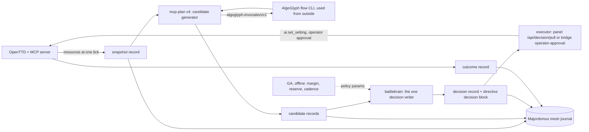

# Battlebrain: one authority for the freight-line decision

RESEARCH-ONLY. Status:
- **Phase 02 (contracts, I0095):** done.
- **Phase 03 (shadow mode, I0096):** done, with one shadow run on a real capture.
- **Live gates (I0097):** built and tested on three real captures.
- **The live cutover itself:** not run. Nothing here has reached a game.

## Decided so far (owner, 2026-11-22)

- **First decision type: the freight-line hybrid.** Every ~90 game days: *next freight line (one
  `fr_*` slot) or HOLD*. Candidates come from planner v4 and AlgoGlyph kernels on one coherent
  snapshot. The policy adopts a line only above an ROI margin and a cash reserve, and the genetic
  algorithm tunes those offline. PrismaticAI builds. A bounded forked-simulation evaluation of
  the top-k candidates is stage 2. The pick came after a consultation of a peer session, Fable and
  Codex; Gemini did not run.
- **The authority lives in this fork** (`tools/research/mcp-rhai/src/bin/battlebrain.rs`).
  prismatic-platform and algoglyph are used from outside only: Prismatic's existing
  `GET /api/openttd/decision`, and AlgoGlyph's `npm run --silent flow -- kernels|kernel|serve`.
  Neither repository is edited for this work.
- **The canonical bridge executor** is openttd-prismatic-bridge `feature/operator-approval`. The
  bridge never approves its own request.
- **The blackboard is the Majordomus mesh journal**, by the owner's answer of 2026-11-20
  ([`../agent-loop.md`](../agent-loop.md)). Its kinds are closed: observation, hypothesis, plan,
  decision, blocker, handoff, outcome.

## Dataflow of the slice (target, not yet wired)

## Authority matrix

Current state from the read-only audit of 2026-11-22. The target owner is the one component
allowed to turn a candidate into an executable choice.

| Decision | Chosen today by (audit) | Target owner |
|---|---|---|
| which freight lines the bot is handed (`fr_*`) | `cargo.rs` knapsack + `panel_bot.rs` slot order, once at `start_ai` | **battlebrain** (decision record) |
| which freight line the bot builds by itself | PrismaticAI `rail.nut` own-lines score | PrismaticAI only when the governed company's own freight pick is off (a default-OFF setting, Phase 03) |
| pricing a rail line | `linecost.rs` via AlgoGlyph track-planning | AlgoGlyph track-planning, output domain-checked; a candidate input, never a choice |
| portfolio within a budget | `cargo.rs` knapsack-dp **or a built-in copy** | AlgoGlyph knapsack-dp as candidate evidence; the built-in copy is a separate, named solver |
| aggressiveness | Prismatic `OpenttdController` Monte Carlo | unchanged (outside this slice) |
| GA settings | `battle.py` offline, `prismatic_tune.rhai` live | offline only; it feeds the policy parameters |
| approval | the operator, but also panel auto-approve and armed UI input | the operator (auto-approve is outside this slice) |

## Contracts (I0095)

There is one source of truth: `tools/research/mcp-rhai/src/battlebrain_contract.rs`. The schemas
below are generated by `battlebrain schema <name>`, and `cargo test --bin battlebrain` refuses a
committed schema that differs from the generated one.

| Contract | File | What it carries |
|---|---|---|
| `battlebrain-record/v1` | [`../../tools/research/schema/battlebrain-record.v1.schema.json`](../../tools/research/schema/battlebrain-record.v1.schema.json) | One mesh record body. Types: snapshot, inference, candidate, decision, outcome (mesh kinds: observation, hypothesis, plan, decision, outcome). Each carries scope (instance, company), game tick and date, producer and version, `derived_from`, and the id (the digest of the body). The legal transitions are its `x-transitions`. |
| `algoglyph-invocation/v1` | [`../../tools/research/schema/algoglyph-invocation.v1.schema.json`](../../tools/research/schema/algoglyph-invocation.v1.schema.json) | One kernel call: the kernel, the digest and commit of the catalogue the runner reported, the input digest and units, the budget, the status, and the output digest or errors. |
| `battlebrain-decision/v1` | `$defs.battlebrainDecision` in [`../prismatic-bridge/decision-contract.schema.json`](../prismatic-bridge/decision-contract.schema.json) | The block a directive carries: the decision record, snapshot digest, idempotency key, policy and stale date. |

**Fails closed.** The validators refuse each of these with a stable code; each has an invalid
fixture under `tools/research/schema/fixtures/battlebrain/`:

| Refused input | Code |
|---|---|
| an unknown schema version | `unknown_schema` |
| an unknown type or status | `invalid_field` |
| a record without provenance, or a decision not derived from its snapshot | `missing_provenance` |
| a decision written by anyone but `battlebrain`, or an outcome or snapshot written by it | `writer_not_allowed` |
| an edited body under its old id | `id_mismatch` |
| an amount in an unknown unit | `unknown_unit` |
| a kernel absent from the discovered catalogue | `unknown_kernel` |
| an envelope from another catalogue or checkout | `stale_catalogue` |
| an illegal transition | `illegal_transition` |
| a knapsack answer without items, over capacity or with a wrong best | `invalid_output` (domain check) |
| a kernel with no domain check used to price or select | `no_domain_check` |

**Discovery.** The catalogue is whatever the runner answers at that checkout. The fixture
`catalogue.json` is the real answer of algoglyph `1b8e009` (53 kernels). There is no built-in
kernel list. Per-kernel domain checks exist only for `knapsack-dp` and `track-planning`: they are
adapters at a protocol boundary, because the runner's outputs carry no schema.

## Shadow mode (I0096)

The shadow run goes in four steps, and nothing in them reaches a game:

1. `mcp-plan --capture <dir>` writes every `openttd://` read with its sha256 and game tick, plus
   `openttd://companies`. It is one pass of GET requests only.
2. `mcp-plan --snapshot <dir>` replays the capture and refuses any file whose digest changed.
3. `battlebrain snapshot` turns the capture into a snapshot record. The record carries the tick
   window and states whether the capture is coherent.
4. `battlebrain shadow` applies `freight-margin@1` (`battlebrain_policy.rs`). It writes three
   records: the planner's candidate, battlebrain's own candidate, and a decision in mode
   `shadow`. It also writes a comparison that classifies any divergence as one of `same`,
   `intended_policy_difference`, `input_model_discrepancy` or `tie_order`. The comparison's
   metrics report a fallback solver, a missing kernel, unpriced and unroutable lines, and
   whether the snapshot was coherent.

The policy is a pure function with a documented tie-break: higher annual return, then lower
investment, then lower cargo, producer and acceptor ids.

The executor refuses any directive whose decision block is invalid (422) or in mode `shadow`
(409). It refuses before any step, whoever submits it (`panel_decision.rs` `decision_gate`).

**Evidence on one real capture**
([`battlebrain-shadow-20261122T084607Z-coplay-8800`](../results/battlebrain-shadow-20261122T084607Z-coplay-8800.md);
the capture is under
`tools/research/schema/fixtures/battlebrain/captures/coplay-8800-1953-02-09/`):

- The capture is the owner's co-play game, read in one pass with its owner session's consent.
  It is not coherent: ticks 85325 to 85368.
- Two replays gave byte-identical output, and so did the shadow run on each of them.
- The planner's line costs 127,603. That is more than company 3 can spend while keeping its
  reserve (125,011), so the divergence is `input_model_discrepancy`: the planner prices
  against `max_loan`.
- Battlebrain picks a line with a better annual return that it can afford, but the line has no
  track-planning price.

## Three real captures with freight-margin@2 (I0097)

The captures come from the owner's co-play game on :8800, company 3: three read-only passes,
each with the consent of the game's owner session. Every replay and every shadow run gave
byte-identical output twice. The summaries below are derived from their records by
`battlebrain report`.

| capture (game date) | divergence | planner v4 | battlebrain (freight-margin@2) |
|---|---|---|---|
| [1953-02-09](../results/battlebrain-shadow-20261122T084607Z-coplay-8800-freight-margin-2.md) | `input_model_discrepancy` | 41→1, priced, but over budget once the reserve is kept | 0→1, priced, affordable |
| [1962-05-29](../results/battlebrain-shadow-20261122T104111Z-coplay-8800-freight-margin-2.md) | `input_model_discrepancy` | 29→34, never priced by track-planning | 41→1, priced |
| [1963-02-22](../results/battlebrain-shadow-20261122T105052Z-coplay-8800-freight-margin-2.md) | `same` | 41→1, priced | 41→1, priced |

None of the divergences is a `defect`. In each case the planner either ignores the money the
company has now (it prices its portfolio against `max_loan`) or picks a line it never priced
(track-planning priced 16 of 40 candidates). None of the three captures is coherent: they span
28 to 43 ticks while the game runs. `openttd.resources.read_many` (#39) and a coherent
`mcp-plan --capture` are the fix.

**`battlebrain live`** writes the live directive only after these checks:

- the snapshot window is at most `--max-window-ticks`, which defaults to 0, meaning one tick;
- the policy requires priced lines;
- the companies were read after the snapshot.

The directive sets `planned_freight_only=1` and one `fr_*` slot.

- `battlebrain serve --once` hands the directive out to exactly one loopback GET.
- The executor applies a live block only through a pull keyed with the block's own idempotency
  key, on or before its stale date in game time.
- `battlebrain rollback` gives the directive back to the baseline (`planned_freight_only=0`).

## Cutover thresholds (the Phase 04 gate)

A decision may go live only when all of these hold. Each one is a correctness or safety
condition, not output equality:

- the snapshot is coherent (one tick), or the game was paused while it was read;
- the selected line has `track: found` from track-planning, so an unpriced or unroutable line
  never goes live;
- the investment fits money plus loan headroom minus the reserve, re-read just before submission;
- the decision block validates, its mode is `live`, its idempotency key has not been used, and
  its stale date has not passed;
- PrismaticAI runs with `planned_freight_only=1`, so the line has one author;
- every divergence across at least three captures (seeds, maps or companies) is classified, and
  none is `defect`.

## Not yet done

- Cutover (Phase 04): no live decision, no rollback switch, no live run.
- Only one real capture exists, and it is not coherent.
- A planner adapter limitation: the baseline is the portfolio's best-scored freight rail line,
  not the bot's slot order from `settings_from_plan`.
- AlgoGlyph still has no kernel version, output schema or units. The invocation envelope pins
  the catalogue digest and checkout instead.
