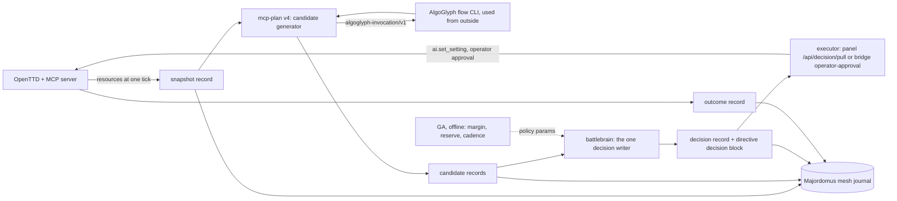

# Battlebrain: one authority for the freight-line decision

RESEARCH-ONLY. Status: **Phase 02 (contracts) in progress** under issue I0095. Nothing here
decides or reaches a game yet; shadow mode (Phase 03) and cutover (Phase 04) are not built.

## Decided so far (owner, 2026-11-22)

- **First decision type: the freight-line hybrid.** Every ~90 game days: *next freight line (one
  `fr_*` slot) or HOLD*. Candidates come from planner v4 and AlgoGlyph kernels on one coherent
  snapshot. The policy adopts a line only above an ROI margin and a cash reserve, and the genetic
  algorithm tunes those offline. PrismaticAI builds. A bounded forked-simulation evaluation of
  the top-k candidates is stage 2. The pick came after a consultation of a peer session, Fable and
  Codex; Gemini did not run.
- **The authority lives in this fork** (`tools/research/mcp-rhai/src/bin/battlebrain.rs`).
  prismatic-platform and algoglyph are used from outside only: Prismatic's existing
  `GET /api/openttd/decision`, and AlgoGlyph's `npm run --silent flow -- kernels|kernel|serve`.
  Neither repository is edited for this work.
- **The canonical bridge executor** is openttd-prismatic-bridge `feature/operator-approval`. The
  bridge never approves its own request.
- **The blackboard is the Majordomus mesh journal**, by the owner's answer of 2026-11-20
  ([`../agent-loop.md`](../agent-loop.md)). Its kinds are closed: observation, hypothesis, plan,
  decision, blocker, handoff, outcome.

## Dataflow of the slice (target, not yet wired)

## Authority matrix

Current state from the read-only audit of 2026-11-22. The target owner is the one component
allowed to turn a candidate into an executable choice.

| Decision | Chosen today by (audit) | Target owner |
|---|---|---|
| which freight lines the bot is handed (`fr_*`) | `cargo.rs` knapsack + `panel_bot.rs` slot order, once at `start_ai` | **battlebrain** (decision record) |
| which freight line the bot builds by itself | PrismaticAI `rail.nut` own-lines score | PrismaticAI only when the governed company's own freight pick is off (a default-OFF setting, Phase 03) |
| pricing a rail line | `linecost.rs` via AlgoGlyph track-planning | AlgoGlyph track-planning, output domain-checked; a candidate input, never a choice |
| portfolio within a budget | `cargo.rs` knapsack-dp **or a built-in copy** | AlgoGlyph knapsack-dp as candidate evidence; the built-in copy is a separate, named solver |
| aggressiveness | Prismatic `OpenttdController` Monte Carlo | unchanged (outside this slice) |
| GA settings | `battle.py` offline, `prismatic_tune.rhai` live | offline only; it feeds the policy parameters |
| approval | the operator, but also panel auto-approve and armed UI input | the operator (auto-approve is outside this slice) |

## Contracts (I0095)

There is one source of truth: `tools/research/mcp-rhai/src/battlebrain_contract.rs`. The schemas
below are generated by `battlebrain schema <name>`, and `cargo test --bin battlebrain` refuses a
committed schema that differs from the generated one.

| Contract | File | What it carries |
|---|---|---|
| `battlebrain-record/v1` | [`../../tools/research/schema/battlebrain-record.v1.schema.json`](../../tools/research/schema/battlebrain-record.v1.schema.json) | One mesh record body. Types: snapshot, inference, candidate, decision, outcome (mesh kinds: observation, hypothesis, plan, decision, outcome). Each carries scope (instance, company), game tick and date, producer and version, `derived_from`, and the id (the digest of the body). The legal transitions are its `x-transitions`. |
| `algoglyph-invocation/v1` | [`../../tools/research/schema/algoglyph-invocation.v1.schema.json`](../../tools/research/schema/algoglyph-invocation.v1.schema.json) | One kernel call: the kernel, the digest and commit of the catalogue the runner reported, the input digest and units, the budget, the status, and the output digest or errors. |
| `battlebrain-decision/v1` | `$defs.battlebrainDecision` in [`../prismatic-bridge/decision-contract.schema.json`](../prismatic-bridge/decision-contract.schema.json) | The block a directive carries: the decision record, snapshot digest, idempotency key, policy and stale date. |

**Fails closed.** The validators refuse each of these with a stable code; each has an invalid
fixture under `tools/research/schema/fixtures/battlebrain/`:

| Refused input | Code |
|---|---|
| an unknown schema version | `unknown_schema` |
| an unknown type or status | `invalid_field` |
| a record without provenance, or a decision not derived from its snapshot | `missing_provenance` |
| a decision written by anyone but `battlebrain`, or an outcome or snapshot written by it | `writer_not_allowed` |
| an edited body under its old id | `id_mismatch` |
| an amount in an unknown unit | `unknown_unit` |
| a kernel absent from the discovered catalogue | `unknown_kernel` |
| an envelope from another catalogue or checkout | `stale_catalogue` |
| an illegal transition | `illegal_transition` |
| a knapsack answer without items, over capacity or with a wrong best | `invalid_output` (domain check) |
| a kernel with no domain check used to price or select | `no_domain_check` |

**Discovery.** The catalogue is whatever the runner answers at that checkout. The fixture
`catalogue.json` is the real answer of algoglyph `1b8e009` (53 kernels). There is no built-in
kernel list. Per-kernel domain checks exist only for `knapsack-dp` and `track-planning`: they are
adapters at a protocol boundary, because the runner's outputs carry no schema.

## Not yet done

The panel, `mcp-plan` and PrismaticAI do not use these contracts yet. There is no shadow mode,
no cutover and no live run. Known gaps that the contracts only make visible:

- AlgoGlyph has no kernel version, output schema or units. The envelope pins the catalogue digest
  and checkout instead.
- MCP resources are read at different moments. Phase 03 needs one coherent snapshot.
- The approval is not yet bound to a decision id.
