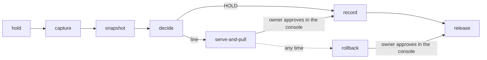

# Battlebrain cutover: the runbook as a script

RESEARCH-ONLY. [`tools/research/battlebrain-cutover`](../../tools/research/battlebrain-cutover)
runs the cutover runbook agreed with the operator, one subcommand per phase, for one company of
one game. [`tools/research/battlebrain-cutover-check`](../../tools/research/battlebrain-cutover-check)
rehearses it offline against a stand-in game. The script has not been run against a real game.

The script never approves. It stops at the owner's approval and prints the pending approval ids
with the console command for the owner. It calls neither `/api/approve` nor `/api/auto-approve`.

## Phases

Each phase names the panel it acts on (`--panel`, required, no default) and a run directory
(`--dir`) where every phase reads the files of the phases before it. Each phase prints what it
does before it does it. The routes, bodies and key forms are the code's:
`src/rhai_shared.rs`, `src/panel_decision.rs` and `src/bin/battlebrain.rs` in
`tools/research/mcp-rhai`.

| Phase | What it does | Run again |
|---|---|---|
| `hold` | `POST /api/rhai/shared {"key": "planner.<c>", "value": "battlebrain", "writer": W, "rev": 0}`; a 409 means another writer holds the key, and the phase stops with the holder | changes nothing when this run holds the key at its revision; `--adopt-rev N` takes over a key already set to `battlebrain` by `--writer` at revision N |
| `capture` | `mcp-plan --panel P --limit 40 --track 16 --capture DIR/capture`, the plan in `DIR/capture/plan.json`; refused unless `capture.json` says `window.coherent: true`, and a refused capture is set aside | reads nothing once a coherent capture exists |
| `snapshot` | `battlebrain snapshot --capture DIR/capture --instance I --company C` | refused when it would differ from the snapshot this run wrote |
| `decide` | one `GET /api/resources/companies`, saved raw with its envelope, then `battlebrain live --snapshot --plan --companies --company C --max-window-ticks 0` (`--margin`, `--reserve` passed on). HOLD writes no directive | reads nothing once decided |
| `serve-and-pull` | refused while `GET /api/status` says `auto_approve: true`, or while `planner.<c>` is not this run's writer at this run's revision; then `battlebrain serve --directive F --port p` and `POST /api/decision/pull {"url": "http://127.0.0.1:p/", "key": K}`, where K is the directive's `decision.idempotency_key`. It prints `prismatic_mcp approve <id>` for each pending approval and stops | serves nothing again: it prints the pull it made |
| `record` | read-only `GET /api/resources/game/state` and `GET /api/bots`, then an outcome record (`DIR/outcome.json`, validated by `battlebrain validate`): `applied` when the company runs every setting of the directive, `refused` when the pull was refused. Refused while neither holds (the settings are not observable yet). A HOLD is recorded as `DIR/record.json` with its decision record | |
| `release` | `POST /api/rhai/shared/delete {"key", "writer", "rev"}` with this run's revision | changes nothing once released |
| `rollback` | `battlebrain rollback --snapshot DIR/snapshot.json --company C [--of DIR/decision.directive.json]`, then serve-and-pull of that directive. Its key is `<the decision's key>:rollback`, or `<instance>:<c>:<date>:rollback` without a decision | as serve-and-pull |

The decision's key is `<instance>:<company>:<snapshot date>:freight-line`
(`battlebrain live`). `battlebrain serve` records each key it serves in its ledger
(`$BATTLEBRAIN_STATE_DIR/served-keys`, else `$HOME/.local/state/battlebrain/served-keys`) and
never serves one twice. The panel answers a repeated pull of a key from its own memory
(`keyed`, marked `replayed`) and applies nothing.

## Where the code differs from the runbook

- `battlebrain serve` has no `--once`: it always answers one GET and exits. A probe of its port
  would be that one GET, so the script never probes. It asks the panel to pull again while the
  pull fails to connect (502, which the panel keeps under no key).
- `battlebrain rollback` needs `--snapshot` as well as `--company`.
- The plan for `battlebrain live` is the standard output of `mcp-plan`; `--capture` writes only
  the reads and `capture.json`.
- The current state on :8800 (`planner.0` set at revision 1 by `openttd-c1`) is taken over with
  `hold --writer openttd-c1 --adopt-rev 1`, or released first.

## The rehearsal

`tools/research/battlebrain-cutover-check` builds the binaries it needs (incremental, offline)
and starts the ignored test `panel::tests::the_cutover_rehearsal_stand_in` of the mcp-panel
test binary. That test serves real panels on random loopback ports, each in front of the stand-in
game of the live path (`fake_game` in `src/panel.rs`, which the rollback test of round 2 uses
too), in two worlds: `ahead` (the snapshot's tick + 74) and `behind` (one tick before the
snapshot, as an earlier save reloaded).

The stand-in game cannot feed a planner, so the capture comes from a stand-in of
`mcp-plan --capture`: the recorded capture `coplay-8800-1963-02-22`, its window set to one tick.
The real `mcp-plan` is run against the stand-in game once, and its capture is refused. The
scenarios are the full happy path, each phase run twice, a HOLD, a 409 on hold, a decision
pulled in the `behind` world (refused `world_changed` and recorded), a replayed pull and the
refusals of single phases.

The check traces every run of the script (`xtrace` to a file, the line number in `PS4`) and
fails on any executable line that no scenario ran. It also fails if a traced call reached
`/api/approve`, `/api/auto-approve` or `:8800`, and it reads the stand-in's pending approvals at
the end: they are all still pending.

What the rehearsal does not show:

- the stand-in game answers no AI settings, so `record` is shown refusing (not observable yet)
  and recording a refused pull, never recording `applied`;
- the stand-in answers every `openttd.ai.set_settings` with a pending approval, so the refusal of
  a pull that left no approval pending runs as a line, never as a case; the same holds for the
  refusal while auto-approve is on, which the check does not switch on;
- a real game: the stand-in answers in the game's envelope (`openttd://companies` under
  `data.companies`, as `src/prismatic_mcp/prismatic_mcp_server.cpp` writes it, read by the one
  helper `company_list` in `src/battlebrain_contract.rs`), but it is still a stand-in.

The check runs in the Research Rust workflow (`.github/workflows/research-rust.yml`), after the
crate's tests, on the same runner.
