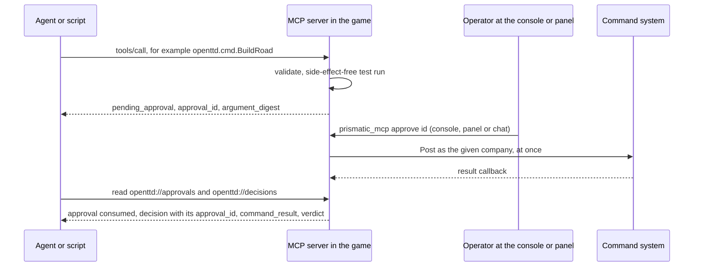

# Approval gate

**RESEARCH-ONLY.** Every change an agent asks the embedded MCP server for waits until the operator
approves it. The request is held as a pending approval bound to its exact arguments. Only after
the operator says yes does it run, and then only through the game's own command system. The
control panel can approve on the owner's behalf, but only when the owner turns on its auto-approve
switch.

## Why it exists

An agent can be wrong, can repeat itself, or can be steered by input it should not trust. A gate
keeps a person between the agent's intent and the game. It also keeps the game a valid substrate:
the change is a registered command, so a network game stays in lockstep. The real-world
counterpart is human-in-the-loop approval in automated trading (an order above a limit waits for a
desk sign-off) and in operations (a change request needs an approver before it is applied).

## How it works

- **Two phases.** A mutation never runs on its first submission. It answers `pending_approval`
  with an `approval_id` and the digest of its arguments.
- **Bound to the arguments.** The approval matches the exact canonical arguments, not only the
  64-bit digest (`detail::ClassifySubmit` in `prismatic_mcp_detail.h`). An approval for
  `pause: true` does not authorize `pause: false`.
- **Approving executes.** Since [ADR 0038](../../.ai/repo/adrs/0038-one-approval-core-plans-not-settings-every-channel-an-adapter.md)
  the approval is the execution: `ApproveById` carries the action out on the game server the
  moment the operator approves it, whichever channel the approval came through (the console's
  `prismatic_mcp approve <id>`, the panel's `POST /api/approve`, a client's chat `!approve <id>`).
  Nothing resubmits. The caller reads the outcome back: the approval's `state` in
  `openttd://approvals` (`pending`, `approved`, `denied`, `consumed`, with `expired`), and the
  decision recorded with that `approval_id` in `openttd://decisions` (`decision_id`,
  `command_result`, `verdict`, `error`).
- **One use, with a lifetime.** Executing consumes the approval. Submitting the same call again
  afterwards asks for a fresh approval, and approving that one runs the action a second time.
  Approvals expire after `APPROVAL_TTL_TICKS` and the store holds at most `MAX_APPROVALS`
  (`prismatic_mcp_server.cpp`).
- **Named ids, or the owner's filter.** The console takes `prismatic_mcp approve <id> [<id> ...]`
  and `deny <id> [<id> ...]`. Since [ADR 0041](../../.ai/repo/adrs/0041-bulk-consent-and-standing-approval-rules.md)
  it also takes `approve all|deny all [<tool-glob> [<json-matcher>]]` and standing rules (below),
  as the owner's acts: never from an armed or injected console, an MCP client or the panel's
  `/api/console` (`src/console_cmds.cpp`).
- **Through commands.** `ExecuteAction()` posts the command through the normal deterministic path,
  never a pool write (rule
  [`project.game-state-mutates-only-through-commands`](../../.ai/repo/rules/project/game-state-mutates-only-through-commands.v1.md)).
- **Honest verdict.** The answer separates dispatch from effect: `VERIFIED_SUCCESS`,
  `EXECUTED_UNVERIFIED` (ran, effect not observed, always the case for a Script API call on a
  network server) or `VERIFIED_FAILURE`. `openttd://decisions` keeps the trace.
- **What needs no approval.** Read-only tools, `openttd.decision.validate`, and an
  `openttd.api.*` call without `execute: true`, which runs in `GSTestMode` and changes nothing.

### In the control panel

The panel keeps no queue of its own: it reads the game server's (`openttd://approvals`) and shows
each pending approval with an Approve button. `/api/status` `pending` (and `status().pending` in
Rhai) lists them as `{id, tool, args, created_tick, expires_tick}`. `POST /api/approve {id}` types
the approval into the game's console, where the server executes it, and answers with the decision
the server recorded for it (ADR 0038); it resubmits nothing. `POST /api/approve` and
`POST /api/auto-approve {on: true}` need the panel's owner secret, which mcp-panel keeps in a 0600
file it names at start (never prints): the page signs the owner in once (its "Owner sign-in" box,
`POST /api/owner/login`, or one visit to `/?owner=<secret>`) and then holds the cookie
`mcp_owner_<port>` across restarts, and curl sends `X-Panel-Owner` ([mcp-control.md](../mcp-control.md#approval-is-bound-to-the-owner)).
An owner-only tool (`openttd.ai.set_settings`) is approved only at the game's console.
`POST /api/auto-approve {on}` is the owner's full-auto switch: while it is on, a loop approves the
panel's own pending requests once a second, never an owner-only one. It starts off unless the
owner passes `--auto-approve`. `POST /api/console` refuses any line that would approve, so an agent
that can type console lines still cannot approve through them (`is_approval_line`). The convention
that only the owner turns auto-approve on, never an agent on an inference, is recorded in
[`auto-approve-is-the-owners-switch`](../../.ai/repo/knowledge/curated/auto-approve-is-the-owners-switch.md).

The full contract, with every field, is
[`16-decision-contract.md`](../prismatic-mcp/16-decision-contract.md).

### Standing rules and bulk consent

The owner's order of 2026-11-23 ([ADR 0041](../../.ai/repo/adrs/0041-bulk-consent-and-standing-approval-rules.md)):
approve or deny all over a filter, and "always allow" / "always deny" rules, as Claude Code's
permission rules do.

| Console line | What it does |
|---|---|
| `prismatic_mcp approve all [<tool-glob> [<json-matcher>]]` | approves and executes every pending approval the filter selects, one id at a time; skips expired ones (and owner-only ones with `--via panel`) |
| `prismatic_mcp deny all [<tool-glob> [<json-matcher>]]` | withdraws every pending approval the filter selects |
| `prismatic_mcp rule allow\|deny <tool-glob> [<json-matcher>] [--persist]` | a standing rule: applied at once to every waiting approval, then to each new one as it is created |
| `prismatic_mcp rules` | every rule with its hits, channel and time |
| `prismatic_mcp rule remove <id>` | ends a rule (and drops it from the rules file) |

- **The glob** (`*` any run, `?` one character) matches the MCP tool name (`openttd.ai.set_setting`)
  or the action type (`ai.set_setting`, `command.BuildRailroadTrack`).
- **The matcher** is JSON over the approval's canonical arguments. A plain key is a subset match.
  A `$` key is a path (`$.a.b`, `$['a b']`, `$.list[0]`, `$.list[*]`, `$.*`, `$..name`) whose every
  selected value must match. A string is a glob (against the JSON text of a non-string), `"*"` is
  any value present, other scalars are equality, an array matches element by element. At the
  console it may be written with single quotes, `{'company': 1, 'name': 'max_*'}`, or as one quoted
  token `"{\"name\":\"max_*\"}"`.
- **Deny wins over allow.** An allow rule from the panel (`--via panel`) never decides an
  owner-only tool (`ai.set_settings`).
- **Recorded:** a decision a rule makes names it (`approved_via` / `settled_by`:
  `rule #3 allow ...`), and `DecisionTrace` prints `via=`. `openttd://approvals` and
  `openttd.ui.control` carry `rules` and each approval's `matched_rule`.
- **Lifetime:** none exists by default. A rule lives as long as the game: a new or loaded world
  ends every rule that is not persisted. With `--persist` it is kept in
  `<personal dir>/prismatic_mcp_approval_rules.<server port>.json` (mode 0600). That file is loaded
  and printed when the MCP server starts, only if it is the user's and nobody else may read it.
  A loaded rule is `created_via file` and never decides an owner-only tool.
- **Guards:**
  - An allow rule over several tools (`*`, `openttd.cmd.*`) whose matcher constrains no value
    needs `--force`, and only the console takes it (`Rules::IsBroadMatcher`, the same definition
    as the panel's `broad_matcher`). A matcher constrains no value when it is none or `{}`, or
    every entry, under any key or path, is a non-empty run of `*`, a lone `$ne`, or an object of
    the same kind: `{"company": "*"}`, `{"$.*": "*"}`, `{"x": {"$ne": null}}`. A literal, the
    empty string, any other glob, `$in`, a bound or an array narrows.
  - Removing a deny rule is refused to armed or injected input, like an allow rule.
  - Rules decide a request before the queue's cap.
- **Attended and unattended channels** (with #264). #264 holds the deadline's unattended approve
  to one company's own action for a company a registered approver played when it was asked and
  plays now (`approver_at_creation`, `ApproverPlays`). The same condition holds every other
  unattended decision: the panel's auto-approve loop (`--via auto`: per id, `approve all`, and a
  rule made via auto) and an allow rule loaded from the rules file (`created_via file`, since any
  process running as this user can write the file). Such a decision is held, reported as
  "held: no registered approver plays company N", and the load says of each file allow rule that it
  "decides only for companies a registered approver plays; remake it at the console to make it
  unconditional". A rule the owner makes at the console, in the window or through the
  owner-authenticated panel route, and an approve all from those, is the owner's explicit act and is
  not held, so it works in a local game without approver seats. Owner-only tools are never decided by
  a rule, and every rule decision records the rule and the channel it was made through.
- **For programs:** `--via panel|auto|window` names the channel. With `--nonce <n>` the console
  prints one line, `[approval-core] {"nonce", "ok", "decided": [ids], "refused": [{id, error}],
  "rejected": [{id, error}], "skipped": [{id, error}], "rule_id", "error"}`. Refused means not run
  (not pending, expired, owner-only for the channel); rejected means approved and run, but the
  command was refused, so nothing was enacted.
- **Tested end to end:** `tools/research/mcp-control-window-check`, which `tools/gate.sh research`
  runs after ctest (NOT RUN without node or a base set).

The Prismatic control window drives the same lines with `--via window`. Every row has Approve,
Deny and Always... at the same x, a check box (Shift for a range, Space on the selected row) and
Approve selected/all (confirmed with the count). There are a tool selector and Hide expired, and
after each decision the next row is selected. Keys: Up/Down or J/K move, A or Y approve,
D or N deny; only after a click in the window, a held key decides once, and for 400 ms after rows
moved by themselves nothing decides. An allow rule and a Remove are confirmed. The panel's owner
routes write the lines with `--via panel`.

### The deadline

An approval nobody answers no longer waits until it expires (`APPROVAL_TTL_TICKS`, about 3.7 game
years). In the owner's game of 2026-11-22, `replan.rhai` filed about twenty settings a month and held
every later plan while they waited, so the company stopped building. Now the server settles each
pending approval at its deadline with the operator's standing verdict. It does so on the main thread,
once a poll (`SettleDueApprovals`), and every channel sees the result, because they all read the one
queue:

| Verdict | At the deadline |
|---|---|
| `keep` (the default) | retired unanswered (`denied`, `settled_by: deadline keep`): nothing is enacted, the game keeps what it has, and the requester may ask again |
| `approve` | executed through the one execution path, recorded with `approved_via: deadline (...)` and `settled_by: deadline approve (approver in company N)`, but only when a chat approver could decide it (`detail::ChatScoped`: one company's own AI, or a company-level command) **and** a registered approver played the company it names both when it was asked and at the deadline; anything else is retired as under `keep`, with `settled_by` naming why |

`approve` stands in for the owner's own answer, so it acts only where the owner could have answered
(the owner's decision, 2026-11-23). The server derives that from facts it holds, never from names:
the approver keys (`prismatic_mcp approvers`) and the company each connected client plays
(`detail::ApproverSeats`). openttd://approvals lists the result as `approver_companies`
(`{company, client_id, key_fp}`), each approval's `approver_at_creation`, and the last changes as
`approver_events` (`joined`, `left`, `shared`), which the log repeats. An approval that names no
company is never settled by `approve`. OpenTTD admits two connections with one key, so a registered
key that two clients present at once is no approver from either of them: it has no seat, and its
`!approve` is refused (`SharedKey`), so a copied key cannot approve from a second client.

- **The default:** one game month (30 days), which is the cadence `replan.rhai` plans at, with the
  verdict `keep`. So a plan nobody answered is settled before the next one is asked for, and
  nothing is ever enacted that someone did not decide.
- **Changing it:** `prismatic_mcp approval_deadline <game days> [keep|approve]` (0 days turns the
  deadline off). With no argument the command prints the policy in force. `approve` is consent given
  in advance, so it is refused where `approve` is refused: an armed console (`PRISMATIC_MCP_INPUT=1`)
  and the panel's `POST /api/console` (`is_approval_line`). The owner types it at the server's own
  console. A dedicated server has no console of its own, so its operator gives the policy when
  starting it: `PRISMATIC_MCP_APPROVAL_DEADLINE=<days>[:keep|approve]` in the environment, read once
  at start (`detail::ParseDeadlinePolicyText`), or `mcp-e2e --approval-deadline 30:approve`. A
  malformed value keeps the default, and the log says so.
- **Where you see it:** `openttd://approvals` gives each approval its `deadline_tick` and
  `settled_by`, and the queue its `deadline` (`ticks`, `days`, `verdict`). `prismatic_mcp approvals`
  prints `deadline_tick=` on a pending row and `settled_by=` on a settled one, and the log says
  `[prismatic-mcp] deadline: ...` for each approval it settles.
- **Not yet:** a deadline tuned from data, for example from how long the owner takes to answer,
  measured in the DuckDB store. It is fixed until then.

## Where it lives

| File | What it holds |
|---|---|
| [`src/prismatic_mcp/prismatic_mcp_server.cpp`](../../src/prismatic_mcp/prismatic_mcp_server.cpp) | `ValidateAction`, the approval store, `ExecuteAction`, `Conclude`, the trace |
| [`src/prismatic_mcp/prismatic_mcp_rules.h`](../../src/prismatic_mcp/prismatic_mcp_rules.h) | the standing rules' glob, JSON matcher and paths, `Decide` (deny over allow, the owner-only guard), the console spelling |
| [`src/prismatic_mcp/prismatic_mcp_panel.cpp`](../../src/prismatic_mcp/prismatic_mcp_panel.cpp) | the control window: per-row buttons, check boxes, selectors, keyboard, Rules section |
| [`src/prismatic_mcp/prismatic_mcp_detail.h`](../../src/prismatic_mcp/prismatic_mcp_detail.h) | `ACTION_TYPES`, the pure `ClassifySubmit` state machine, the deadline's `DeadlineDue` and `ParseDeadlinePolicy` |
| [`src/console_cmds.cpp`](../../src/console_cmds.cpp) | `prismatic_mcp approvals`, `approve`, `deny`, `approve all`, `deny all`, `rule`, `rules`, `approval_deadline`, `decisions` |
| [`tools/research/mcp-rhai/src/panel.rs`](../../tools/research/mcp-rhai/src/panel.rs) | pending list, `/api/approve`, `/api/auto-approve`, the console refusal |
| [`tools/research/mcp-panel/rhai/ttd.rhai`](../../tools/research/mcp-panel/rhai/ttd.rhai) | `ttd::set_pause`, which waits for the approval and never approves itself |

## How it is tested

- Catch2 case "The approval state machine binds to canonical args, executes once, refuses replay
  and changed args" and "ArgDigest is deterministic and argument-binding" in
  [`src/tests/test_prismatic_mcp.cpp`](../../src/tests/test_prismatic_mcp.cpp), run by
  `tools/gate.sh research`. The deadline has two cases of its own: "An unanswered approval is
  settled at its deadline with the operator's standing verdict, keep by default" and "The deadline
  policy is parsed from the console's game days and verdict, and a malformed line changes nothing".
- The rules and bulk consent have their own cases there: the glob, the JSON matcher and its
  paths, "A deny rule wins over an allow rule, and an allow rule from the panel never decides an
  owner-only tool", rules applied when added and as approvals are created, approve all and deny
  all with filters, the console's spelling (an injected line approves nothing), and the control
  window's rows, selectors, bulk targets, next row and hit areas.
- `tools/research/mcp-live-check` approves and denies real mutations over HTTP.
- `cargo test` in `tools/research/mcp-rhai` covers `is_approval_line` (including the deadline's
  standing `approve` verdict) and that
  `--auto-approve` parses (`panel.rs` tests).
- `tools/research/mcp-carryout-check` checks that a planned change reaches the bot and that
  nothing is applied behind the owner's back.

## Related

- [MCP server in the engine](mcp-server-in-the-engine.md), [Control panel](control-panel.md),
  [Rail steward and monitor](rail-steward-and-monitor.md)
- [Human in the loop](../concepts/human-in-the-loop.md),
  [Deterministic lockstep](../concepts/deterministic-lockstep.md),
  [Agents and supervision](../concepts/agents-and-supervision.md)
