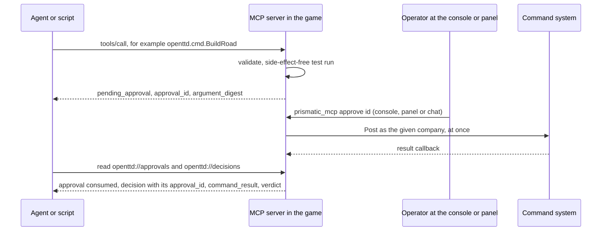

# Approval gate

**RESEARCH-ONLY.** Every change an agent asks the embedded MCP server for waits until the operator
approves it. The request is held as a pending approval bound to its exact arguments. Only after
the operator says yes does it run, and then only through the game's own command system. The
control panel can approve on the owner's behalf, but only when the owner turns on its auto-approve
switch.

## Why it exists

An agent can be wrong, can repeat itself, or can be steered by input it should not trust. A gate
keeps a person between the agent's intent and the game. It also keeps the game a valid substrate:
the change is a registered command, so a network game stays in lockstep. The real-world
counterpart is human-in-the-loop approval in automated trading (an order above a limit waits for a
desk sign-off) and in operations (a change request needs an approver before it is applied).

## How it works

- **Two phases.** A mutation never runs on its first submission. It answers `pending_approval`
  with an `approval_id` and the digest of its arguments.
- **Bound to the arguments.** The approval matches the exact canonical arguments, not only the
  64-bit digest (`detail::ClassifySubmit` in `prismatic_mcp_detail.h`). An approval for
  `pause: true` does not authorize `pause: false`.
- **Approving executes.** Since [ADR 0038](../../.ai/repo/adrs/0038-one-approval-core-plans-not-settings-every-channel-an-adapter.md)
  the approval is the execution: `ApproveById` carries the action out on the game server the
  moment the operator approves it, whichever channel the approval came through (the console's
  `prismatic_mcp approve <id>`, the panel's `POST /api/approve`, a client's chat `!approve <id>`).
  Nothing resubmits. The caller reads the outcome back: the approval's `state` in
  `openttd://approvals` (`pending`, `approved`, `denied`, `consumed`, with `expired`), and the
  decision recorded with that `approval_id` in `openttd://decisions` (`decision_id`,
  `command_result`, `verdict`, `error`).
- **One use, with a lifetime.** Executing consumes the approval. Submitting the same call again
  afterwards asks for a fresh approval, and approving that one runs the action a second time.
  Approvals expire after `APPROVAL_TTL_TICKS` and the store holds at most `MAX_APPROVALS`
  (`prismatic_mcp_server.cpp`).
- **Named ids only.** The console takes `prismatic_mcp approve <id> [<id> ...]` and
  `deny <id>|all`. There is no `approve all` (`src/console_cmds.cpp`).
- **Through commands.** `ExecuteAction()` posts the command through the normal deterministic path,
  never a pool write (rule
  [`project.game-state-mutates-only-through-commands`](../../.ai/repo/rules/project/game-state-mutates-only-through-commands.v1.md)).
- **Honest verdict.** The answer separates dispatch from effect: `VERIFIED_SUCCESS`,
  `EXECUTED_UNVERIFIED` (ran, effect not observed, always the case for a Script API call on a
  network server) or `VERIFIED_FAILURE`. `openttd://decisions` keeps the trace.
- **What needs no approval.** Read-only tools, `openttd.decision.validate`, and an
  `openttd.api.*` call without `execute: true`, which runs in `GSTestMode` and changes nothing.

### In the control panel

The panel keeps no queue of its own: it reads the game server's (`openttd://approvals`) and shows
each pending approval with an Approve button. `/api/status` `pending` (and `status().pending` in
Rhai) lists them as `{id, tool, args, created_tick, expires_tick}`. `POST /api/approve {id}` types
the approval into the game's console, where the server executes it, and answers with the decision
the server recorded for it (ADR 0038); it resubmits nothing. `POST /api/approve` and
`POST /api/auto-approve {on: true}` need the panel's owner secret, which mcp-panel keeps in a 0600
file it names at start (never prints): the page signs the owner in once (its "Owner sign-in" box,
`POST /api/owner/login`, or one visit to `/?owner=<secret>`) and then holds the cookie
`mcp_owner_<port>` across restarts, and curl sends `X-Panel-Owner` ([mcp-control.md](../mcp-control.md#approval-is-bound-to-the-owner)).
An owner-only tool (`openttd.ai.set_settings`) is approved only at the game's console.
`POST /api/auto-approve {on}` is the owner's full-auto switch: while it is on, a loop approves the
panel's own pending requests once a second, never an owner-only one. It starts off unless the
owner passes `--auto-approve`. `POST /api/console` refuses any line that would approve, so an agent
that can type console lines still cannot approve through them (`is_approval_line`). The convention
that only the owner turns auto-approve on, never an agent on an inference, is recorded in
[`auto-approve-is-the-owners-switch`](../../.ai/repo/knowledge/curated/auto-approve-is-the-owners-switch.md).

The full contract, with every field, is
[`16-decision-contract.md`](../prismatic-mcp/16-decision-contract.md).

### Plans: a re-plan settles as one

A re-planner changes several AI settings at once (`fr_from`, `fr_to`, `fr_cargo`, ...). Filed one
`openttd.ai.set_setting` each, they used to settle one by one. In run 12609 (2026-11-23), rows of
plans nine months apart completed one freight slot (#227 `fr10_to`, #460 `fr10_cargo`,
#461 `fr10_from`). The bot left its autopilot for a plan nobody had made, and its road and air
growth stopped for 17 months. Now `openttd.ai.set_setting` takes an optional `plan` id
(`detail::ValidPlanId`: 1-64 letters, digits or `._:-`), bound with the arguments:

- **All or none.** Approving or denying any row of a plan, through any channel, approves or denies
  every pending row of that plan (`ApprovePlan`, `DenyById`). Approval first checks every row
  again: not expired, and valid against the game as it is now (`ValidateAction`). When any row fails,
  the whole plan is retired with the reason (`settled_by: plan refused: ...`) and nothing of it is
  enacted. The deadline settles a plan the same way, as one.
- **A newer plan replaces the older.** The first row of a new plan withdraws every pending row of an
  older, different plan of the same company, whatever their settings (`superseded_by`).
- **A change outside any plan does not cut into one.** It is refused when a pending plan holds the
  setting it changes, and the answer names the plan to approve or deny first
  (`detail::PlanSupersedes`).
- **Filing.** `build_plan.rhai` files each re-plan under one id (`plan_id`: company, event sequence,
  game tick) through `POST /api/bots/setting {plan}`. `openttd://approvals` shows each row's `plan`.

Proof: `src/tests/test_prismatic_mcp.cpp` holds the decision table, and part 5 of
`tools/research/mcp-approval-check` holds it against a running server. On three settings of one
running AI it files plan P1 (two rows). A manual change of one of them is refused, and both rows stay
pending. Plan P2 then withdraws both of P1's rows. With the owner secret, approving one row of plan
P3 executes both, and the game reads both new values. On 2026-11-25 this passed 19/19 against a
disposable stack (`mcp-e2e --no-gui` on free ports, the panel's own owner secret file).

The design and its review are in `research/design-approval-countdown-owner-companies.md`
(branch `doc/auto-approve-owner-answer`, PR #254).

### The deadline

An approval nobody answers no longer waits until it expires (`APPROVAL_TTL_TICKS`, about 3.7 game
years). In the owner's game of 2026-11-22, `replan.rhai` filed about twenty settings a month and held
every later plan while they waited, so the company stopped building. Now the server settles each
pending approval at its deadline with the operator's standing verdict. It does so on the main thread,
once a poll (`SettleDueApprovals`), and every channel sees the result, because they all read the one
queue:

| Verdict | At the deadline |
|---|---|
| `keep` (the default) | retired unanswered (`denied`, `settled_by: deadline keep`): nothing is enacted, the game keeps what it has, and the requester may ask again |
| `approve` | executed through the one execution path, recorded with `approved_via: deadline (...)`, but only when a chat approver could decide it (`detail::ChatScoped`: one company's own AI, or a company-level command); anything wider is retired as under `keep` |

- **The default:** one game month (30 days), which is the cadence `replan.rhai` plans at, with the
  verdict `keep`. So a plan nobody answered is settled before the next one is asked for, and
  nothing is ever enacted that someone did not decide.
- **Changing it:** `prismatic_mcp approval_deadline <game days> [keep|approve]` (0 days turns the
  deadline off). With no argument the command prints the policy in force. `approve` is consent given
  in advance, so it is refused where `approve` is refused: an armed console (`PRISMATIC_MCP_INPUT=1`)
  and the panel's `POST /api/console` (`is_approval_line`). The owner types it at the server's own
  console. A dedicated server has no console of its own, so its operator gives the policy when
  starting it: `PRISMATIC_MCP_APPROVAL_DEADLINE=<days>[:keep|approve]` in the environment, read once
  at start (`detail::ParseDeadlinePolicyText`), or `mcp-e2e --approval-deadline 30:approve`. A
  malformed value keeps the default, and the log says so.
- **Where you see it:** `openttd://approvals` gives each approval its `deadline_tick` and
  `settled_by`, and the queue its `deadline` (`ticks`, `days`, `verdict`). `prismatic_mcp approvals`
  prints `deadline_tick=` on a pending row and `settled_by=` on a settled one, and the log says
  `[prismatic-mcp] deadline: ...` for each approval it settles.
- **Not yet:** a deadline tuned from data, for example from how long the owner takes to answer,
  measured in the DuckDB store. It is fixed until then.

## Where it lives

| File | What it holds |
|---|---|
| [`src/prismatic_mcp/prismatic_mcp_server.cpp`](../../src/prismatic_mcp/prismatic_mcp_server.cpp) | `ValidateAction`, the approval store, `ExecuteAction`, `Conclude`, the trace |
| [`src/prismatic_mcp/prismatic_mcp_detail.h`](../../src/prismatic_mcp/prismatic_mcp_detail.h) | `ACTION_TYPES`, the pure `ClassifySubmit` state machine, the deadline's `DeadlineDue` and `ParseDeadlinePolicy` |
| [`src/console_cmds.cpp`](../../src/console_cmds.cpp) | `prismatic_mcp approvals`, `approve`, `deny`, `approval_deadline`, `decisions` |
| [`tools/research/mcp-rhai/src/panel.rs`](../../tools/research/mcp-rhai/src/panel.rs) | pending list, `/api/approve`, `/api/auto-approve`, the console refusal |
| [`tools/research/mcp-panel/rhai/ttd.rhai`](../../tools/research/mcp-panel/rhai/ttd.rhai) | `ttd::set_pause`, which waits for the approval and never approves itself |

## How it is tested

- Catch2 case "The approval state machine binds to canonical args, executes once, refuses replay
  and changed args" and "ArgDigest is deterministic and argument-binding" in
  [`src/tests/test_prismatic_mcp.cpp`](../../src/tests/test_prismatic_mcp.cpp), run by
  `tools/gate.sh research`. The deadline has two cases of its own: "An unanswered approval is
  settled at its deadline with the operator's standing verdict, keep by default" and "The deadline
  policy is parsed from the console's game days and verdict, and a malformed line changes nothing".
- `tools/research/mcp-live-check` approves and denies real mutations over HTTP.
- `cargo test` in `tools/research/mcp-rhai` covers `is_approval_line` (including the deadline's
  standing `approve` verdict) and that
  `--auto-approve` parses (`panel.rs` tests).
- `tools/research/mcp-carryout-check` checks that a planned change reaches the bot and that
  nothing is applied behind the owner's back.

## Related

- [MCP server in the engine](mcp-server-in-the-engine.md), [Control panel](control-panel.md),
  [Rail steward and monitor](rail-steward-and-monitor.md)
- [Human in the loop](../concepts/human-in-the-loop.md),
  [Deterministic lockstep](../concepts/deterministic-lockstep.md),
  [Agents and supervision](../concepts/agents-and-supervision.md)
