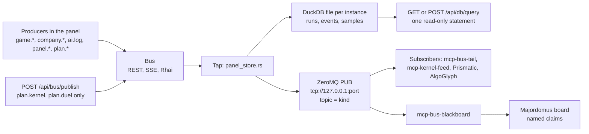

# Event bus and store

**RESEARCH-ONLY.** Every event a control panel raises goes onto one in-process bus. One tap on
that bus forwards each event, in bus order, to two sinks: a ZeroMQ PUB socket on loopback and a
DuckDB file for that panel instance. Any process on the machine can follow a game live over
ZeroMQ, and any later decision can query what earlier games recorded. A separate bridge forwards
a digest of the bus to the Majordomus board.

## Why it exists

The panel's REST and SSE feeds keep a bounded buffer and are gone when the panel stops. A duel
that lasts ten game years, a calibration across many games, or an agent in another process needs
the history, in order, after the fact. The store keeps it; the bus lets other programs react
without polling. The real-world counterpart is an event log beside an operational system: a
message bus for live subscribers plus an append-only analytic store for replay and audit.

## How it works

- **One table of kinds.** Every kind a bus carries is a row of `KINDS` in `panel_events.rs`, with
  its producer and payload. `GET /api/bus` lists the table, and a knowledge note holds it as a
  generated region
  ([`the-panel-bus-carries-these-event-kinds`](../../.ai/repo/knowledge/curated/the-panel-bus-carries-these-event-kinds.md)).
- **Envelope.** Two frames per message: the topic (the event kind, so a subscription is a kind
  prefix) and JSON of schema `prismatic-bus/v1` with `seq`, `ts_ms`, `instance`, `session`,
  `seed`, `game_tick`, `game_date`, `kind` and `data`.
- **Store.** `$PRISMATIC_STORE_DIR/<instance>.duckdb`, by default under
  `~/.local/state/prismatic-mcp/store/`, committed in batches at least twice a second. Tables:
  `runs`, `events`, `samples`. It is the cargo feature `store` and links the system libduckdb; a
  panel without it reports `"store": "off"`.
- **SQL in files.** Every statement the store runs on its own lives in
  [`tools/research/mcp-rhai/sql/`](../../tools/research/mcp-rhai/sql/README.md), one file each:
  `tables/<name>.sql`, `views/NN_<name>.sql`, `queries/<name>.sql` and `inserts/<table>.sql` (the
  writer's rows, a named parameter per column). `battle-postmortem` keeps its own under
  `sql/postmortem/`. `build.rs` embeds whatever the directories hold
  (`src/store_sql.rs`), and no Rust or Rhai code builds SQL by joining strings: every value is a
  bound parameter.
- **Analytic views.** Every time a store opens, it runs the table files and then every view file
  (`CREATE OR REPLACE VIEW`), so a changed definition reaches old files too. Each view carries its
  `COMMENT ON VIEW` and a `COMMENT ON COLUMN` for each of its columns. `GET /api/db/tables` lists
  them under `views` with their comment and columns.
  They are generic over runs: every row carries `instance` and `run_ms` (the run's start), and the
  current run is the largest `run_ms`. Read them instead of repeating their SQL. A test fails when
  this list lacks a view.

  | View | What it answers |
  |---|---|
  | `run_spans` | every run with its start and the next run's start |
  | `company_month` | each company's last sample of each game month: value, money, loan, net, vehicles and the change from the month before |
  | `game_month` | `company_month` over one game's runs: a panel restarted on a save of its own game starts a new run with a new seed, so a run continues the one before when it starts after that run's first month, at most a month after its last, with a company of the same id and name at the join; each month comes from the newest run that has it (`game_ms` names the game) |
  | `company_latest` | each company's latest month and its rank by value in its run |
  | `run_events` | every event with the run it belongs to |
  | `news` | the news the owner's window showed, one column per field (`type`, `style`, `text`, `advice`, `refs`) |
  | `advice` | the news of type advice: a lost or stuck vehicle, one that loses money, an old one, a failed order or renewal |
  | `plan_decisions` | every `plan.*` decision with its choice and version |
  | `kind_month` | how many events of each kind each game month raised |
  | `build_audit` | each company's construction audit of each game month: depots by type and whether a vehicle can drive out, duplicate depots and stations, drive-through and bay stops, defects and new defects (from `build_audit.rhai`'s `audit.<company>` writes) |
  | `service_actions` | every action a panel service took (a replan proposal or hold, a watchdog stall alert, a build_audit defect flag, a rail_monitor advice flag, a gap_watch alert), derived from its shared-memory writes, with the company's state the month before and the expected effect ([Service self-evaluation](service-self-evaluation.md)) |
| `service_eval` | every evaluation `service_eval.rhai` wrote (`eval.<service>.<action>`): verdict, counts, posterior, poor streak |
| `schema_doc` | the store describing itself: every table, view and column with its comment |

- **The store documents itself.** Every table file comments its table and each column next to
  its definition, and every view file comments its view and each column the view has. DuckDB 1.5
  takes `COMMENT ON COLUMN` on a view, and `CREATE OR REPLACE VIEW` drops it, so the comments follow
  the view in its file and are written at every open.
  An agent or a script learns the store with one query: `SELECT * FROM schema_doc` (also
  `GET /api/db/query?sql=...`). `GET /api/db/tables` reads the same comments back from the store
  (`queries/store_schema.sql`). A test fails when a file creates an object other than its name, a
  table, view or column lacks its comment, a view file lacks the comment of a column the store
  gives that view (read from `duckdb_columns()`), or `schema_doc` has a row without one.
- **Named queries.** A file in `sql/queries/` is one read-only statement with named parameters
  (`$company`), and its leading `--` lines describe it. `GET /api/db/named` lists them with their
  parameters, which come from DuckDB's prepared statement and are never declared twice.
  `POST /api/db/named {name, params}` runs one with the values bound, never pasted into the text.
  Rhai reaches both as `api_dbNamed()` and `api_dbNamedRun(#{name: "company_rank", params:
  #{company: 0}})`. `replan.rhai` reads `company_rank` and `company_trend`, `capital_watch.rhai` reads
  `capital_months` (every company's month-end net and vehicles of the current game, across its runs: `game_month`); `newest_events` is what
  `/api/db/query` answers without `?sql=`. The panel's own reads are named queries too:
  `calibration_readings` (the calibration), `duel_outcomes` (own_lines from duels),
  `kernel_window` (an action plan's books, `mcp-kernel-feed`), `company_samples` (the history a
  company offers Prismatic: its text as `samples_query`, its values as `samples_params`) and
  `event_field` (what an import already holds). A decision's `inputs.stored` names the query as
  it ran: `{query, name, params, rows}`. Across stores a query travels by name: another running
  panel answers it on its own `POST /api/db/named`. `POST /api/db/query` also takes `params` for
  an ad-hoc statement's named parameters.

- **Read-only queries.** Only SELECT, WITH, DESCRIBE, SUMMARIZE or SHOW, one statement; the
  connection also runs without external access. While the panel runs it holds the file's lock, so
  outside readers go through the route or the bus
  ([`a-running-panels-duckdb-store-is-locked-to-other-processes`](../../.ai/repo/knowledge/curated/a-running-panels-duckdb-store-is-locked-to-other-processes.md)).
- **Decisions as data.** Each planning decision publishes a `plan.*` event with
  `{decision, version, inputs: {live, stored}, choice}`, beside its prose sentence. The
  calibration reads earlier readings back from the stores; the duel driver reads its record from
  the store ([Duels](duels.md)).
- **Board bridge.** `mcp-bus-blackboard` subscribes to each panel's bus and announces one line per
  game month and the rare events as named claims `openttd:<instance>:month` and
  `openttd:<instance>:events`. It is off unless started, and never outlives what it serves: every
  subscription runs on one runtime and a panel gone from the registry is unsubscribed (ZeroMQ
  retries a dead panel forever); a Majordomus server that stops answering is retried with a
  growing wait, looked up again, and given up on after `--give-up` seconds (exit 4); `--idle-exit`,
  `--exit-with-parent` and `--pidfile` cover the rest
  ([`daemon.rs`](../../tools/research/mcp-rhai/src/daemon.rs)).
- **The hub** publishes the events it raises itself through the same sinks into a bus and store of
  its own ([Hub](hub.md)).

The endpoint, envelope, queries and subscription examples in full are in
[`../mcp-control.md`](../mcp-control.md) ("The event bus on ZeroMQ and the DuckDB store", "The bus on
the Majordomus blackboard"). The feature record is
[`event-bus-and-store`](../../.ai/repo/features/event-bus-and-store.md).

## Where it lives

| File | What it holds |
|---|---|
| [`tools/research/mcp-rhai/src/panel_events.rs`](../../tools/research/mcp-rhai/src/panel_events.rs) | `KINDS`, the `plan` payload, the external-kind check |
| [`tools/research/mcp-rhai/src/panel_store.rs`](../../tools/research/mcp-rhai/src/panel_store.rs) | the panel's tap and its read routes |
| [`tools/research/mcp-rhai/src/bus_sinks.rs`](../../tools/research/mcp-rhai/src/bus_sinks.rs) | the ZeroMQ and DuckDB sinks, the read-only guard, named queries with bound parameters |
| [`tools/research/mcp-rhai/sql/`](../../tools/research/mcp-rhai/sql/README.md) | the store's tables, views, named queries and row inserts, and battle-postmortem's statements, one file each |
| [`tools/research/mcp-rhai/src/store_sql.rs`](../../tools/research/mcp-rhai/src/store_sql.rs) | the embedded files and `Named`, a query with the values bound to it |
| [`tools/research/mcp-rhai/src/bin/mcp-bus-tail.rs`](../../tools/research/mcp-rhai/src/bin/mcp-bus-tail.rs) | a SUB client that prints envelopes |
| [`tools/research/mcp-rhai/src/bin/mcp-bus-blackboard.rs`](../../tools/research/mcp-rhai/src/bin/mcp-bus-blackboard.rs) | the digest to the Majordomus board |
| [`tools/research/mcp-rhai/src/board.rs`](../../tools/research/mcp-rhai/src/board.rs) | the board client it shares with Rhai's `board_post` |
| [`tools/research/mcp-rhai/src/daemon.rs`](../../tools/research/mcp-rhai/src/daemon.rs) | the pidfile, the watch (parent, working directory, registry), the idle clock and the backoff the bridge and the hub share |
| [`tools/research/mcp-rhai/build.rs`](../../tools/research/mcp-rhai/build.rs) | finds libduckdb, stamps the git revision, embeds `sql/` |
| [`tools/research/mcp-panel/static/data.html`](../../tools/research/mcp-panel/static/data.html), [`data.js`](../../tools/research/mcp-panel/static/data.js) | the Data page: a query, its rows, a chart |

## How it is tested

- `cargo test` in `tools/research/mcp-rhai`: `panel_events.rs` (the table is unique, no publish
  call names an undeclared kind, every kind has a producer, the knowledge note holds the table,
  only declared external kinds enter from outside), `bus_sinks.rs` (one read-only statement
  passes the guard, the envelope, events and samples go into DuckDB and come back, every SQL file
  names its object and says what it does, an insert names each column of its table, a value is
  bound and never pasted), `panel_store.rs` (a named query across stores, a locked one through
  its panel's `/api/db/named`), `battle-postmortem` (its SQLite reads and DuckDB writes) and
  `mcp-bus-blackboard.rs`; `tests/daemons.rs` runs the real bridge and hub binaries until each
  stops on its own: a server that stopped, a server moved, a parent gone, a working directory or a
  registry deleted, a panel record removed, a dead panel, and a pidfile held by a live copy.
- `tools/research/mcp-panel-check` on a running panel: the endpoint, an envelope received by
  `mcp-bus-tail`, events in the store, INSERT and a second statement refused, `plan.portfolio` and
  `plan.bot_settings` found on the bus and in the store.
- `node --test`: `data.test.mjs` and `data-page.test.mjs`; `mcp-overview-check` drives `/data` in
  a browser.

## Related

- [Control panel](control-panel.md), [Hub](hub.md), [Duels](duels.md),
  [Planner and AlgoGlyph](planner-and-algoglyph.md),
  [Majordomus supervision](majordomus-supervision.md)
- [Calibration against reality](../concepts/calibration-against-reality.md),
  [Evidence and validation status](../concepts/evidence-and-validation-status.md),
  [Agents and supervision](../concepts/agents-and-supervision.md)
- ADRs [0033](../../.ai/repo/adrs/0033-every-panel-event-goes-out-on-zeromq-and-into-a-duckdb-store.md)
  and [0034](../../.ai/repo/adrs/0034-planning-decisions-read-recorded-history-and-emit-structured.md)
