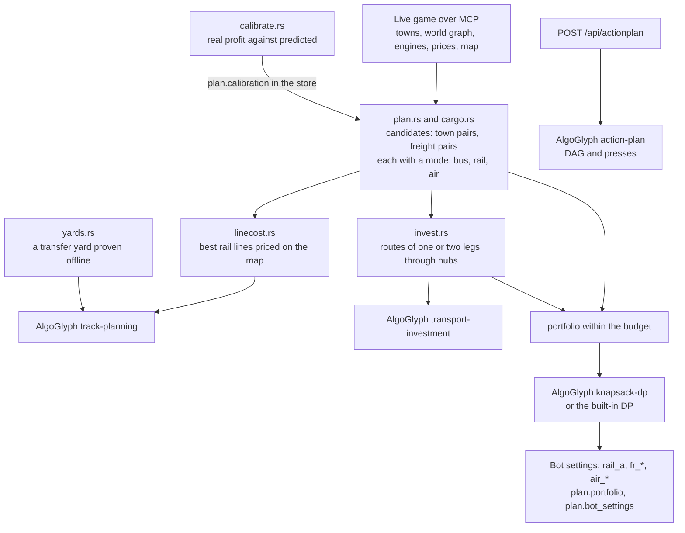

# Planner and AlgoGlyph

**RESEARCH-ONLY.** The planner decides what the owner's bot should build. It reads the live game
over MCP, prices every candidate route with the game's own payment formula and the vehicles on
offer now, and picks a portfolio within a budget. AlgoGlyph is a separate planning engine (its own
repository) whose kernels answer the hard parts: the knapsack that picks the portfolio, the rail
route on the real map, investments through hubs, and an action plan as a dependency graph. The
planner also turns a sentence from the owner into a query, and measures what running lines really
earn to correct its own predictions.

## Why it exists

A company AI that picks routes by fixed rules leaves money on the table and cannot explain why it
chose what it did. The planner makes every assumption a parameter, every price come from the
game, and every choice a recorded decision. Pricing a rail line on the real map rather than as a
straight line, and checking a prediction against what the game paid, keep the plan tied to the
world it plans for. The real-world counterpart is capital budgeting in a transport network:
candidate projects, a cost model, a budget constraint, and post-investment review.

## How it works

- **Candidates and prices** (`plan.rs`, `cargo.rs`). Town pairs and freight pairs from
  `openttd://towns` and `openttd://world/graph`, priced with the cargo payment formula cited from
  `src/economy.cpp` and vehicle speeds from `openttd://engines`. Every number is a parameter with a
  default; `?params=JSON` overrides any of them and the answer echoes the effective set.
- **Portfolio.** A 0/1 knapsack over the best option of every candidate. AlgoGlyph's `knapsack-dp`
  solves it when its runner is available, otherwise the same dynamic programme built in; the
  answer names the solver.
- **Line cost on the map** (`linecost.rs`). For the best rail candidates, AlgoGlyph's
  `track-planning` lays the route on the game's map, ways, terrain, prices and bridges. Its money
  replaces the straight-line estimate; a candidate with no route loses its rail option.
- **Transfer yards** (`yards.rs`). Before any bot builds one, the yard is proven offline: the
  better line's tiles are blocked and the second line is laid from a platform beside it.
- **Investment** (`invest.rs`). The same facts handed to `transport-investment`, which also
  considers routes through a hub, ranked by return on investment. The kernel prices routes from
  the payment formula alone, so the planner's `calibration` is applied to every route it returns:
  monthly profit scaled by the mode's ratio, the lowest one for a route of several legs, then the
  kernel's own score and ROI recomputed (`invest.rs calibrated`).
- **Action plan.** `POST /api/actionplan` turns a set of actions with dependencies into a
  validated DAG and executable steps through `action-plan`, refused if it would overdraw.
- **Calibration** (`calibrate.rs`). Running lines with a whole year of profit are matched to the
  planner's candidate for the same ends; the median ratio per mode becomes the `calibration`
  parameter. `POST /api/calibration` stores the reading as `plan.calibration`; a planned bot reads
  every stored reading back when `PRISMATIC_PLAN_CALIBRATION` is `all` or `seed` (off by default).
- **Sentences** (`intent.rs`). "find the most productive coal mine" or a Czech sentence becomes a
  query: nouns from the game's own language files, orderings nearest, most productive, most
  profitable; `POST /api/intent`, the console's `plan` verb.
- **How AlgoGlyph is reached** (`hub_algoglyph.rs`). Through its flow CLI
  (`npm run flow -- kernel <id> -`), found at `$MCP_ALGOGLYPH_DIR` or two default checkouts.
  `flow_serve.rs` keeps one long-lived `flow serve` per process when `MCP_ALGOGLYPH_SERVE` is on.
  `kernel_feed.rs` and `mcp-kernel-feed` complete a kernel's input from the store's trailing
  samples (only `action-plan` has a feed today).

The planner's model, its versions, measurements and every route are in
[`../mcp-control.md`](../mcp-control.md) (from "A route planner with modes of transport" on), and
the AlgoGlyph hub methods in [`../mcp-hub.md`](../mcp-hub.md) ("AlgoGlyph: the planning engine").

## Replanning while the game runs

The planner runs when the bot starts, and once a game month after that. The monthly run is the
panel service [`replan.rhai`](../../tools/research/mcp-panel/rhai/replan.rhai) (Scripts page, or
`POST /api/services/start {"name":"replan"}`). It composes what exists and decides nothing of
its own:

| Step | Source |
|---|---|
| The company's last four quarters: income, expenses, value, performance rating, cargo delivered, and the trend between the last two | `ScriptCompany.GetQuarterly*` through MCP |
| Its rank by value and its value change over the last six months | the store's views `company_latest` and `company_month` |
| The competition: each company's last quarter, and per transport type the profit per vehicle a year old, with the leader and this company's gap to it | the same calls, `openttd://vehicles` |
| A fresh portfolio on today's map and money | `POST /api/bots/planned` (mcp-plan, AlgoGlyph track-planning and knapsack-dp), published as `plan.portfolio` and `plan.bot_settings` |
| The chance that a new line pays | AlgoGlyph `bayes-update` on this company's own lines a year old: earned or lost |
| The months to pay back the portfolio's investment | AlgoGlyph `pert-monte-carlo`, optimistic, likely and pessimistic at the posterior's upper end, mean and lower end |
| The verdict | a switch only when the lower end is at least `MIN_PAYS` (0.5) and 80 % of the draws pay back within `HORIZON_MONTHS` (24) |
| The changes | `build_plan::apply`: only settings that differ from the bot's live ones, each approval-gated. Nothing new is proposed while an earlier change for the company still waits for the owner, or while another planner holds the company: the shared key `planner.<company>` names it (unset or `replan`: this service) |
| The record | the shared blackboard `replan.<company>` (a `rhai.shared` event, so on the bus and in the store), and a `plan` record on the Majordomus mesh when the panel has a mesh session |

The planner's call prices up to 16 rail lines with AlgoGlyph and took 3 min 10 s at load 50, so the
script raises its own HTTP timeout for that call only (`http_timeout(seconds)`, per script thread).

Run on 2026-11-22 against the seed 20261122 co-play game (8 companies). The first round, in July
1953, found company 1 2nd of 8, with income 140,440 in the last quarter (62,169 less than the
quarter before) and a rating of 360 (+107). Sindingbury Transport earned 71,323 per train and
company 1 earned 33,873; company 1 led for road vehicles and aircraft. Its record was 12 of 12
lines earning, so a new line paid with at least 0.85 at the 90 % lower bound, and 18 settings were
proposed, each waiting for approval. The round in January 1954 found the plan equal to the live
settings. <!-- open-finding kind=failed -->In that round track-planning found a route on the map for none of the 21 rail lines, so
no line went to the bot unpriced and the round held.<!-- /open-finding --> <!-- open-finding kind=not-run -->Mesh records: NOT RUN, because the panel had
no `$MAJORDOMUS_URL`.

On 2026-11-22 the first version proposed again every round. The plan's `fr*` slots changed
from round to round, so the proposals did not collapse onto earlier ones, and about 130 waited unanswered.
That is why a round now holds while anything waits.

The payback is only as good as the planner's monthly profit, and the planner over-predicts
([`the-planner-overpredicts-what-a-line-earns`](../../.ai/repo/knowledge/curated/the-planner-overpredicts-what-a-line-earns.md)).
The record-based lower bound is what discounts it.

## Where it lives

| File | What it holds |
|---|---|
| [`tools/research/mcp-rhai/src/plan.rs`](../../tools/research/mcp-rhai/src/plan.rs) | passenger candidates, the payment model, defaults |
| [`tools/research/mcp-rhai/src/cargo.rs`](../../tools/research/mcp-rhai/src/cargo.rs) | freight candidates and the portfolio knapsack |
| [`tools/research/mcp-rhai/src/linecost.rs`](../../tools/research/mcp-rhai/src/linecost.rs) | rail line cost from track-planning |
| [`tools/research/mcp-rhai/src/yards.rs`](../../tools/research/mcp-rhai/src/yards.rs) | transfer yards proven on the map |
| [`tools/research/mcp-rhai/src/sites.rs`](../../tools/research/mcp-rhai/src/sites.rs) | where a rail station and its depot can go |
| [`tools/research/mcp-rhai/src/invest.rs`](../../tools/research/mcp-rhai/src/invest.rs) | transport-investment over the live game |
| [`tools/research/mcp-rhai/src/calibrate.rs`](../../tools/research/mcp-rhai/src/calibrate.rs) | real against predicted profit, the stored readings |
| [`tools/research/mcp-rhai/src/intent.rs`](../../tools/research/mcp-rhai/src/intent.rs) | sentences to queries |
| [`tools/research/mcp-rhai/src/graph.rs`](../../tools/research/mcp-rhai/src/graph.rs) | the road network as a graph |
| [`tools/research/mcp-rhai/src/hub_algoglyph.rs`](../../tools/research/mcp-rhai/src/hub_algoglyph.rs), [`flow_serve.rs`](../../tools/research/mcp-rhai/src/flow_serve.rs), [`kernel_feed.rs`](../../tools/research/mcp-rhai/src/kernel_feed.rs) | how kernels are called and fed |
| [`tools/research/mcp-rhai/src/panel_bot.rs`](../../tools/research/mcp-rhai/src/panel_bot.rs) | the planned bot start: portfolio to settings |
| [`tools/research/mcp-rhai/src/bin/mcp-plan.rs`](../../tools/research/mcp-rhai/src/bin/mcp-plan.rs), [`mcp-intent.rs`](../../tools/research/mcp-rhai/src/bin/mcp-intent.rs), [`mcp-kernel-feed.rs`](../../tools/research/mcp-rhai/src/bin/mcp-kernel-feed.rs) | the command-line front ends |

## How it is tested

- `cargo test` in `tools/research/mcp-rhai`: tests in `plan.rs`, `cargo.rs`, `linecost.rs`,
  `yards.rs`, `sites.rs`, `invest.rs`, `calibrate.rs`, `intent.rs`, `hub_algoglyph.rs`,
  `flow_serve.rs`, `kernel_feed.rs` and `panel_bot.rs`.
- `tools/research/mcp-intent-check`: the owner's plan sentences typed into the game's console and
  answered end to end. `tools/research/mcp-carryout-check`: an answered sentence's settings reach
  the bot, through the approval gate.
- `mcp-hub intent-check`: the same sentences through the hub against every instance.
- Duels measure whether a plan wins; see [Duels](duels.md). The finding that the model
  over-predicts is
  [`the-planner-overpredicts-what-a-line-earns`](../../.ai/repo/knowledge/curated/the-planner-overpredicts-what-a-line-earns.md).

## Related

- [PrismaticAI](prismatic-ai.md), [Duels](duels.md), [Event bus and store](event-bus-and-store.md),
  [Hub](hub.md), [Rail steward and monitor](rail-steward-and-monitor.md)
- [Portfolio under a budget](../concepts/portfolio-under-a-budget.md),
  [Calibration against reality](../concepts/calibration-against-reality.md),
  [Derived, not restated](../concepts/derived-not-restated.md)
