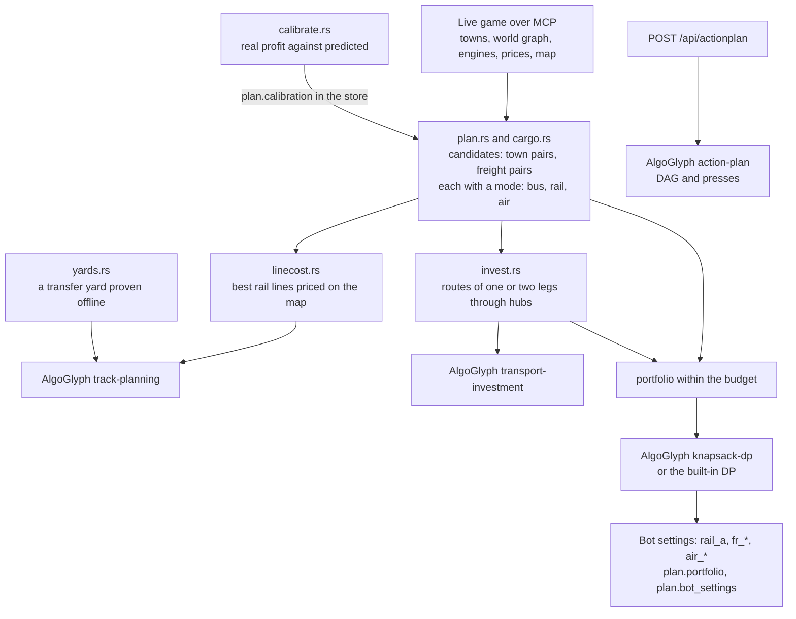

# Planner and AlgoGlyph

**RESEARCH-ONLY.** The planner decides what the owner's bot should build. It reads the live game
over MCP, prices every candidate route with the game's own payment formula and the vehicles on
offer now, and picks a portfolio within a budget. AlgoGlyph is a separate planning engine (its own
repository) whose kernels answer the hard parts: the knapsack that picks the portfolio, the rail
route on the real map, investments through hubs, and an action plan as a dependency graph. The
planner also turns a sentence from the owner into a query, and measures what running lines really
earn to correct its own predictions.

## Why it exists

A company AI that picks routes by fixed rules leaves money on the table and cannot explain why it
chose what it did. The planner makes every assumption a parameter, every price come from the
game, and every choice a recorded decision. Pricing a rail line on the real map rather than as a
straight line, and checking a prediction against what the game paid, keep the plan tied to the
world it plans for. The real-world counterpart is capital budgeting in a transport network:
candidate projects, a cost model, a budget constraint, and post-investment review.

## How it works

- **Candidates and prices** (`plan.rs`, `cargo.rs`). Town pairs and freight pairs from
  `openttd://towns` and `openttd://world/graph`, priced with the cargo payment formula cited from
  `src/economy.cpp` and vehicle speeds from `openttd://engines`. Every number is a parameter with a
  default; `?params=JSON` overrides any of them and the answer echoes the effective set.
- **Kernels by capability** (`cargo.rs` `Kernels`, I0221). The planner never calls a kernel by
  name. It names a capability (`portfolio-within-budget`, `rail-line-price`, `routes-by-return`),
  and Battlebrain's matcher picks the kernel from the catalogue the runner reports
  (`flow -- kernels` at the checkout's commit, or `mcp-plan --catalogue <file>`). The input and
  the answer go through that kernel's adapter, and the answer must pass the adapter's domain
  check. Each answer names its kernel and catalogue, and the plan's `kernels` keeps every match
  decision. With no match the call is not made, and the refusal is recorded. See
  [Battlebrain](../battlebrain/README.md#capabilities-i0098).
- **Portfolio.** A 0/1 knapsack over the best option of every candidate. The kernel that
  satisfies `portfolio-within-budget` (today `knapsack-dp`) solves it when there is a match and
  its answer passes its check. Otherwise the same dynamic programme built in decides. The answer
  names the solver, and `fallback` says why the built-in decided.
- **Line cost on the map** (`linecost.rs`). For the best rail candidates, the kernel that
  satisfies `rail-line-price` (today `track-planning`) lays the route on the game's map, ways, terrain, prices and bridges. Its money
  replaces the straight-line estimate; a candidate with no route loses its rail option.
- **Transfer yards** (`yards.rs`). Before any bot builds one, the yard is proven offline: the
  better line's tiles are blocked and the second line is laid from a platform beside it.
- **Investment** (`invest.rs`). The same facts handed to the kernel that satisfies
  `routes-by-return` (today `transport-investment`). It also considers routes through a hub,
  ranked by return on investment. The kernel prices routes from the payment formula alone, so the
  planner's `calibration` is applied to every route it returns: monthly profit scaled by the
  mode's ratio, the lowest one for a route of several legs, then the kernel's own score and ROI
  recomputed (`invest.rs calibrated`).
- **Producers another company holds, and one plan per company** (`cargo.rs` `rail_claims`,
  `panel_bot.rs` `assign_producers`). The planner applies the bot's own rule (`rail.nut`
  `ForeignRailStationAt`): a raw producer where a company has a rail station tile within 4 tiles
  of one of the producer's tiles belongs to that company. It reads this from `openttd://map` (the
  `S` tiles and their owners, the `I` tiles) and `openttd://map/ways` (a station tile with track).
  `mcp-plan --for <ids>` leaves out every freight candidate whose producer a company outside
  `<ids>` holds, before the list is cut and the best lines are priced. The plan's `claims` names
  those producers. The panel plans every running company of its AI from one answer. Each producer
  goes to one company only: the best producer to the lower id, the next best to the other
  company, and so on. A producer a company holds goes to that company. The top-level settings are
  for a company not started yet, and `bot_settings.companies` holds one plan per company.
  Two things are inferred, not read. The game serves no industry id per tile, so an industry
  tile counts for the industry whose location tile lies nearest north of it. It also serves no
  raw flag, so "raw" means "produces cargo, accepts none". The sub-tropical lumber mill, a
  processing industry that accepts nothing, therefore counts as raw. A rail waypoint counts as a
  station. Both of these errors leave a producer out, so they make the planner more careful, not less.
- **Action plan.** `POST /api/actionplan` turns a set of actions with dependencies into a
  validated DAG and executable steps through `action-plan`, refused if it would overdraw.
- **Calibration** (`calibrate.rs`). Running lines with a whole year of profit are matched to the
  planner's candidate for the same ends; the median ratio per mode becomes the `calibration`
  parameter. `POST /api/calibration` stores the reading as `plan.calibration`; a planned bot reads
  every stored reading back when `PRISMATIC_PLAN_CALIBRATION` is `all` or `seed` (off by default).
- **Sentences** (`intent.rs`). "find the most productive coal mine" or a Czech sentence becomes a
  query: nouns from the game's own language files, orderings nearest, most productive, most
  profitable; `POST /api/intent`, the console's `plan` verb.
- **How AlgoGlyph is reached** (`hub_algoglyph.rs`; I0227, ADR 0039). AlgoGlyph is the git
  submodule [`tools/research/vendor/algoglyph`](../../tools/research/vendor/algoglyph), pinned at one
  commit. Its record [`algoglyph.pin.json`](../../tools/research/vendor/algoglyph.pin.json) holds the
  commit, the kernels the stack needs and the runner's catalogue there. The pin is the only
  AlgoGlyph version the fork trusts, and
  [`tools/research/algoglyph-pin`](../../tools/research/algoglyph-pin) installs it (`install`),
  checks it (`check`) and moves it (`bump [REF]`, which stages the gitlink and the record). The
  planner's kernels run through the flow CLI (`npm run flow -- kernel <id> -`). The checkout is
  `$MCP_ALGOGLYPH_DIR` when it is set. Otherwise it is the first installed checkout cleanly at the
  pin: the submodule, else `~/dev/algoglyph-wt/main` or `~/dev/algoglyph`. mcp-e2e takes the same
  one (`algoglyph-pin runner`). The submodule's crate `algoglyph-kernels` is linked into mcp-rhai.
  Every sorting kernel of its registry that the runner does not list is a catalogue entry with
  engine `native-rust`, after the runner's entries (`algoglyph.kernels`, Rhai `kernels()`). It is
  answered in-process, not through npm (`algoglyph_native.rs`). The planner's own kernels have no
  Rust port, so they stay on the runner.
  `flow_serve.rs` keeps one long-lived `flow serve` per process when `MCP_ALGOGLYPH_SERVE` is on.
  `kernel_feed.rs` and `mcp-kernel-feed` complete a kernel's input from the store's trailing
  samples (only `action-plan` has a feed today).
- **Kept current in the background** ([Strategist and blackboard](strategist-and-blackboard.md)).
  The panel's strategist runs the same planner in process (`plan_pipeline.rs`, shared with
  `mcp-plan`) once per game month and at least every few minutes, with transport-investment,
  track-planning and town advice on a small pool of workers and one `flow serve` for the panel.
  It writes the result to the panel's blackboard (`strategy.*`) and publishes `plan.strategy`.

The planner's model, its versions, measurements and every route are in
[`../mcp-control.md`](../mcp-control.md) (from "A route planner with modes of transport" on), and
the AlgoGlyph hub methods in [`../mcp-hub.md`](../mcp-hub.md) ("AlgoGlyph: the planning engine").

## Replanning while the game runs

The planner runs when the bot starts, and once a game month after that. The monthly run is the
panel service [`replan.rhai`](../../tools/research/mcp-panel/rhai/replan.rhai) (Scripts page, or
`POST /api/services/start {"name":"replan"}`). Each round makes one plan and then goes through
every running company of its AI (`AI`). Each company gets the steps below with its own entry of
`bot_settings.companies`. A company the plan has no entry for is skipped with a line that says so.
The script composes what exists and decides nothing of its own:

| Step | Source |
|---|---|
| The company's last four quarters: income, expenses, value, performance rating, cargo delivered, and the trend between the last two | `ScriptCompany.GetQuarterly*` through MCP |
| Its rank by value and its value change over the last six months | the store's views `company_latest` and `company_month` |
| The competition: each company's last quarter, and per transport type the profit per vehicle a year old, with the leader and this company's gap to it | the same calls, `openttd://vehicles` |
| A fresh portfolio on today's map and money | `POST /api/bots/planned` (mcp-plan, AlgoGlyph track-planning and knapsack-dp), published as `plan.portfolio` and `plan.bot_settings` |
| The chance that a new line pays | AlgoGlyph `bayes-update` on this company's own lines a year old, earned or lost, kept per mode (rail, road, air, water, by vehicle type). A plan is judged by the modes of the lines it adds: a freight slot or the rail pair is rail, the air pair is air. Where it adds two modes, the weaker lower bound decides. A plan that adds no line is judged on the whole record |
| The months to pay back the portfolio's investment | AlgoGlyph `pert-monte-carlo`, optimistic, likely and pessimistic at the posterior's upper end, mean and lower end, over the monthly profit of the chosen lines (`predicted_monthly`): the plan's freight price of a line (a freight line without one is another company's and counts 0), else the planner's own monthly profit above 0 of the option it chose (the portfolio's `monthly_profit`), else this company's realised profit per vehicle of its earning lines of that mode a year old (last year's, over 12), times the vehicles the option buys (the portfolio's `vehicles`, else 1). It is the profit of a line that pays, since `bayes-update` weighs the chance that it does, and per vehicle, since a mature line's fleet is not what a new line buys. Otherwise the line counts 0. The record's `monthly_from` counts the lines priced each way, and `earned` how many earning lines of each mode a record price came from |
| The verdict | a switch only when the lower end is at least `MIN_PAYS` (0.5) and 80 % of the draws pay back within `HORIZON_MONTHS` (24) |
| The changes | `build_plan::apply_to` that company, in one call: only settings that differ from the bot's live ones, each approval-gated, after [`bot_floors.rhai`](../../tools/research/mcp-panel/rhai/bot_floors.rhai) `guard` (below). Nothing new is proposed while an earlier change for the company still waits for the owner, or while another planner holds the company: the shared key `planner.<company>` names it (unset or `replan`: this service) |
| The record | the shared blackboard `replan.<company>` (a `rhai.shared` event, so on the bus and in the store), and a `plan` record on the Majordomus mesh when the panel has a mesh session. `held` is why the round held, as text: another planner, approvals still waiting, or the model's reason. It is null when the round proposed or had nothing to change. `held_by` is the planner refusal, `record.by_mode` and `model.by_mode`/`judged_by` the per-mode record, `floors` what the guard did, and `sent` the settings filed |

The planner's call prices up to 16 rail lines with AlgoGlyph and took 3 min 10 s at load 50, so the
script raises its own HTTP timeout for that call only (`http_timeout(seconds)`, per script thread).

Run on 2026-11-22 against the seed 20261122 co-play game (8 companies). The first round, in July
1953, found company 1 2nd of 8, with income 140,440 in the last quarter (62,169 less than the
quarter before) and a rating of 360 (+107). Sindingbury Transport earned 71,323 per train and
company 1 earned 33,873; company 1 led for road vehicles and aircraft. Its record was 12 of 12
lines earning, so a new line paid with at least 0.85 at the 90 % lower bound, and 18 settings were
proposed, each waiting for approval. The round in January 1954 found the plan equal to the live
settings. <!-- open-finding kind=failed -->In that round track-planning found a route on the map for none of the 21 rail lines, so
no line went to the bot unpriced and the round held.<!-- /open-finding --> <!-- open-finding kind=not-run -->Mesh records: NOT RUN, because the panel had
no `$MAJORDOMUS_URL`.

Why none of the 21 had a route. OBSERVED: the 30 rounds of that game in the :8800 store that
priced lines on the map include only this one that found nothing; the others found 10 to 20. The
same round's `knapsack-dp` call to AlgoGlyph succeeded, so the runner worked. OBSERVED on a copy of
the game's save with its 8 AIs running: track-planning refuses an input whose openttd://map/terrain
slopes differ from openttd://map's heights ("read map and terrain at the same moment"). 3 of 400
back-to-back reads of the input from the panel had such a difference, after a terraform between the
map read and the terrain read. mcp-plan read that input once and gave it to every line, so one
refusal meant 21 refused lines. INFERRED: this is what happened in January 1954. The panel logged
only the count, so that round's refusal text was never recorded. Since then linecost.rs
`coherent_input` reads the map again after the other resources and reads the whole input again while
the heights change, up to three times. It then leaves the terrain out rather than send an input that
will be refused, and records how it read in `line_costs.input`. The panel names the reason for each
line without a route. Details are in
[`track-planning-refuses-a-map-and-terrain-read-at-different-moments`](../../.ai/repo/knowledge/curated/track-planning-refuses-a-map-and-terrain-read-at-different-moments.md).

On 2026-11-22 the first version proposed again every round. The plan's `fr*` slots changed
from round to round, so the proposals did not collapse onto earlier ones, and about 130 waited unanswered.
That is why a round now holds while anything waits.

### The plan keeps the bot's autopilot floors

PrismaticAI raises `own_lines` to 10 and `max_routes` to 30, caps `cash_reserve` at 5000, and sets
`intercity` and `self_steward` only while it has no plan (`main.nut`, `if (b.autopiloted)`). A plan
is one complete freight slot, the rail pair or the air pair. Once a re-plan gives it one, the bot
runs on its live values. In game 10487 (2026-11-23) replan filed 36 `ai.set_setting` rows on
1952-04-05 to 1952-04-07. The owner's chat approved the first. The approval deadline's standing
verdict `approve` executed the other 35 on 1952-04-12, with nobody answering. On 1952-04-15 the
heartbeat changed from `own_cap=10 ... autopilot=engaged` to `own_cap=4 ... own_lines=4
autopilot=growth-on-plan`. The 4 was the run's start string, inert while the floor applied. The
bot stayed there until the game ended in 2114, with 42 vehicles. Run 12609 did the same through
three chat approvals (#227, #460, #461) that completed slot `fr10` over nine months. No other path
handed the bot its slots. The bot started with every slot unset, and the live values of
`fr_` and `fr2_` are those of approved rows (#31 to #33, #129 to #131).

`bot_floors.rhai` is the panel's one copy of those floors. The test
`the_floors_are_main_nuts_autopilot_block` (`src/rhai_shared.rs`) reads `main.nut` and fails when
the two drift. Its `guard(live, diff)` takes the bot's line groups from the names the bot declares
(`x_from`/`x_to`/`x_cargo`, `x_a`/`x_b`), so it names no slot (rule
`project.decision-authority-boundaries` B2). It changes a plan's difference in four ways:

1. A plan never turns the autopilot off, because with it off there are no floors.
2. A line the plan touches is filed whole, so its members go through the same plan.
3. With the autopilot on, a floor key that the plan proposes is held to its floor.
4. When the bot would be planned afterwards, each declared floor key whose live value would drop
   the floor is filed at its floor in the same call. The 1952-04 plan of 10487 would have carried
   `own_lines=10`.

A bot that is already planned and has lost a floor is offered it back alone while the model holds
its new plan. An approval of the whole plan at once is the plan batch of `fix/approval-plan-batch`
(one plan id over every row of one `apply_to`). Until that lands, an approver can still pick single
rows of a plan by hand, but the deadline's `approve` executes all of them. A mode with no line a
year old starts at the prior alone, whose lower bound is below `MIN_PAYS`. So replan never proposes the
first line of a mode. The bot's autopilot builds that first line itself, as it built the trains of
10487 (a design review by codex, 2026-11-24, named this cold start).

The payback is only as good as the planner's monthly profit, and the planner over-predicts
([`the-planner-overpredicts-what-a-line-earns`](../../.ai/repo/knowledge/curated/the-planner-overpredicts-what-a-line-earns.md)).
The record-based lower bound is what discounts it.

Before 2026-11-25 the portfolio dropped the price of a chosen passenger pair, so such a line
counted 0 a month. In the owner's game 21647 (store of the :8800 panel) 2475 of 2832 replan rounds
predicted 0, so the model never ran ("no payback to model") while 11 of 12 lines a year old earned
at a company value of 44.9M (2000-09). The portfolio now keeps the planner's monthly profit and the vehicle count of each chosen
option. A line still without a price counts at the realised profit per vehicle of its mode's
earning lines. That figure comes from surviving lines a year old or more, the same survivors the
bayes-update counts, so the record's lower bound is the only discount on it; `monthly_from.earned`
shows how many lines it rests on. Two reviews named the flaws of the first version, and each is
fixed. codex (2026-11-25) named the double count of a mean that includes the losing lines, and the
dropped planner price. openttd-51 (PR #311) named four more: a mature line's whole fleet priced as
one new line, a planner price of 0 counted as priced, the option matched on mode alone, and the
missing count of lines.

## Outcome feedback

The monthly round said whether a new line pays (earned or lost), but nothing compared what the plan
predicted with what each mode really earned, or our mode mix with the leader's. With calibration
off by default, the plan kept handing the bot the modes the game paid least for.
[`outcome.rs`](../../tools/research/mcp-rhai/src/outcome.rs) closes that loop as a proposal.
`mcp-plan --outcome --for <ids>` and the panel's planned-bot path (`POST /api/bots/planned`,
which `replan.rhai` calls every month) answer `outcome.<company>` for each company of `--for`:

| Part | What it is |
|---|---|
| `modes` | Per mode, calibrate.rs's realised / predicted ratios, split by the owner of each line: ours, and every other company's. The prior is the weighted median (other companies' lines weigh 0.5), shrunk with 2 pseudo-lines toward `default`, the same median over every line. A mode with no line gets `default`, so an unmeasured mode never beats a measured one. A ratio measured against an already calibrated plan is scaled back to the model's prediction. |
| `plan.model`, `plan.outcome` | The plan's portfolio, and the same candidates and budget chosen again by the same capability (AlgoGlyph knapsack-dp, or the built-in DP labelled as the fallback). Every option's score is scaled by the prior. This is a sensitivity: fleet sizes stay as the model chose them, and the planner is not run again. |
| `mix` | Per vehicle type, our vehicles and profit per vehicle last year, and the best other company with at least 3 vehicles a year old. |
| `signals`, `verdict` | `overpredicted_mode_planned` (mismatch): the plan holds a mode whose prior is below 0.5, on at least 3 weighted lines. `outcome_plan_differs` (watch): the outcome plan holds other lines and beats the model's lines, scored with the prior, by at least 10 %. `leader_out_earns` (watch): the best other company earns at least 1.25 times ours per vehicle of a type. The verdict is `mismatch`, `watch`, `consistent`, or `insufficient` (fewer than 3 weighted measured lines). |
| `proposal` | `params.calibration` from the priors, with `applied: false`. |

The panel writes each answer to the shared blackboard as `outcome.<company>` (writer `panel_bot`),
stamped with the game's seed, date and tick and with the `plan.portfolio` it belongs to. The write
is a `rhai.shared` event, so it is on the bus and in the store, for a gap watcher and the strategy
review to read. Nothing here changes a setting, a slot or a default. Calibration stays off by
default until held-start pairs on three seeds favour it (rule `a-tuning-claim-needs-held-start-pairs`).

The seed 12609 game (PrismaticAI as company 0 against seven AIs), read on 2026-11-23 from `GET
/api/plan` and `openttd://vehicles` and assessed offline (`outcome::tests::saved`), went as follows.
Our six bus lines earned a median 6 % of their prediction and our three freight-rail lines 72 %.
Air was about right: one line of ours at 124 %, the others' five at 93 %. The plan for a 300k
budget held freight rail 1, passenger rail 2 and bus 2. With the prior (air 0.91, bus 0.16,
freight rail 0.53, rail 0.40, default 0.47), the same candidates chose freight rail 3, worth 48,114
more than the model's own lines scored the same way (196,456). The verdict was `mismatch` on the
bus mode. Company 1 earned 1.54 times ours per aircraft. Air stays out of the outcome plan because
its option is six aircraft and two airports for about 195k, scored over a 24-month payback.

When it is written: whenever the planned-bot path runs. That is the bot start when the stack plans
its bot, and `POST /api/bots/planned`, which plans also under `--no-plan-bot` and which every
`replan.rhai` round calls. Each running company of the panel's AI (`--ai`, PrismaticAI by default)
gets its key. With neither a planned start nor the replan service running, nothing writes it, and
a company of another AI or of a person gets no key. A reader treats a missing or stale key (`game`)
as "not assessed", never as "consistent".
A failed read of `openttd://vehicles` or `openttd://stations` costs only the assessment
(`outcome.why`) and its calibration (`calibration.error`), never the plan: before, it failed the
planner, and the bot started unplanned (openttd-51's review of #305). Calibration asked for by
itself (`--calibrate`) still fails on such a read.

The value of `outcome.<company>` is a contract: a gap watcher, the strategy review (ADR 0042),
a digest and the bot's self-evaluation read it. A field is added, never renamed or removed:

| Field | Type | Meaning |
|---|---|---|
| `company` | integer | the company assessed (0-based) |
| `verdict` | `mismatch` \| `watch` \| `consistent` \| `insufficient` | the overall answer |
| `why` | string | the verdict in one sentence |
| `signals[]` | `{kind, severity, why, ...}` | `kind` is `overpredicted_mode_planned` (with `mode`, `planned_lines`, `prior`, `median`, `lines.ours`, `lines.others`), `outcome_plan_differs` (with `model`, `outcome` mode mixes, `model_score_under_prior`, `outcome_score`, `gain`) or `leader_out_earns` (with `type`, `leader`, `ours`, `edge`); `severity` is `mismatch` or `watch` |
| `modes.<mode>` | `{ours: {lines, median}, others: {lines, median}, n_eff, median, prior}` | the action-outcome join per mode: our lines and the others' realised / predicted, and the prior; `modes.default` is `{n_eff, median, prior, why}` |
| `plan.model`, `plan.outcome` | `{solver, total_score, investment_k, budget_k, lines[], mix{mode: n}}`; `plan.model.score_under_prior` | the plan's portfolio and the one chosen again with the prior; `plan.rescore` says it is a sensitivity |
| `mix[]` | `{type, ours: {vehicles, counted, per_vehicle_year}, leader: {company, name, vehicles, counted, per_vehicle_year} or null}` | our fleet per vehicle type against the best other company |
| `proposal` | `{params: {calibration: {mode: factor, default}}, applied: false, how}` | what a calibrated run would use; never applied here |
| `rule`, `rule_params`, `authority` | string, object, string | how the prior is formed, its constants, and the boundary |
| `game` | `{seed, date, tick}` | the game the answer was read from: compare it before trusting the answer |
| `portfolio_seq` | integer or null | the `plan.portfolio` event it belongs to |
| `producer` | string | `mcp-plan --outcome (src/outcome.rs), via panel_bot.rs:planned` |

Why the three-seed held-start A/B of calibration averaged about zero:

- The arms barely differed. Both handed the bot the same freight lines; only the uncalibrated arm
  added a passenger-rail pair (seed 4242: `duel-20261117T215303` and `duel-20261117T215310`).
- The factors came from one reading of another game (six lines, one vehicle each), and air got
  `default` 0.37 there. This game says air is the best-predicted mode.
- They were read once at the bot start. No line is two years old in a fresh game before month 24.
- calibrate.rs pools every company's lines, and the record that the monthly round keeps counts
  lines, not money.

Open: the outcome plan is not yet a re-run of the planner with the prior (fleet sizes and the
candidate cut). `road` mixes buses and trucks. The budget is still `difficulty.max_loan`, not
money plus headroom, and the game held about 370k idle. No held-start pair has measured the proposal.

## Where it lives

| File | What it holds |
|---|---|
| [`tools/research/mcp-rhai/src/plan.rs`](../../tools/research/mcp-rhai/src/plan.rs) | passenger candidates, the payment model, defaults |
| [`tools/research/mcp-rhai/src/cargo.rs`](../../tools/research/mcp-rhai/src/cargo.rs) | freight candidates and the portfolio knapsack |
| [`tools/research/mcp-rhai/src/linecost.rs`](../../tools/research/mcp-rhai/src/linecost.rs) | rail line cost from track-planning |
| [`tools/research/mcp-rhai/src/yards.rs`](../../tools/research/mcp-rhai/src/yards.rs) | transfer yards proven on the map |
| [`tools/research/mcp-rhai/src/sites.rs`](../../tools/research/mcp-rhai/src/sites.rs) | where a rail station and its depot can go |
| [`tools/research/mcp-rhai/src/invest.rs`](../../tools/research/mcp-rhai/src/invest.rs) | transport-investment over the live game |
| [`tools/research/mcp-rhai/src/calibrate.rs`](../../tools/research/mcp-rhai/src/calibrate.rs) | real against predicted profit, the stored readings |
| [`tools/research/mcp-rhai/src/outcome.rs`](../../tools/research/mcp-rhai/src/outcome.rs) | the plan against what the game pays: owner-split priors, the outcome plan, the fleet against the leader, signals |
| [`tools/research/mcp-rhai/src/intent.rs`](../../tools/research/mcp-rhai/src/intent.rs) | sentences to queries |
| [`tools/research/mcp-rhai/src/graph.rs`](../../tools/research/mcp-rhai/src/graph.rs) | the road network as a graph |
| [`tools/research/mcp-rhai/src/hub_algoglyph.rs`](../../tools/research/mcp-rhai/src/hub_algoglyph.rs), [`flow_serve.rs`](../../tools/research/mcp-rhai/src/flow_serve.rs), [`kernel_feed.rs`](../../tools/research/mcp-rhai/src/kernel_feed.rs) | how kernels are called and fed |
| [`tools/research/mcp-rhai/src/panel_bot.rs`](../../tools/research/mcp-rhai/src/panel_bot.rs) | the planned bot start: portfolio to settings, one plan per company of the AI |
| [`tools/research/mcp-rhai/src/plan_pipeline.rs`](../../tools/research/mcp-rhai/src/plan_pipeline.rs) | one planner run, shared by `mcp-plan` and the panel's strategist |
| [`tools/research/mcp-rhai/src/bin/mcp-plan.rs`](../../tools/research/mcp-rhai/src/bin/mcp-plan.rs), [`mcp-intent.rs`](../../tools/research/mcp-rhai/src/bin/mcp-intent.rs), [`mcp-kernel-feed.rs`](../../tools/research/mcp-rhai/src/bin/mcp-kernel-feed.rs) | the command-line front ends |

## How it is tested

- `cargo test` in `tools/research/mcp-rhai`: tests in `plan.rs`, `cargo.rs`, `linecost.rs`,
  `yards.rs`, `sites.rs`, `invest.rs`, `calibrate.rs`, `outcome.rs`, `intent.rs`, `hub_algoglyph.rs`,
  `flow_serve.rs`, `kernel_feed.rs`, `panel_bot.rs` and `plan_pipeline.rs`. The rival and sibling
  claims are covered by `rail_stations_near_a_raw_producer_hold_it_for_their_company`,
  `a_plan_for_a_company_leaves_out_the_producers_another_company_holds`,
  `two_companies_of_one_ai_are_handed_different_producers_best_first` and
  `every_running_company_gets_a_plan_of_its_own`. The outcome feedback is covered by
  `the_plan_changes_toward_what_the_outcomes_pay_and_the_mismatch_is_named` (`outcome.rs`) and
  `an_outcome_assessment_becomes_a_stamped_blackboard_record` (`panel_bot.rs`). A whole `replan.rhai` round over stubbed reads
  is covered by `replan_proposes_each_company_of_its_ai_its_own_plan` (`rhai_shared.rs`).
- `tools/research/mcp-intent-check`: the owner's plan sentences typed into the game's console and
  answered end to end. `tools/research/mcp-carryout-check`: an answered sentence's settings reach
  the bot, through the approval gate.
- `mcp-hub intent-check`: the same sentences through the hub against every instance.
- Duels measure whether a plan wins; see [Duels](duels.md). The finding that the model
  over-predicts is
  [`the-planner-overpredicts-what-a-line-earns`](../../.ai/repo/knowledge/curated/the-planner-overpredicts-what-a-line-earns.md).

## Related

- [Strategist and blackboard](strategist-and-blackboard.md), [PrismaticAI](prismatic-ai.md), [Duels](duels.md), [Event bus and store](event-bus-and-store.md),
  [Hub](hub.md), [Rail steward and monitor](rail-steward-and-monitor.md)
- [Portfolio under a budget](../concepts/portfolio-under-a-budget.md),
  [Calibration against reality](../concepts/calibration-against-reality.md),
  [Derived, not restated](../concepts/derived-not-restated.md)
