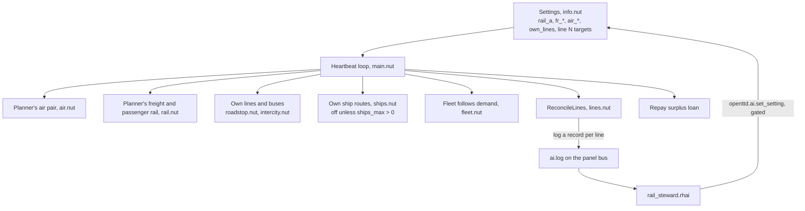

# PrismaticAI

**RESEARCH-ONLY.** PrismaticAI is the owner's company AI: a Squirrel script that OpenTTD loads like
any AI from BaNaNaS and that plays one company. It builds bus routes, intercity roads, airports,
freight rail and passenger rail, and, behind the setting `ships_max` (off by default), ship routes. What it builds first comes from its settings, which the control
panel fills from the planner's portfolio. Its rail lines are kept as desired state that an outside
steward sets and the bot reconciles. It is content, not engine code: no CMake option builds or
ships it, and it stays out of the `bin/ai/` folder upstream ships.

## Why it exists

The planner decides; something in the game has to carry the decision out with the game's own
rules. An AI script is the game's supported way to act as a company: it issues the same commands a
player issues, through the Script API, so it needs no special access and stays deterministic. Its
settings are the steering wheel from outside, and because they are `CONFIG_INGAME`, a change
reaches a running bot through `openttd.ai.set_setting`, which waits for the owner's approval. The
real-world counterpart is an execution agent under a planning system: the planner sets targets, the
agent executes them on the ground and reports back.

## How it works

- **Heartbeat** (`main.nut` `Start`). Every round reads the settings again (`Behaviour`), then:
  the planner's air pair, freight lines (`fr_*` to `fr16_*`) and passenger rail first, then the
  bot's own lines and buses, the fleet, line reconciliation and the loan. Old vehicles are renewed
  by the game's own autorenew.
- **Rail a train can always run** (`rail.nut`). No 90-degree turn anywhere (`Turns90`, because
  `pf.forbid_90_deg` is on by default). Termini with two platforms joined by a throat with path
  signals. A terminus takes the catching site with the most cargo on the axis toward the other end,
  then on the other axis, then with its exit reversed: flat land first, then sloped land on
  foundations where `construction.build_on_slopes` allows it, and a levelled site last
  (`BuildRailStationAt`). A line search gets a node budget by its distance (`RAIL_NODES_PER_TILE`), so one that
  cannot succeed stops instead of trying every tile it can reach. The laid line is walked (`VerifyRailLine`) before a
  train is bought. The depot stands
  behind a platform. Platform length and wagons follow demand (`PlatformPlan`).
- **Road stops and depots a bus can always use** (`roadstop.nut`). A stop is drive-through on a
  straight road first, and a bay only where no such road is near. A road depot is reused when it
  lies on the road network of the stop it serves. A new depot faces only a road piece reachable
  from that stop (one `RoadReach` walk answers every candidate) and never stands beside another
  depot (`DepotBeside`), so its exit leads onto the route.
- **Lines as desired state** (`lines.nut`). Each line has a slot and logs a record
  (`PrismaticAI: rail line <slot>: label=...|a=...|...|state=...`) when built and every game month.
  The settings `line<N>_trains` and `line<N>_wagons` are targets; the bot clones, resizes, sells, or
  closes a line to match, removing only what the line owns: its track (a level crossing keeps its
  road), its own platforms (`AIRail.RemoveRailStationTileRectangle`, never a whole joined station)
  and its throats and depot. The bot never decides there; it reconciles.
- **Ships, off by default** (`ships.nut`, setting `ships_max`). The planner has no water mode, so
  the bot plans its ship routes itself, the way it plans its own freight lines: oil rigs (which
  hand their oil only to their own station and have no land for rail) and coastal producers to an
  acceptor by the sea, and pairs of coastal towns, ranked by estimated yearly profit. The best few
  are checked on the map before anything is built: a dock site at each end, tested with
  `AITestMode`, and an A* over water (`AIMarine.AreWaterTilesConnected`) between the docks. Then
  come the docks, a ship depot and the ships. From there `fleet.nut` runs them like road and air
  routes (adds, sells, invests, finds their depot). A shore tile that is not yet the one inclined
  slope a dock needs is levelled towards the water first (after AAAHogEx). Rivers are not used:
  they are one tile wide, and AAAHogEx digs canals there. First headless runs (2026-11-22, 10
  years, `battle.py ablate`, against AAAHogEx and AdmiralAI): on OpenTTD seed 930967890 the bot
  built 3 ferry routes and ran 4 ships that earned 8,680 in 1968 and 5,576 in 1969 together, far
  below its estimate. On seed 178496673, where AAAHogEx ran 18 ships, every candidate stood by a
  river and none was built. The value difference between the two variants on the same seed
  (+38%) came from different timing of everything else, not from the ships.
- **Events are read, and vehicles that cannot earn are dealt with** (`events.nut`). Each heartbeat
  drains the game's events. A lost vehicle's line is checked with the builders' own checks
  (`VerifyRailLine` lays a missing piece again, `RailWalk` follows the track from one station to
  the other, `RepairDepot` joins or rebuilds the depot); a train whose line cannot be repaired is
  sold and the line gets no new train until a monthly walk finds it whole; a line whose trains get
  lost on a track that does join its stations takes no new train either. A losing vehicle on a
  broken route is sold; on a whole one the fleet's two-year rule and the steward judge it. Once a
  month a vehicle stopped in a depot with no orders gets a line's orders or is sold.
- **Every build step checks the game's answer.** A step that fails is logged and skipped; the
  API's return values are the source of truth (header of `main.nut`).
- **Air yield per plane** (`fleet.nut` `AirReport`, `AirRouteHasDemand`; `autopilot.nut`
  `BestAirPair`). Once a game year the bot logs each air route's planes, distance, airport types
  with the routes at each, engines and last year's profit per plane, then the company's total
  (`PrismaticAI: air report`), with how full the flying planes are, so a match log measures air
  income per aircraft. The setting `air_add_full` lets one more plane call at an airport of ours
  only while the planes flying from it are that full. The reason and the measurements are in
  [Air yield per aircraft](#air-yield-per-aircraft) below.

Install, the settings table and the rail rules in full are in
[`tools/research/prismatic-ai/README.md`](../../tools/research/prismatic-ai/README.md); the rail
reasoning is in [`../rail-steward.md`](../rail-steward.md).

## Air yield per aircraft

Measured on 2026-11-22 in the owner's co-play game (seed 20261122, the 1979 save
`coplay-deploy-1626.sav`, read through `GET /api/resources/vehicles` and `/stations` of the panel
on :8800), aircraft a year old or more, profit last year:

| Company | Planes | Airports | Routes per airport | Planes per airport | Mean distance | Flying full | Broken down now | Profit a plane |
|---|---|---|---|---|---|---|---|---|
| PrismaticAI (company 0) | 50 | 9 | 7-8 | 7-13 | 171 tiles | 56% | 9 | 22,507 |
| AAAHogEx (company 1) | 42 | 22 | 1 | 1-8 | 217 tiles | 89% | 0 | 85,094 |

Both fly the Bakewell Luckett LB-9 (38 of AAAHogEx's 39 judged planes, all 48 of ours), so the
engine is not the gap. The bot's 50 planes fly 35 routes, a full mesh between 9 airports. The
other PrismaticAI companies in that game show the same shape (5, 6 and 7: 4-6 airports, 18-32
planes, 21-29k a plane). Under the default manual cargo distribution a passenger at a hub boards
whichever plane comes first. A new route from a hub therefore adds a plane that shares that
airport's passengers with every route already there, and it is paid for a shorter trip. Planes
came from three places that never asked whether the existing planes were full:
`InvestSurplus` (the route's average profit per plane), fleet growth (20 passengers waiting,
`air_add_waiting`), and new autopilot routes from airports we already had (`air_reuse`, which
rich growth switches on).

A headless match shows the same thing over time (`battle.py ablate`, OpenTTD seed 31337,
1960-1970, against AAAHogEx and AdmiralAI, default settings, from the bot's air report). Air
profit was 389k a year with 10 planes in 1963. By 1968 it was 250k with 49 planes on 19 routes,
5.6k a plane. The planes added after 1963 lowered the total.

The first measure tried was waiting passengers (`air_add_loads`, a full plane load waiting at
every airport of the route). On the same seed it held the bot at 4 planes, flying 47k a plane in
1970 against the default's 7.6k, but cost 39.8% of company value (3.88M against 6.43M). On seed
930967890 both variants flew one plane and ended within 1.8%. A station's rating keeps fewer
passengers waiting than one 200-seat plane takes, so the gate shut too early, and that measure was
dropped. `air_add_full` asks instead how full the planes flying from the airport are now
(`AirLoadPercent`, running planes only). Ablation on 2026-11-22, 10 years from 1960, against
AAAHogEx and AdmiralAI, one replay per seed (single replays are chaotic, knowledge
`a-bot-change-that-moves-money-in-every-game-replays-as-chaos`):

| Seed | Variant | Company value | Planes at the end | Profit a plane-year, last 3 reports |
|---|---|---|---|---|
| 31337 | default (`air_add_full=0`) | 6,753,676 | 51 | 7,228 |
| 31337 | `air_add_full=60` | 5,129,113 (-24.1%) | 13 | 24,524 |
| 31337 | `air_add_full=80` | 4,482,365 (-33.6%) | 9 | 24,979 |
| 1383023900 | default | 6,265,670 | 32 | 6,168 |
| 1383023900 | `air_add_full=60` | 3,905,034 (-37.7%) | 5 | -558 |
| 1383023900 | `air_add_full=80` | 3,001,047 (-52.1%) | 6 | -1,494 |
| 930967890 | default | 2,070,699 | 1 | 1,331 |
| 930967890 | `air_add_full=60` and `=80` | 2,109,608 (+1.9%) | 0 | none flew a year |

The gate raised profit per plane on seed 31337 by a factor of 3.4, but it lowered company value on
both seeds where the bot flies. In these 1960s matches the planes flew 1-26% full at the yearly
report. Every plane added still earned a few thousand a year. The money the gate kept back stayed
in the bank, where it earns nothing, so cutting planes cut value. Profit per plane is therefore not
the measure to optimise while money lies idle. The default stays 0 (off). `air_add_full` is a gene
of the battle's GA (`battle.json` `tuning`) so that the GA can search it. Not measured: a later
start year with bigger towns, like the 1979 co-play game, where planes fly 56% full; where the
planes should go instead (fresh town pairs against more hub routes); and the 9 of 50 planes broken
down in the co-play game.

## Road and air yield

Measured on 2026-11-22 with `battle.py ablate`, six years from 1950, the live game's settings
(the `live=` string of that day: `air_routes_max=2`, `invest_air_cap=10`, `invest_road_cap=12`,
`invest_ppv_div=6`, `max_routes=30`), against AAAHogEx, LuDiAI AfterFix, CivilAI and AdmiralAI,
one binary (`build/openttd` sha1 `94de29ae5b`) for both trees. Each row is a **single match**,
not a held-start pair (rule `project.a-tuning-claim-needs-held-start-pairs`), so the table is
evidence for the mechanism, not a tuning claim. Values are the referee's REF Q line of 1956-01.

| Seed | Tree | Company value | Road vehicles | Road profit/yr | Planes | Air profit/yr | Rail profit/yr | Money | Our value / AAAHogEx's |
|---|---|---|---|---|---|---|---|---|---|
| 15805 | master | 810,604 | 26 | 11,500 | 15 | 122,842 | 227,908 | 22,624 | 23.8% |
| 15805 | yield | 1,067,159 (+31.6%) | 15 | 6,040 | 14 | 159,569 | 245,768 | 267,062 | 22.6% |
| 2927 | master | 1,491,647 | 32 | 6,472 | 16 | 182,228 | 388,189 | 732,594 | 23.9% |
| 2927 | yield | 1,807,500 (+21.2%) | 4 | 4,507 | 29 | 374,407 | 367,812 | 834,612 | 40.4% |
| 31337 | master | 2,147,290 | 35 | 12,581 | 18 | 171,057 | 427,666 | 1,394,490 | 49.4% |
| 31337 | yield | 2,362,747 (+10.0%) | 3 | 1,662 | 36 | 399,847 | 571,836 | 862,040 | 86.2% |
| 4242 | master | 2,183,221 | 36 | 15,141 | 18 | 196,011 | 510,339 | 1,437,029 | 45.7% |
| 4242 | yield | 1,897,566 (-13.1%) | 15 | 18,174 | 25 | 365,615 | 259,648 | 744,945 | 58.0% |

Geometric mean +11.1%. Air profit rose on every seed (1.3x to 2.3x). On seed 4242 the loss is
rail: the bot's own freight lines picked other industries (lines 3, 5 and 6 differ, and 10
attempts were refused against master's 4), which the yield change does not decide but shifts in
time; such shifts are the chaos of single replays (knowledge
`a-bot-change-that-moves-money-in-every-game-replays-as-chaos`). AAAHogEx's own value differs
between the two trees' games for the same reason.

What the logs showed on master: `InvestSurplus` took the first air route of seed 15805 from 5
planes earning 106,795 a year to 6 earning 87,026 and on to 10 planes, and added buses earning
951 to 2,790 a year each; the heartbeat built 14 to 23 bus routes a game. The yield tree's road
report shows why buses do not pay: a bus inside one town (10-11 tiles between its stops) earned
38 to 536 a year on a price of 4,921, an intercity bus (26-52 tiles) 460 to 3,048.

The fitness check (`battle.py fitness`, seed 930967890, from 1960, default settings) passes on
both trees, with mixed values: -6.2%, +28.0%, +62.3%, -4.4%, -8.9% and -29.0% for its six
PrismaticAI contestants (geometric mean +3.1%). On that map our planes fly 2-8% full and lose
money in some years. master kept adding planes and held 0.88M; the yield tree added none and held
1.46M idle by 1966. Company value counts a vehicle at its depreciated price, so on a map where
nothing earns, a vehicle bought with idle money still raises value at the six-year mark.

Measured afterwards on 24 replayed 20-year arena matches (`battle.py ablate --match`, four editions,
matches 6 to 36, 2026-11-23): #243 as merged (`f8cf1beade`) replayed at -22.6% geometric against
`dbd39147ee` (4 of 24 better), with 219 planes against 488 and 715 road vehicles against 902. On
`11411cdc4d`, `load_add_min=0` replayed at +29.6% against 50 (22 of 24 better, 0.88 to 2.03, 332
more planes); `load_add_min=0` with `road_yield=0` at +21.3% (20 better). So `load_add_min` is 0 by
default and `road_yield` stays at 20. Not measured: held-start pairs; `road_probes` and
`air_yield_routes` alone.

## Where it lives

| File | What it holds |
|---|---|
| [`PrismaticAI/info.nut`](../../tools/research/prismatic-ai/PrismaticAI/info.nut) | name, API version, every setting |
| [`PrismaticAI/main.nut`](../../tools/research/prismatic-ai/PrismaticAI/main.nut) | the heartbeat and the starter route |
| [`PrismaticAI/rail.nut`](../../tools/research/prismatic-ai/PrismaticAI/rail.nut) | termini, the A* line search, laying, the walk check, depots, trains |
| [`PrismaticAI/lines.nut`](../../tools/research/prismatic-ai/PrismaticAI/lines.nut) | line slots, the record, `ReconcileLines` |
| [`PrismaticAI/events.nut`](../../tools/research/prismatic-ai/PrismaticAI/events.nut) | the game's events: lost and unprofitable vehicles, line repair, vehicles with no orders |
| [`PrismaticAI/fleet.nut`](../../tools/research/prismatic-ai/PrismaticAI/fleet.nut) | road, air and ship capacity from waiting cargo and the link graph; the yield gates (`RouteLoad`, `RoadPays`) and the road report |
| [`PrismaticAI/ships.nut`](../../tools/research/prismatic-ai/PrismaticAI/ships.nut) | ship routes behind `ships_max`: candidates, dock sites, the water path check, docks, depot, ships |
| [`PrismaticAI/roadstop.nut`](../../tools/research/prismatic-ai/PrismaticAI/roadstop.nut), [`intercity.nut`](../../tools/research/prismatic-ai/PrismaticAI/intercity.nut), [`air.nut`](../../tools/research/prismatic-ai/PrismaticAI/air.nut) | bus stops and depots, intercity roads, airports |
| [`install`](../../tools/research/prismatic-ai/install) | links the bot into the personal `ai/` folder; `--check` verifies it |
| [`tools/research/mcp-rhai/src/panel_bot.rs`](../../tools/research/mcp-rhai/src/panel_bot.rs) | the panel side: planned start, settings, running bots |

## How it is tested

- There are no unit tests of the Squirrel code. It is exercised by games.
- `tools/research/mcp-duel --months 12 --seed 4242` plays a game with the bot against an
  unplanned copy of itself or another AI ([Duels](duels.md)); the records are under
  [`research/results/`](../results/).
- `cargo test` in `tools/research/mcp-rhai` runs the Rhai side that reads the bot's records
  (`rail_*` tests on fixtures in `main.rs`).
- `tools/research/prismatic-ai/install --check` exits 0 when the game loads this checkout's bot.
- `tools/research/mcp-carryout-check` checks that proposed settings reach the running bot only
  through the gate.

## Related

- [Planner and AlgoGlyph](planner-and-algoglyph.md),
  [Rail steward and monitor](rail-steward-and-monitor.md), [Duels](duels.md),
  [Approval gate](approval-gate.md)
- [Desired-state reconciliation](../concepts/desired-state-reconciliation.md),
  [Deterministic lockstep](../concepts/deterministic-lockstep.md),
  [Human in the loop](../concepts/human-in-the-loop.md)
- Knowledge
  [`rail-lines-a-train-can-turn-on`](../../.ai/repo/knowledge/curated/rail-lines-a-train-can-turn-on.md),
  [`the-bots-rail-pathfinder-lays-plain-track-only`](../../.ai/repo/knowledge/curated/the-bots-rail-pathfinder-lays-plain-track-only.md)
