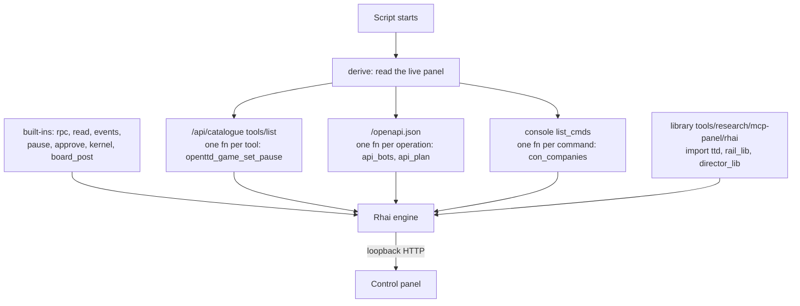

# Rhai scripting

**RESEARCH-ONLY.** [Rhai](https://rhai.rs) is a small embedded scripting language for Rust. Here it
is the language for scripts that drive a running game from outside: `mcp-rhai` runs a script
against a control panel, the panel runs scripts in its own process, and the panel's Scripts page
edits them and runs them as background services that reload when their file changes. A script
gets one function per MCP tool, per panel route and per console command, derived from the live
game when it starts.

## Why it exists

Driving a game through raw JSON-RPC or curl is slow to write and easy to get wrong. A scripting
layer lets the owner and agents write a whole game, a narrator, a steward or a monitor in a few
dozen lines. Deriving the functions from the live catalogue means a tool or route added to the game
or panel is callable from Rhai without editing the host. A script talks to the panel's loopback
API, so it never sees the MCP bearer token. The real-world counterpart is the scripting console of
an operations or automation platform (runbooks as code), whose bindings follow the platform's API.

## How it works

- **Built-ins.** `rpc`, `read`, `overview`, `status`, `console`, `pause`, `approve`,
  `auto_approve`, `events`, `mcp_call`, `mcp_read`, `world_plan`, `world_graph`, `kernel`,
  `kernels`, `board_post`, `build_audit` (the construction rules of `hub.audit`, pure over
  `read()` answers), `loopback_get` (JSON from a loopback URL only: no other host, no
  userinfo, no redirects), `env`, `sleep`, `to_json`, and `tools()`, `commands()`, `help()` to list
  what was derived (header of `main.rs`).
- **Derived functions** (`derive` in `main.rs`): a tool name with dots turned into underscores, an
  `api_<operationId>` per operation of the panel's OpenAPI document (streaming routes left out), a
  `con_<name>` per console command. With `--hub URL`, one `hub_<method>` per hub method.
- **The library.** `import "ttd" as ttd;` loads `ttd.rhai`, the high-level commands. Its
  `set_pause` waits for the operator's approval and never approves itself. `$MCP_RHAI_PATH`
  overrides the folder.
- **In the panel.** `POST /api/rhai` and `POST /api/rhai/stream` run a script in the panel's
  process, in the same engine (`host` in `main.rs`, compiled into `mcp-panel` as `rhai_host`).
- **The Scripts page.** `/scripts` lists every `.rhai` file with its header comment, imports and
  importers. The editor checks the text with the Rhai parser as you type; Save writes only text that
  parses (otherwise 422), in place, so the diff shows it and committing stays the owner's. A script
  can run once (streamed) or as a service. A watcher looks every second
  (`RELOAD_EVERY`) and restarts a service whose own file or any imported library changed; a change
  that does not parse leaves the old run going and says why in its log.

The scripts in the library today:

| Script | What it does |
|---|---|
| [`ttd.rhai`](../../tools/research/mcp-panel/rhai/ttd.rhai) | high-level commands: state, new game, start an AI, gated pause, report, watch |
| [`demo.rhai`](../../tools/research/mcp-panel/rhai/demo.rhai), [`full_game.rhai`](../../tools/research/mcp-panel/rhai/full_game.rhai) | a game driven from a new world to a final report |
| [`rail_lib.rhai`](../../tools/research/mcp-panel/rhai/rail_lib.rhai), [`rail_steward.rhai`](../../tools/research/mcp-panel/rhai/rail_steward.rhai), [`rail_monitor.rhai`](../../tools/research/mcp-panel/rhai/rail_monitor.rhai) | rail lines as data, the steward, the monitor ([Rail steward and monitor](rail-steward-and-monitor.md)) |
| [`advice_lib.rhai`](../../tools/research/mcp-panel/rhai/advice_lib.rhai) | the game's advice news (`news.shown` with `advice`) as data: grouped by advice and vehicle, joined with the vehicle's line, tallied per company; `rail_monitor.rhai` reacts to them with `advice.<company>` on the shared blackboard, a mesh `observation` and a chat line for the owner, and issues no command ([The game's advice](../rail-steward.md#the-games-advice)) |
| [`director_lib.rhai`](../../tools/research/mcp-panel/rhai/director_lib.rhai), [`director.rhai`](../../tools/research/mcp-panel/rhai/director.rhai) | moves the owner's camera to where the bot works |
| [`narrator.rhai`](../../tools/research/mcp-panel/rhai/narrator.rhai) | reports the bot's actions as in-game chat |
| [`prismatic_tune.rhai`](../../tools/research/mcp-panel/rhai/prismatic_tune.rhai) | keeps the live PrismaticAI on the battle GA's best measured settings, each change approval-gated ([Battle brain and live tuner](../battle-brain.md)) |
| [`arena.rhai`](../../tools/research/mcp-panel/rhai/arena.rhai) | keeps the LAN battle's contestants playing in the live game; editing its lineup changes the game live ([Live arena](../live-arena.md)) |
| [`steward.rhai`](../../tools/research/mcp-panel/rhai/steward.rhai) | the bot asks the owner yes/no questions in the game |
| [`ask_relay.rhai`](../../tools/research/mcp-panel/rhai/ask_relay.rhai), [`build_plan.rhai`](../../tools/research/mcp-panel/rhai/build_plan.rhai) | answers "Ask the planner..." requests; carries out a planned sentence |
| [`build_audit.rhai`](../../tools/research/mcp-panel/rhai/build_audit.rhai) | once a game month judges every company's construction (depots without an exit, duplicate depots and stations, drive-through against bay stops) and keeps it in the shared key `audit.<company>` and the store's view `build_audit`; one chat line for a new defect of the owner's company ([Hub](../mcp-hub.md#no-duplicate-buildings)) |
| [`replan.rhai`](../../tools/research/mcp-panel/rhai/replan.rhai) | re-plans the running bot every game month: trend, competition, the planner's portfolio, a modelled switch, approval-gated changes ([Planner and AlgoGlyph](planner-and-algoglyph.md#replanning-while-the-game-runs)) |
| [`watchdog.rhai`](../../tools/research/mcp-panel/rhai/watchdog.rhai) | finds a company that has built or bought nothing for longer than a threshold tuned from the game's own data, and says what holds it ([The progress watchdog](#the-progress-watchdog)) |
| [`gap_watch.rhai`](../../tools/research/mcp-panel/rhai/gap_watch.rhai) | once a game month judges every PrismaticAI company against the leader (share of its value, idle cash, unused credit, plans that do not land, collateral damage) from replan's and watchdog's keys, the store and the bus; tells the owner, and, only with the owner's switch, files one owner-only `openttd.ai.set_settings` ([The leader-gap watch](#the-leader-gap-watch)) |

Usage and the built-in list in full: [`../mcp-control.md`](../mcp-control.md) ("Rhai"), and the
Scripts page in [`../rail-steward.md`](../rail-steward.md) ("The Scripts page").

### The progress watchdog

No company should go for long without building or buying anything while nobody knows why. In the
owner's game of 2026-11-22, company 1 kept 32 vehicles from 1952-07 to 1953-08 while twenty approvals
waited. [`watchdog.rhai`](../../tools/research/mcp-panel/rhai/watchdog.rhai) runs as a panel service
(`POST /api/services/start {"name":"watchdog"}`) and looks every 20 s:

- **Progress** is a change in a company's vehicles by type or in its stations
  (`openttd://companies` `fleet`, `openttd://stations` `owner`). The game days since the last change
  (`game_tick` / 74) are its quiet time.
- **The threshold is derived from the game's own data.** Every quiet time that ends, for any
  company, is kept on the blackboard (`watchdog.tuning.gaps`, the last 64). The threshold starts at
  7 game days (the owner: "zacneme treba tyden"). Once there are 5 quiet times, it is 1.5 times their
  90th percentile, kept within 7 to 365 days. On the live game it went from 7 to 21 days after ten
  quiet times.
- **A stalled company is told why**, from what the panel reports:
  - the approvals pending for it (`status().pending`),
  - replan's hold (`replan.<company>.held`),
  - its money against the bot's `line_budget`,
  - every service that the panel's supervisor reports `stalled` or `gave_up` (`api_services()`).
  If none of these applies, it says so: the bot chose to build nothing.
- **Where it goes:** the blackboard key `watchdog.<company>` (`signature`, `since_day`,
  `quiet_days`, `threshold_days`, `stalled`, `reasons`), which reaches the bus and the DuckDB store
  as a `rhai.shared` event. When the owner's company becomes stalled, one chat line goes out, once
  per stall.
- **It changes nothing in the game.** A waiting approval is settled by the server's deadline
  ([Approval gate](approval-gate.md)), never here. The file's first line, `// stall: 180`, tells the
  panel's supervisor how long the service may stay quiet before it is restarted.

### The leader-gap watch

replan and watchdog measure, and nothing reacted to what they found: in the owner's game of
2026-11-22, our share of the leader's value fell, the bot repaid its whole loan while the leader kept
290k borrowed, and our aircraft were capped at two routes while the leader earned most of its lead
with aircraft ([control-loops audit](../control-loops-audit.md)).
[`gap_watch.rhai`](../../tools/research/mcp-panel/rhai/gap_watch.rhai) closes that loop as a panel
service (`POST /api/services/start {"name":"gap_watch"}`). It re-runs no analysis another service
does:

- **It reads** `replan.<company>` (our value, the competitors' values, the leader per transport
  type), `watchdog.<company>` (the stall), the store's named query `company_samples` (each month's
  value, money, loan and vehicles of us and of the leader), and the panel bus after a cursor
  (`game.month` events mark the months, since `/api/events` envelopes carry no game date; the
  bot's own lines about refused, failed or removed builds, levelling paid for nothing, loan repaid,
  producers held by others; the approvals filed for the company and the decisions executed). It
  reads no game resource on its own cadence; `openttd://approvals` only when it files a proposal.
- **Once a game month** it sets flags, each with its reason: `losing_ground`, `idle_capital` (cash
  above the reserve), `unused_credit` (loan below the highest seen while the leader borrows),
  `stalled`, `plans_not_landing`, `collateral`, `replan_silent` and `unknown` (missing inputs are
  never "on track"). It keeps how many months in a row each flag held, and after a restart it
  skips the months the replayed bus shows that it judged already.
- **It acts through the existing channels only:** the blackboard key `gap.<company>` (on the bus
  and in the store); one console line and one news item when a flag has held two months or the
  level rises; and, only when the panel runs with `GAP_WATCH_PROPOSE=1` (the owner's switch), one
  `openttd.ai.set_settings` approval carrying every lever. That tool is owner-only: its approval is
  typed at the game's console. The deadline policy that settles it is read from
  `openttd://approvals`, never assumed.
- **A lever** restores a setting the bot declares toward its declared default (`invest_borrow` to
  1), within its declared range, after its flag held three months, and only where the competition
  shows the leader ahead in that transport type and ours earning. `air_grow_money` moves only from
  0, and air levers wait while levelling was paid for nothing. It never names a freight-line slot
  (rule `project.decision-authority-boundaries`, B2).
- **Bounded and stoppable:** one proposal pending at most, none while another `set_settings` for
  the company or a `set_setting` on a lever waits, three months between proposals, none again after
  the same one went unapplied twice. The shared keys `gap_watch.pause` and `gap_watch.stop` pause
  or end it for anyone; `gap_watch.owner` says who runs it; `// stall: 300` and one printed line a
  look keep the supervisor from restarting it.

## Where it lives

| File | What it holds |
|---|---|
| [`tools/research/mcp-rhai/src/main.rs`](../../tools/research/mcp-rhai/src/main.rs) | the `mcp-rhai` binary and the engine `host`: built-ins, `derive`, `derive_hub` |
| [`tools/research/mcp-rhai/src/panel_scripts.rs`](../../tools/research/mcp-rhai/src/panel_scripts.rs) | the library, parse check, save, services, hot reload |
| [`tools/research/mcp-rhai/src/panel.rs`](../../tools/research/mcp-rhai/src/panel.rs) | `/api/rhai`, `spawn_script`, the script routes in `routes()` |
| [`tools/research/mcp-panel/rhai/`](../../tools/research/mcp-panel/rhai/) | the script library |
| [`tools/research/mcp-panel/static/scripts.html`](../../tools/research/mcp-panel/static/scripts.html), [`scripts.js`](../../tools/research/mcp-panel/static/scripts.js) | the Scripts page: editor, highlighting, outline, services |

## How it is tested

- `cargo test` in `tools/research/mcp-rhai`: `main.rs` tests run `rail_lib.rhai`,
  `advice_lib.rhai` and `director_lib.rhai` on fixtures (`rail_*`, `advice_*`, the director), run
  `build_audit.rhai` against fakes of the panel's reads, shared memory and chat (`build_audit_*`),
  run `watchdog.rhai` against a scripted panel (a stall found, said once with its reasons, the
  threshold tuned) and its pure functions (`watchdog_*`), run `gap_watch.rhai` against a scripted
  panel month by month (`gap_watch_tests.rs`: flags, one bounded proposal and its outcome, the
  switch, pause, stop, unknown inputs, a replayed bus, no approval path), check that every hub method but streams
  is a Rhai function, and that a kernel refusal is an error; `panel_scripts.rs` tests cover names,
  docs, imports, the parse check, and a service that hot-reloads on a library edit.
- `node --test tools/research/mcp-panel/test/scripts.test.mjs`: tokens, the outline, stream frames.
- `tools/research/mcp-scripts-check <panel-url>` drives the Scripts page in a real Chrome.

## Related

- [Control panel](control-panel.md), [Hub](hub.md),
  [Rail steward and monitor](rail-steward-and-monitor.md), [Approval gate](approval-gate.md)
- [Derived, not restated](../concepts/derived-not-restated.md),
  [Desired-state reconciliation](../concepts/desired-state-reconciliation.md),
  [End to end or it does not exist](../concepts/end-to-end-or-it-does-not-exist.md)
