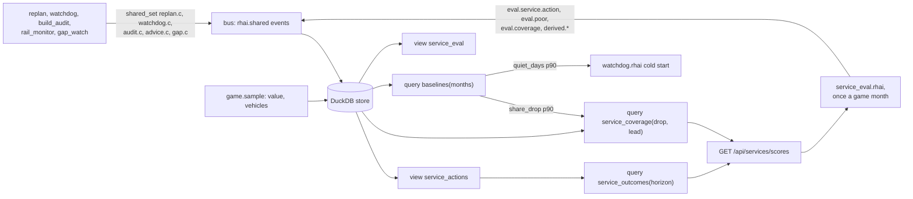

# Service self-evaluation

**RESEARCH-ONLY.** The panel's Rhai services (`replan`, `watchdog`, `build_audit`, `rail_monitor`,
`gap_watch`) watch the game and act: they propose settings, raise alerts, flag defects. Until now
nothing checked whether anything better followed. The owner's order of 2026-11-23: the services
"never reacted while we kept losing"; they are to judge themselves from the data, their thresholds
are to come from the data, and a service that keeps doing badly is to be said, never silenced.

This page describes how that works: an action ledger derived from what the services already write,
an outcome join, a score per service and action, coverage of the months a company lost ground, and
thresholds derived from the store with the hand-typed constant kept only as a declared fallback.

## How it works

### 1. The action ledger is derived, not written twice

Every `shared_set` of a service is a `rhai.shared` event in the panel's store. The view
`service_actions` ([`86_service_actions.sql`](../../tools/research/mcp-rhai/sql/views/86_service_actions.sql))
turns those writes into actions, with no change to any service:

| Service | Key | Action | When |
|---|---|---|---|
| replan | `replan.<c>` | `proposal` | the round filed approvals (`pending` non-empty) |
| replan | `replan.<c>` | `hold` | the round filed none |
| watchdog | `watchdog.<c>` | `stall_alert` | `stalled` turned true |
| build_audit | `audit.<c>` | `defect_flag` | `new_keys` non-empty |
| rail_monitor | `advice.<c>` | `advice_flag` | the advice tally's `total` rose |
| gap_watch | `gap.<c>` | `gap_alert` | `level` rose |

Each row has an id (`<instance>:<run_ms>:<seq>` of the event), the company, the month, the state the
service acted on (the company's value, its share of every company's value, the gap to the leader and
its vehicles at the end of the month before the action), what the service observed (`detail`: replan's
reason and pending approvals, the watchdog's quiet days and reasons, the new defect keys, ...) and
the effect the action is expected to have (`expected`). Because the ledger is derived, it covers every
run the store already holds, not only those after this change.

### 2. The outcome join

The named query `service_outcomes` ([`service_outcomes.sql`](../../tools/research/mcp-rhai/sql/queries/service_outcomes.sql))
keeps one action per service, action, company and month and joins it to the same company
`$horizon` game months after its state month, in the same run:

- `relative_outcome`: the change of the company's share of the field's value over the horizon minus
  its **pre-action** baseline, the median change of its earlier windows of the same length that
  ended by the state month. No outcome after the action enters the baseline. Positive means above
  the company's own trend.
- `value_change`: the absolute change beside it, since a share can rise while value falls.
- `resolved` (detectors only): whether the service's own measure got better within the horizon, a
  later `watchdog.<c>` with `stalled` false (progress), a later `audit.<c>` with fewer defects, a
  later `gap.<c>` with a lower level; `resolved_days` is the latency in game days.
- `status`: `scored`, `pending` (the latest run has not reached the horizon), `ended` (its run
  stopped first), `company_gone` (the run went on without the company), `no_state` or
  `no_baseline`.

### 3. The score

`GET /api/services/scores` ([`src/service_eval.rs`](../../tools/research/mcp-rhai/src/service_eval.rs))
scores each service and action:

- a **detector** (`stall_alert`, `defect_flag`, `gap_alert`) by its resolution: an alert is good
  when what it reported got better. It is not penalised for reporting a deterioration correctly;
- the others (`proposal`, `hold`, `advice_flag`) by `relative_outcome > 0`.

Each count gets a Jeffreys Beta posterior, and `p_below_half` is the posterior probability that the
success rate is under one half. The verdict:

| Verdict | Rule |
|---|---|
| `insufficient` | fewer than `MIN_N` (8) outcomes, a cold-start constant |
| `poor` | `p_below_half` >= `POOR_P` (0.9), and for a non-detector a negative median relative outcome (a practical deficit, not a coin toss) |
| `helps` | the mirror image |
| `unclear` | anything else |

`runs` says how many independent games the count rests on. The answer carries its `caveat`: the
outcomes are **associative, not causal**. An alert that fires when things are already bad may be
followed by a recovery that would have come anyway (regression to the mean), successive horizons
overlap, and the companies of one run share it. Proving that a service helps needs held-out runs
(the service off on comparable seeds), which this does not do.

`?horizon=` (1 to 24 game months, default 3, a design choice of the evaluation and not a threshold)
and `?scope=run` (the newest run with an action) change the reading.

### 4. Did a service react while we lost ground?

`service_coverage` ([`service_coverage.sql`](../../tools/research/mcp-rhai/sql/queries/service_coverage.sql))
asks the converse question, from the samples alone and never from a service's own writes: a
**deterioration episode** is a run of consecutive game months in which a company's share fell by at
least `$drop` each month. Per service it counts the episodes, how many it acted on (any action but a
hold, from one month before the episode to its end), the median latency, and how many of its actions
fell outside any episode (its alert burden). `$drop` is derived: the 90th percentile of the monthly
share drops of the earlier runs (`baselines` `share_drop`) once there are 30 of them, else the
declared fallback 0.01.

### 5. Persistently poor is said, never silenced

[`service_eval.rhai`](../../tools/research/mcp-panel/rhai/service_eval.rhai) runs as a panel service
(`POST /api/services/start {"name":"service_eval"}`) and reads the route once a game month. It
prints one line every look, the heartbeat its `// stall: 600` needs, so a paused game or a slow
month does not get it restarted (#308 fixed the same bug in the watchdog). A month counts as
evaluated once its `eval.*` keys are written, and a failed threshold read after that is only
printed:

- `eval.<service>.<action>`: the score, its verdict and `streak`, the evaluations in a row judged
  poor. The streak advances only when new outcomes matured (`n` grew): reading the same evidence
  again is one finding, not several. A verdict that is not poor resets it. The view `service_eval`
  ([`87_service_eval.sql`](../../tools/research/mcp-rhai/sql/views/87_service_eval.sql)) keeps the
  history in the store.
- `eval.poor`: every score whose streak reached `PERSIST` (3), with the rule and the caveat;
  `eval.coverage`: the newest run's coverage per service.
- one log line per persistently poor score, starting `[service_eval] POOR`, in
  `GET /api/services/log?name=service_eval`, where the strategy digest can show it.

It disables, restarts and changes nothing: no service, setting or approval. What to do about a poor
service stays with the owner and with the config-evolution loop that reads these scores.

## Derived thresholds

[`derive_lib.rhai`](../../tools/research/mcp-panel/rhai/derive_lib.rhai) gives a service a threshold
from the named query `baselines` ([`baselines.sql`](../../tools/research/mcp-rhai/sql/queries/baselines.sql)):
`factor` times a percentile within bounds once the store holds `min_n` values of the metric, else the
caller's hand-typed constant, declared as the fallback. Each answer says its `source` (`derived` or
`fallback`), `n`, `runs` and why. `baselines` reads only comparable runs before the store's latest one, so a
running game never calibrates on itself: a loaded continuation (a run whose first sample lies within
a month of the previous run's last one, whatever seed the loader gave it, e.g. 31337 continuing
15805) is left out, and so is a run whose lineup differs from the latest run's by more than two
companies (a one-company duel against an eight-company co-play game). The game speed is not in the
store and is not matched. Its metrics:

| Metric | What it measures | Used for |
|---|---|---|
| `quiet_days` | completed quiet spells, game days between two changes of a company's vehicle count; each company's first and still-open last spell are censored and left out | the watchdog's cold start: 1.5 x p90, within 7..365 days, after 20 spells; else `START_DAYS` 7 |
| `share_drop` | how far a company's share of every company's value fell from one month to the next | the coverage episodes: p90 after 30 drops; else 0.01 |
| `leader_ratio_drop` | how far a company's value as a share of the leader's fell over `$months` (gap_watch's `WINDOW`, 6) | `derived.gap_watch.share_drop` (p75), which gap_watch reads as its flag threshold; while the store holds fewer than 30 drops its value is null, and gap_watch keeps its `SHARE_DROP` 0.05 under the name "cold start" |

The watchdog keeps tuning itself from its own gaps once it has seen five (unchanged); the store only
replaces its first week, and only after 20 comparable spells (a stricter floor than five: a 90th
percentile of five values says little about the tail). `watchdog.tuning.threshold_source` says which
one holds: `start` (7, the store off or too thin), `store` or `this run`. `derive_lib`'s `baselines` never throws: a store that is off, or answers what is not a table of
rows, gives `()`, which leaves the start value. The watchdog's store read also has its own `try`, so
neither costs the round its reads. `service_eval.rhai` publishes the derived values its consumers
read as `derived.<consumer>.<name>`, each visible with its provenance. The watchdog derives its
own cold start, so none is published for it. Vehicle-count stability is a
proxy of the watchdog's signature, which also counts vehicle types and stations, so store spells are
at least as long as the watchdog's own; that is why its own gaps take over.

Not derived, on purpose: replan's `MIN_PAYS` and `HORIZON_MONTHS` are a risk tolerance of the switch
rule, not a measured quantity; tuning them from replan's scores belongs to the config-evolution
loop, which reads `eval.replan.*`.

## What the store already says

A copy of the `panel-8800` store of 2026-11-23 (18 runs, 9822 shared writes), horizon 3 months,
coverage with the derived drop (p90 0.0060 over 3016 drops in the 4 comparable earlier runs: the
loaded continuations and the one-company runs left out):

| Service, action | Actions | Judged by | Successes | Runs |
|---|---|---|---|---|
| replan proposal | 55 | relative outcome | 27 of 51 | 5 |
| replan hold | 156 | relative outcome | 126 of 147 | 7 |
| watchdog stall_alert | 143 | resolution | 81 of 142, median 20 days | 4 |
| build_audit defect_flag | 271 | resolution | 19 of 262, median 30 days | 3 |
| rail_monitor advice_flag | 13 | relative outcome | 4 of 12 | 2 |

| Service | Deterioration episodes | Acted on | Actions outside any episode |
|---|---|---|---|
| replan | 219 | 7 (3.2 %) | 47 of 55 |
| watchdog | 157 | 19 (12.1 %) | 126 of 147 |
| build_audit | 105 | 34 (32.4 %) | 229 of 275 |
| rail_monitor | 54 | 2 (3.7 %) | 18 of 20 |

Read with the caveat: replan proposed something in 7 of 219 losing streaks, which is the
owner's complaint measured; build_audit's flagged defects were fixed within three months in 7 % of
cases; replan's holds were followed by above-trend months more often than not, which says more about
regression to the mean after a bad month than about holding. The baselines also place gap_watch's
hand-typed 0.05 between the 75th (0.018) and the 90th percentile (0.055) of the six-month drops
relative to the leader (3029 drops, 4 comparable runs): it flags about the worst seventh of them. The
watchdog's cold start on this store is 52 days (1.5 x the p90 34.2 of 7394 spells) instead of 7.

## Where it lives

| File | What |
|---|---|
| [`sql/views/86_service_actions.sql`](../../tools/research/mcp-rhai/sql/views/86_service_actions.sql) | the derived action ledger |
| [`sql/views/87_service_eval.sql`](../../tools/research/mcp-rhai/sql/views/87_service_eval.sql) | the history of the evaluations |
| [`sql/queries/service_outcomes.sql`](../../tools/research/mcp-rhai/sql/queries/service_outcomes.sql), [`service_coverage.sql`](../../tools/research/mcp-rhai/sql/queries/service_coverage.sql), [`baselines.sql`](../../tools/research/mcp-rhai/sql/queries/baselines.sql) | the outcome join, the coverage, the baselines |
| [`src/service_eval.rs`](../../tools/research/mcp-rhai/src/service_eval.rs) | `GET /api/services/scores`: the score, the posterior, the verdict |
| [`mcp-panel/rhai/service_eval.rhai`](../../tools/research/mcp-panel/rhai/service_eval.rhai) | the monthly evaluation service: streaks, `eval.poor`, the log line, `derived.*` |
| [`mcp-panel/rhai/derive_lib.rhai`](../../tools/research/mcp-panel/rhai/derive_lib.rhai) | thresholds from the store with a declared fallback |
| [`mcp-panel/rhai/watchdog.rhai`](../../tools/research/mcp-panel/rhai/watchdog.rhai) | its cold-start threshold from the store |

## How it is tested

`cargo test --bin mcp-panel service_eval` (the `store` feature): the Beta CDF against closed forms;
the scoring rule per endpoint and verdict; a threshold derived or falling back; the answer assembled
from canned query answers and the route without a store (its 503); the real SQL end to end on an
in-memory store with two runs of samples and replan and watchdog writes (actions derived, the state
of the month before, a stall resolved within the horizon and not within a shorter one, the coverage,
`?scope=run`, each query's failure); `derive_lib.rhai` against a stubbed store; the watchdog run
against a scripted panel and store (cold start 51 days derived, `threshold_source` store, a stall found; a store that breaks the baselines or is off: the start value, round 0 still read); `baselines` leaving out a loaded run, another lineup and the latest run; and
`service_eval.rhai` run for seven game months against a scripted route (streaks that advance only
on new outcomes and reset, the `POOR` line once at three, `eval.coverage`, `derived.*`, a failing
route). The store's own tests check that every view and column is commented and listed here and in
[`event-bus-and-store.md`](event-bus-and-store.md).
