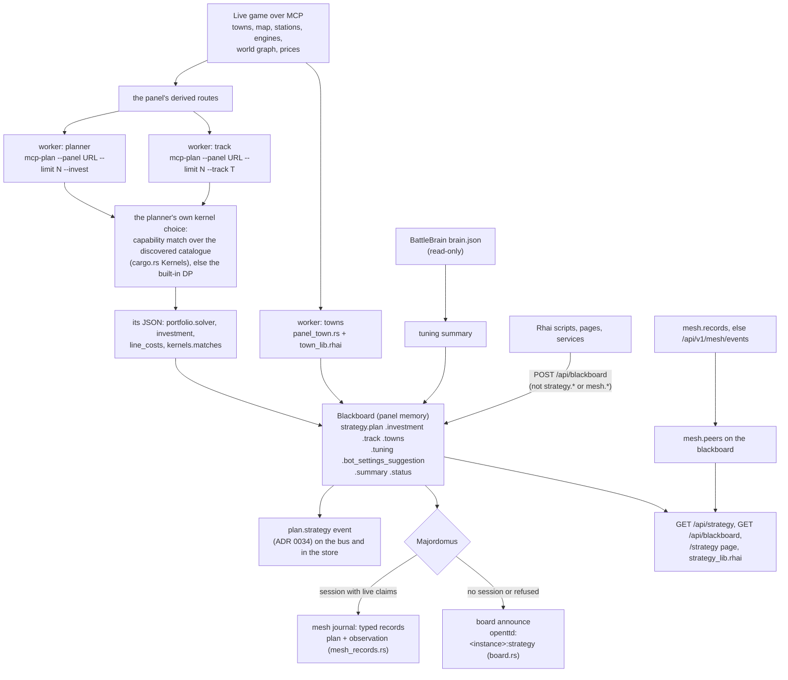

# Strategist and blackboard

**RESEARCH-ONLY.** A background thread of the control panel, the strategist, keeps recomputing
the long-term plan while a game runs. Each cycle it runs the planner with its portfolio,
transport-investment and rail lines priced on the map, the town advice for every rated company,
and a read of BattleBrain's tuning proposals. It writes the results to the panel's blackboard, the shared
working state of one panel instance. Panel routes, Rhai scripts and pages read the blackboard,
and scripts write their own keys to it. The strategist only reads and computes. It never changes
the game: no tool call, no setting, no bot start.

## Why it exists

Until now the planner ran only when something asked for it: a bot start, `GET /api/plan`, a
duel. Between those calls nothing knew what the plan would be now.

The strategist gives the plan one place that stays current. It answers once per game month, and
on demand. It runs the same planner the panel's routes run, and names the solver and the kernels
the planner reported, including the built-in fallback when no kernel answered. The blackboard
gives scripts, pages and later the bot's settings one state to read, with who wrote each value,
when, and at which game date. The real-world counterpart is a planning cell that keeps a running
estimate and posts it where every desk can read it, beside the notes the desks leave each other.

## How it works

- **When a cycle runs.** The thread starts with the panel and wakes every second. While a game
  runs (the MCP server is up and the server process lives), a cycle is due in three cases. The
  first cycle runs as soon as the game is up. A new game month starts one, but no sooner than
  `PRISMATIC_STRATEGY_MIN_GAP` seconds after the last cycle. Otherwise one runs every
  `PRISMATIC_STRATEGY_EVERY` seconds. `POST /api/strategy/run` runs one now, and `{wait: true}`
  answers with the cycle's record. A lock keeps two cycles from overlapping.
- **The pool.** A cycle runs its parts on three scoped workers:
  1. **Planner.** The `mcp-plan` sibling binary (`panel::sibling`, as `GET /api/plan` and
     `GET /api/investment` find it), run as one of the panel's children (`panel::run`) with
     `--panel <url> --limit N --invest` and the loan limit as `--params {"budget": ...}`. It builds
     the passenger and freight candidates, picks the portfolio within the budget, and runs
     transport-investment over its own candidates. The strategist parses its JSON.
  2. **Track.** With `PRISMATIC_STRATEGY_TRACK` > 0, a second `mcp-plan` run with `--track N`
     prices that many of the best rail lines of each list on the real map and picks the portfolio
     again. Like `GET /api/plan?track=N`, it is skipped, with the reason, when
     `MCP_ALGOGLYPH_DIR` is not set.
  3. **Towns.** For every company that has a rating in a town, `panel_town::live_from` runs
     `town_lib.rhai`'s advice (see [Town authority model](town-authority.md)). The tolerance comes
     from the game's console. A town in a poor band, or below the new-station gate (-200), is a
     warning, kept with its first two pieces of advice.

  After the pool, the tuning step reads BattleBrain's `brain.json` (schema `battle-brain/v1`;
  `research/battle-brain.md`). It keeps the eight proposals, each with its kind (`safe` or
  `explore`), predicted share and spread, plus the rows, distinct settings, trust region and the
  file's time. It never writes the file and never calls the GA. A missing file is noted on
  `strategy.status`.
- **Which solver and kernels.** The strategist does not locate AlgoGlyph, choose a kernel or
  start a kernel server. The planner does all of that, as on master (I0221, I0227, I0228): each
  kernel is picked by capability from the discovered catalogue. The strategist reports what the
  planner's answers say. `strategy.summary.planner` and `strategy.status` carry `solvers` (the
  portfolio's, transport-investment's, the line pricing's) and `kernels`, one
  `<capability>: <kernel>` per capability the planner resolved, or `none (<refusal code>)`.
  `strategy.plan.kernels` and `strategy.track.kernels` keep the catalogue (digest, commit, size)
  and each match. When the portfolio's solver is the built-in DP, the planner's
  `portfolio.fallback` reason is named in the event's `inputs.live.fallback` and in the mesh
  observation.

  Master's planner has no in-process entry point for a full plan or investment: `mcp-plan`'s run
  is a closure inside its `main`. Running the binary is how the panel's own routes reach it, so
  the strategist does the same and adds no planner code of its own.
- **Board keys.** Each cycle writes:

  | Key | Holds |
  |---|---|
  | `strategy.plan` | the portfolio: solver, kernel, total score, budget, and each chosen line (ends, mode, score, investment, profit); candidate counts by mode; params digest; the planner's catalogue and kernel matches |
  | `strategy.investment` | transport-investment's solver, runs and portfolio, as `mcp-plan --invest` answered |
  | `strategy.track` | the lines priced on the map, the portfolio after them and the kernel matches, or why it was skipped |
  | `strategy.towns` | tolerance and, per rated company, its town warnings with advice |
  | `strategy.tuning` | BattleBrain's proposals, rows, distinct settings, trust region, the file's time |
  | `strategy.bot_settings_suggestion` | the settings `panel_bot::settings_from_plan` would choose, as data only, never applied |
  | `strategy.summary` | the cycle number, game date, trigger, the planner (entry point, arguments, solvers, kernels, catalogue), solver, lines, score, counts, duration |
  | `strategy.status` | `off`, `waiting`, `running`, `ok` or `error`, its reason, each part's error, the solvers and kernels, the mesh outcome, notes |
  | `mesh.peers` | what the peers on the Majordomus mesh plan (below) |

  `strategy.*` and `mesh.*` are reserved: `POST /api/blackboard` refuses them (403). A script
  writes any other key. Each write publishes a `blackboard.write` event `{key, revision, by}`. A
  key keeps its last eight values with their writers, revisions, wall times and game dates.
- **The decision event.** Each cycle publishes one `plan.strategy` event with
  `{decision: "strategy.cycle", version, inputs, choice}` (ADR 0034). `inputs.live` names the
  strategist's own reads, the planner's entry point, arguments and reads, the trigger, every
  fallback taken (the built-in DP with the planner's reason, a skipped track), and the brain file.
  `inputs.stored` states the fallback: the strategist reads no recorded history yet, with the
  store's status. `choice` is the solver, the solvers and kernels, the lines and score, the counts, and the chosen
  lines.
  A `panel.plan` sentence sits beside it.
- **Errors.** A part that fails is that part's error on `strategy.status` and in the cycle record.
  The other parts still write their keys. Nothing ends the thread.

## How it relates to the other blackboards

This repository now has four stores that are each called a blackboard. They have different
scopes:

| | Scope | Writes | Lives |
|---|---|---|---|
| **The panel's blackboard** (this page, `panel_strategy.rs`) | one panel instance: its strategist, its scripts, its pages | the strategist (`strategy.*`, `mesh.*`); scripts and pages, any other key | in the panel's memory; history in the store as `plan.strategy` and `blackboard.write` |
| **The shared memory of Rhai** (`rhai_shared.rs`, `/api/rhai/shared`) | one panel's scripts and services | compare-and-swap by revision, any key | in the panel's memory; every write a `rhai.shared` event |
| **The Majordomus mesh journal** (`mesh_records.rs`) | every agent session and machine of the mesh: "the one blackboard" (owner, 2026-11-20) | typed records (`observation`, `hypothesis`, `plan`, `decision`, `blocker`, `handoff`, `outcome`) inside the writing session's live claims | Majordomus, signed and replicated |
| **The Majordomus board** (`board.rs`, `majordomus_announce`) | peers on one machine's server | named claims announced over an MCP session | the server; a departed peer's claims stay readable |
| **Prismatic's blackboard** (`prismatic.rs`, `blackboard.*` tools) | Prismatic's frames | `prismatic_bb_put` | the Prismatic platform |

The panel's blackboard is local working state, so a script can keep a hint beside the strategy
without a round trip to Majordomus. It adds history and reserved namespaces to what the Rhai
shared memory offers. Both live in the panel and both put their writes on the bus. Nothing on
this page writes to Prismatic's blackboard.

The strategist works with the Majordomus mesh in three steps. None of them can fail a cycle. The
address is `$MAJORDOMUS_URL`, else `$PRISMATIC_MAJORDOMUS_URL`, else `http://127.0.0.1:8741`, and
it must be loopback.

1. **Typed records.** When `$MAJORDOMUS_SESSION` names a session, the strategist writes kind
   `plan` with the current summary as a short title: month, lines, solver, score, and a pointer to
   `GET <panel>/api/strategy`. It writes kind `observation` when there are town warnings or the
   solver fell back. The task is `$PRISMATIC_STRATEGY_MESH_TASK` (default `openttd-strategy`) and
   the scope is `$PRISMATIC_STRATEGY_MESH_SCOPE` (default this page), which a live claim of the
   session must cover. The strategist revises its own record at the revision it holds, and only
   when the title changed. The journal's refusals are typed (`Admission`):
   - `stale_revision` or `not_own`: the held record is dropped and one new record is written.
   - `out_of_scope` (no live claim covers the scope): fall back to step 2.
   - A 404 or no answer (typed records need Majordomus 1.2.0): fall back to step 2.
2. **Board announce.** Without a session, or when a write is refused, the strategist announces
   the same text as the named claim `openttd:<instance>:strategy` (for example
   `openttd:panel-8800:strategy`) on the board, through `board.rs`. It announces only when the
   text changed, keeps the session alive, and closes it when the panel stops. The board keeps the
   claim after that. If the announce fails too, the reason is on `strategy.status` (`mesh`).
3. **Peer plans.** The strategist reads `mesh.records` for kind `plan` and kind `decision` and
   keeps the newest ten of each by other authors. Where typed records are not served (Majordomus
   1.0.2 on this machine), it reads `GET /api/v1/mesh/events?newest=true&limit=200` instead. From
   those events it keeps written plan and decision records, and the newest intent of each other
   session that is still open (`session_opened`, `claim_acquired`). The result goes on the
   blackboard as `mesh.peers`, read-only to scripts, and the Strategy page shows it beside our
   own strategy.

`PRISMATIC_STRATEGY_MESH=0` turns all three steps off.

## Configuration

| Variable | Default | Effect |
|---|---|---|
| `PRISMATIC_STRATEGIST` | on (off in panels `mcp-duel` and `mcp-ab` start) | `0`, `off`, `false` or `no`: no thread; `POST /api/strategy/run` still runs a cycle |
| `PRISMATIC_STRATEGY_EVERY` | 300 | seconds between cycles at the latest (at least 10) |
| `PRISMATIC_STRATEGY_MIN_GAP` | 30 | seconds a new game month waits after the last cycle (at least 5) |
| `PRISMATIC_STRATEGY_LIMIT` | 20 | candidates per list (the planner's `--limit`) |
| `PRISMATIC_STRATEGY_TRACK` | 3 | rail lines priced on the map per list (0 to 10; needs AlgoGlyph) |
| `PRISMATIC_STRATEGY_BRAIN` | `~/ttd-battle/results/brain.json` | BattleBrain's output, read-only |
| `PRISMATIC_STRATEGY_MESH` | on | off: no record, no announce, no peer read |
| `PRISMATIC_STRATEGY_MESH_TASK`, `_MESH_SCOPE` | `openttd-strategy`, this page | the typed records' task and scope (comma-separated) |
| `MAJORDOMUS_URL`, `PRISMATIC_MAJORDOMUS_URL`, `MAJORDOMUS_SESSION` | see above | the mesh address and the session typed records are written as |
| `MCP_ALGOGLYPH_DIR` | unset | read by the planner, as for every `mcp-plan` the panel runs; unset, the track worker is skipped |

## Observer effects and limits

- A cycle runs `mcp-plan` twice (plan with investment; track), each reading about ten resources
  from the game through the panel, and sends one console line
  (`setting difficulty.town_council_tolerance`). Each of these takes time from the server, and the
  console line shows up in the server log. Measured times are under "Measured" below. A measured
  comparison therefore starts its panels without it: `tools/research/mcp-duel` and
  `tools/research/mcp-ab` export `PRISMATIC_STRATEGIST=0` unless the caller set the variable, so
  both arms of a duel or an A/B run with the same timing. Every other panel runs it. Set
  `PRISMATIC_STRATEGIST=0` wherever else timing matters.
- The board lives in memory, so a restarted panel starts empty. The store keeps every
  `plan.strategy` and `blackboard.write`, not the values.
- `by` is what a writer declares. The loopback API does not authenticate anyone.
- The peer read from journal events sees the newest 200 events only.
- Bot settings stay where they are. `strategy.bot_settings_suggestion` is data, and no code applies
  it.

## Measured

Two live panels from this branch's build against `build-gate-research/openttd` (seed 4242, a new
game, `PRISMATIC_STRATEGY_MESH=0`, 2026-11-22). Both passed `tools/research/mcp-strategy-check`
(15 of 15).

| Run | Runner | Cycle | Plan (`--invest`) | Track (`--track 3`) | Towns | Portfolio solver | Kernels the planner chose |
|---|---|---|---|---|---|---|---|
| 1 | none (`MCP_ALGOGLYPH_DIR` unset, as `mcp-e2e` leaves it without a runner at the pin) | 1.5 s | 0.8 s | skipped | 0.6 s | `builtin knapsack` (`unset_dir`) | none: no catalogue |
| 2 | a clone of AlgoGlyph at the pin `1b8e009`, catalogue of 53 kernels | 18.3 to 20.6 s (3 cycles) | 7.6 to 8.8 s | 17.7 to 19.8 s | 0.6 s | `algoglyph knapsack-dp` | `portfolio-within-budget: knapsack-dp`, `routes-by-return: transport-investment`, `rail-line-price: track-planning` |

The cycle's time is the slowest worker's, the track run, because the workers run side by side.
Every `mcp-plan` run starts AlgoGlyph's runner again for each kernel call. Without its own serve,
the strategist pays that on every cycle, as `GET /api/plan` and `GET /api/investment` do.

## Where it lives

| File | What it holds |
|---|---|
| [`tools/research/mcp-rhai/src/panel_strategy.rs`](../../tools/research/mcp-rhai/src/panel_strategy.rs) | the blackboard, the strategist thread, a cycle, the mesh steps, the four routes |
| [`tools/research/mcp-rhai/src/bin/mcp-plan.rs`](../../tools/research/mcp-rhai/src/bin/mcp-plan.rs) | the planner the strategist runs, unchanged |
| [`tools/research/mcp-rhai/src/panel_events.rs`](../../tools/research/mcp-rhai/src/panel_events.rs) | the `plan.strategy` and `blackboard.write` kinds |
| [`tools/research/mcp-panel/rhai/strategy_lib.rhai`](../../tools/research/mcp-panel/rhai/strategy_lib.rhai) | the scripts' helpers: `strategy`, `run_now`, `get`, `entries`, `history`, `put`, `peers`; pure `lines`, `warnings`, `headline`, `is_reserved` |
| [`tools/research/mcp-panel/static/strategy.html`](../../tools/research/mcp-panel/static/strategy.html), [`strategy.js`](../../tools/research/mcp-panel/static/strategy.js) | the Strategy page |

Routes, also in `/openapi.json` and to Rhai as `api_<operationId>`:

| Route | operationId | What |
|---|---|---|
| `GET /api/strategy` | `strategy` | status, summary, the last cycle with each part's duration, the next run, the current strategy |
| `POST /api/strategy/run` | `strategyRun` | run a cycle now; `{wait: true}` answers its record; 409 without a game |
| `GET /api/blackboard` | `blackboard` | every key, or `?key=` / `?prefix=`, with history (`?history=0` leaves it out) |
| `POST /api/blackboard` | `blackboardWrite` | `{key, value, by?}`; `strategy.*` and `mesh.*` refused |

## How it is tested

- `cargo test` in `tools/research/mcp-rhai`. The `panel_strategy.rs` tests cover the board's
  history and reserved namespaces, the configuration from the environment, when a cycle is due,
  the portfolio and town-warning shapes, the planner's arguments and the solver and kernel names
  read from its answer, BattleBrain's summary, the typed journal refusals, and
  peers from records and from journal events. `strategy_lib_reads_the_strategists_board_values`
  in `main.rs` checks the Rhai library's pure functions. The route-table test counts the four
  routes, and `panel_events.rs` checks that both new kinds are declared and published.
- `node --test tools/research/mcp-panel/test/strategy.test.mjs`: the page's pure parts, and the
  page mounted in the fake browser (open a key, run a cycle, filter by prefix).
- `tools/research/mcp-strategy-check <panel-url>`: the page in Chrome against a running panel. It
  checks the state and parts against `/api/strategy` and that every blackboard key has a row. It
  writes a key and opens it, and it checks that a write to `strategy.*` is refused and that the
  prefix stays in the address. It declares `e2e-covers: panel /strategy` for
  `tools/research/e2e-coverage`.

## Related

- [Planner and AlgoGlyph](planner-and-algoglyph.md), [Control panel](control-panel.md),
  [Town authority model](town-authority.md), [Event bus and store](event-bus-and-store.md),
  [Rhai scripting](rhai-scripting.md), [Majordomus supervision](majordomus-supervision.md)
- ADR [0033](../../.ai/repo/adrs/0033-every-panel-event-goes-out-on-zeromq-and-into-a-duckdb-store.md),
  ADR [0034](../../.ai/repo/adrs/0034-planning-decisions-read-recorded-history-and-emit-structured.md),
  [the Majordomus blackboard is written by announcing on a board](../../.ai/repo/knowledge/curated/the-majordomus-blackboard-is-written-by-announcing-on-a-board.md)
