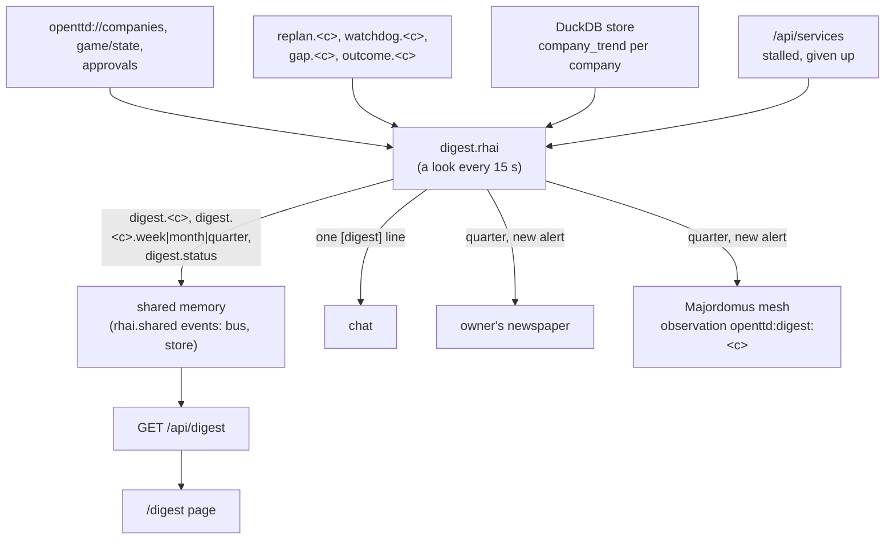

# Strategy digest

**RESEARCH-ONLY.** A Rhai service of the control panel, `digest`, that tells the owner on a fixed
cadence of game time how the strategy is doing and what the system is changing, and escalates when
it is failing. Every figure in it is read from the game, the panel's shared keys and the store; none
is typed. It writes the panel's shared memory, the chat, the owner's newspaper and the Majordomus
mesh. It issues no command and approves nothing.

## Why it exists

Until now the owner learned that PrismaticAI was losing only by asking. In one game they found out
in 1964 that their company ran 1 train against AAAHogEx's 140. The signals were all there, each in
its own place: replan compared the companies per vehicle type every month, the watchdog knew when a
company built nothing, the approval queue knew what waited and when its deadline would settle it,
the store held every company's value month by month. Nothing put them together, nothing brought them
to the owner unasked, and nothing raised its voice when the numbers turned bad.

## How it works

### Cadence

Every round the service reads the game date. When it crosses a game week, month or quarter, it
composes one digest per running company of the AI, at the highest cadence crossed (quarter, then
month, then week), about the period that just ended: on 1954-04-01 the digest is about 1954-Q1.
The first digest after the service starts, or after the date went back (a new or reloaded game,
whose histories are then cleared), is a `start` digest: where things stand today, said at once,
kept in no history.

### Content

| Part | Read from |
|---|---|
| standing: rank by company value, our share of the leader's value and its change since the last digest of the same cadence, whether the leader changed, our vehicles against the largest other fleet | `openttd://companies` |
| series: the share of the leader by game month (up to 36), and its completed quarters | the store's named query `company_trend` for every company; the digest's own month history without a store |
| by type: last year's profit per vehicle, ours against the best company of each type | `replan.<company>.competition`, stale after two game months |
| operating profit of the last quarter and its change | `replan.<company>.finances` |
| money: cash, loan, max loan, idle cash, unused credit | `openttd://companies`; idle cash and unused credit from `gap.<company>` (the leader-gap watch, `gap_watch.rhai`) when that key exists |
| failed or skipped: the watchdog's stall and its reasons, replan's hold, refusals and why it did not switch, services stalled or given up, approvals the deadline settled, builds the gap watch counted refused, failed or removed, the planner outcome's mismatch | `watchdog.<company>`, `replan.<company>`, `/api/services`, `openttd://approvals`, `gap.<company>`, `outcome.<company>` |
| changes: replan's verdict, why, its proposed settings and portfolio; what became of the period's approvals (approved, denied, settled by the deadline) | `replan.<company>`, `openttd://approvals` |
| governance: who changed governance in the period (auto-approve): setting, from, to, via, credential, Origin, User-Agent, peer; each change is also said at once, and auto-approve turned on is put in the newspaper | the panel's `governance.*` events (`governance.changed`), kept in `digest.governance` (50) |
| capital: trailing reinvestment and idle-capital ratio, and capital_watch's flags | `capital.<company>` (capital_watch.rhai) |
| evaluation: service.action entries persistently poor (with their streak) and, per service, the deterioration episodes of the newest run and how many it reacted to; associative, not causal, and said so | `eval.poor`, `eval.coverage` (service_eval) |
| approvals: every pending one of the company with its countdown to the deadline and the verdict it then gets | each record's `deadline_tick` and its own `verdict` (or `default_verdict`), else the queue's `deadline.verdict` |

A part whose source is missing or stale is listed in `unknown`, and a digest with nothing worse is
`unknown`, never `ok`. The signal keys are read as their writers define them: `gap.<company>`
(gap_watch.rhai: `flags`, `streaks`, `level`, `idle_cash`, `unused_credit`, `builds`, `held`) and
`outcome.<company>` (panel_bot.rs from src/outcome.rs: `verdict`, `why`, `signals[]` with `kind`
and `severity`). An absent one is listed in `unknown`, so a writer that stopped is seen.

### Escalation

The digest's level is the highest of its alerts: ok, unknown, watch, alert. The thresholds are the
constants at the top of `digest.rhai`, which the service reloads within a second when edited.

| Alert | When | Level |
|---|---|---|
| `share_falling` | the quarterly share fell two quarters running, by at least 5 points in all | alert |
| `far_behind` | the share was below 25 % in the last two months; it clears only above 30 % | alert |
| `behind` | the share is below 50 % | watch |
| `fleet_gap` | our vehicles are below 10 % of the largest other fleet | alert |
| `last_place` | rank is last of more than two | watch |
| `stalled` | the watchdog says stalled; past twice its threshold | watch; alert |
| `approvals_due` | an approval's deadline is 7 game days away or less | watch |
| `approvals_waiting` | an approval without a deadline has waited more than 30 game days | alert |
| `idle_cash` | without `gap.<company>`: nothing was built for 60 game days while cash is twice the line budget or a loan is held beside cash (with it, its `idle_capital` flag says so) | watch |
| `bot_stopped` | a company of the AI that had a digest no longer runs | alert |
| `governance` | someone changed governance in the period | alert when auto-approve was turned on, else watch |
| `gap.<flag>` | each flag of `gap.<company>` (losing_ground, idle_capital, unused_credit, stalled, plans_not_landing, collateral, replan_silent) | alert once it held 2 months or a lever was proposed, else watch |
| `eval.poor.<service.action>` | service_eval marks the entry persistently poor | watch (associative) |
| `eval.coverage.<service>` | the service reacted to less than 10 % of at least 20 deterioration episodes | watch (associative) |
| `capital.<flag>` | each flag of `capital.<company>` (capital_watch: under_reinvesting, hoarding) | alert (the flags already need persistence) |
| `outcome.<kind>` | each signal of `outcome.<company>` (overpredicted_mode_planned, outcome_plan_differs, leader_out_earns) | alert for severity mismatch, else watch |

The performance alerts (the first five) wait until two quarters of the series are complete, so a
young game does not alarm.

### Channels

- **Chat**: one `[digest]` line for the owner's company (`$DIGEST_COMPANY`, else the first running
  company of the AI, the one the owner co-plays): every month and quarter; a week only when its
  level, rank or alerts changed; never closer than `COOLDOWN_S` (300 s) of wall-clock time, except a
  new alert, which is said at once; an unresolved alert again every `REPEAT_S` (900 s).
- **Newspaper**: every quarterly digest and every new alert of the owner's company.
- **Shared memory**: `digest.<company>` (the latest), `digest.<company>.week|month|quarter` (52,
  120, 80 rows), `digest.status` (the heartbeat, every round). Every write is a `rhai.shared` event.
- **Mesh**: every quarterly digest and every new alert as an `observation` record, task
  `openttd:digest:<company>`, and auto-approve turned on as task `openttd:digest:governance`, when
  the panel has a mesh session.
- **Page**: `/digest`, below.

### The page

`/digest` reads `GET /api/digest`: a tab per company with a digest, the level and every alert (new
ones marked), the service's heartbeat (stale after its declared stall limit), tiles for rank, share, vehicles,
operating profit, cash and loan, and waiting approvals, the share of the leader by month (a click
opens that month's row), profit per vehicle type (a click opens the replan key it comes from),
what failed, the changes with each waiting approval's countdown and default verdict, and the
history of a chosen cadence. Both charts maximize with their button, leave with Escape, and a
maximized chart is a link (`?max=share-chart`); the company and the history's cadence are in the
address too.

## Observer effects and limits

- The service reads; it never changes the game. Its reads are one `openttd://companies` and one
  `openttd://game/state` per round, and one `company_trend` query per company per month.
- Game time drives the cadence: at normal speed a game week is about 15 real seconds, so weekly
  digests are kept as data and said only when something changed.
- The thresholds are not yet calibrated against recorded games; they are constants to tune.
- The fleet gap compares vehicle counts, not capacity per transport type.
- The cooldown lives in the service's memory: a restarted service may speak once more.
- The owner's company is `$DIGEST_COMPANY` or the first running PrismaticAI company; in an arena
  with several PrismaticAI companies that may not be the owner's, until `ttd::owner_company()`
  (openttd-51's fix/owner-company-derived) replaces the choice.
- The page calls the service stale after the stall limit `digest.rhai` declares on its first line,
  read as the supervisor reads it; without that line it never calls the service alive.
- The approval countdown and verdict are read from each approval record as the server publishes it;
  the per-company countdown with a default verdict the owner ordered for their own and the co-play
  company (in design) needs no change here when it puts `deadline_tick` and `verdict` on the record.

## Where it lives

| File | What it holds |
|---|---|
| [`tools/research/mcp-panel/rhai/digest.rhai`](../../tools/research/mcp-panel/rhai/digest.rhai) | the service: cadence, composition, escalation, channels |
| [`tools/research/mcp-rhai/src/panel_digest.rs`](../../tools/research/mcp-rhai/src/panel_digest.rs) | `GET /api/digest`, and the tests of the route and of the service |
| [`tools/research/mcp-panel/static/digest.html`](../../tools/research/mcp-panel/static/digest.html), [`digest.js`](../../tools/research/mcp-panel/static/digest.js) | the Digest page |
| [`tools/research/mcp-digest-check`](../../tools/research/mcp-digest-check) | the page in Chrome |

Start it as a service: `POST /api/services/start {"name": "digest"}`, from the Scripts page
(`/scripts/digest`), or in `MCP_SERVICES` of `tools/research/mcp-e2e`.

## How it is tested

- `cargo test --bin mcp-panel digest` in `tools/research/mcp-rhai`: the route's assembly (owner by
  default, histories, alerts across companies, a stale heartbeat, an unknown company); the
  service's pure parts (cadence, standing, series, quarters, approvals with countdown and verdict,
  grace, hysteresis, levels, the chat rule); and six rounds of the whole service over stubbed host
  reads (a start digest that alerts at once, a round in the same week, a quiet week kept and not
  said, a month, a quarter with news and a mesh record, a stopped bot said once).
- `node --test tools/research/mcp-panel/test/digest.test.mjs`: the page's pure parts and the page
  mounted in the fake browser (both charts, a click on a month, the period in the address).
- `tools/research/mcp-digest-check <panel-url> [--start]`: the page in Chrome against a running
  panel. It declares `e2e-covers: panel /digest` for `tools/research/e2e-coverage`.

## Related

- [Rhai scripting](rhai-scripting.md) (the services, the watchdog), [Planner and AlgoGlyph](planner-and-algoglyph.md)
  (replan), [Approval gate](approval-gate.md) (the deadline), [Event bus and store](event-bus-and-store.md),
  [Strategist and blackboard](strategist-and-blackboard.md), [Majordomus supervision](majordomus-supervision.md)
