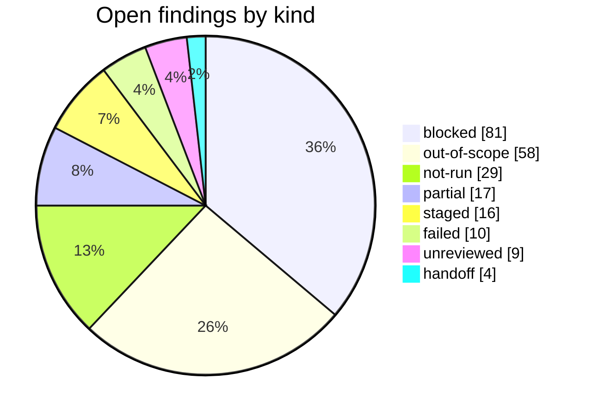

# Open findings

What this repository's own records say is still missing, blocked, handed off, not run or failed,
in one table. Nothing on this page is written by hand: `tools/surfaces/surfaces sync` computes it
from the records with [`tools/surfaces/findings.py`](../tools/surfaces/findings.py), and
`tools/surfaces/surfaces check` (the pre-commit hook, `tools/gate.sh change`, CI) fails while the
page is stale. Where to look and which vocabulary the records use is declared once, in the
`[findings]` table of [`surfaces.toml`](../surfaces.toml); the generator itself names no fact of
this repository ([tools/surfaces/README.md](../tools/surfaces/README.md#open-findings)).

Read a row as: the **kind** of finding, what the record says (**finding**), where it says it
(**evidence**: the issue record or document, at the line), which open issue owns it
(**follow-up**, or none yet), and how the row was obtained (**label**):

- **OBSERVED**: the source states the open status itself: a status cell, an evidence result, a
  front-matter status, a passage marked as a finding.
- **DERIVED**: the generator computed it from several records: an issue blocked by the
  lifecycle stamps of its dependencies, or a non_scope entry of a finished issue that no open
  issue names.

A finding leaves this page when its source changes: the issue it waits on is completed, the
status cell is updated, the marker is removed, or an open issue that names the left-out work is
filed (then it stays, with that issue as its follow-up, until the issue is done). Answers that
depend on the moment, such as `majordomus plan drift`, are not committed here:
`tools/surfaces/findings.py --live` prints them.

To mark a passage of a document as a finding, put `<!-- open-finding kind=K -->` before it,
either on its own line before a paragraph (the finding is that paragraph) or inline (the finding
runs to `<!-- /open-finding -->` or the end of the paragraph). `follow-up=I0123` names the issue
that owns it. `K` must be one of the kinds below; the check fails on an undeclared kind, an
unknown attribute, a follow-up that names no issue, or a closing marker with no opening one.

## By kind

<!-- surfaces:begin open-findings as=pie -->

<!-- surfaces:end open-findings -->

## Findings

<!-- surfaces:begin open-findings -->
| Kind | Count | Meaning |
|---|---|---|
| blocked | 81 | An open issue waits on an issue that is not done; the follow-up is what it waits on |
| out-of-scope | 58 | A finished issue left this out (its non_scope) and no open issue names it |
| failed | 10 | A run or check the records say failed |
| not-run | 29 | A validation the records say did not run |
| partial | 17 | A capability or run the records say is only partly there |
| staged | 16 | Designed and written down, not implemented |
| handoff | 4 | A change asked of another repository; nothing in this one can close it |
| unreviewed | 9 | A knowledge record still awaiting its review |
| drift | 0 | An issue's stamps contradict its delivered work (live only: majordomus plan drift) |

| Kind | Finding | Evidence | Follow-up | Label |
|---|---|---|---|---|
| blocked | The battle referee's REF Q sample carries every company's loan and maximum loan, and the battle record and charts use them — waits on I0118 (open) | [I0119](../.ai/repo/project/issues/I0119.yaml):19 | [I0118](../.ai/repo/project/issues/I0118.yaml) | DERIVED |
| blocked | A battle record states the game settings the match really ran under, read back from the game: max_loan, vehicle-slot limits, difficulty and the build id — waits on I0119 (open) | [I0120](../.ai/repo/project/issues/I0120.yaml):18 | [I0119](../.ai/repo/project/issues/I0119.yaml) | DERIVED |
| blocked | Cross-arena replays run on the original's game build and reproduce it, or the record names the divergence with a desync log — waits on I0120 (open) | [I0121](../.ai/repo/project/issues/I0121.yaml):18 | [I0120](../.ai/repo/project/issues/I0120.yaml) | DERIVED |
| blocked | The post-mortem of edition a80cc94a and battle-brain pick one proposal, which is tested on held-start pairs over three seeds against a named opponent before any default changes — waits on I0118 (open), I0119 (open), I0120 (open) | [I0124](../.ai/repo/project/issues/I0124.yaml):17 | [I0118](../.ai/repo/project/issues/I0118.yaml), [I0119](../.ai/repo/project/issues/I0119.yaml), [I0120](../.ai/repo/project/issues/I0120.yaml) | DERIVED |
| blocked | PrismaticAI logs, every heartbeat, the gate that stopped it adding a vehicle, and a battle post-mortem counts which gate binds each company — waits on I0118 (open) | [I0125](../.ai/repo/project/issues/I0125.yaml):19 | [I0118](../.ai/repo/project/issues/I0118.yaml) | DERIVED |
| blocked | PrismaticAI's fleet grows before it is rich: the early purchase gates are AI settings, and the binding one is loosened only on held-start pairs — waits on I0125 (open) | [I0126](../.ai/repo/project/issues/I0126.yaml):20 | [I0125](../.ai/repo/project/issues/I0125.yaml) | DERIVED |
| blocked | PrismaticAI borrows for a build when it pays and repays what it did not spend, so its early bank balance stays near its reserve — waits on I0119 (open), I0126 (open) | [I0127](../.ai/repo/project/issues/I0127.yaml):21 | [I0119](../.ai/repo/project/issues/I0119.yaml), [I0126](../.ai/repo/project/issues/I0126.yaml) | DERIVED |
| blocked | A new PrismaticAI air route opens with as many planes as its towns' passengers and its airports support, not one — waits on I0127 (open) | [I0128](../.ai/repo/project/issues/I0128.yaml):21 | [I0127](../.ai/repo/project/issues/I0127.yaml) | DERIVED |
| blocked | A failed PrismaticAI build removes what it laid and is never tried again, and the fitness check fails on a station the bot left without vehicles — waits on I0118 (open) | [I0130](../.ai/repo/project/issues/I0130.yaml):21 | [I0118](../.ai/repo/project/issues/I0118.yaml) | DERIVED |
| blocked | PrismaticAI's road search crosses the slopes the game lets a road climb, so hilly maps no longer stop its intercity routes — waits on I0130 (open) | [I0131](../.ai/repo/project/issues/I0131.yaml):17 | [I0130](../.ai/repo/project/issues/I0130.yaml) | DERIVED |
| blocked | The PrismaticAI self-steward lineup spends its money instead of hoarding, rejoins fitness.must_not_hoard, and its fleet economics are measured against its no-steward control — waits on I0126 (open), I0130 (open) | [I0132](../.ai/repo/project/issues/I0132.yaml):21 | [I0126](../.ai/repo/project/issues/I0126.yaml), [I0130](../.ai/repo/project/issues/I0130.yaml) | DERIVED |
| blocked | PrismaticAI loads the town-authority model, logs each served town's rating band, and consults it before one station build that is A/B-tested — waits on I0128 (open) | [I0134](../.ai/repo/project/issues/I0134.yaml):22 | [I0128](../.ai/repo/project/issues/I0128.yaml) | DERIVED |
| blocked | A freight line handed to PrismaticAI is built at the station sites the planner chose, and the site rule lives only in sites.rs — waits on I0129 (open) | [I0135](../.ai/repo/project/issues/I0135.yaml):23 | [I0129](../.ai/repo/project/issues/I0129.yaml) | DERIVED |
| blocked | A committed recovery scenario proves PrismaticAI survives a save and load mid-run and a forced build failure: no line built twice, the failed build cleaned up and replanned — waits on I0130 (open) | [I0136](../.ai/repo/project/issues/I0136.yaml):20 | [I0130](../.ai/repo/project/issues/I0130.yaml) | DERIVED |
| blocked | PrismaticAI moves a vehicle from a route with idle capacity to one where cargo waits, instead of selling and buying, and the move happens at most once across a restart — waits on I0126 (open), I0136 (open) | [I0137](../.ai/repo/project/issues/I0137.yaml):21 | [I0126](../.ai/repo/project/issues/I0126.yaml), [I0136](../.ai/repo/project/issues/I0136.yaml) | DERIVED |
| blocked | A plan-derived setting change is re-checked against the game before it applies: a plan whose snapshot is stale, or whose line endpoints or money no longer hold, is refused — waits on I0138 (open) | [I0139](../.ai/repo/project/issues/I0139.yaml):19 | [I0138](../.ai/repo/project/issues/I0138.yaml) | DERIVED |
| blocked | openttd://stations carries a per-platform model: each rail platform's tiles, axis, length and occupancy, and which platforms belong to one station — waits on I0140 (open) | [I0141](../.ai/repo/project/issues/I0141.yaml):18 | [I0140](../.ai/repo/project/issues/I0140.yaml) | DERIVED |
| blocked | A read-only openttd://subsidies resource lists every offered and awarded subsidy with its cargo, ends, award company and remaining time, from the game's own subsidy pool — waits on I0141 (open) | [I0142](../.ai/repo/project/issues/I0142.yaml):19 | [I0141](../.ai/repo/project/issues/I0141.yaml) | DERIVED |
| blocked | The investment model values a subsidy as a time-bounded candidate: its multiplier counts only while the line could still be built and delivering before the subsidy ends — waits on I0142 (open), I0138 (open) | [I0143](../.ai/repo/project/issues/I0143.yaml):18 | [I0142](../.ai/repo/project/issues/I0142.yaml), [I0138](../.ai/repo/project/issues/I0138.yaml) | DERIVED |
| blocked | The planner prices revenue from the game's own income quote, one batched read-only call, and keeps the economics of running lines apart from those of a new investment — waits on I0138 (open), I0142 (open) | [I0144](../.ai/repo/project/issues/I0144.yaml):22 | [I0138](../.ai/repo/project/issues/I0138.yaml), [I0142](../.ai/repo/project/issues/I0142.yaml) | DERIVED |
| blocked | Calibration measures real against predicted profit per service and leg, so a multi-leg service, a shared cost and transfer waiting time are measured rather than dropped — waits on I0140 (open), I0145 (open) | [I0146](../.ai/repo/project/issues/I0146.yaml):17 | [I0140](../.ai/repo/project/issues/I0140.yaml), [I0145](../.ai/repo/project/issues/I0145.yaml) | DERIVED |
| blocked | A two-leg cargo transfer service through one shared station is proven on a server: unloaded as transfer, carried on by the second leg, and paid once at the final acceptor — waits on I0140 (open), I0141 (open), I0145 (open) | [I0147](../.ai/repo/project/issues/I0147.yaml):18 | [I0140](../.ai/repo/project/issues/I0140.yaml), [I0141](../.ai/repo/project/issues/I0141.yaml), [I0145](../.ai/repo/project/issues/I0145.yaml) | DERIVED |
| blocked | One sentence asking to connect the two largest towns is carried out end to end: towns ranked by population, rail, road and air priced from live costs and the game's quote, one plan approved, built, and the observed diff recorded — waits on I0138 (open), I0144 (open) | [I0149](../.ai/repo/project/issues/I0149.yaml):18 | [I0138](../.ai/repo/project/issues/I0138.yaml), [I0144](../.ai/repo/project/issues/I0144.yaml) | DERIVED |
| blocked | One Battlebrain freight-line decision goes live on the owner's game through every cutover gate, its outcome is recorded, and the rollback switch returns the bot to the baseline, read back from the game — waits on I0150 (open), I0151 (open) | [I0152](../.ai/repo/project/issues/I0152.yaml):19 | [I0150](../.ai/repo/project/issues/I0150.yaml), [I0151](../.ai/repo/project/issues/I0151.yaml) | DERIVED |
| blocked | Battlebrain runs continuously as a read-only Director: every decision period it captures at one tick, records one shadow decision per idempotency key superseding the stale one, and the panel shows the latest — waits on I0150 (open) | [I0153](../.ai/repo/project/issues/I0153.yaml):18 | [I0150](../.ai/repo/project/issues/I0150.yaml) | DERIVED |
| blocked | Battlebrain is measured against a fixed baseline: provenance share, stale-plan rejections and shadow agreement are reported, and held-start duel pairs on three seeds compare it with planner v4 — waits on I0152 (open) | [I0154](../.ai/repo/project/issues/I0154.yaml):19 | [I0152](../.ai/repo/project/issues/I0152.yaml) | DERIVED |
| blocked | A red-team review attacks the live decision path (replayed key, stale block, over-wide window, unpriced line, second writer, self-approval) and records each attack and the refusal that stopped it — waits on I0151 (open), I0152 (open) | [I0155](../.ai/repo/project/issues/I0155.yaml):17 | [I0151](../.ai/repo/project/issues/I0151.yaml), [I0152](../.ai/repo/project/issues/I0152.yaml) | DERIVED |
| blocked | Battlebrain chooses computations by typed capability: the policy names a capability, a domain-checked kernel from the discovered catalogue computes it, inside a bounded typed DAG — waits on I0152 (open), I0159 (open) | [I0156](../.ai/repo/project/issues/I0156.yaml):18 | [I0152](../.ai/repo/project/issues/I0152.yaml), [I0159](../.ai/repo/project/issues/I0159.yaml) | DERIVED |
| blocked | The authority matrix lists every investment selector the ADR 0037 audit found, mcp-human's town-pair, bus and loan heuristics included, each as an executor of a Battlebrain decision or as its own named decision type with an owner — waits on I0151 (open) | [I0157](../.ai/repo/project/issues/I0157.yaml):17 | [I0151](../.ai/repo/project/issues/I0151.yaml) | DERIVED |
| blocked | Every kernel output the planner or Battlebrain consumes passes a domain check: transport-investment gains one, and a kernel without one is refused on every path, not only in Battlebrain — waits on I0158 (open) | [I0159](../.ai/repo/project/issues/I0159.yaml):18 | [I0158](../.ai/repo/project/issues/I0158.yaml) | DERIVED |
| blocked | The frozen planner A/B against the autopilot is repeated under one protocol: three held-start runs per seed on 4242, 31337, 20208 and a held-out seed, plus 120-month runs — waits on I0161 (open) | [I0162](../.ai/repo/project/issues/I0162.yaml):19 | [I0161](../.ai/repo/project/issues/I0161.yaml) | DERIVED |
| blocked | AlgoGlyph's contribution is isolated: the same candidates planned with AlgoGlyph on and off, paired on held starts, and a run that fell back never counts as AlgoGlyph — waits on I0161 (open) | [I0163](../.ai/repo/project/issues/I0163.yaml):20 | [I0161](../.ai/repo/project/issues/I0161.yaml) | DERIVED |
| blocked | A pre-registered three-arm experiment compares the unplanned bot, the planned bot and the planned bot steered by Prismatic's live decision, on the same maps, seeds, executor and start — waits on I0161 (open), I0163 (open), I0168 (open) | [I0164](../.ai/repo/project/issues/I0164.yaml):19 | [I0161](../.ai/repo/project/issues/I0161.yaml), [I0163](../.ai/repo/project/issues/I0163.yaml), [I0168](../.ai/repo/project/issues/I0168.yaml) | DERIVED |
| blocked | A minimal decisive PrismaticAI vs AAAHogEx experiment: same seeds, settings and length, each seed played in both start-slot orders, and the value ratio reported with an interval — waits on I0161 (open), I0118 (open), I0119 (open), I0120 (open), I0121 (open) | [I0165](../.ai/repo/project/issues/I0165.yaml):20 | [I0161](../.ai/repo/project/issues/I0161.yaml), [I0118](../.ai/repo/project/issues/I0118.yaml), [I0119](../.ai/repo/project/issues/I0119.yaml), [I0120](../.ai/repo/project/issues/I0120.yaml), [I0121](../.ai/repo/project/issues/I0121.yaml) | DERIVED |
| blocked | PrismaticAI's gap to AAAHogEx is measured to narrow: one change from the gap report raises the paired value ratio beyond the baseline's interval, or the record says it did not — waits on I0165 (open), I0123 (open), I0124 (open) | [I0166](../.ai/repo/project/issues/I0166.yaml):19 | [I0165](../.ai/repo/project/issues/I0165.yaml), [I0123](../.ai/repo/project/issues/I0123.yaml), [I0124](../.ai/repo/project/issues/I0124.yaml) | DERIVED |
| blocked | A frozen-input ablation says whether Prismatic changed the decision: the same captured observation decided by prismatic_api, repeatedly, and by the panel's baseline, side by side — waits on I0168 (open) | [I0169](../.ai/repo/project/issues/I0169.yaml):19 | [I0168](../.ai/repo/project/issues/I0168.yaml) | DERIVED |
| blocked | Retrieval gains a semantic ranker, made the default only if it beats BM25 on the held-out half of a new benchmark version — waits on I0220 (verified) | [I0173](../.ai/repo/project/issues/I0173.yaml):22 | [I0220](../.ai/repo/project/issues/I0220.yaml) | DERIVED |
| blocked | ZeroMQ consumers detect a gap in the publisher's seq and backfill the missing events from the DuckDB store, or report the range they could not fill — waits on I0148 (open) | [I0174](../.ai/repo/project/issues/I0174.yaml):22 | [I0148](../.ai/repo/project/issues/I0148.yaml) | DERIVED |
| blocked | A plan of dependent steps runs through both executors with a receipt per step, and a partial build is recorded as partial, never as rolled back — waits on I0187 (open) | [I0175](../.ai/repo/project/issues/I0175.yaml):20 | [I0187](../.ai/repo/project/issues/I0187.yaml) | DERIVED |
| blocked | A plan interrupted mid-build resumes without spending twice, and an owner who takes over in the GUI mid-plan stops the remaining steps — waits on I0175 (open) | [I0176](../.ai/repo/project/issues/I0176.yaml):20 | [I0175](../.ai/repo/project/issues/I0175.yaml) | DERIVED |
| blocked | A chaos check drives the decision path through its infrastructure failures (kernel serve killed, store off, stale read, approval denied or expired, a command that never posts, the panel restarting) to a closed outcome — waits on I0176 (open), I0160 (open) | [I0177](../.ai/repo/project/issues/I0177.yaml):18 | [I0176](../.ai/repo/project/issues/I0176.yaml), [I0160](../.ai/repo/project/issues/I0160.yaml) | DERIVED |
| blocked | One run joins the whole loop: an evidence query, typed mesh records, Prismatic's live decision, an authenticated approval, the command and its observed effect, linked in one record; stopping it leaves no listener — waits on I0168 (open), I0172 (open), I0182 (open), I0187 (open) | [I0178](../.ai/repo/project/issues/I0178.yaml):18 | [I0168](../.ai/repo/project/issues/I0168.yaml), [I0172](../.ai/repo/project/issues/I0172.yaml), [I0182](../.ai/repo/project/issues/I0182.yaml), [I0187](../.ai/repo/project/issues/I0187.yaml) | DERIVED |
| blocked | A role-separated multi-agent controller (researcher, planner, critic, executor) is compared with a solo controller on invalid recommendations and duplicate actions, with and without the critic and retrieval — waits on I0178 (open), I0161 (open) | [I0179](../.ai/repo/project/issues/I0179.yaml):19 | [I0178](../.ai/repo/project/issues/I0178.yaml), [I0161](../.ai/repo/project/issues/I0161.yaml) | DERIVED |
| blocked | Panel and hub JavaScript is covered by real Playwright end-to-end tests whose V8 coverage feeds the changed-line gate — waits on I0180 (open) | [I0181](../.ai/repo/project/issues/I0181.yaml):18 | [I0180](../.ai/repo/project/issues/I0180.yaml) | DERIVED |
| blocked | The panel and the hub answer a standards MCP client, with tools and resources derived from their route table and method table — waits on I0184 (open) | [I0185](../.ai/repo/project/issues/I0185.yaml):22 | [I0184](../.ai/repo/project/issues/I0184.yaml) | DERIVED |
| blocked | One versioned transport. operations catalogue (snapshot, plan, evaluate, apply, status, explain) is declared once and projected to MCP, REST, Rhai, the console and the panel — waits on I0185 (open) | [I0186](../.ai/repo/project/issues/I0186.yaml):20 | [I0185](../.ai/repo/project/issues/I0185.yaml) | DERIVED |
| blocked | One request id follows a request from any surface through plan, approval, execution and verified outcome, in versioned typed contracts and an append-only event stream — waits on I0182 (open) | [I0187](../.ai/repo/project/issues/I0187.yaml):23 | [I0182](../.ai/repo/project/issues/I0182.yaml) | DERIVED |
| blocked | A provider-neutral reasoner adapter proposes intents and plans against the live capability schemas and reports reasoner_unavailable without breaking any deterministic capability — waits on I0187 (open) | [I0188](../.ai/repo/project/issues/I0188.yaml):18 | [I0187](../.ai/repo/project/issues/I0187.yaml) | DERIVED |
| blocked | The fork's Rust crates report line coverage with cargo llvm-cov, and the changed-line gate refuses an uncovered new Rust line — waits on I0180 (open), I0220 (verified) | [I0189](../.ai/repo/project/issues/I0189.yaml):17 | [I0180](../.ai/repo/project/issues/I0180.yaml), [I0220](../.ai/repo/project/issues/I0220.yaml) | DERIVED |
| blocked | The gated C++ research code (src/prismatic_mcp, research instrumentation) is built with coverage in a research profile, and its changed lines are judged by the gate — waits on I0180 (open) | [I0190](../.ai/repo/project/issues/I0190.yaml):19 | [I0180](../.ai/repo/project/issues/I0180.yaml) | DERIVED |
| blocked | The ~ console takes /chat, /cancel, /rhai and /flow next to /ask, /do, /plan and /bot, and a /status that never shadows upstream's status — waits on I0192 (open) | [I0193](../.ai/repo/project/issues/I0193.yaml):20 | [I0192](../.ai/repo/project/issues/I0192.yaml) | DERIVED |
| blocked | Every AlgoGlyph kernel appears on its own, with its input schema, in the hub catalogue, OpenAPI, Rhai completion and the flow palette, proven by a throwaway fixture kernel — waits on I0184 (open) | [I0195](../.ai/repo/project/issues/I0195.yaml):20 | [I0184](../.ai/repo/project/issues/I0184.yaml) | DERIVED |
| blocked | An AlgoGlyph flow editor in the panel: a D3 graph and CodeMirror text of one versioned flow, kept in sync both ways, with typed ports, cycle refusal and runs pinned to a revision — waits on I0194 (open), I0195 (open) | [I0196](../.ai/repo/project/issues/I0196.yaml):23 | [I0194](../.ai/repo/project/issues/I0194.yaml), [I0195](../.ai/repo/project/issues/I0195.yaml) | DERIVED |
| blocked | The bot page changes a running company AI's settings under one approval through openttd.ai.set_settings, and a browser journey rereads the same company's values — waits on I0199 (open) | [I0200](../.ai/repo/project/issues/I0200.yaml):19 | [I0199](../.ai/repo/project/issues/I0199.yaml) | DERIVED |
| blocked | The /ui page is checked to render the client's windows, and an owner-armed reversible widget click from the browser is read back from the client — waits on I0199 (open) | [I0201](../.ai/repo/project/issues/I0201.yaml):17 | [I0199](../.ai/repo/project/issues/I0199.yaml) | DERIVED |
| blocked | A bot setting is badged live only when the running binary can change it, and a setting it cannot change says why — waits on I0200 (open) | [I0203](../.ai/repo/project/issues/I0203.yaml):19 | [I0200](../.ai/repo/project/issues/I0200.yaml) | DERIVED |
| blocked | One schema-driven control renderer draws the bot settings and every hub operation form, honours min, max, step and enum, and never lets a refresh overwrite a draft — waits on I0203 (open) | [I0204](../.ai/repo/project/issues/I0204.yaml):22 | [I0203](../.ai/repo/project/issues/I0203.yaml) | DERIVED |
| blocked | The generic crawl is green on every panel and hub page, walks Back, Forward and deep-link reloads, and accepts a disabled control only with its stated reason — waits on I0204 (open) | [I0205](../.ai/repo/project/issues/I0205.yaml):22 | [I0204](../.ai/repo/project/issues/I0204.yaml) | DERIVED |
| blocked | The cluster is an ECharts topology graph of instances and their real relationships, derived from the registry and probes, with an accessible table, filters and an inspector — waits on I0206 (open) | [I0207](../.ai/repo/project/issues/I0207.yaml):22 | [I0206](../.ai/repo/project/issues/I0206.yaml) | DERIVED |
| blocked | One selection model links every view: a pick in the map, a graph, a table, the plan or the cluster selects the same entity in every other view and in the address — waits on I0204 (open), I0207 (open) | [I0208](../.ai/repo/project/issues/I0208.yaml):23 | [I0204](../.ai/repo/project/issues/I0204.yaml), [I0207](../.ai/repo/project/issues/I0207.yaml) | DERIVED |
| blocked | A Director page in the one shell joins opportunities, the action-plan DAG, the approval lifecycle and history, every mark leading to its page and every action through the console's own approval path — waits on I0208 (open), I0153 (open), I0187 (open) | [I0209](../.ai/repo/project/issues/I0209.yaml):25 | [I0208](../.ai/repo/project/issues/I0208.yaml), [I0153](../.ai/repo/project/issues/I0153.yaml), [I0187](../.ai/repo/project/issues/I0187.yaml) | DERIVED |
| blocked | One tested operator path: a check runs the contributor walkthrough from a research build through the panel, an approval and an observed change to a run record, and a second walkthrough adds a capability once and sees it on every surface — waits on I0115 (open), I0184 (open),… | [I0211](../.ai/repo/project/issues/I0211.yaml):21 | [I0115](../.ai/repo/project/issues/I0115.yaml), [I0184](../.ai/repo/project/issues/I0184.yaml), [I0199](../.ai/repo/project/issues/I0199.yaml) | DERIVED |
| blocked | A line planned by track-planning and laid by mcp-human reports its estimated cost, the money actually spent and the delta, or REFUTED or NOT VERIFIED with the reason — waits on I0212 (open) | [I0213](../.ai/repo/project/issues/I0213.yaml):21 | [I0212](../.ai/repo/project/issues/I0212.yaml) | DERIVED |
| blocked | A track plan leaves a replayable plan receipt: kernel and catalogue, input, resource and plan digests, game tick, step receipts and expected against observed effects, and a replay reproduces its plan digest — waits on I0138 (open), I0175 (open), I0213 (open) | [I0214](../.ai/repo/project/issues/I0214.yaml):22 | [I0138](../.ai/repo/project/issues/I0138.yaml), [I0175](../.ai/repo/project/issues/I0175.yaml), [I0213](../.ai/repo/project/issues/I0213.yaml) | DERIVED |
| blocked | Injected faults on the track-plan-to-build path (AlgoGlyph missing, timeout, malformed output, tick change, partial build, command never confirmed) each end in an explicit refusal or mismatch report — waits on I0138 (open), I0159 (open), I0160 (open), I0214 (open) | [I0215](../.ai/repo/project/issues/I0215.yaml):20 | [I0138](../.ai/repo/project/issues/I0138.yaml), [I0159](../.ai/repo/project/issues/I0159.yaml), [I0160](../.ai/repo/project/issues/I0160.yaml), [I0214](../.ai/repo/project/issues/I0214.yaml) | DERIVED |
| blocked | The planner, its AlgoGlyph pricing and the bot play the Brno real-world scenario, and the run's record reports what was planned, built and earned against the prediction — waits on I0214 (open) | [I0216](../.ai/repo/project/issues/I0216.yaml):20 | [I0214](../.ai/repo/project/issues/I0214.yaml) | DERIVED |
| blocked | The Director page charts forecast against actual per line, from plan receipts and calibration, each mark leading to its receipt and its line on the map — waits on I0209 (open), I0213 (open), I0214 (open) | [I0217](../.ai/repo/project/issues/I0217.yaml):18 | [I0209](../.ai/repo/project/issues/I0209.yaml), [I0213](../.ai/repo/project/issues/I0213.yaml), [I0214](../.ai/repo/project/issues/I0214.yaml) | DERIVED |
| blocked | A remote person plays a recorded game against the disclosed bot over the internet, with every change waiting for the host's approval — waits on I0218 (open) | [I0219](../.ai/repo/project/issues/I0219.yaml):19 | [I0218](../.ai/repo/project/issues/I0218.yaml) | DERIVED |
| blocked | replan's competition block decomposes the gap per vehicle type into a volume term and a yield term, against the leader and the median — waits on I0270 (open) | [I0271](../.ai/repo/project/issues/I0271.yaml):17 | [I0270](../.ai/repo/project/issues/I0270.yaml) | DERIVED |
| blocked | Regime thresholds come from regimes.json alone, baselines from derived., and every other constant is a declared bootstrap or owner policy — waits on I0270 (open) | [I0272](../.ai/repo/project/issues/I0272.yaml):18 | [I0270](../.ai/repo/project/issues/I0270.yaml) | DERIVED |
| blocked | Idle capital uses spendable cash, and its lever is the in-bot allocator's declared reserve or line budget — waits on I0272 (open) | [I0273](../.ai/repo/project/issues/I0273.yaml):16 | [I0272](../.ai/repo/project/issues/I0272.yaml) | DERIVED |
| blocked | replan answers gap..requests with a focused replan, accepted or declined with a reason, and an unanswered request escalates — waits on I0271 (open) | [I0274](../.ai/repo/project/issues/I0274.yaml):18 | [I0271](../.ai/repo/project/issues/I0271.yaml) | DERIVED |
| blocked | Proposals filed, approved, denied and retired by deadline are counted once, from the approval core's decision events — waits on I0270 (open) | [I0275](../.ai/repo/project/issues/I0275.yaml):19 | [I0270](../.ai/repo/project/issues/I0270.yaml) | DERIVED |
| blocked | outcome. is a contract key: gap_watch and the digest read it, and its verdict is a flag — waits on I0270 (open) | [I0276](../.ai/repo/project/issues/I0276.yaml):17 | [I0270](../.ai/repo/project/issues/I0270.yaml) | DERIVED |
| blocked | Calibration becomes an owner-approved runtime switch, proposed with its evidence — waits on I0276 (open) | [I0277](../.ai/repo/project/issues/I0277.yaml):17 | [I0276](../.ai/repo/project/issues/I0276.yaml) | DERIVED |
| blocked | battle-brain's prediction for the live configuration is checked against the live outcome each quarter before any live row trains it — waits on I0278 (open) | [I0279](../.ai/repo/project/issues/I0279.yaml):18 | [I0278](../.ai/repo/project/issues/I0278.yaml) | DERIVED |
| blocked | The owner digest reads every contract key and links each number to it — waits on I0270 (open), I0275 (open), I0276 (open) | [I0280](../.ai/repo/project/issues/I0280.yaml):18 | [I0270](../.ai/repo/project/issues/I0270.yaml), [I0275](../.ai/repo/project/issues/I0275.yaml), [I0276](../.ai/repo/project/issues/I0276.yaml) | DERIVED |
| blocked | A contract writer that stops writing is reported from the age of its key, by R's evaluation and in the digest — waits on I0270 (open) | [I0281](../.ai/repo/project/issues/I0281.yaml):17 | [I0270](../.ai/repo/project/issues/I0270.yaml) | DERIVED |
| blocked | gap_watch, digest, service_eval and the evolve proposal writer are on boundary B3's list, and none may name an fr slot — waits on I0270 (open) | [I0282](../.ai/repo/project/issues/I0282.yaml):17 | [I0270](../.ai/repo/project/issues/I0270.yaml) | DERIVED |
| blocked | replan's MIN_PAYS and HORIZON_MONTHS are declared owner policy, published beside the realised payback distribution of the game's own lines — waits on I0276 (open) | [I0283](../.ai/repo/project/issues/I0283.yaml):16 | [I0276](../.ai/repo/project/issues/I0276.yaml) | DERIVED |
| blocked | A replay of game 12609's recorded store through the cycle flags the aircraft gap and the idle capital in the first quarter they were visible, and stays quiet on controls — waits on I0271 (open), I0272 (open), I0273 (open), I0275 (open) | [I0284](../.ai/repo/project/issues/I0284.yaml):18 | [I0271](../.ai/repo/project/issues/I0271.yaml), [I0272](../.ai/repo/project/issues/I0272.yaml), [I0273](../.ai/repo/project/issues/I0273.yaml), [I0275](../.ai/repo/project/issues/I0275.yaml) | DERIVED |
| out-of-scope | Answering the contract from prismatic-platform and consuming it in the bridge: each is an issue in its own repository, named here once it exists | [I0011](../.ai/repo/project/issues/I0011.yaml):15 | none — needs an issue | DERIVED |
| out-of-scope | New MCP tools and resources in src/prismatic_mcp: carried on branch research/mcp-full-auto by the session that owns the C++ side | [I0031](../.ai/repo/project/issues/I0031.yaml):17 | none — needs an issue | DERIVED |
| out-of-scope | An agent that approves its own decisions: approval stays the operator's act (panel button or the owner's auto-approve switch) | [I0031](../.ai/repo/project/issues/I0031.yaml):18 | none — needs an issue | DERIVED |
| out-of-scope | New MCP tools in src/prismatic_mcp (the command-table catalogue is carried on branch research/mcp-full-auto) | [I0032](../.ai/repo/project/issues/I0032.yaml):17 | none — needs an issue | DERIVED |
| out-of-scope | A WebSocket transport: SSE carries the same feed one way over plain HTTP | [I0032](../.ai/repo/project/issues/I0032.yaml):18 | none — needs an issue | DERIVED |
| out-of-scope | openttd.ai. tools, client mode and operator-token approval in src/prismatic_mcp (branch research/mcp-full-auto) | [I0033](../.ai/repo/project/issues/I0033.yaml):15 | none — needs an issue | DERIVED |
| out-of-scope | PrismaticAI itself, in ~/dev/openttd-prismatic-bridge (branch feat/live-behaviour) | [I0033](../.ai/repo/project/issues/I0033.yaml):16 | none — needs an issue | DERIVED |
| out-of-scope | Approval by policy: auto-approve is the owner's call | [I0033](../.ai/repo/project/issues/I0033.yaml):17 | none — needs an issue | DERIVED |
| out-of-scope | Upstream's own documents: published as they are, never edited here (ADR 0011) | [I0034](../.ai/repo/project/issues/I0034.yaml):26 | none — needs an issue | DERIVED |
| out-of-scope | Commands that cannot be expressed as typed JSON yet (EncodedString, Order, variants): listed with the reason in openttd://commands | [I0036](../.ai/repo/project/issues/I0036.yaml):15 | none — needs an issue | DERIVED |
| out-of-scope | In-game ~ console commands and live knob changes (C++ side, halted by the owner) | [I0037](../.ai/repo/project/issues/I0037.yaml):14 | none — needs an issue | DERIVED |
| out-of-scope | Moving the owner's OS mouse pointer: it would take the mouse away from the owner | [I0040](../.ai/repo/project/issues/I0040.yaml):15 | none — needs an issue | DERIVED |
| out-of-scope | Changes inside ~/dev/algoglyph: planned there, named here once they exist | [I0041](../.ai/repo/project/issues/I0041.yaml):14 | none — needs an issue | DERIVED |
| out-of-scope | openttd://vehicles and per-command catalogue (branch research/mcp-full-auto) | [I0042](../.ai/repo/project/issues/I0042.yaml):15 | none — needs an issue | DERIVED |
| out-of-scope | prismatic_mcp_server.cpp and console_cmds.cpp (openttd-59's catalogue) | [I0043](../.ai/repo/project/issues/I0043.yaml):17 | none — needs an issue | DERIVED |
| out-of-scope | The bot building rail or air routes (next); calibrating the planner against the payment formula (source analysis pending) | [I0050](../.ai/repo/project/issues/I0050.yaml):15 | none — needs an issue | DERIVED |
| out-of-scope | Live bot settings (openttd.ai.set_setting is in openttd-59's uncommitted catalogue); the steward asks about expansion only once that tool exists | [I0051](../.ai/repo/project/issues/I0051.yaml):15 | none — needs an issue | DERIVED |
| out-of-scope | Vehicle purchase and running costs (next: live engine data); the bot building rail or air | [I0053](../.ai/repo/project/issues/I0053.yaml):16 | none — needs an issue | DERIVED |
| out-of-scope | Annotations on tools in prismatic_mcp_server.cpp and prismatic_mcp_ui.cpp (openttd-59 and openttd-07 lanes) | [I0056](../.ai/repo/project/issues/I0056.yaml):16 | none — needs an issue | DERIVED |
| out-of-scope | Winning a network game as a client (client mode is openttd-59's lane); rail routes | [I0057](../.ai/repo/project/issues/I0057.yaml):18 | none — needs an issue | DERIVED |
| out-of-scope | Arming input, which stays the owner's switch (ADR 0014) | [I0058](../.ai/repo/project/issues/I0058.yaml):21 | none — needs an issue | DERIVED |
| out-of-scope | Signals and more than one train per line; the in-game ~ console commands (openttd-59 lane) | [I0059](../.ai/repo/project/issues/I0059.yaml):14 | none — needs an issue | DERIVED |
| out-of-scope | The bots' own reuse of stations and depots (PrismaticAI: openttd-80, in its bridge repository; mcp-human: openttd-07) | [I0060](../.ai/repo/project/issues/I0060.yaml):21 | none — needs an issue | DERIVED |
| out-of-scope | Trucks for freight; signals and several trains per line; AlgoGlyph traces in the UI (kernel id, input and work are shown) | [I0064](../.ai/repo/project/issues/I0064.yaml):15 | none — needs an issue | DERIVED |
| out-of-scope | The ~ console verb (openttd-59's console commands); executing a build in a running company (needs openttd.ai.set_setting); the hub surface (openttd-a0) | [I0069](../.ai/repo/project/issues/I0069.yaml):16 | none — needs an issue | DERIVED |
| out-of-scope | OpenttdController's own change (subscribe to ZeroMQ or query the store, fit the model): an issue in prismatic-platform, named here once it exists | [I0085](../.ai/repo/project/issues/I0085.yaml):17 | none — needs an issue | DERIVED |
| out-of-scope | A ZeroMQ or DuckDB reader inside AlgoGlyph itself: an issue in the algoglyph repository if one is ever wanted | [I0086](../.ai/repo/project/issues/I0086.yaml):24 | none — needs an issue | DERIVED |
| out-of-scope | Any change in prismatic-platform or algoglyph (owner, 2026-11-22: used from outside only) | [I0095](../.ai/repo/project/issues/I0095.yaml):20 | none — needs an issue | DERIVED |
| out-of-scope | Shadow mode, cutover and any game mutation (Phase 03 and later) | [I0095](../.ai/repo/project/issues/I0095.yaml):21 | none — needs an issue | DERIVED |
| out-of-scope | Wiring the planner, the panel or PrismaticAI to the contracts | [I0095](../.ai/repo/project/issues/I0095.yaml):22 | none — needs an issue | DERIVED |
| out-of-scope | Cutover: no shadow decision reaches a game | [I0096](../.ai/repo/project/issues/I0096.yaml):20 | none — needs an issue | DERIVED |
| out-of-scope | Any change in prismatic-platform or algoglyph | [I0096](../.ai/repo/project/issues/I0096.yaml):21 | none — needs an issue | DERIVED |
| out-of-scope | Starting a game: captures read a running research panel only, with its owner's consent | [I0096](../.ai/repo/project/issues/I0096.yaml):22 | none — needs an issue | DERIVED |
| out-of-scope | The live pull itself on :8800 (it needs the owner's approval of every setting change and p1's go-ahead) | [I0097](../.ai/repo/project/issues/I0097.yaml):17 | none — needs an issue | DERIVED |
| out-of-scope | Any change in prismatic-platform or algoglyph | [I0097](../.ai/repo/project/issues/I0097.yaml):18 | none — needs an issue | DERIVED |
| out-of-scope | Any change in algoglyph or prismatic-platform (the AlgoGlyph-side gap is a written proposal only) | [I0098](../.ai/repo/project/issues/I0098.yaml):16 | none — needs an issue | DERIVED |
| out-of-scope | Routing the planner's own kernel calls (cargo.rs, linecost.rs, mcp-plan.rs) through the matcher | [I0098](../.ai/repo/project/issues/I0098.yaml):17 | none — needs an issue | DERIVED |
| out-of-scope | Changing which tools exist or how approval works | [I0110](../.ai/repo/project/issues/I0110.yaml):17 | none — needs an issue | DERIVED |
| out-of-scope | Any savegame field (rule: no savegame field for an agent channel) | [I0110](../.ai/repo/project/issues/I0110.yaml):18 | none — needs an issue | DERIVED |
| out-of-scope | Behaviour changes; this issue edits comments and documentation only | [I0111](../.ai/repo/project/issues/I0111.yaml):15 | none — needs an issue | DERIVED |
| out-of-scope | Changing what any feature does | [I0112](../.ai/repo/project/issues/I0112.yaml):13 | none — needs an issue | DERIVED |
| out-of-scope | Generated regions between majordomus:begin/end markers (edit the policy or templates instead) | [I0112](../.ai/repo/project/issues/I0112.yaml):14 | none — needs an issue | DERIVED |
| out-of-scope | Implementing missing capabilities; a missing one is a row with status NOT RUN or OPEN and the issue that owns it | [I0114](../.ai/repo/project/issues/I0114.yaml):18 | none — needs an issue | DERIVED |
| out-of-scope | The C++ tool openttd.ai.set_settings (its own branch, feature/mcp-ai-set-settings-atomic) | [I0117](../.ai/repo/project/issues/I0117.yaml):18 | none — needs an issue | DERIVED |
| out-of-scope | The live pull on :8800 | [I0117](../.ai/repo/project/issues/I0117.yaml):19 | none — needs an issue | DERIVED |
| out-of-scope | Any change in algoglyph or prismatic-platform | [I0221](../.ai/repo/project/issues/I0221.yaml):24 | none — needs an issue | DERIVED |
| out-of-scope | How the AlgoGlyph checkout is located, the flow serve and the catalogue discovery of the hub (feature/algoglyph-submodule) | [I0221](../.ai/repo/project/issues/I0221.yaml):25 | none — needs an issue | DERIVED |
| out-of-scope | Kernel calls outside the planner: the hub's algoglyph. methods, the Rhai rail steward, mcp-human, the action plan and the kernel feed | [I0221](../.ai/repo/project/issues/I0221.yaml):26 | none — needs an issue | DERIVED |
| out-of-scope | Opening an issue for each finding that has none; the page names them, the owner decides which deserve one | [I0226](../.ai/repo/project/issues/I0226.yaml):21 | none — needs an issue | DERIVED |
| out-of-scope | Rewriting the non_scope entries of other issues to name a follow-up | [I0226](../.ai/repo/project/issues/I0226.yaml):22 | none — needs an issue | DERIVED |
| out-of-scope | The Majordomus side of the generator (a separate proposal carries it into prismatic-majordomus) | [I0226](../.ai/repo/project/issues/I0226.yaml):23 | none — needs an issue | DERIVED |
| out-of-scope | Any commit in algoglyph or prismatic-platform: the submodule is pinned at an upstream commit and never modified | [I0227](../.ai/repo/project/issues/I0227.yaml):35 | none — needs an issue | DERIVED |
| out-of-scope | Routing the planner's own kernel calls (cargo.rs, linecost.rs, invest.rs, bin/mcp-plan.rs) through the matcher (feature/planner-kernels-by-capability) | [I0227](../.ai/repo/project/issues/I0227.yaml):36 | none — needs an issue | DERIVED |
| out-of-scope | battlebrain.rs, panel_decision.rs, authority_boundaries.rs (fix/battlebrain-executor-round2) | [I0227](../.ai/repo/project/issues/I0227.yaml):37 | none — needs an issue | DERIVED |
| out-of-scope | mcp-human's own AlgoGlyph client, which reads MCP_ALGOGLYPH_DIR as mcp-e2e sets it | [I0227](../.ai/repo/project/issues/I0227.yaml):38 | none — needs an issue | DERIVED |
| out-of-scope | Any change in algoglyph or prismatic-platform | [I0228](../.ai/repo/project/issues/I0228.yaml):19 | none — needs an issue | DERIVED |
| out-of-scope | Pinning AlgoGlyph as a submodule (feature/algoglyph-submodule) | [I0228](../.ai/repo/project/issues/I0228.yaml):20 | none — needs an issue | DERIVED |
| out-of-scope | Routing the planner's kernel calls through the matcher (feature/planner-kernels-by-capability) | [I0228](../.ai/repo/project/issues/I0228.yaml):21 | none — needs an issue | DERIVED |
| failed | the gate is FAIL on master for that unrelated reason, not PASS. | [I0110](../.ai/repo/project/issues/I0110.yaml):52 | none — needs an issue | OBSERVED |
| failed | -G 15805 with the live-like match settings does not regenerate live game 15805's map: none of its towns appears in the headless log (2026-11-24, lundra, 20261122-master-g2a6a616221). The planned arm is a fixed slot set, not the live plan, and the start of 15805 cannot be… | [research/ai-battle/README.md](ai-battle/README.md):782 | none — needs an issue | OBSERVED |
| failed | On the 15805 save, master's PrismaticAI runs 3 trains instead of 1. Its value after four years is 151k against the old code's 309k, and 0.029 of AAAHogEx, under the live ratio of 0.050. More lines do not yet mean more value on this map. | [research/ai-battle/README.md](ai-battle/README.md):805 | none — needs an issue | OBSERVED |
| failed | On seed 4242 the self-steward lineup hoards after the change (hoards:1964-04..1966-01:716618->1549902@60v), where it did not before. Producers that rivals claimed are no longer candidates, and the bot has no other sink for the money. The gate's seed passes. The sink that is… | [research/incident-2026-11-22-sibling-industries.md](incident-2026-11-22-sibling-industries.md):221 | none — needs an issue | OBSERVED |
| failed | A line whose track is finished but whose locomotive is refused for money is left on the map with no train, and the bot forgets it: BuildTrain returns -1 and the line never enters RAIL_LINES. In this game that happened to two lines with 303 rail pieces and 11 bridges. #234's… | [research/incident-2026-11-23-live-game-15805.md](incident-2026-11-23-live-game-15805.md):204 | none — needs an issue | OBSERVED |
| failed | A line that is given up leaves its stations and track behind. Ten of company 0's 12 rail stations have no train. Two of those lines (Wruntwood, Wetston) have no train because of the finding above. The other three (Flardingham - Dretford, Ponninghall - Harnwell, Sunfingburg Farm… | [research/incident-2026-11-23-live-game-15805.md](incident-2026-11-23-live-game-15805.md):211 | none — needs an issue | OBSERVED |
| failed | The 29 set_setting calls of the re-plan of 1952-05 waited for approval and never reached the bot. It still runs the slots of 1950-02-08. The store has no record of how those approvals ended. | [research/incident-2026-11-23-live-game-15805.md](incident-2026-11-23-live-game-15805.md):255 | none — needs an issue | OBSERVED |
| failed | In that round track-planning found a route on the map for none of the 21 rail lines, so no line went to the bot unpriced and the round held. | [research/mechanisms/planner-and-algoglyph.md](mechanisms/planner-and-algoglyph.md):148 | none — needs an issue | OBSERVED |
| failed | One replay of one code does not separate the two codes on these saves. The same pre-fix code eb0d839ce0 on deploy-225.sav was worth 151,321 (0.029) on lundra on 2026-11-24 (AI battle README). Here it was worth 313,078 (0.055). The two runs differ in binary build and host, so… | [research/replay-2026-11-25-after-fixes.md](replay-2026-11-25-after-fixes.md):121 | none — needs an issue | OBSERVED |
| failed | On both rich saves, master's capital allocator (#276) was idle in all 16 quarters. On final-15805 it bought one train while money rose from 0.74M to 1.19M; on 21647 it bought nothing while money rose from 32.3M to 36.4M. With #285, final-21647-1992.sav is the same: 0 purchases… | [research/replay-2026-11-25-after-fixes.md](replay-2026-11-25-after-fixes.md):171 | none — needs an issue | OBSERVED |
| not-run | without a base set: ctest 94/94 PASS with -E '^regression', regression reported NOT RUN with a pointer to research/baseset-prerequisite-macos.md, change: PARTIAL (exit 3), no 120 s timeouts; | [I0028](../.ai/repo/project/issues/I0028.yaml):35 | none — needs an issue | OBSERVED |
| not-run | The economy loop (mcp-human game: reinforce, borrow) is implemented but NOT RUN yet. | [I0045](../.ai/repo/project/issues/I0045.yaml):48 | none — needs an issue | OBSERVED |
| not-run | NOT RUN: the page in a browser (WebGL terrain, clicks, maximize) - the browser extension was disconnected. | [I0048](../.ai/repo/project/issues/I0048.yaml):34 | none — needs an issue | OBSERVED |
| not-run | the held-start parity duel pair that would make it the default was NOT RUN: 34 GiB free, below 35): 1 npm process (flow -- serve) answered all 22 kernel calls (21 track-planning, 1 knapsack-dp), 0 fallbacks, 53 s; | [I0086](../.ai/repo/project/issues/I0086.yaml):57 | none — needs an issue | OBSERVED |
| not-run | prismatic-rhai-check NOT RUN live (nothing on 4004, exit 3), 6/6 against a fixture | [I0092](../.ai/repo/project/issues/I0092.yaml):43 | none — needs an issue | OBSERVED |
| not-run | NOT RUN: decision-contract.example.json against the edited schema with a JSON Schema validator (none installed); | [I0095](../.ai/repo/project/issues/I0095.yaml):48 | none — needs an issue | OBSERVED |
| not-run | NOT RUN: any live decision (shadow only); | [I0096](../.ai/repo/project/issues/I0096.yaml):49 | none — needs an issue | OBSERVED |
| not-run | NOT RUN: a live pull (needs the owner's approval and p1's go-ahead); | [I0097](../.ai/repo/project/issues/I0097.yaml):46 | none — needs an issue | OBSERVED |
| not-run | NOT RUN: tools/gate.sh change (Mac under its 35 GiB disk floor, then and now). | [I0110](../.ai/repo/project/issues/I0110.yaml):45 | none — needs an issue | OBSERVED |
| not-run | NOT RUN: tools/gate.sh change (Mac under its 35 GiB disk floor). | [I0114](../.ai/repo/project/issues/I0114.yaml):45 | none — needs an issue | OBSERVED |
| not-run | NOT RUN: the OpenTTD build of tools/gate.sh change, because the Mac is under the 35 GiB disk floor (31 GiB free after freeing 8.6 GB of my merged build outputs); | [I0117](../.ai/repo/project/issues/I0117.yaml):45 | none — needs an issue | OBSERVED |
| not-run | NOT RUN: tools/gate.sh change (Mac under its 35 GiB disk floor; | [I0117](../.ai/repo/project/issues/I0117.yaml):52 | none — needs an issue | OBSERVED |
| not-run | NOT RUN: tools/research/mcp-panel-check (needs a live panel built from master; | [I0220](../.ai/repo/project/issues/I0220.yaml):41 | [I0220](../.ai/repo/project/issues/I0220.yaml) | OBSERVED |
| not-run | NOT RUN: tools/gate.sh change (Mac under its 35 GiB disk floor). | [I0226](../.ai/repo/project/issues/I0226.yaml):52 | none — needs an issue | OBSERVED |
| not-run | NOT RUN locally: the cargo tests and tools/gate.sh change (Mac under its 35 GiB disk floor). | [I0227](../.ai/repo/project/issues/I0227.yaml):71 | none — needs an issue | OBSERVED |
| not-run | NOT RUN on master: --bin algoglyph-contracts (CI has no AlgoGlyph checkout for its source-equality test; | [I0228](../.ai/repo/project/issues/I0228.yaml):47 | none — needs an issue | OBSERVED |
| not-run | echo: Prismatic echoes observed_digest in GET /api/openttd/decision: NOT RUN | [research/agent-loop.md](agent-loop.md):79 | none — needs an issue | OBSERVED |
| not-run | companies: the bridge's GET /companies carries a tick and a digest: NOT RUN | [research/agent-loop.md](agent-loop.md):81 | none — needs an issue | OBSERVED |
| not-run | The money effect of the planned-mode trap and of the broken decide-to-act loop was not measured: no paired replay from held starts was run. This and the other items below were not verified, or could not be: | [research/analysis-2026-11-23-why-prismatic-loses.md](analysis-2026-11-23-why-prismatic-loses.md):490 | none — needs an issue | OBSERVED |
| not-run | C2 correctness, per pair (H1): NOT RUN (owner's one-game order) | [research/battlebrain/experiment-freight-margin.md](battlebrain/experiment-freight-margin.md):267 | none — needs an issue | OBSERVED |
| not-run | C3 performance: NOT RUN (owner's one-game order) | [research/battlebrain/experiment-freight-margin.md](battlebrain/experiment-freight-margin.md):268 | none — needs an issue | OBSERVED |
| not-run | C4 strategy (H2): NOT RUN (owner's one-game order) | [research/battlebrain/experiment-freight-margin.md](battlebrain/experiment-freight-margin.md):269 | none — needs an issue | OBSERVED |
| not-run | C5 operator safety: NOT RUN (owner's one-game order) | [research/battlebrain/experiment-freight-margin.md](battlebrain/experiment-freight-margin.md):270 | none — needs an issue | OBSERVED |
| not-run | A client restart after a crash (the supervisor fix): NOT RUN: no crash happened in this run | [research/coplay.md](coplay.md):103 | none — needs an issue | OBSERVED |
| not-run | The per-company plan is tested offline only. No live game has run a replan.rhai round with several PrismaticAI companies yet, and no fitness or duel record measures it. Some parts of a plan are still shared by every company of an AI: the passenger rail pair (rail_a, rail_b) and… | [research/incident-2026-11-22-sibling-industries.md](incident-2026-11-22-sibling-industries.md):227 | none — needs an issue | OBSERVED |
| not-run | Some things were not measured. The records do not give the money each failed line cost, whose track stopped the Flardingham line at tile 37716, or why line 1 runs one train when it may run two (trains_max=2). | [research/incident-2026-11-23-live-game-15805.md](incident-2026-11-23-live-game-15805.md):265 | none — needs an issue | OBSERVED |
| not-run | Mesh records: NOT RUN, because the panel had no $MAJORDOMUS_URL. | [research/mechanisms/planner-and-algoglyph.md](mechanisms/planner-and-algoglyph.md):149 | none — needs an issue | OBSERVED |
| not-run | A remote human joining over the internet: NOT RUN: needs a second machine and a person | [research/real-game.md](real-game.md):105 | none — needs an issue | OBSERVED |
| not-run | An invite-only game through the coordinator: NOT RUN | [research/real-game.md](real-game.md):106 | none — needs an issue | OBSERVED |
| partial | without a base set: ctest 94/94 PASS with -E '^regression', regression reported NOT RUN with a pointer to research/baseset-prerequisite-macos.md, change: PARTIAL (exit 3), no 120 s timeouts; | [I0028](../.ai/repo/project/issues/I0028.yaml):35 | none — needs an issue | OBSERVED |
| partial | Retrieve: PARTIAL | [research/agent-loop.md](agent-loop.md):54 | none — needs an issue | OBSERVED |
| partial | Coordinate: PARTIAL | [research/agent-loop.md](agent-loop.md):55 | none — needs an issue | OBSERVED |
| partial | Decide: PARTIAL | [research/agent-loop.md](agent-loop.md):57 | none — needs an issue | OBSERVED |
| partial | Authorize: PARTIAL | [research/agent-loop.md](agent-loop.md):59 | none — needs an issue | OBSERVED |
| partial | A source station can catch a second producer of its cargo besides the one it was built for, and pick up from it too. When another PrismaticAI company already serves that neighbour, the two share it. The claim checks look only at the producer the line was built for. A site that… | [research/incident-2026-11-22-sibling-industries.md](incident-2026-11-22-sibling-industries.md):236 | none — needs an issue | OBSERVED |
| partial | The sibling mark is the pair of auto-renew settings that main.nut sets at every start. If a person changes those settings in a co-played company, that company stops counting as a sibling, and a rival that uses the same pair is taken for one. The planner's copy of the claim… | [research/incident-2026-11-22-sibling-industries.md](incident-2026-11-22-sibling-industries.md):244 | none — needs an issue | OBSERVED |
| partial | With more producers free, rich mode starts lines in the last game year of a fitness match. Their path searches take 100 to 210 days each, so they are still being laid when the match ends. The fitness check's trainless_stations (four quarterly reports) counts their termini as… | [research/incident-2026-11-22-sibling-industries.md](incident-2026-11-22-sibling-industries.md):256 | none — needs an issue | OBSERVED |
| partial | A line still starts once the balance plus the loan headroom reach line_budget (30000 in this game), which is less than the price of the one train it needs (30649 in this log). #234 makes a line that runs short of money wait, but the gate still starts lines the company cannot… | [research/incident-2026-11-23-live-game-15805.md](incident-2026-11-23-live-game-15805.md):218 | none — needs an issue | OBSERVED |
| partial | On a mature map, more own lines do not help much. In the headless replay of the 1958 save, NextOwnFreightLine found no candidate even with the restore fixed: 26 producer-cargoes were held by a rival's rail station, and the holder moved 72-91% of their output. The levers left… | [research/incident-2026-11-23-live-game-15805.md](incident-2026-11-23-live-game-15805.md):230 | none — needs an issue | OBSERVED |
| partial | The trainless rule counts the same station ids over a year. Two cases can still mislead it, and neither has been seen in a judged lineup on the gate seed: a line whose laying takes longer than a year, and a station id the game hands to a new station soon after the old one was… | [research/incident-2026-11-23-trainless-lines.md](incident-2026-11-23-trainless-lines.md):245 | none — needs an issue | OBSERVED |
| partial | A line whose trains got lost on a whole track is halted (lost_trains, events.nut). Before CloseHaltedLines, it kept its stations without a train for the rest of the game, as on seed 31337 (PrismaticAI solo-max, station 98, WOOD Gonbourne Forest - Wundwood Sawmill). It is closed… | [research/incident-2026-11-23-trainless-lines.md](incident-2026-11-23-trainless-lines.md):251 | none — needs an issue | OBSERVED |
| partial | An adopted line is only as good as the pairing heuristic. Two trainless stations near a producer and an acceptor that the walk joins are taken as one line even when the bot never planned them as one. A train that gets lost there is sold within LOST_SELL_DAYS and the line is… | [research/incident-2026-11-23-trainless-lines.md](incident-2026-11-23-trainless-lines.md):264 | none — needs an issue | OBSERVED |
| partial | Dedicated build, feature ON: PARTIAL | [research/prismatic-mcp/11-continuation-baseline.md](prismatic-mcp/11-continuation-baseline.md):21 | none — needs an issue | OBSERVED |
| partial | Native status visible: PARTIAL | [research/prismatic-mcp/11-continuation-baseline.md](prismatic-mcp/11-continuation-baseline.md):26 | none — needs an issue | OBSERVED |
| partial | Streamable HTTP: DELETE (session end): PARTIAL | [research/prismatic-mcp/spec-compliance-matrix.md](prismatic-mcp/spec-compliance-matrix.md):14 | none — needs an issue | OBSERVED |
| partial | MCP-Protocol-Version / MCP-Session-Id headers: PARTIAL | [research/prismatic-mcp/spec-compliance-matrix.md](prismatic-mcp/spec-compliance-matrix.md):16 | none — needs an issue | OBSERVED |
| staged | Five holes found by this analysis have no owner: contesting or defending a producer a rival serves, replan's record pooled across modes, replan's unrecorded hold reasons, replan's mesh write refused out_of_scope, and the watchdog's restarts. In detail: | [research/analysis-2026-11-23-why-prismatic-loses.md](analysis-2026-11-23-why-prismatic-loses.md):352 | none — needs an issue | OBSERVED |
| staged | A line that yields to a claim counts as a failed own line (own_failed in main.nut), and its pair stays in freight_tried. If the company that kept the producer later fails to build its line, neither company returns to that producer. | [research/incident-2026-11-22-sibling-industries.md](incident-2026-11-22-sibling-industries.md):251 | none — needs an issue | OBSERVED |
| staged | FeedNewLine (growth.nut, setting rail_feed, default 0) joins feeder platforms at other producers and checks only the transported amount, not ForeignRailStationAt. With rail_feed on, it can join a producer that a sibling has just claimed. | [research/incident-2026-11-22-sibling-industries.md](incident-2026-11-22-sibling-industries.md):264 | none — needs an issue | OBSERVED |
| staged | A save written by the old code carries own_built with the failed tries in it, so #234's slot return does not reach a game loaded from it. In this game the bot restored 4 own with one rail line. A load that recounts own_built from the restored lines is on… | [research/incident-2026-11-23-live-game-15805.md](incident-2026-11-23-live-game-15805.md):223 | none — needs an issue | OBSERVED |
| staged | The planner still hands company 0 producers that AAAHogEx holds. The first line of the plan of 1958-05-18 is the Plondham Iron Ore line that the bot skipped in 1953. Planning per company with the held producers left out is on fix/planner-per-company and is not merged. | [research/incident-2026-11-23-live-game-15805.md](incident-2026-11-23-live-game-15805.md):245 | none — needs an issue | OBSERVED |
| staged | Five of the 15 lines found no station site. Sites on sloped land, on the other axis and with the exit reversed are on fix/prismatic-station-sites and are not merged. Whether that branch would have found a site for the two 0 sloped cases is not known. | [research/incident-2026-11-23-live-game-15805.md](incident-2026-11-23-live-game-15805.md):250 | none — needs an issue | OBSERVED |
| staged | From 1954 the company paid its whole 300k loan back (0 by 1958-08-23) and built no rail line, while its buses earned 371 a year each. The capital sink and the road and air yield are the subjects of fix/prismatic-steward-capital and fix/prismatic-road-air-yield, which have no… | [research/incident-2026-11-23-live-game-15805.md](incident-2026-11-23-live-game-15805.md):259 | none — needs an issue | OBSERVED |
| staged | The track of a line given up half laid stays on the map, and so does its upkeep. The builders keep no list of the pieces they laid before BuildRailAlong gave up, so removing it needs that list first. | [research/incident-2026-11-23-trainless-lines.md](incident-2026-11-23-trainless-lines.md):233 | none — needs an issue | OBSERVED |
| staged | Re-plans that wait for approval are not surfaced. None of the 199 set_setting calls for company 0 (1952 to 1962) was approved: 29 were cleared at a load and 170 retired by the deadline within about a minute (analysis). The plan the bot runs is still that of 1950-02-08. Whether… | [research/incident-2026-11-23-trainless-lines.md](incident-2026-11-23-trainless-lines.md):238 | none — needs an issue | OBSERVED |
| staged | A line waiting for its depot (depot_pending) has no depot for the adoption to find. When a restart from the map loses it, it is not adopted again. | [research/incident-2026-11-23-trainless-lines.md](incident-2026-11-23-trainless-lines.md):260 | none — needs an issue | OBSERVED |
| staged | Streamable HTTP: GET/SSE: STAGED | [research/prismatic-mcp/spec-compliance-matrix.md](prismatic-mcp/spec-compliance-matrix.md):15 | none — needs an issue | OBSERVED |
| staged | resources/templates/list: STAGED | [research/prismatic-mcp/spec-compliance-matrix.md](prismatic-mcp/spec-compliance-matrix.md):22 | none — needs an issue | OBSERVED |
| staged | resources/list_changed notification: STAGED | [research/prismatic-mcp/spec-compliance-matrix.md](prismatic-mcp/spec-compliance-matrix.md):23 | none — needs an issue | OBSERVED |
| staged | prompts/list / prompts/get: STAGED | [research/prismatic-mcp/spec-compliance-matrix.md](prismatic-mcp/spec-compliance-matrix.md):26 | none — needs an issue | OBSERVED |
| staged | logging notifications: STAGED | [research/prismatic-mcp/spec-compliance-matrix.md](prismatic-mcp/spec-compliance-matrix.md):27 | none — needs an issue | OBSERVED |
| staged | progress / cancellation: STAGED | [research/prismatic-mcp/spec-compliance-matrix.md](prismatic-mcp/spec-compliance-matrix.md):28 | none — needs an issue | OBSERVED |
| handoff | prismatic-platform: echo observed_digest, the digest of the companies it read from OPENTTD_BRIDGE_URL, in the answer of GET /api/openttd/decision (OpenttdController#decision); this fork's panel already checks an echo (tools/research/mcp-rhai/src/panel_decision.rs freshness). | [research/agent-loop.md](agent-loop.md):85 | none — needs an issue | OBSERVED |
| handoff | openttd-prismatic-bridge: merge feature/operator-approval (09afefa: the bridge approves nothing itself, a waiting setting is answered pending, POST /decision/resume applies it once the operator approved it in the game) into main. | [research/agent-loop.md](agent-loop.md):91 | none — needs an issue | OBSERVED |
| handoff | openttd-prismatic-bridge: carry the game tick and a digest of the companies' identities on GET /companies, as this fork's panel records them (tools/research/mcp-rhai/src/panel_decision.rs observe, identity_digest). | [research/agent-loop.md](agent-loop.md):96 | none — needs an issue | OBSERVED |
| handoff | So Battlebrain keeps an adapter registry (ADAPTERS in tools/research/mcp-rhai/src/battlebrain_contract.rs). For one kernel id, an adapter states the capability it satisfies, how each requirement field maps to the kernel's input and output, with the conversion, whether the… | [research/battlebrain/algoglyph-contract-proposal.md](battlebrain/algoglyph-contract-proposal.md):24 | none — needs an issue | OBSERVED |
| unreviewed | candidate: Resource reads of a running game span ticks; a planner capture is at one tick only through openttd.resources.read_many | [.ai/repo/knowledge/candidates/a-planner-capture-is-coherent-only-through-read-many.md](../.ai/repo/knowledge/candidates/a-planner-capture-is-coherent-only-through-read-many.md):8 | none — needs an issue | OBSERVED |
| unreviewed | candidate: AlgoGlyph's track-planning kernel answers found, unreachable or budget, never ok; only found prices a line | [.ai/repo/knowledge/candidates/algoglyph-track-planning-answers-found-unreachable-or-budget.md](../.ai/repo/knowledge/candidates/algoglyph-track-planning-answers-found-unreachable-or-budget.md):8 | none — needs an issue | OBSERVED |
| unreviewed | candidate: One openttd.ai.set_settings approval covers several AI settings and expires at its expires_tick; any other approval lives 100000 ticks (~3.7 game years) | [.ai/repo/knowledge/candidates/an-ai-set-settings-approval-expires-at-the-actions-own-stale-date.md](../.ai/repo/knowledge/candidates/an-ai-set-settings-approval-expires-at-the-actions-own-stale-date.md):8 | none — needs an issue | OBSERVED |
| unreviewed | candidate: Majordomus refuses an accepted ADR whose origin is extracted; the person adopting it makes it origin authored with an acceptance note | [.ai/repo/knowledge/candidates/an-extracted-adr-is-accepted-by-the-person-who-adopts-it.md](../.ai/repo/knowledge/candidates/an-extracted-adr-is-accepted-by-the-person-who-adopts-it.md):8 | none — needs an issue | OBSERVED |
| unreviewed | candidate: majordomus start finds an issue only once its file is staged, and refuses one whose YAML has a multi-line plain scalar with '- ' lines | [.ai/repo/knowledge/candidates/majordomus-start-binds-an-issue-only-from-the-git-index.md](../.ai/repo/knowledge/candidates/majordomus-start-binds-an-issue-only-from-the-git-index.md):8 | none — needs an issue | OBSERVED |
| unreviewed | candidate: Planner v4 chooses its portfolio against difficulty.max_loan, not what the company can spend now; on the co-play game its pick was over budget or unpriced in two of three shadow runs | [.ai/repo/knowledge/candidates/planner-v4-budgets-against-max-loan-not-money-now.md](../.ai/repo/knowledge/candidates/planner-v4-budgets-against-max-loan-not-money-now.md):8 | none — needs an issue | OBSERVED |
| unreviewed | candidate: Planner v4 names industries by world-graph id ("industry:41"), not by number; battlebrain_contract::graph_number is the one normalisation | [.ai/repo/knowledge/candidates/planner-v4-ids-are-world-graph-ids-read-through-graph-number.md](../.ai/repo/knowledge/candidates/planner-v4-ids-are-world-graph-ids-read-through-graph-number.md):8 | none — needs an issue | OBSERVED |
| unreviewed | candidate: PrismaticAI trails AAAHogEx on network breadth; raising its caps or growing its stations does not close the gap | [.ai/repo/knowledge/candidates/prismatic-ai-falls-behind-aaahogex-on-breadth-not-caps.md](../.ai/repo/knowledge/candidates/prismatic-ai-falls-behind-aaahogex-on-breadth-not-caps.md):8 | none — needs an issue | OBSERVED |
| unreviewed | candidate: Rhai's default expression and call depth limits are half as deep in a debug build, so a deep script can parse in release and fail in debug | [.ai/repo/knowledge/candidates/rhai-expression-depth-is-halved-in-a-debug-build.md](../.ai/repo/knowledge/candidates/rhai-expression-depth-is-halved-in-a-debug-build.md):8 | none — needs an issue | OBSERVED |
<!-- surfaces:end open-findings -->
