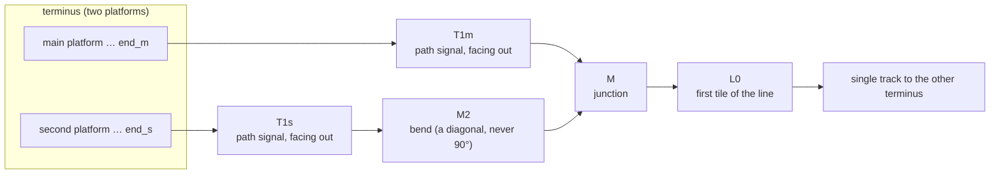

# Rail lines that pay: geometry, a steward and a monitor

**RESEARCH-ONLY.** How the owner's bot builds rail that trains can always run, and what keeps
each line paying afterwards. The parts:

- the bot (PrismaticAI, [`tools/research/prismatic-ai/`](../tools/research/prismatic-ai/README.md))
  builds the line;
- the Rhai steward
  ([`rail_steward.rhai`](../tools/research/mcp-panel/rhai/rail_steward.rhai)) decides what each
  line should run;
- the Rhai monitor
  ([`rail_monitor.rhai`](../tools/research/mcp-panel/rhai/rail_monitor.rhai)) reports what is
  wrong to the Majordomus board;
- the panel's Scripts page edits and runs these scripts, and reloads a running script when its
  file changes.

Every number is derived from the game or from the line's own record, and the scripts name no line,
station or engine.

## The problem: a train that cannot turn earns nothing

The owner saw trains that could not turn around and lines that lost money. The game's rules
explain it:

- **90-degree turns are forbidden by default.** `pf.forbid_90_deg` defaults to `true`
  (`src/table/settings/pathfinding_settings.ini`). The track follower then cuts every trackdir that
  crosses the one the train arrives on (`follow_track.hpp`, `TrackdirCrossesTrackdirs`).
  - On a 4-neighbour grid, a 90-degree turn is two corner pieces on adjacent tiles that turn the
    same way: the moves `d1, d2, d3` with `d3 == -d1`.
  - Alternating corners (`d3 == d1`) are a 45-degree diagonal, which is allowed.
  - A line holding one forbidden turn is two dead ends to a train. The train finds no path, gets
    lost, turns at the end of the track, and never reaches its destination.
- **The old search checked this only in the middle of the line.** At the first tile beyond a
  station, the direction "before" was taken as the current one. A turn right after the exit and a
  turn right before the far station were therefore never compared with their neighbours.
- **A re-plan around a refused piece started blind.** It started as if from a straight platform,
  so its first new corner could make a 90-degree turn with the last piece already laid.
- **Depots were joined to the line on any tile, corners included.** The two joining pieces then
  meet the line's own corner at 90 degrees, and a train leaving the depot may take neither way.
- **One platform per station limited a line to one train.** Two trains on one track without
  signals would meet head-on, so capacity could grow only by wagons.

## The geometry the bot builds now

`tools/research/prismatic-ai/PrismaticAI/rail.nut`:



| Rule | Where | Why |
|---|---|---|
| `Turns90(d1, d2, d3)` rejects `d1 != d2 && d2 != d3 && d3 == -d1` | `FindRailPath` on every step, the step one beyond `from` (using `from_end`), the goal step into `to_end`, and a re-plan (`from_in`) | the game's own 90-degree rule; also faster: no 90-degree slowdown where it is allowed |
| Two platforms and a two-tile throat (`rail_platforms`, default 2) | `BuildRailStationAt`, `TerminusGeometry`, `BuildThroat` | The second platform bends onto the main row at `M` as a diagonal, never at 90 degrees. The site check covers platforms and throat together: flat, buildable, and an exit that leads on |
| Straight through each throat's first line tile (`L0`) and into the far one | `FindRailPath` `from_straight` / `to_straight`, `ExitLeadsOn(…, straight)` | The second platform joins the line by a sideways move (M2 to M). A corner on `L0` toward its side would be a 90-degree turn on the second platform's route only, invisible from the main one (found by Codex's independent review, 2026-11-18) |
| A path signal on each platform's exit (`T1m`, `T1s`) | `BuildThroat` | A train leaves only when it can reserve its whole way into a free platform at the other end (a dead end counts as a safe position, `pbs.cpp` `IsSafeWaitingPosition`). It never waits on the single track, so up to `trains_max` = the smaller end's platforms share it with no passing loop |
| A search's node budget follows its distance | `FindRailPath` (`RAIL_NODES_PER_TILE` 200 a tile, at least 2000, at most 150000; track B twice track A's nodes) | A search that cannot reach its goal tries every tile it can reach first: 202 to 331 game days each on seeds 930967890, 1814625749 and 4242, one a re-plan between tiles ten apart, and on the fitness seed the planned bot's money sat idle for fifteen months. The 42 searches that found their line there used at most 148 nodes a tile (median 66). Each search now logs its nodes and game days |
| The laid line is walked | `VerifyRailLine` (`AIRail.AreTilesConnected`) | A gap shows up as a warning with its tile, never as a lost train. A missing piece is laid once more |
| The depot behind a platform's dead end | `BuildRailDepotBehind` | Trains reach it through their own platform and leave inside the signals. As a fallback, beside a straight piece only (`BuildRailDepotBeside`) |
| Platform length and wagons from demand | `PlatformPlan` | `wagons = ceil(supply × trip_days / 30 / trains / capacity)`, where the trip is both ways at the locomotive's speed (0.036 tiles a day per km/h) plus a week at the stations. The platform holds the locomotive and the wagons at half a tile each, capped by `vehicle.max_train_length` and `station.station_spread`. `BuildTrain` checks the real length (`AIVehicle.GetLength`) |

## The steward: each line as desired state

The bot builds and the steward decides. The bot then reconciles the line to the steward's target
(`lines.nut` `ReconcileLines`).

1. **Record.** Every line logs one record at build time and again every game month:
   `PrismaticAI: rail line <slot>: label=…|a=…|b=…|st_a=…|st_b=…|cargo=…|platforms=…|len=…|depot=…|trains_max=…|wagons_fit=…|tiles=…|state=…`.
   The panel stamps each ai.log event with its company.
2. **Read** (`rail_lib.rhai`). The steward joins the records with `openttd://vehicles` (trains
   whose orders name both stations), `openttd://stations` and `openttd://engines`. Waiting cargo
   comes from the Script API in test mode (`ScriptStation.GetCargoWaitingVia`), which reads and
   changes nothing.
   - Under cargodist it is the cargo routed to the other stop.
   - Under manual distribution every waiting unit's next hop is `STATION_INVALID`, so it is the
     cargo waiting via any station.
   - Line records carry their station ids (`st_a`, `st_b`), so a joined platform inside a
     neighbour's catchment still finds its own station.
3. **Decide** (`target`, thresholds in `policy()`):
   - **close** a line that lost money last year and again this year, once its oldest train is
     past `judge_after_days` (400: profit resets on 1 January);
   - **lengthen** while a trainload or more waits and the platform has room (`wagons_fit`);
   - **add a train** once the trains are full length, up to `trains_max`;
   - **shrink** by one train when almost nothing waits and the newest train lost money.
4. **Choose** (`choose`). Closing and shrinking are always chosen. The rest goes through
   AlgoGlyph's `knapsack-dp` kernel over the money above the bot's `cash_reserve`.
   - Cost is what the change asks for now. A wagon is priced at the line's own wagons
     (`consist_value` less the front vehicle's `value`, from `openttd://vehicles`), and lengthening
     pays for every train of the line. A new train is the locomotive's price now plus its wagons.
   - Gain is the line's own profit per unit of capacity times the capacity added.
   - Without AlgoGlyph the steward chooses greedily by gain per cost, and the answer says which
     solver ran.
5. **Hand over.** A setting already asked for the same value is not asked again while its approval
   is pending, nor within `RETRY_ROUNDS` after the owner left it unapproved. A new value is asked
   at once. Each target is a setting of the bot, `line<slot>_trains` (0 closes the line)
   and `line<slot>_wagons`, set through `openttd.ai.set_setting`. That call waits for the owner's
   approval unless the owner switched auto-approve on (knowledge
   `auto-approve-is-the-owners-switch`).
6. **Reconcile** (the bot, every heartbeat):
   - a train with a different wagon count goes to the depot, is resized there and is started
     again;
   - a missing train is cloned with shared orders;
   - a surplus train is sold;
   - a closing line sells its trains, then removes its track, its own platforms and throats, and
     its depot, so it stops costing maintenance. The removal never touches what is not the line's:
     - a level crossing loses only its rail (`AIRail.RemoveRail`), and the town keeps its road;
     - a station loses only this line's platforms (`AIRail.RemoveRailStationTileRectangle`).
       Demolishing a station tile would remove every platform of the station, a joined line's
       included (`station_cmd.cpp` `RemoveRailStation`);
   - a wagon the game will not refit or couple (a NewGRF rule) is sold again, and a train that
     would carry nothing is not started (`AddWagon`).
7. **Renew.** For each locomotive type the company runs, the steward looks for a buildable one on
   the same rails that is at least `renew_speed_gain` (1.15) times faster. It hands the pair to the
   game's own autoreplace (`ScriptGroup.SetAutoReplace(GROUP_ALL, old, new)` through the Script
   API, gated). The game swaps the engines at the next depot visit, and the company's autorenew
   replaces old ones as before.

`STEWARD_DRY=1` decides and prints without handing anything over. `STEWARD_EVERY_S` sets the
round (default 120 s). A round's decisions are posted to the board as `openttd:<instance>:steward`.

## The in-bot steward's capital

With `self_steward=1` the bot applies the policy above itself (`steward.nut` `SelfSteward`). In
six-year headless matches with the live game's settings, PrismaticAI's profit per train was close
to AAAHogEx's, but it ran 3-9 times fewer trains. Its lines stayed at one or two trains.

**What stopped growth** (master f4c02d0aac, `battle.py ablate`, start 1950, field AAAHogEx,
LuDiAI AfterFix, CivilAI, AdmiralAI, seeds 15805, 2927, 31337 and 4242, `script=4` logs):

- **The signal.** Every line runs full-load orders. A train at the source takes the cargo as it
  arrives, so a trainload waits only when the trains cannot carry it at all. The steward decided
  one to four trains per match, all by the double-track rule (half a trainload waiting). The
  single-track `add_train` rule (a whole trainload waiting) never fired. The 27 lines peaked at one
  to three trains: the double-track ones of 15-37 allowed, the single-track ones mostly at one of
  two.
- **What a shortage looks like instead.** The source station's rating falls with the days since
  the last pickup (`station_cmd.cpp` `UpdateStationRating`), and the industry moves only the
  rating's share of its output to the station. In the branch's yearly state lines, lines with one
  train sat at 27-48%. Lines with a train at the platform most of the time sat at 64-80%.
- **Money, where the loan was drawn.** `RepaySurplus` (main.nut) pays the loan down to the reserve
  after every heartbeat, so the bank seldom held a train's price. In the owner's live game (seed
  15805, 1958-08) a coal line earning 33.9k a year per train kept one train of two. The bank held
  13k, and 250k of the loan was unused.
- **Rare rounds.** The steward runs at most once a game month, on a heartbeat. A heartbeat waits
  for the bot's rail path searches (90-178 game days each) and airport surveys. On the fitness
  seed the monthly line records appeared about once a game year from 1963 on.
- **Single track is a ceiling.** One track carries one train at a time, so a single-track line
  moves about one trainload per two trips whatever it runs. Re-laying the second track of such a
  line later on the junction geometry it was built with failed in all 8 tries in these matches:
  the tiles beyond `B2` were taken by the line's own track A, by roads or by other rail. That code
  was not kept.

**The change** (`steward.nut`, `lines.nut`, `info.nut`):

- **`steward_rating`** (default 55). An earning line (`LineEarns`) gets more trains while its
  source rates the cargo below this percent, a source platform is free and its newest train is
  `STEWARD_SETTLE_DAYS` (90) old. It gets one train, plus one for every 15 points the rating is
  lower, up to `trains_max`.
- **Several trains per round.** The double-track rule adds one train for every full trainload
  waiting (at least one). `ReconcileLines` buys every missing train of a target in the same
  heartbeat, not one per heartbeat.
- **`steward_borrow`** (default 1). An earning line may borrow for its next train (`FundTrain`).
  The company must not be frozen, the loan must stay at most half its limit, and the headroom left
  must still hold a line budget and two quarters of running costs. Early in a game the loan pays
  for new lines. Without these limits, in a replay of seed 4242, a train borrowed with 280k of
  300k drawn froze construction, and the company built four freight lines where master built
  seven.
- **A state line per line**, on the first round of each game year: `steward state line <slot>`,
  with its trains, waiting cargo, source rating, free source platforms and profit.

**Measured** (single matches with the live game's settings, not held-start pairs, rule
`a-tuning-claim-needs-held-start-pairs`; `battle.py ablate`, start 1950, six years; master and
branch on one binary per round):

| seed | arm | rail trains | company value | rail profit last year (`prail`) | AAAHogEx trains |
|---|---|---|---|---|---|
| 15805 | master 3ed759fd1e | 6 | 746,829 | 126,467 | 47 |
| 15805 | branch | 7 | 754,212 | 113,637 | 46 |
| 2927 | master 3ed759fd1e | 9 | 2,486,144 | 300,766 | 46 |
| 2927 | branch | 12 | 3,106,114 | 445,637 | 45 |
| 31337 | master 3ed759fd1e | 12 | 2,290,859 | 394,295 | 66 |
| 31337 | branch | 14 | 2,044,513 | 261,169 | 49 |
| 4242 | master 3ed759fd1e | 7 | 1,716,762 | 264,104 | 28 |
| 4242 | branch | 17 | 2,609,134 | 501,960 | 43 |

On master 3ed759fd1e (binary `94f7ee692f`) the branch ran 50 rail trains against 34. Its rail
profit was 1.32M against 1.09M, and its value was 14.4% higher as a geometric mean, ahead on three
seeds of four. In an earlier round on master f4c02d0aac (binary `94de29ae5b`) it ran 52 trains
against 39, with rail profit 1.76M against 1.55M and value 7.2% higher, also ahead on three seeds
of four.

The games diverge within the first years, so each row is one sample of a chaotic process. On
31337 the branch built fewer freight lines because its path searches failed differently, and
AAAHogEx's own count moved by up to 17 trains between the arms. The borrowing path (`FundTrain`
from the loan) did not fire in any of these matches: in them the bank held the price whenever the
steward wanted a train. It is the owner's live-game case above and has not been run end to end.

**Tried and not kept.** Two attempts did not work:

- An idle-money rule: more trains while last year's profit per train paid a train back within
  two years. It reached 66 trains, but value fell on all four seeds against the branch above,
  because trains that only share a saturated line's cargo dilute it.
- `rail_feed=3` and `rail_grow_max=7` as variants on top of the change: -44% to +25% by seed, so
  no conclusion.

**Open.** The single-track lines need a second-track design that reserves its corridor when the
line is built. Most of the remaining gap is supply: a line saturates at about one producer's
output. The steward's wait on the heartbeat is the next section.

## The steward between heartbeats

**The problem.** The steward ran once a game month at most, on a heartbeat, and a heartbeat waits
for everything the bot builds in it. A rail path search takes 28-160 game days (seed 2927), a
double-track line runs two, and a heartbeat with a line, an airport and a few bus routes takes
most of a year. In ten-year matches of master 11411cdc4d (live settings, `battle.py ablate`,
start 1950, field AAAHogEx, LuDiAI AfterFix, CivilAI, AdmiralAI, NoCAB, DictatorAI, SimpleAI) the
steward's rounds came 1-3 times in most game years, up to 548 days apart. A line whose source
rating fell waited that long for its next train.

**The change** (`steward.nut` `MaintenanceYield`, `MaintenanceRound`; `rail.nut` `FindRailPath`,
`BuildRailAlong`; `lines.nut` `ReconcileLines`, `FundTrain`). The search loop of `FindRailPath`
checks every 512 nodes whether a game month has begun since the last round. The check is one API
call and a comparison. When one has, a maintenance round runs right there:

- it decides (`SelfSteward`), adds at most four trains to running lines (`ReconcileLines`), and
  buys a first or replacement train or a pending depot (`KeepLinesServed`, one per line at most);
- it pays only from money beyond all of the loan, the cash reserve and one line budget. The
  builder takes the whole loan before a line and lays it from that money, so a round never spends
  it. A round never borrows. A company that builds on borrowed money buys nothing in a round and
  waits for its heartbeat, as before; a company with money of its own buys;
- it never resizes, shrinks or closes a line, and builds no line. A train sent to be sold would
  wait in its depot for the heartbeat's `ManageFleet`. `CloseHaltedLines` demolishes a whole line
  with hundreds of commands and pays for it without a reserve check, so it stays in the heartbeat,
  like `TwinLines`, `GrowPlatforms` and `FeedStations`;
- it never runs while track is being laid. `BuildRailAlong` counts its frames in `MAINT_LAYING`,
  so the search of a re-plan inside a laying yields nothing. A round never runs inside another
  round either;
- it keeps the builder's state: its own `AIAccounting` (the double track's cost of track A decides
  whether track B is affordable; `ScriptAccounting`'s destructor restores the outer count), exec
  mode, and the current rail type.

The heartbeat's `SelfSteward` skips a month a round already decided, so a line changes at most once
a game month. Each round logs `steward round <n> on <y-m-d> (survey|heartbeat)`. This is where the
cadence below is measured from.

**FundTrain.** A train the steward adds is paid from the bank when it holds the reserve plus the
price. Otherwise, for a line that earns, it is paid from the loan within the bounds of
`steward_borrow`. The loan is now raised in whole steps rounded up: `/ step + 1` borrowed one step
too many when the shortfall was a whole number of steps. A borrow logs the loan after it, the
limit, and the headroom left. A refusal by the bounds is logged once per line and reason. A clone
that will not start is sold at once, and a clone copies a running train, never one on its way to
be sold.

**Measured.** Single matches, not held-start pairs (rule `a-tuning-claim-needs-held-start-pairs`):
`battle.py ablate`, ten years from 1950, the live game's settings, the field above, `-d script=4`.
Round 1 compares master 11411cdc4d with the maintenance round alone (commit 20d4f97f29), both on
binary `build/openttd` of 2026-11-23 00:39. Rounds are the `steward round` lines; on master, which
logs none, they are the first heartbeat of each new game month, where its gate opens.

| seed | arm | rounds a year (1951-59) | longest gap | trains added (inside a search) | rail trains | value | AAAHogEx value |
|---|---|---|---|---|---|---|---|
| 15805 | master | 1-12 (median 3) | 386 days | 14 (0) | 19 | 3,194,006 | 17,990,949 |
| 15805 | round 1 | 5-12 (median 12) | 249 days | 19 (13) | 22 | 2,351,483 | 15,004,380 |
| 2927 | master | 0-3 (median 1) | 548 days | 12 (0) | 22 | 6,974,317 | 23,296,935 |
| 2927 | round 1 | 7-12 (median 12) | 193 days | 19 (16) | 29 | 6,687,819 | 18,176,319 |
| 4242 | master | 1-6 (median 2) | 467 days | 10 (0) | 18 | 5,075,273 | 18,842,390 |
| 4242 | round 1 | 3-12 (median 11) | 226 days | 13 (5) | 19 | 4,356,218 | 16,667,892 |

The cadence is what the change is for: about a round a game month in place of one to three a
year. The longest gaps that remain are heartbeats whose time goes to laying track, station and
airport surveys and road building, where no round runs. The trains followed: 3-7 more rail
trains on every seed, most of the added ones bought inside a search. Company value fell on all
three seeds (-26%, -4%, -14%) while AAAHogEx's moved by up to 5.1M between the arms of one seed,
so these single matches do not measure the value effect. Double-track lines allowed 18-39 trains
still ran 2-3; the next section asks why.

FundTrain's borrowing path, end to end, on a copy of the owner's live save
(`final-15805-0106.sav`, 1964-11, null driver, scratch HOME, 45000 ticks) with `test_borrow=1` in a
scratch copy of the bot. Company 0 held about 736k, so without the hook every train was paid from
the bank, as in every match before:

```
self-steward line 3 (IORE Wruntwood Iron Ore Mine - Sunfingburg Steel Mill): add_train (rating): 51% at the source, below 55%, ...; 1 -> 2 of 2
borrowed 30000 for a train of IORE Wruntwood Iron Ore Mine - Sunfingburg Steel Mill (price 28429, bank was 5000; loan now 30000 of 300000, headroom 270000 for a line budget of 30000 and a quarter of 10487)
rail line 3: added train 2652 (2 of 2)
repaid 30000 of the loan (now 0)
borrowed 30000 for a train of COAL Minnbridge Coal Mine - Dontford Power Station (price 28310, bank was 5000; loan now 30000 of 300000, headroom 270000 for a line budget of 30000 and a quarter of 11281)
rail line 1: added train 2923 (2 of 2)
repaid 30000 of the loan (now 0)
```

The borrow is the shortfall in whole loan steps (28,429 above a bank counted at the 5,000
reserve: three steps of 10,000), the loan stays at a tenth of its limit, the headroom keeps the
line budget and two quarters, and `RepaySurplus` repays it at the end of the same heartbeat. The
bound refusing a borrow, from a two-year match of seed 2927 with `test_borrow=1`:

```
no loan for a train of COAL Gundhead Coal Mine - Bindingstone Bay Power Station: the loan would pass half its limit (loan 300000, wanted 300000 of 300000, line budget 30000, a quarter 5089)
```

## Trains from supply

**The problem.** The merged analysis
([`analysis-2026-11-23-why-prismatic-loses.md`](analysis-2026-11-23-why-prismatic-loses.md))
found double-track lines allowed 33-39 trains running 2 ("2 of 33", "2 of 39", 1955-01-02).
PrismaticAI ran 1.54 trains a line at 1960-01 and AAAHogEx 3.24. The steward's only growth rules
were waiting cargo, which full-load orders hide, and the source rating. AAAHogEx sizes a line's
trains from its production.

**The change** (`steward.nut` `LineSupply`, `LineTrainTarget`; setting `steward_target`, default 1).
A freight line's target is the trains that carry its monthly production over one round trip:
production × round-trip days / (30 × a trainload), rounded up, at most `trains_max`. The
production is the line's producer's plus that of every producer feeding its source station
whose cargo someone carries. The round trip is the line's tiles both ways at the locomotive's top
speed plus a week at the stations, the estimate `PlatformPlan` sizes platforms with. A line below
its target that earns, and whose newest train has run 90 days, gets a batch up to the target, at
most doubling. `ReconcileLines` buys a batch whole in a heartbeat, or four at a time in a round
inside a search. The yearly state line logs the supply, the round trip and the target. Reviewed by
Codex before it ran; two of its findings were adopted: settle on the newest train, so batches do
not follow each other, and count only fed producers whose cargo is carried.

**Measured** (single matches, as above; master e95a0e37aa against the branch with both changes,
same binary, ten years):

| seed | arm | rounds a year (1951-59) | longest gap | lines open | rail trains | trains a line | trains added (supply rule) | shrinks | value | AAAHogEx value |
|---|---|---|---|---|---|---|---|---|---|---|
| 15805 | master | 1-12 (median 3) | 386 days | 10 | 19 | 1.9 | 13 (0) | 3 | 3,201,751 | 18,338,114 |
| 15805 | branch | 11-12 | 83 days | 12 | 24 | 2.0 | 18 (15) | 6 | 3,168,025 | 20,754,068 |
| 2927 | master | 1-4 (median 2) | 369 days | 14 | 29 | 2.1 | 15 (0) | 2 | 7,955,336 | 14,654,054 |
| 2927 | branch | 3-12 (median 12) | 341 days | 12 | 26 | 2.2 | 17 (14) | 3 | 5,793,107 | 20,523,497 |
| 4242 | master | 0-9 (median 2) | 609 days | 9 | 15 | 1.7 | 10 (0) | 4 | 3,552,135 | 20,515,903 |
| 4242 | branch | 8-12 (median 12) | 165 days | 11 | 24 | 2.2 | 17 (11) | 5 | 3,691,446 | 18,716,831 |

What it shows:

- **The cadence holds:** about a round a month on all three seeds, the longest gap 83-341 days
  against 369-609.
- **More trains, a little deeper lines:** rail trains 19 → 24, 29 → 26 and 15 → 24 on lines that
  also differ in number; trains a line 1.7-2.1 → 2.0-2.2. The supply rule made most of the adds.
- **The ceiling is the producer, not the rule.** The targets it computed were small: a forest or
  mine of 80-190 a month over a 59-121-day round trip in trainloads of 210 needs one or two trains
  ("80 a month over a 101-day round trip in trainloads of 210 needs 2 of 2"; a double-track line
  "supply 120 a month, round trip 76 days, target 2 trains" of 29 allowed). The double-track lines
  stayed at 2-3 trains because their producers fill no more, so the waiting-cargo rule was not what
  held them there.
- **The line being built kept its money.** No match of either arm logged `still short of money`,
  and `no second track` (track B refused as unaffordable or unfound) came 8, 11 and 8 times on
  master and 11, 7 and 8 on the branch: a round inside track B's search did not starve it.
- **The second train churned, and the shrink judged it too early.** The shrinks rose from 2-4 to
  3-6 a match; line 6 of seed 15805 (WOOD, 80 a month) went 1 → 2 → 1 → 2. Of the branch's 13
  shrinks, 10 sold a train bought during the year before, judged on its profit "last year", which
  covered only the months it ran. The owner's game 21647 showed the same on 1955-09-01: lines 7 and
  10 each sold the second train they had just got, both for "lost -1017". The rule waited
  `STEWARD_JUDGE_AFTER_DAYS` (400) days, which does not cover a calendar year: a train bought in
  July is 400 days old in August of the next year. Now a train's profit last year judges it only
  once it ran all of last year (`JudgeAge`: at least the days since 1 January of last year), for
  the shrink, the close and `LineEarns` alike. Rerun with that fix on seeds 15805 and 4242
  (same settings and binary): one shrink a match, each of a train that ran all of the year before
  it was judged on; rail trains 22 and 22, value 2,990,237 and 4,067,890 (master 3,201,751 and
  3,552,135), longest gap between rounds 66 and 112 days.
- **A close was decided on days of a year, too.** The close rule asked for a loss last year and
  this year. In January "this year" is a few days of running costs before the first delivery: of
  the 10 closes in the matches above (both arms), 4 came on day 1-12 of a year ("lost -2296 last
  year and -13 this year", 1958-01-02, seed 2927). Now a line closes only when the trains that ran
  all of last year lost money in it and the line still loses money after the first 90 days of this
  year. The owner's game 21647 closed line 7 (OIL Runnley Oil Wells) on 1957-08-25, after its
  second train had been sold on a partial year in 1955; whether its oil wells were declining the
  Script API cannot tell from one month's production, so the rule reads the trains' money only.
- **Value: no conclusion.** -1.1%, -27.2% and +3.9%, while AAAHogEx's own value moved by up to
  5.9M between the arms of one seed. Single chaotic matches do not measure it, and no default here
  changes on the strength of these numbers alone (rule `a-tuning-claim-needs-held-start-pairs`).

**Open.** Trains a line is bounded by supply: deeper lines need more producers per station (the
feeders of `growth.nut`) or shorter, more frequent trains, which keep the station rating up, as
AAAHogEx's estimator sizes them. Whether the target should round to the nearest train, so a
line that needs 1.3 trainloads a trip keeps one, has not been measured.

## The monitor: what is wrong, on the board

`rail_monitor.rhai` runs a round every `MONITOR_EVERY_S` (default 60 s) and reports, worst first:

| Kind | From |
|---|---|
| `crashed` | `openttd://vehicles` `crashed` |
| `lost` | `openttd://vehicles` `lost` (`VehicleFlag::PathfinderLost`, the "is lost" news): no way to the destination, a broken line or a forbidden turn |
| `unserved` | a line record with no train |
| `warning` | the bot's rail warnings since the last round: no rail path, a broken line, a refused throat or piece, no depot |
| `broken_down` | `openttd://vehicles` `broken_down` (`breakdown_ctr == 1`, stopped now) |
| `stopped` | a train stopped outside a depot |
| `old` | a train past its maximum age |

The monitor posts to the Majordomus board as the named claim `openttd:<instance>:rail`. It posts
when the report changes, and at least every `MONITOR_REPEAT_S` (600 s) while problems last.
Every agent session sees the post in `majordomus_blackboard` and `majordomus_peers`.
`board_post(claim, text)` is the Rhai side of `tools/research/mcp-rhai/src/board.rs`, the client
`mcp-bus-blackboard` also uses. `MCP_BOARD_DRY=1` prints the post instead of sending it.

### The game's advice

The game tells the player what goes wrong with their vehicles in advice news: a vehicle is lost, a
train is stuck, a vehicle lost money last year or is old, an order is wrong, autorenew or a refit
failed, a vehicle waits in a depot, an aircraft's next airport is too far. The panel publishes
every item as `news.shown` with its `advice` and `refs`
([News in the owner's window](mcp-control.md#news-in-the-owners-window-both-ways)). The monitor
reads them every `ADVICE_EVERY_S` (2 s), so the bus's 5000-event window never drops one
unread, with the pure functions of
[`advice_lib.rhai`](../tools/research/mcp-panel/rhai/advice_lib.rhai):

1. **Group.** One advice about one vehicle is one group, however often the game repeats it.
2. **Join.** Each group is joined with its vehicle now (`openttd://vehicles`): type, unit, owner,
   tile, profits, `lost`, and its line: the bot's rail line label when the train runs one, else
   the names of the stations its orders visit.
3. **Judge.** An advice still holds while its condition does: a lost vehicle while `lost` is set,
   an unprofitable one while last year's profit is below zero, an old one while it is past its
   maximum age. A vehicle that is gone needs nothing.
4. **Report.** Per company: the tally `advice.<company>` on the shared blackboard (counts by
   advice and the newest groups; every write is a `rhai.shared` event, so it reaches the bus and
   the store), and an `observation` record on the Majordomus mesh (task
   `openttd:<instance>:advice:<company>`) when the panel has a mesh session. A mesh failure is
   printed once per reason and never stops the monitor.
5. **Tell the owner.** One chat line for each advice that is new and still holds, for the owner's
   company only, at most `ADVICE_SAY_MAX` (3) a look, and the same vehicle again only after
   `MONITOR_REPEAT_S`: "train 8 lost on line COAL A - B: track broken near tile 1234 (18, 19)?".
   The owner's company is `$MONITOR_OWNER_COMPANY` when set, else the company the window shows
   advice for: the game raises advice only for the window's own company. `MONITOR_CHAT=0` prints
   the lines instead.

The monitor observes and reports. It issues no game command and approves nothing; repairing a
broken line is the bot's own work.

## The Scripts page: an editor, services and hot reload

The panel serves `/scripts` and `/scripts/<name>`
([`static/scripts.html`](../tools/research/mcp-panel/static/scripts.html),
[`scripts.js`](../tools/research/mcp-panel/static/scripts.js),
[`src/panel_scripts.rs`](../tools/research/mcp-rhai/src/panel_scripts.rs)). The page is part of
the panel's one shell.

- **Library.** Every `.rhai` file of `$MCP_RHAI_PATH` (default `tools/research/mcp-panel/rhai`),
  with what its own text says:
  - its header comment as documentation;
  - its imports;
  - the scripts that import it, which makes it a library;
  - its service state.
- **Editor.**
  - Rhai highlighting, line numbers and an outline of its functions with their `///` docs.
  - A live parse check that marks the error's line (`POST /api/script/check`).
  - Save takes only text that parses (`POST /api/script/save`). The file is written in place, so
    the repository's diff shows the change and committing stays the owner's.
  - Keys: Ctrl/Cmd+S saves, Ctrl/Cmd+Enter runs, Escape stops a run, Tab indents.
- **Run once.** The editor's text runs in the panel's process, and its output streams to the page
  (`POST /api/rhai/stream`).
- **Service.**
  - The saved script runs in the background (`POST /api/services/start`, `/stop`), and its log
    streams into the page (`GET /api/services/log`).
  - **Hot reload:** a watcher looks every second, and a running service whose file, or any library
    it imports, changed is restarted on the new text. A library in a subdirectory
    (`import "policy/lib"`) counts, and a template import (`` import `policy/${name}` ``) counts
    every script under its directory. This works for a Save on the page and for an
    edit in any editor. A change that does not parse leaves the old run going and says why in the
    log.
  - A file changed on disk is loaded into the page when the page holds no unsaved edit, and
    offered otherwise.

The routes are declared once (`src/panel.rs` `routes()`), so they are also in `/openapi.json`,
Swagger UI at `/docs`, and every Rhai script as `api_scripts()`, `api_serviceStart(#{name})` and
so on.

## Surfaces that changed

| Surface | Change |
|---|---|
| `openttd://vehicles` | `lost`, `broken_down`, `engine_id` per vehicle |
| `openttd://engines` | for trains: `wagon`, `power_hp`, `railtypes` (labels) |
| Panel HTTP, OpenAPI, Rhai `api_*` | `/api/scripts`, `/api/script`, `/api/script/check`, `/api/script/save`, `/api/services`, `/api/services/start`, `/api/services/stop`, `/api/services/log`; the page `/scripts` |
| Rhai built-ins | `board_post(claim, text)` |
| Bot settings | `rail_platforms`, `rail_len`, `line<N>_trains`, `line<N>_wagons`; `rail_wagons` 0 now means derive |

## What was checked

- **Held-start A/B on three seeds** (24 months, two duels at a time, rule
  `project.a-tuning-claim-needs-held-start-pairs`). The new geometry against the bridge's
  previous bot (19c2cbe), measured on the planned company's value:

  | Seed | New | Old | Change |
  |---|---|---|---|
  | 4242 | 265418 | 211797 | +25.3% |
  | 31337 | 517772 | 348825 | +48.4% |
  | 20208 | 415994 | 234031 | +77.8% |

  - It starts behind (two-platform termini cost more) and overtakes by month 18.
  - No arm logged a broken line. The stricter sites refuse a few more lines: "no rail path" came
    2, 4 and 0 times against 2, 0 and 0.
  - The unplanned rival runs each arm's own AI, so it is not a control. The direction is the same
    on all three seeds.
  - The records and their reading: knowledge `rail-lines-a-train-can-turn-on`.
- **A 12-month duel on seed 4242** (`research/results/duel-20261118T063729-seed4242.md`). The
  bot ran with the new geometry, before the steward and line slots existed.
  - Six rail lines were built, each with two-platform termini at both ends, a throat with path
    signals, and a depot behind a platform.
  - None logged "no rail path", a broken line or a refused throat.
  - At month 12 the planned company had 6 trains and was worth 55,349, against 7,840 for the
    unplanned one.
  - This is one run; the held-start A/B on three seeds above is the comparison.
- **The bot reconciling its line targets**, in a 12-month duel on seed 4242 with
  `--bot-settings line1_wagons=3,line2_trains=2`
  (`research/results/duel-20261118T071045-seed4242.md`). These are start settings, which are not
  gated, so the owner's approval gate was never bypassed.
  - `openttd://vehicles` read during the run showed line 1's train shortened from 5 wagons to 3
    (4 parts).
  - Line 2 ran two trains on its single track, one moving while the other waited in its platform,
    and neither was lost or crashed.
  - A target above the platform's `wagons_fit` (6 for 5) was capped and caused no resizing loop
    (the run on port 8871).
  - The duel record keeps a selection of the bot's log, not the reconciliation lines: the evidence
    is the game state read during the run.
- **Closing a line, live**: an 8-month duel on seed 4242 with `--bot-settings line1_trains=0`
  (`research/results/duel-20261118T090800-seed4242.md`; the full log from the panel's DuckDB
  store).
  - Line 1 was built on 1950-02-04.
  - On 1950-03-13 its train went to the depot to be sold.
  - On 1950-05-01 the line was closed with 233 tiles cleared. Its record then said
    `state=closed` with both station ids gone (`st_a=-1`).
  - The company's other lines kept running.
  - The company value of 1 is the point of the test, not a result: the line was closed on
    purpose.
- **An independent review in two passes** by Codex, read-only over the branch (Gemini's CLI is
  refused for this account, and no valid OpenAI key or local model was available).
  - The first pass found 14 defects, among them that closing a line demolished joined platforms
    and crossing roads, and that a corner beyond a throat was a 90-degree turn on the second
    platform's route.
  - The second pass confirmed those fixes and found 6 gaps: a re-plan past a throat, wagon
    prices, the steward re-asking pending targets (Rhai passes maps by value), comment-only
    browser checks, shared temporary files and indented code taken for a diagram.
  - Every finding was checked against the code and fixed (commits a837d92, 070a021 and the
    second-pass fix).
- **`cargo test` in `tools/research/mcp-rhai`.** The `rail_*` tests run `rail_lib.rhai` on
  fixtures: records, line assembly, every target, the choice within a budget, renewals, and the
  monitor's ranking and digest. The `panel_scripts` tests cover names, docs, imports, the parse
  check, libraries, and a service that hot-reloads on a library edit, keeps running on an edit
  that does not parse, and stops on request.
- **`tools/research/mcp-scripts-check <panel-url>`** drives the Scripts page in a real Chrome.
  On a stack of this worktree (2026-11-18) it passed 16 of 16 checks:
  - the library list and the marked script;
  - highlighting and line numbers;
  - a typed parse error marked on its line, and Save refused with 422, leaving the file untouched;
  - a new script created from the page;
  - an edit on disk loaded into the editor;
  - a service started with its log streaming in, and reloaded by an edit;
  - Run once streaming its output and exit;
  - no page error, and no horizontal scroll at 390 px.
- **The steward and the monitor on a live game** (`STEWARD_DRY=1`, `MCP_BOARD_DRY=1`, the duel's
  panel).
  - Both read every resource and the line records.
  - The young line got no change, as `judge_after_days` says.
  - The monitor's post went to the board as `openttd:panel-<port>:rail` when it ran as a panel
    service.
  - Its first live run found that `openttd://stations` gives a station's `tile` and
    `catchment_area`, not a rectangle of its own. `station_at` now matches the station's own tile
    first, and a test pins that shape.
- **`node --test tools/research/mcp-panel/test/*.test.mjs`.** `scripts.test.mjs` covers:
  - tokens that join back to every library script character for character;
  - token kinds, escaping, the outline, indenting, stream frames and the address;
  - the page against its script.

## Limits

- **Two platforms, not N.** The throat merges exactly two. A third platform needs a longer
  ladder, and `TerminusGeometry` is where it would go.
- **A closed line leaves no gap in the slots.** Its slot is not reused, and lines beyond slot 24
  get no targets.
- **The bot keeps its lines in memory** (`RAIL_LINES`). An AI restart forgets them, and the
  records in the event store are the only trace.
- **The steward's gain is a line's past earnings per capacity.** A line with no profit yet earns
  nothing in the knapsack, so it is lengthened only after a year.
- **The bot's own per-vehicle sell rule still runs** (`fleet.nut`: older than two years and
  losing money both years). The steward's close rule judges the whole line earlier.
