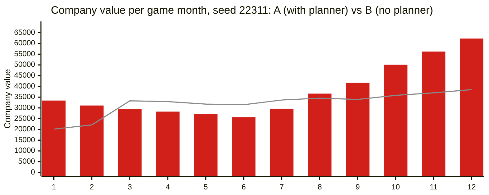
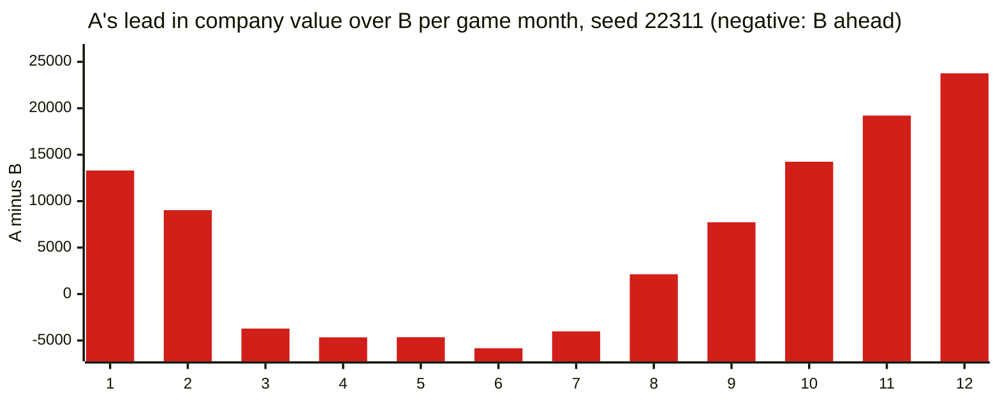
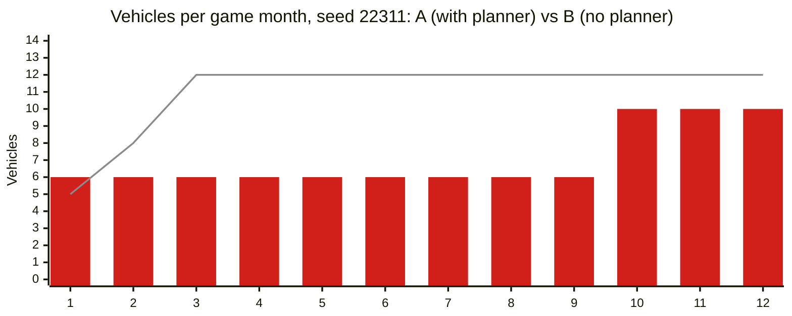

# A/B: the planner's air pair vs no planner (seed 22311, 12 months)

Generated by `tools/research/mcp-ab` (first planner-driven bot, air pair + buses). Both games use the same seed and map and start the same
bot (PrismaticAI). A starts it with the planner's best air pair (`mcp-plan` by_mode.air); B starts it
without one. Figures come from the console's `companies` command, once per game month.

planner: air Neningpool - Frinborough, 299.0 tiles, score 275249.0

The Date column is empty: this run read the date from the wrong field (`data.date` instead of the
envelope's `game_date`). The harness was fixed for later runs; the values are unaffected.

The pair was chosen by planner v2, which did not yet count vehicle costs; planner v3, which does,
also scores this kind of air route positive once a round trip counts both directions.

**Final company value: A 62277 vs B 38514 (difference 23763).**

<!-- ab-charts:begin -->
<!-- generated by tools/research/mcp-ab from this record's JSON; `mcp-ab --render` rewrites it, `mcp-ab --render --check` fails while it is stale -->

<!-- ab-charts:end -->

## A: with the planner's air pair

| Month | Date | Value | Money | Loan | Road vehicles | Aircraft |
|---|---|---|---|---|---|---|
| 1 | None | 33438 | 2404 | 100000 | 4 | 2 |
| 2 | None | 31126 | 1935 | 100000 | 4 | 2 |
| 3 | None | 29581 | 2218 | 100000 | 4 | 2 |
| 4 | None | 28285 | 2701 | 100000 | 4 | 2 |
| 5 | None | 27137 | 3140 | 100000 | 4 | 2 |
| 6 | None | 25665 | 3259 | 100000 | 4 | 2 |
| 7 | None | 29656 | 8972 | 100000 | 4 | 2 |
| 8 | None | 36660 | 17654 | 100000 | 4 | 2 |
| 9 | None | 41671 | 24347 | 100000 | 4 | 2 |
| 10 | None | 50097 | 41 | 100000 | 8 | 2 |
| 11 | None | 56234 | 8219 | 100000 | 8 | 2 |
| 12 | None | 62277 | 16272 | 100000 | 8 | 2 |

## B: without the planner

| Month | Date | Value | Money | Loan | Road vehicles | Aircraft |
|---|---|---|---|---|---|---|
| 1 | None | 20137 | 73460 | 100000 | 5 | 0 |
| 2 | None | 22094 | 48975 | 100000 | 8 | 0 |
| 3 | None | 33298 | 26701 | 100000 | 12 | 0 |
| 4 | None | 32947 | 27579 | 100000 | 12 | 0 |
| 5 | None | 31784 | 27712 | 100000 | 12 | 0 |
| 6 | None | 31500 | 28698 | 100000 | 12 | 0 |
| 7 | None | 33674 | 32095 | 100000 | 12 | 0 |
| 8 | None | 34531 | 34153 | 100000 | 12 | 0 |
| 9 | None | 33946 | 34790 | 100000 | 12 | 0 |
| 10 | None | 35853 | 37817 | 100000 | 12 | 0 |
| 11 | None | 37021 | 40088 | 100000 | 12 | 0 |
| 12 | None | 38514 | 42710 | 100000 | 12 | 0 |
