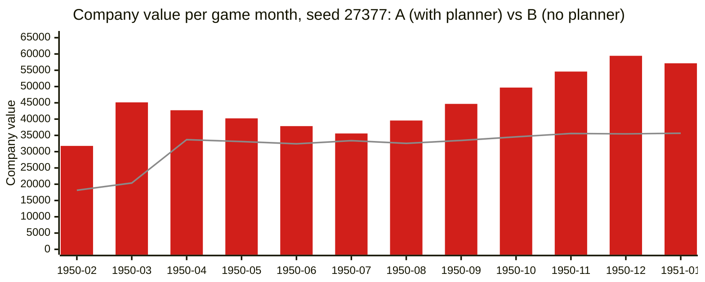
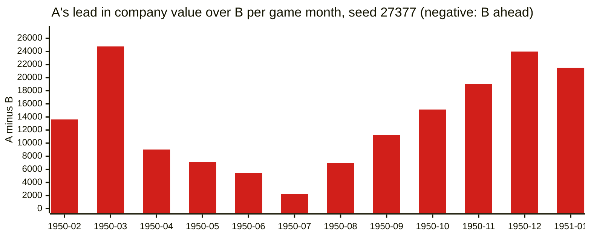
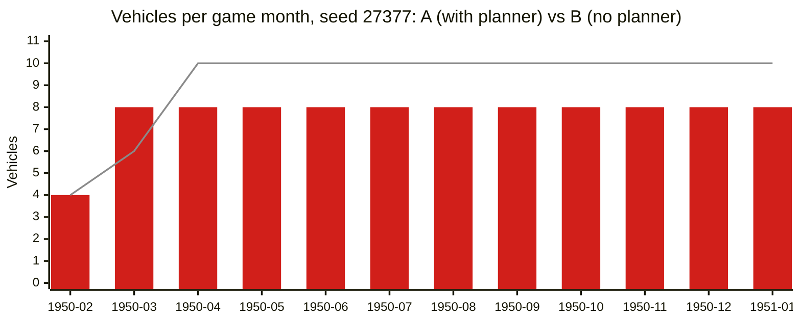

# A/B: the planner's air pair vs no planner (seed 27377, 12 months)

Generated by `tools/research/mcp-ab` (planner v3: rail + air pairs, live vehicle costs, loan to the limit for the line). Both games use the same seed and map and start the same
bot (PrismaticAI). A starts it with the planner's best air pair (`mcp-plan` by_mode.air); B starts it
without one. Figures come from the console's `companies` command, once per game month.

planner: air Plinnpool - Gonningwell, 279.0 tiles, 5 vehicle(s), profit 9271.0/month, score 54307.0

What this run shows, read from the figures: A borrowed to the loan limit for the planner's rail pair,
but no train was built (trains 0 all year), so 222184 of borrowed money sat idle at interest. The
gain over B comes from the air pair and the buses. The bot now gives the loan back when no line is
built (bridge 84c71fe), and later runs store each game's bot log in the JSON (`bot_log`), so a
failure like this one can be explained.

**Final company value: A 57138 vs B 35657 (difference 21481).**

<!-- ab-charts:begin -->
<!-- generated by tools/research/mcp-ab from this record's JSON; `mcp-ab --render` rewrites it, `mcp-ab --render --check` fails while it is stale -->

<!-- ab-charts:end -->

## A: with the planner's air pair

| Month | Date | Value | Money | Loan | Road vehicles | Aircraft |
|---|---|---|---|---|---|---|
| 1 | 1950-02-03 | 31767 | 213353 | 300000 | 2 | 2 |
| 2 | 1950-03-06 | 45137 | 191534 | 300000 | 6 | 2 |
| 3 | 1950-04-06 | 42722 | 191142 | 300000 | 6 | 2 |
| 4 | 1950-05-07 | 40230 | 190639 | 300000 | 6 | 2 |
| 5 | 1950-06-07 | 37844 | 190027 | 300000 | 6 | 2 |
| 6 | 1950-07-08 | 35584 | 189546 | 300000 | 6 | 2 |
| 7 | 1950-08-08 | 39564 | 195454 | 300000 | 6 | 2 |
| 8 | 1950-09-09 | 44671 | 202463 | 300000 | 6 | 2 |
| 9 | 1950-10-10 | 49681 | 209355 | 300000 | 6 | 2 |
| 10 | 1950-11-10 | 54600 | 216122 | 300000 | 6 | 2 |
| 11 | 1950-12-11 | 59438 | 222744 | 300000 | 6 | 2 |
| 12 | 1951-01-11 | 57138 | 222184 | 300000 | 6 | 2 |

## B: without the planner

| Month | Date | Value | Money | Loan | Road vehicles | Aircraft |
|---|---|---|---|---|---|---|
| 1 | 1950-02-04 | 18143 | 78733 | 100000 | 4 | 0 |
| 2 | 1950-03-07 | 20370 | 61762 | 100000 | 6 | 0 |
| 3 | 1950-04-07 | 33691 | 41469 | 100000 | 10 | 0 |
| 4 | 1950-05-08 | 33105 | 41947 | 100000 | 10 | 0 |
| 5 | 1950-06-08 | 32408 | 42276 | 100000 | 10 | 0 |
| 6 | 1950-07-09 | 33375 | 44200 | 100000 | 10 | 0 |
| 7 | 1950-08-09 | 32555 | 44400 | 100000 | 10 | 0 |
| 8 | 1950-09-09 | 33457 | 46323 | 100000 | 10 | 0 |
| 9 | 1950-10-10 | 34554 | 48414 | 100000 | 10 | 0 |
| 10 | 1950-11-10 | 35579 | 50441 | 100000 | 10 | 0 |
| 11 | 1950-12-11 | 35463 | 51305 | 100000 | 10 | 0 |
| 12 | 1951-01-11 | 35657 | 52435 | 100000 | 10 | 0 |
