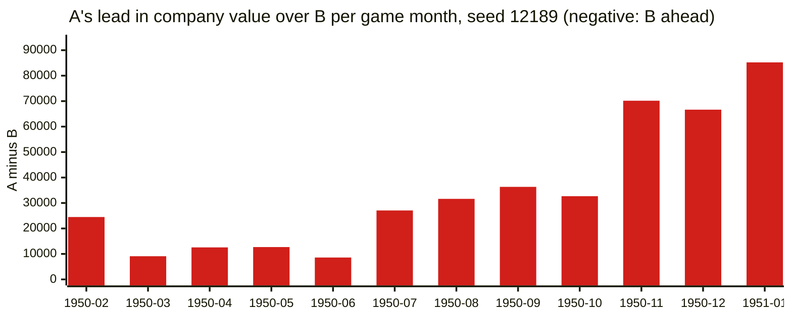
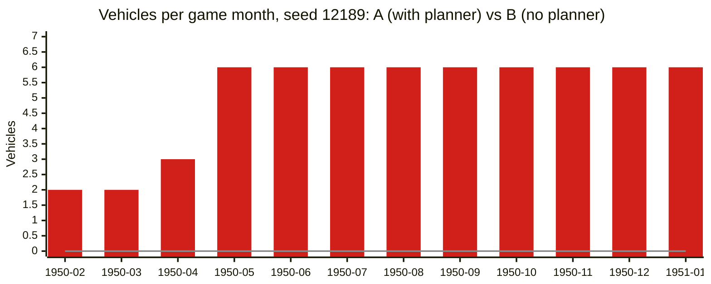

# A/B: the planner's air pair vs no planner (seed 12189, 12 months)

Generated by `tools/research/mcp-ab` (planner v4: AlgoGlyph portfolio, coal by rail, passengers; AI opcode budget at the game's maximum, weighted A*). Both games use the same seed and map and start the same
bot (PrismaticAI). A starts it with the planner's best air pair (`mcp-plan` by_mode.air); B starts it
without one. Figures come from the console's `companies` command, once per game month.

planner: passengers by rail Fenfinghill - Carborough, score 259941.0

**This run's comparison is not valid.** B, the baseline, built no vehicle in the whole year. Its
bot log (in the JSON) shows it surveying bay-stop sites in one town over and over, with every build
failing silently, while it kept building roads for new pairs. That is a bot bug, fixed in bridge
ff417f0 (refusals logged, the search bounded, failed pairs not retried), not a property of "no
planner". What the run does show: A, with planner v4 (portfolio by AlgoGlyph knapsack-dp), built a
215-tile coal line, a 190-tile passenger line and an air route by month 4, and reached a company
value of 85220, the highest of the runs so far. A rerun with the fixed baseline follows.

**Final company value: A 85220 vs B 1 (difference 85219).**

<!-- ab-charts:begin -->
<!-- generated by tools/research/mcp-ab from this record's JSON; `mcp-ab --render` rewrites it, `mcp-ab --render --check` fails while it is stale -->

<!-- ab-charts:end -->

## A: with the planner's air pair

| Month | Date | Value | Money | Loan | Road vehicles | Aircraft |
|---|---|---|---|---|---|---|
| 1 | 1950-02-03 | 24492 | 222926 | 300000 | 0 | 2 |
| 2 | 1950-03-06 | 9099 | 208949 | 300000 | 0 | 2 |
| 3 | 1950-04-06 | 12566 | 169537 | 300000 | 0 | 2 |
| 4 | 1950-05-07 | 12699 | 109945 | 300000 | 2 | 2 |
| 5 | 1950-06-07 | 8590 | 108622 | 300000 | 2 | 2 |
| 6 | 1950-07-08 | 27067 | 129675 | 300000 | 2 | 2 |
| 7 | 1950-08-08 | 31624 | 136749 | 300000 | 2 | 2 |
| 8 | 1950-09-08 | 36334 | 143959 | 300000 | 2 | 2 |
| 9 | 1950-10-09 | 32674 | 142797 | 300000 | 2 | 2 |
| 10 | 1950-11-09 | 70161 | 182879 | 300000 | 2 | 2 |
| 11 | 1950-12-10 | 66650 | 181930 | 300000 | 2 | 2 |
| 12 | 1951-01-10 | 85220 | 203031 | 300000 | 2 | 2 |

## B: without the planner

| Month | Date | Value | Money | Loan | Road vehicles | Aircraft |
|---|---|---|---|---|---|---|
| 1 | 1950-02-03 | 1 | 100000 | 100000 | 0 | 0 |
| 2 | 1950-03-06 | 1 | 99808 | 100000 | 0 | 0 |
| 3 | 1950-04-06 | 1 | 82454 | 100000 | 0 | 0 |
| 4 | 1950-05-07 | 1 | 61649 | 100000 | 0 | 0 |
| 5 | 1950-06-08 | 1 | 39018 | 100000 | 0 | 0 |
| 6 | 1950-07-09 | 1 | 20415 | 100000 | 0 | 0 |
| 7 | 1950-08-09 | 1 | 1643 | 100000 | 0 | 0 |
| 8 | 1950-09-09 | 1 | -134 | 100000 | 0 | 0 |
| 9 | 1950-10-10 | 1 | -326 | 100000 | 0 | 0 |
| 10 | 1950-11-10 | 1 | -518 | 100000 | 0 | 0 |
| 11 | 1950-12-11 | 1 | -711 | 100000 | 0 | 0 |
| 12 | 1951-01-11 | 1 | -903 | 100000 | 0 | 0 |
