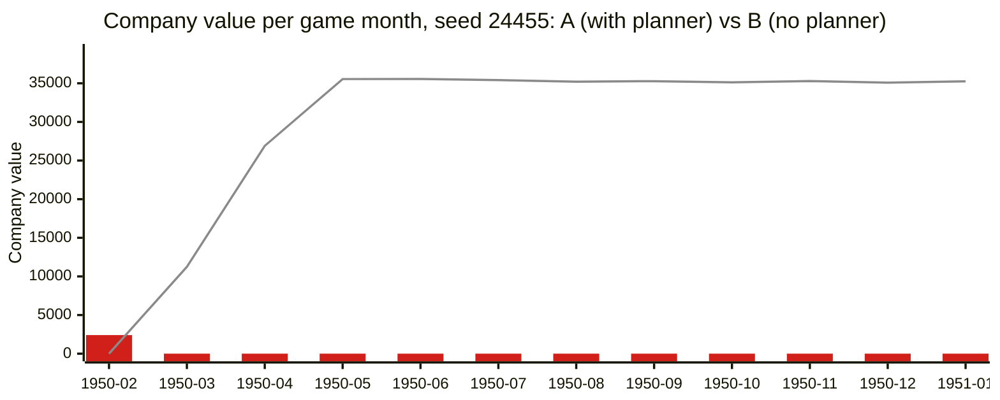
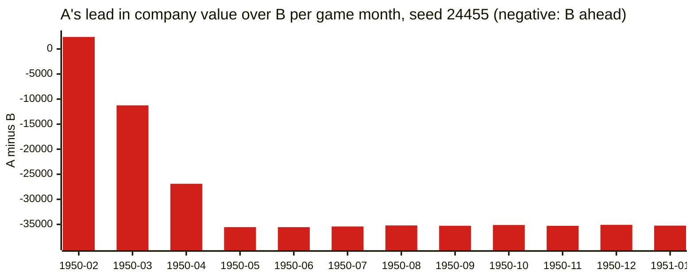
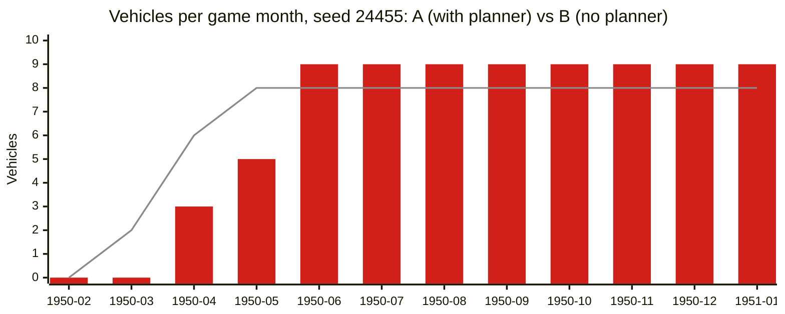

# A/B: the planner's air pair vs no planner (seed 24455, 12 months)

Generated by `tools/research/mcp-ab` (planner v4 rerun with the fixed baseline (bridge ff417f0): AlgoGlyph portfolio, coal and passenger rail vs buses only). Both games use the same seed and map and start the same
bot (PrismaticAI). A starts it with the planner's best air pair (`mcp-plan` by_mode.air); B starts it
without one. Figures come from the console's `companies` command, once per game month.

planner: passengers by rail Menbridge - Bennville, score 317467.0

**The planner lost this run, recorded as it is.** A, with planner v4 (portfolio by AlgoGlyph
knapsack-dp: a coal line by rail), ended the year at company value 1. B, buses only, ended at 35250.
Read from the figures:

- The game's company value counts money minus loan plus vehicles. It does not count track or
  stations, so the roughly 120k that A put into its line shows only through income.
- A's money grew only from about 172k (month 5) to 186k (month 12) with the loan at 300000: the
  line did not pay back within the year.
- The planner scores with `payback_months` 24, while this run measures 12 months.
- A ran the bot version from before surplus-loan repayment and fleet management (bridge db55cd0,
  88efad6).

The earlier wins (+62% twice) came from an air pair, not from freight rail. Next: a run as long as
the planner's payback horizon, a smaller initial fleet that grows with demand, and fleet reduction
on links that carry less than their vehicles can.

**Final company value: A 1 vs B 35250 (difference -35249).**

<!-- ab-charts:begin -->
<!-- generated by tools/research/mcp-ab from this record's JSON; `mcp-ab --render` rewrites it, `mcp-ab --render --check` fails while it is stale -->

<!-- ab-charts:end -->

## A: with the planner's air pair

| Month | Date | Value | Money | Loan | Road vehicles | Aircraft |
|---|---|---|---|---|---|---|
| 1 | 1950-02-04 | 2405 | 297405 | 300000 | 0 | 0 |
| 2 | 1950-03-08 | 1 | 273362 | 300000 | 0 | 0 |
| 3 | 1950-04-08 | 1 | 230887 | 300000 | 2 | 0 |
| 4 | 1950-05-09 | 1 | 197937 | 300000 | 4 | 0 |
| 5 | 1950-06-09 | 1 | 172097 | 300000 | 8 | 0 |
| 6 | 1950-07-10 | 1 | 171793 | 300000 | 8 | 0 |
| 7 | 1950-08-10 | 1 | 171782 | 300000 | 8 | 0 |
| 8 | 1950-09-10 | 1 | 171284 | 300000 | 8 | 0 |
| 9 | 1950-10-11 | 1 | 171324 | 300000 | 8 | 0 |
| 10 | 1950-11-11 | 1 | 183500 | 300000 | 8 | 0 |
| 11 | 1950-12-02 | 1 | 183170 | 300000 | 8 | 0 |
| 12 | 1951-01-02 | 1 | 186318 | 300000 | 8 | 0 |

## B: without the planner

| Month | Date | Value | Money | Loan | Road vehicles | Aircraft |
|---|---|---|---|---|---|---|
| 1 | 1950-02-05 | 1 | 100000 | 100000 | 0 | 0 |
| 2 | 1950-03-08 | 11247 | 89099 | 100000 | 2 | 0 |
| 3 | 1950-04-08 | 26899 | 68147 | 100000 | 6 | 0 |
| 4 | 1950-05-09 | 35546 | 57782 | 100000 | 8 | 0 |
| 5 | 1950-06-09 | 35556 | 58635 | 100000 | 8 | 0 |
| 6 | 1950-07-10 | 35419 | 59335 | 100000 | 8 | 0 |
| 7 | 1950-08-10 | 35214 | 59980 | 100000 | 8 | 0 |
| 8 | 1950-09-10 | 35277 | 60825 | 100000 | 8 | 0 |
| 9 | 1950-10-12 | 35131 | 61471 | 100000 | 8 | 0 |
| 10 | 1950-11-12 | 35293 | 62423 | 100000 | 8 | 0 |
| 11 | 1950-12-03 | 35091 | 62749 | 100000 | 8 | 0 |
| 12 | 1951-01-03 | 35250 | 63672 | 100000 | 8 | 0 |
