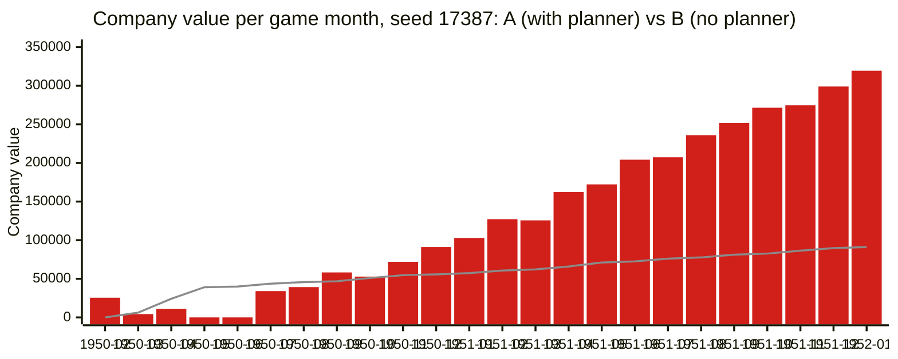
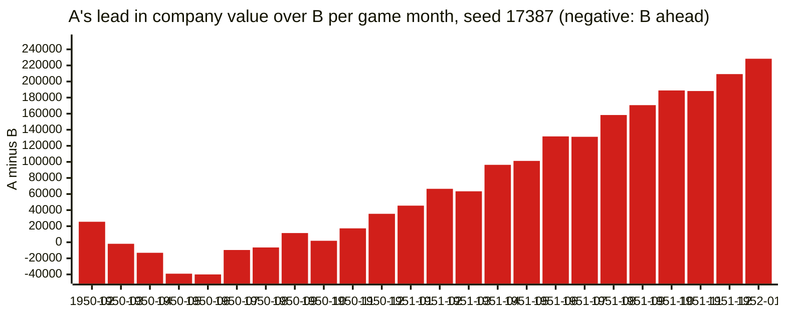
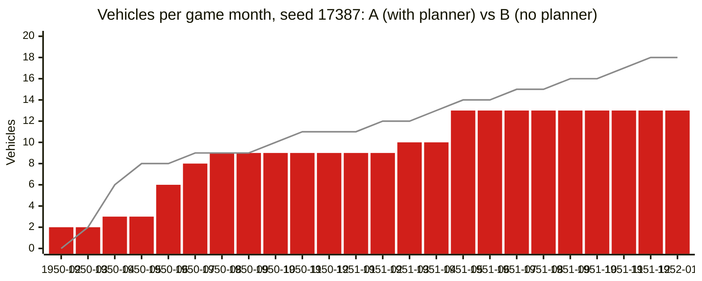

# A/B: the planner's air pair vs no planner (seed 17387, 24 months)

Generated by `tools/research/mcp-ab` (planner v4, 24 months (the planner's payback horizon), bot with surplus-loan repayment and fleet management both ways). Both games use the same seed and map and start the same
bot (PrismaticAI). A starts it with the planner's best air pair (`mcp-plan` by_mode.air); B starts it
without one. Figures come from the console's `companies` command, once per game month.

planner: Wood by rail Forest -> Sawmill, 245.0 tiles, profit 12356.0/month, score 191049.0

**A valid result over the planner's own horizon.** Both games ran the same bot version (bridge
d4ef4fc with surplus-loan repayment and fleet management both ways), and both earned money: B ran 18
buses by the end. A started from the planner v4 portfolio, chosen by AlgoGlyph knapsack-dp: two
rail lines and an air route. A was ahead from month 8 and had repaid its whole loan by month 24.
Values by month: 12: 102868 vs 57306; 18: 207307 vs 76102; 24: 319444 vs 91112, which is 3.5
times B. After 12 months alone, another seed (24455, older bot) had gone the other way. The
infrastructure pays back over the planner's payback horizon, not inside one year.

**Final company value: A 319444 vs B 91112 (difference 228332).**

<!-- ab-charts:begin -->
<!-- generated by tools/research/mcp-ab from this record's JSON; `mcp-ab --render` rewrites it, `mcp-ab --render --check` fails while it is stale -->

<!-- ab-charts:end -->

## A: with the planner's air pair

| Month | Date | Value | Money | Loan | Road vehicles | Aircraft |
|---|---|---|---|---|---|---|
| 1 | 1950-02-03 | 25515 | 224307 | 300000 | 0 | 2 |
| 2 | 1950-03-06 | 4309 | 204511 | 300000 | 0 | 2 |
| 3 | 1950-04-06 | 11072 | 168364 | 300000 | 0 | 2 |
| 4 | 1950-05-08 | 1 | 154476 | 300000 | 0 | 2 |
| 5 | 1950-06-08 | 1 | 39916 | 280000 | 1 | 3 |
| 6 | 1950-07-09 | 34057 | 24716 | 280000 | 2 | 4 |
| 7 | 1950-08-09 | 39233 | 26721 | 280000 | 3 | 4 |
| 8 | 1950-09-09 | 58246 | 39909 | 270000 | 3 | 4 |
| 9 | 1950-10-10 | 52851 | 38431 | 270000 | 3 | 4 |
| 10 | 1950-11-10 | 71993 | 41580 | 250000 | 3 | 4 |
| 11 | 1950-12-11 | 91152 | 44617 | 230000 | 3 | 4 |
| 12 | 1951-01-11 | 102868 | 40117 | 210000 | 3 | 4 |
| 13 | 1951-02-11 | 127191 | 47869 | 190000 | 3 | 4 |
| 14 | 1951-03-04 | 125647 | 41845 | 190000 | 4 | 4 |
| 15 | 1951-04-04 | 162266 | 42164 | 150000 | 4 | 4 |
| 16 | 1951-05-05 | 172234 | 33869 | 150000 | 7 | 4 |
| 17 | 1951-06-05 | 204215 | 39852 | 120000 | 7 | 4 |
| 18 | 1951-07-06 | 207307 | 46903 | 120000 | 7 | 4 |
| 19 | 1951-08-06 | 235968 | 49388 | 90000 | 7 | 4 |
| 20 | 1951-09-06 | 251883 | 48831 | 70000 | 7 | 4 |
| 21 | 1951-10-08 | 271495 | 52314 | 50000 | 7 | 4 |
| 22 | 1951-11-08 | 274643 | 49277 | 40000 | 7 | 4 |
| 23 | 1951-12-09 | 298979 | 47347 | 10000 | 7 | 4 |
| 24 | 1952-01-09 | 319444 | 61357 | 0 | 7 | 4 |

## B: without the planner

| Month | Date | Value | Money | Loan | Road vehicles | Aircraft |
|---|---|---|---|---|---|---|
| 1 | 1950-02-04 | 1 | 100000 | 100000 | 0 | 0 |
| 2 | 1950-03-07 | 6208 | 46560 | 60000 | 2 | 0 |
| 3 | 1950-04-07 | 24177 | 25342 | 60000 | 6 | 0 |
| 4 | 1950-05-08 | 39100 | 16197 | 60000 | 8 | 0 |
| 5 | 1950-06-08 | 40024 | 17995 | 60000 | 8 | 0 |
| 6 | 1950-07-09 | 43688 | 15143 | 60000 | 9 | 0 |
| 7 | 1950-08-09 | 45702 | 18124 | 60000 | 9 | 0 |
| 8 | 1950-09-09 | 46789 | 20126 | 60000 | 9 | 0 |
| 9 | 1950-10-10 | 51005 | 17974 | 60000 | 10 | 0 |
| 10 | 1950-11-10 | 54699 | 15270 | 60000 | 11 | 0 |
| 11 | 1950-12-11 | 55748 | 17418 | 60000 | 11 | 0 |
| 12 | 1951-01-12 | 57306 | 20007 | 60000 | 11 | 0 |
| 13 | 1951-02-12 | 60697 | 17164 | 60000 | 12 | 0 |
| 14 | 1951-03-05 | 62243 | 19502 | 60000 | 12 | 0 |
| 15 | 1951-04-05 | 65932 | 17046 | 60000 | 13 | 0 |
| 16 | 1951-05-06 | 71015 | 15966 | 60000 | 14 | 0 |
| 17 | 1951-06-06 | 72512 | 18800 | 60000 | 14 | 0 |
| 18 | 1951-07-07 | 76102 | 16303 | 60000 | 15 | 0 |
| 19 | 1951-08-07 | 77651 | 19268 | 60000 | 15 | 0 |
| 20 | 1951-09-07 | 81283 | 16991 | 60000 | 16 | 0 |
| 21 | 1951-10-08 | 82617 | 19822 | 60000 | 16 | 0 |
| 22 | 1951-11-08 | 86482 | 17682 | 60000 | 17 | 0 |
| 23 | 1951-12-09 | 89751 | 15167 | 60000 | 18 | 0 |
| 24 | 1952-01-09 | 91112 | 18183 | 60000 | 18 | 0 |
