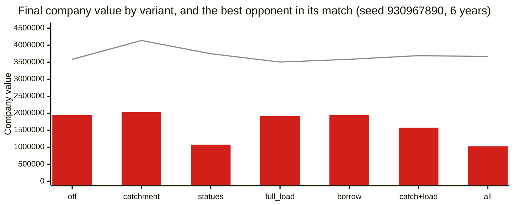
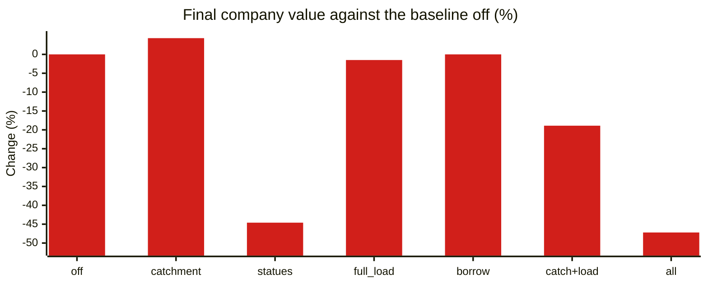
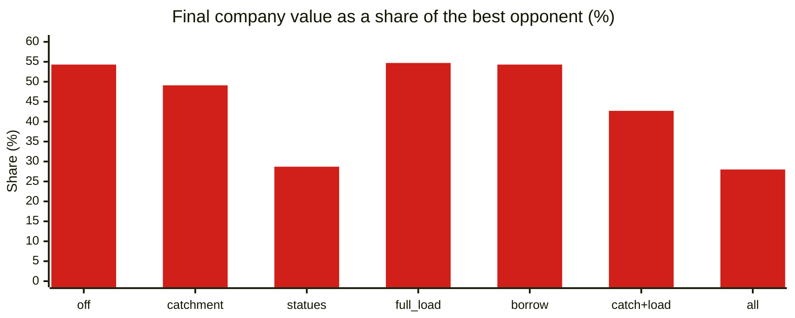
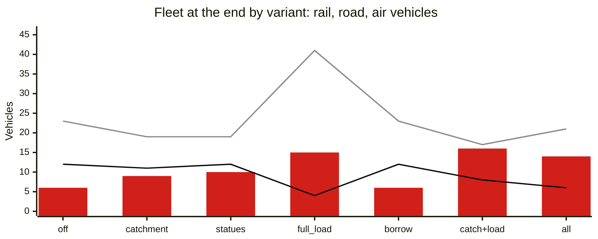

# ablation-20261119T062938-seed930967890

Derived from its .json by `tools/research/ai-battle/battle.py ablate --write`; do not edit.

One local match per variant of PrismaticAI against AAAHogEx, AdmiralAI, seed 930967890, 6 years from 1960, at `42528010af` (tree dirty). Each value is the variant's last quarterly referee sample. One seed: a direction, not a verdict.

| Variant | Value | vs first | Vehicles | Rail | Road | Air | Squirrel errors | Settings |
|---|---|---|---|---|---|---|---|---|
| off | 1,944,921 | +0.0% | 41 | 6 | 23 | 12 | 0 | `catchment_stops=0,statue_money=0,air_full_load=0,invest_borrow=0` |
| catchment | 2,029,321 | +4.3% | 39 | 9 | 19 | 11 | 0 | `catchment_stops=8,statue_money=0,air_full_load=0,invest_borrow=0` |
| statues | 1,077,351 | -44.6% | 41 | 10 | 19 | 12 | 0 | `catchment_stops=0,statue_money=400,air_full_load=0,invest_borrow=0` |
| full_load | 1,915,241 | -1.5% | 60 | 15 | 41 | 4 | 0 | `catchment_stops=0,statue_money=0,air_full_load=1,invest_borrow=0` |
| borrow | 1,944,921 | +0.0% | 41 | 6 | 23 | 12 | 0 | `catchment_stops=0,statue_money=0,air_full_load=0,invest_borrow=1` |
| catch+load | 1,576,656 | -18.9% | 41 | 16 | 17 | 8 | 0 | `catchment_stops=8,statue_money=0,air_full_load=1,invest_borrow=0` |
| all | 1,026,240 | -47.2% | 41 | 14 | 21 | 6 | 0 | `catchment_stops=8,statue_money=400,air_full_load=1,invest_borrow=1` |

<!-- ablation-charts:begin -->
<!-- derived from ablation-20261119T062938-seed930967890.json by `battle.py render`; `battle.py check` fails when it is stale -->

Highest final value: catchment (+4.3% against off); lowest: all (-47.2%). Spread between them: 97.7% of the lowest, on one seed (930967890).

<!-- ablation-charts:end -->
