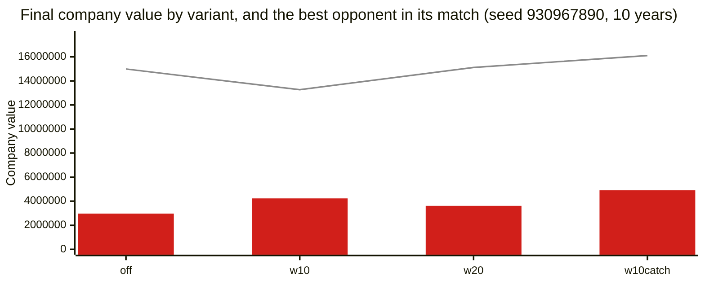
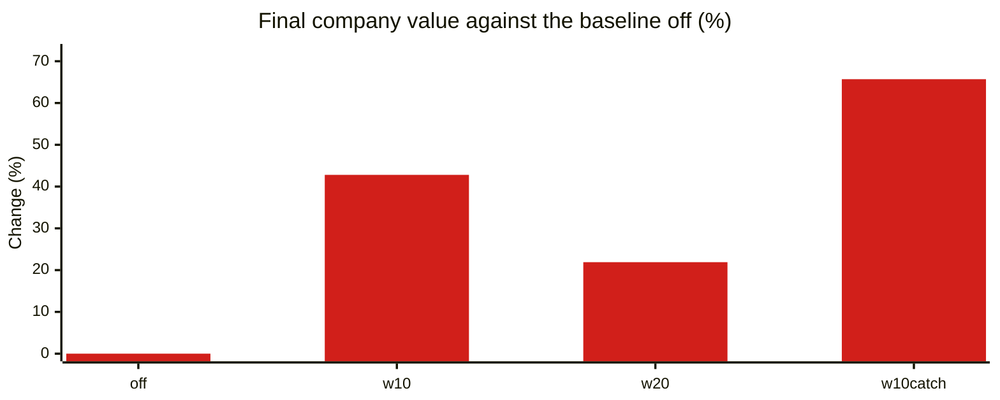
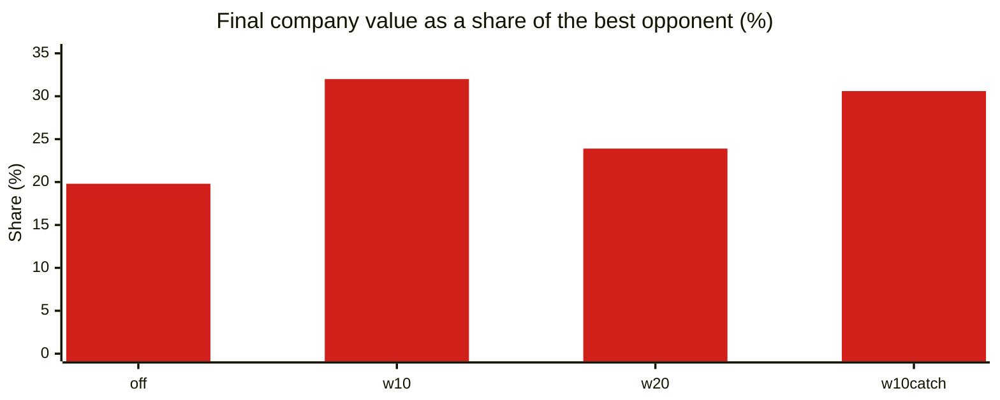
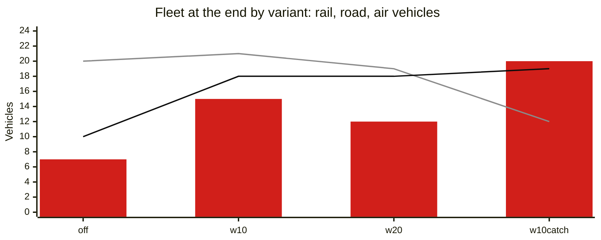

# ablation-20261119T064217-seed930967890

Derived from its .json by `tools/research/ai-battle/battle.py ablate --write`; do not edit.

One local match per variant of PrismaticAI against AAAHogEx, AdmiralAI, seed 930967890, 10 years from 1960, at `a8f5d85484` (tree dirty). Each value is the variant's last quarterly referee sample. One seed: a direction, not a verdict.

| Variant | Value | vs first | Vehicles | Rail | Road | Air | Squirrel errors | Settings |
|---|---|---|---|---|---|---|---|---|
| off | 2,970,755 | +0.0% | 37 | 7 | 20 | 10 | 0 | `air_add_waiting=0` |
| w10 | 4,241,243 | +42.8% | 54 | 15 | 21 | 18 | 0 | `air_add_waiting=10` |
| w20 | 3,621,112 | +21.9% | 49 | 12 | 19 | 18 | 0 | `air_add_waiting=20` |
| w10catch | 4,921,962 | +65.7% | 51 | 20 | 12 | 19 | 0 | `air_add_waiting=10,catchment_stops=8` |

<!-- ablation-charts:begin -->
<!-- derived from ablation-20261119T064217-seed930967890.json by `battle.py render`; `battle.py check` fails when it is stale -->

Highest final value: w10catch (+65.7% against off); lowest: off (+0.0%). Spread between them: 65.7% of the lowest, on one seed (930967890).

<!-- ablation-charts:end -->
