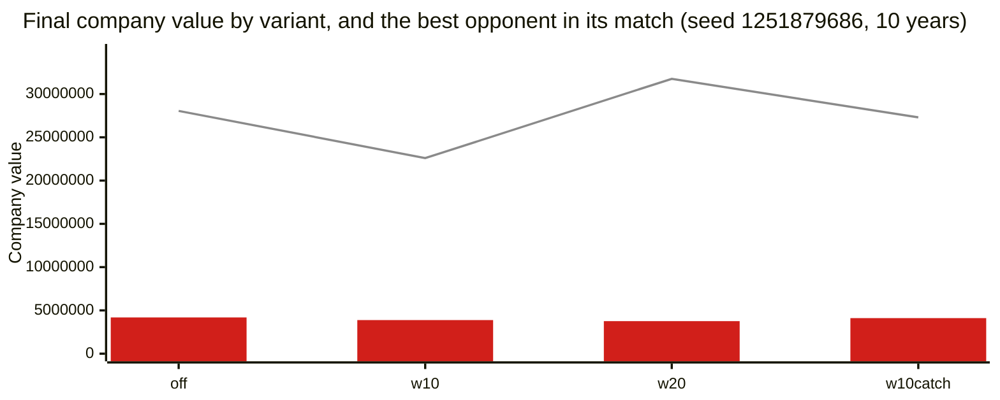
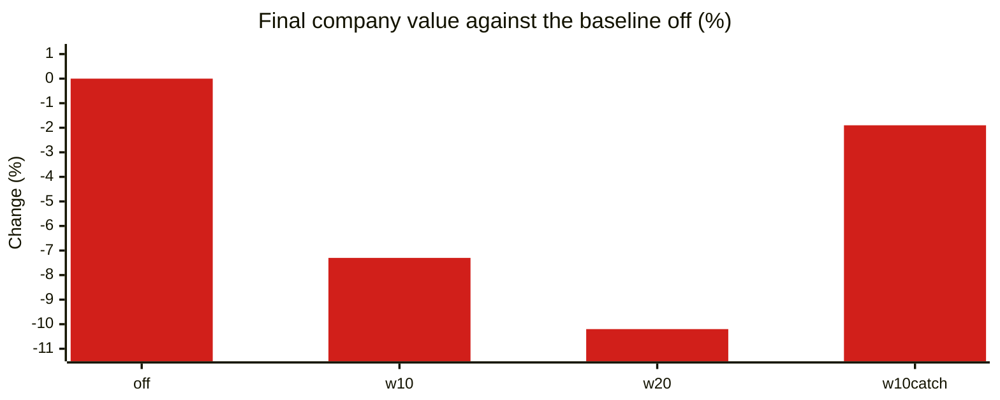
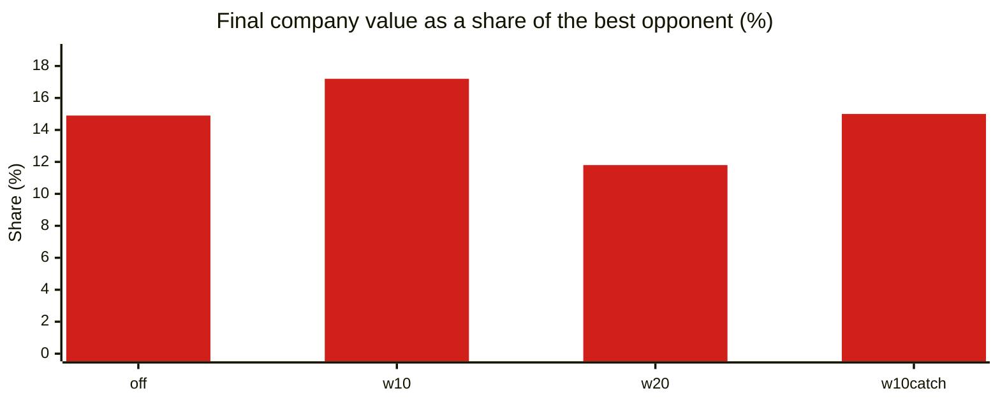
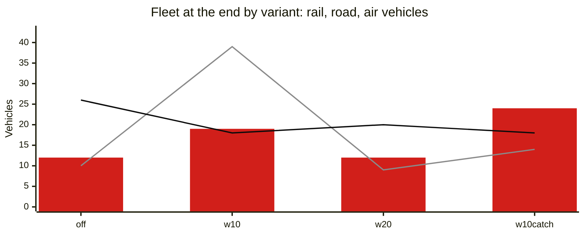

# ablation-20261119T064226-seed1251879686

Derived from its .json by `tools/research/ai-battle/battle.py ablate --write`; do not edit.

One local match per variant of PrismaticAI against AAAHogEx, AdmiralAI, seed 1251879686, 10 years from 1960, at `a8f5d85484` (tree dirty). Each value is the variant's last quarterly referee sample. One seed: a direction, not a verdict.

| Variant | Value | vs first | Vehicles | Rail | Road | Air | Squirrel errors | Settings |
|---|---|---|---|---|---|---|---|---|
| off | 4,185,225 | +0.0% | 48 | 12 | 10 | 26 | 0 | `air_add_waiting=0` |
| w10 | 3,881,008 | -7.3% | 76 | 19 | 39 | 18 | 0 | `air_add_waiting=10` |
| w20 | 3,758,700 | -10.2% | 41 | 12 | 9 | 20 | 0 | `air_add_waiting=20` |
| w10catch | 4,107,028 | -1.9% | 56 | 24 | 14 | 18 | 0 | `air_add_waiting=10,catchment_stops=8` |

<!-- ablation-charts:begin -->
<!-- derived from ablation-20261119T064226-seed1251879686.json by `battle.py render`; `battle.py check` fails when it is stale -->

Highest final value: off (+0.0% against off); lowest: w20 (-10.2%). Spread between them: 11.3% of the lowest, on one seed (1251879686).

<!-- ablation-charts:end -->
