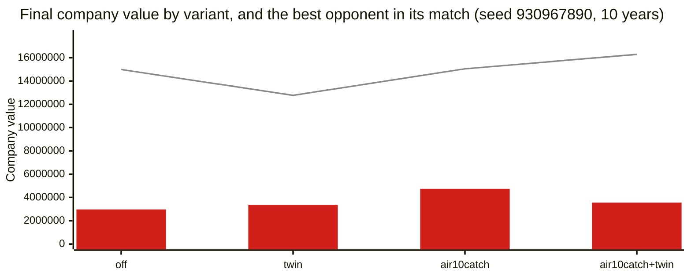
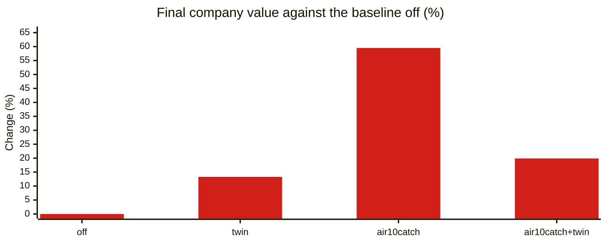
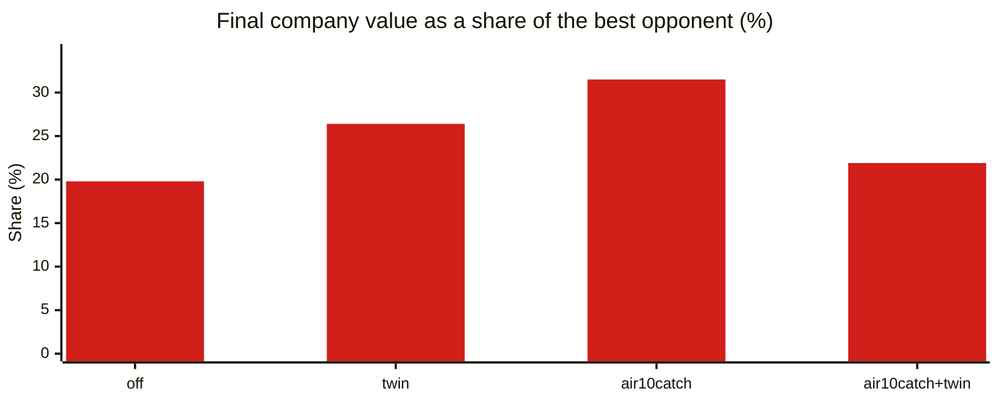
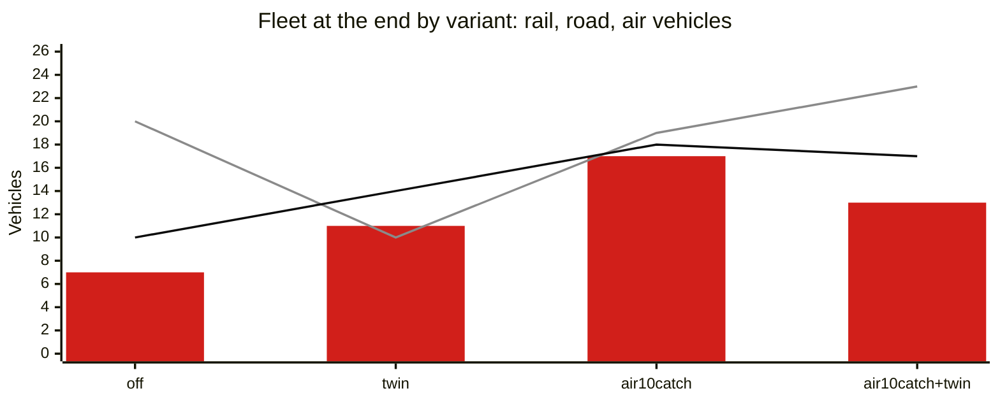

# ablation-20261119T065438-seed930967890

Derived from its .json by `tools/research/ai-battle/battle.py ablate --write`; do not edit.

One local match per variant of PrismaticAI against AAAHogEx, AdmiralAI, seed 930967890, 10 years from 1960, at `55328bdb56` (tree dirty). Each value is the variant's last quarterly referee sample. One seed: a direction, not a verdict.

| Variant | Value | vs first | Vehicles | Rail | Road | Air | Squirrel errors | Settings |
|---|---|---|---|---|---|---|---|---|
| off | 2,970,755 | +0.0% | 37 | 7 | 20 | 10 | 0 | `rail_twin_max=0` |
| twin | 3,366,229 | +13.3% | 35 | 11 | 10 | 14 | 0 | `rail_twin_max=8` |
| air10catch | 4,737,340 | +59.5% | 54 | 17 | 19 | 18 | 0 | `air_add_waiting=10,catchment_stops=8` |
| air10catch+twin | 3,561,794 | +19.9% | 53 | 13 | 23 | 17 | 0 | `air_add_waiting=10,catchment_stops=8,rail_twin_max=8` |

<!-- ablation-charts:begin -->
<!-- derived from ablation-20261119T065438-seed930967890.json by `battle.py render`; `battle.py check` fails when it is stale -->

Highest final value: air10catch (+59.5% against off); lowest: off (+0.0%). Spread between them: 59.5% of the lowest, on one seed (930967890).

<!-- ablation-charts:end -->
