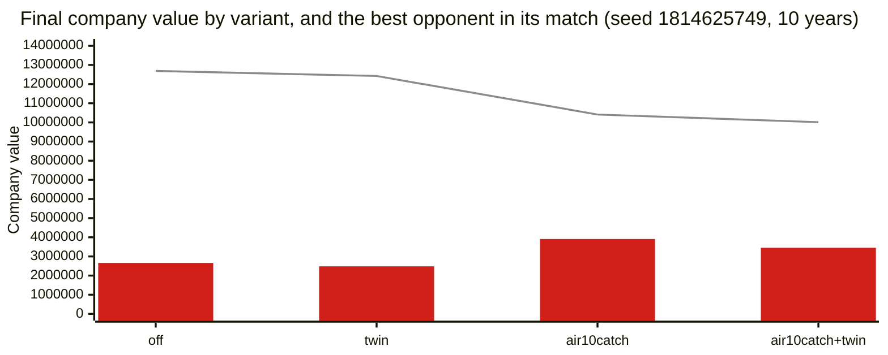
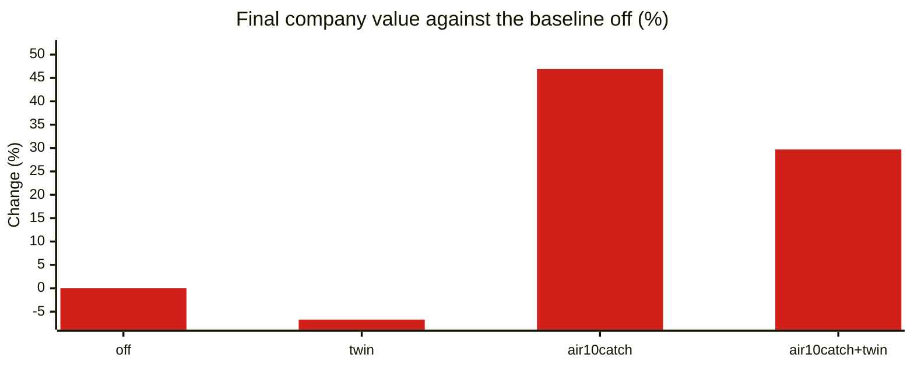
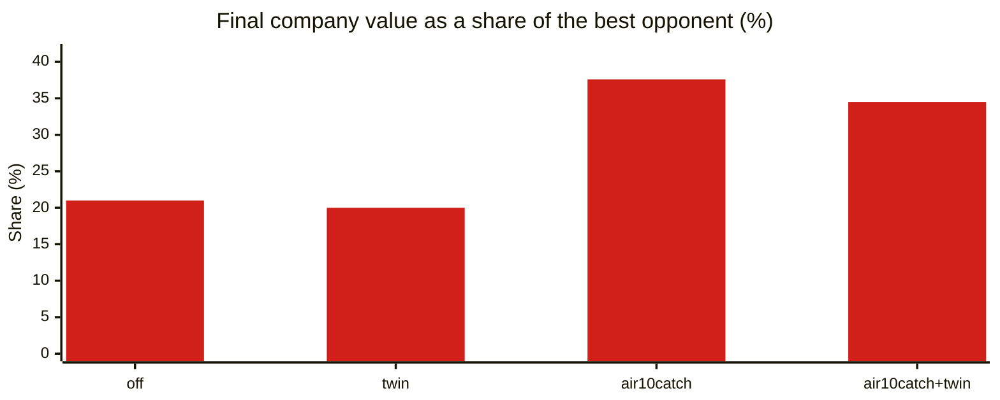
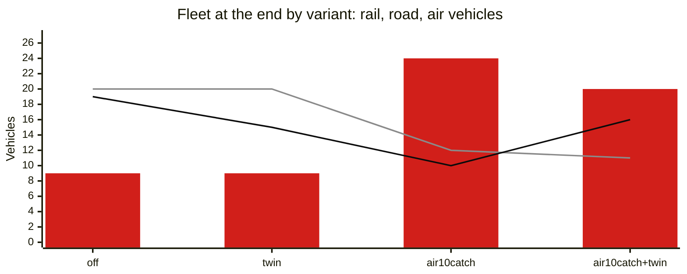

# ablation-20261119T065448-seed1814625749

Derived from its .json by `tools/research/ai-battle/battle.py ablate --write`; do not edit.

One local match per variant of PrismaticAI against AAAHogEx, AdmiralAI, seed 1814625749, 10 years from 1960, at `55328bdb56` (tree dirty). Each value is the variant's last quarterly referee sample. One seed: a direction, not a verdict.

| Variant | Value | vs first | Vehicles | Rail | Road | Air | Squirrel errors | Settings |
|---|---|---|---|---|---|---|---|---|
| off | 2,661,365 | +0.0% | 48 | 9 | 20 | 19 | 0 | `rail_twin_max=0` |
| twin | 2,482,368 | -6.7% | 44 | 9 | 20 | 15 | 0 | `rail_twin_max=8` |
| air10catch | 3,910,059 | +46.9% | 46 | 24 | 12 | 10 | 0 | `air_add_waiting=10,catchment_stops=8` |
| air10catch+twin | 3,451,526 | +29.7% | 47 | 20 | 11 | 16 | 0 | `air_add_waiting=10,catchment_stops=8,rail_twin_max=8` |

<!-- ablation-charts:begin -->
<!-- derived from ablation-20261119T065448-seed1814625749.json by `battle.py render`; `battle.py check` fails when it is stale -->

Highest final value: air10catch (+46.9% against off); lowest: twin (-6.7%). Spread between them: 57.5% of the lowest, on one seed (1814625749).

<!-- ablation-charts:end -->
