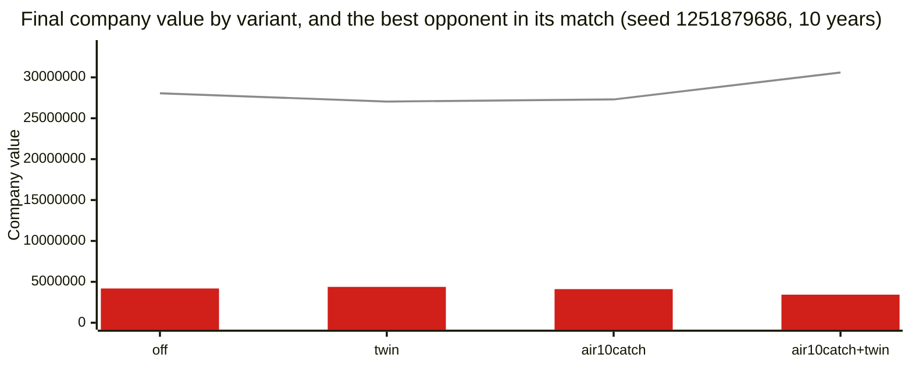
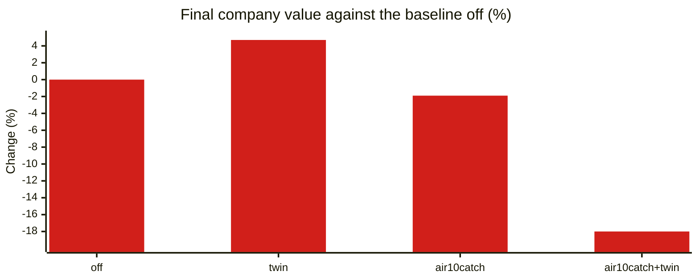
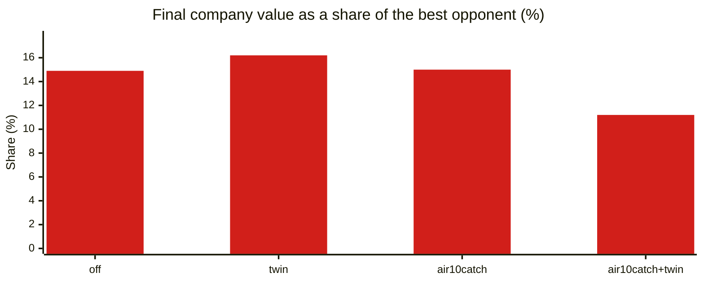
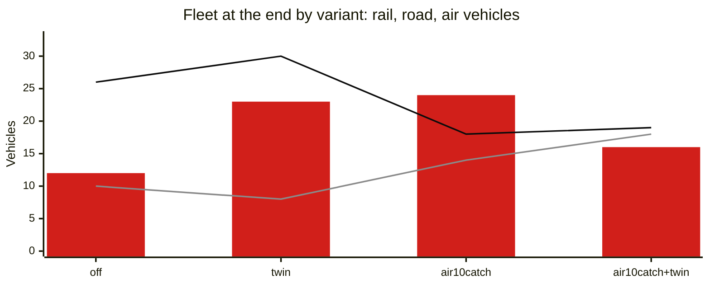

# ablation-20261119T065451-seed1251879686

Derived from its .json by `tools/research/ai-battle/battle.py ablate --write`; do not edit.

One local match per variant of PrismaticAI against AAAHogEx, AdmiralAI, seed 1251879686, 10 years from 1960, at `55328bdb56` (tree dirty). Each value is the variant's last quarterly referee sample. One seed: a direction, not a verdict.

| Variant | Value | vs first | Vehicles | Rail | Road | Air | Squirrel errors | Settings |
|---|---|---|---|---|---|---|---|---|
| off | 4,185,225 | +0.0% | 48 | 12 | 10 | 26 | 0 | `rail_twin_max=0` |
| twin | 4,381,791 | +4.7% | 61 | 23 | 8 | 30 | 0 | `rail_twin_max=8` |
| air10catch | 4,107,028 | -1.9% | 56 | 24 | 14 | 18 | 0 | `air_add_waiting=10,catchment_stops=8` |
| air10catch+twin | 3,430,545 | -18.0% | 53 | 16 | 18 | 19 | 0 | `air_add_waiting=10,catchment_stops=8,rail_twin_max=8` |

<!-- ablation-charts:begin -->
<!-- derived from ablation-20261119T065451-seed1251879686.json by `battle.py render`; `battle.py check` fails when it is stale -->

Highest final value: twin (+4.7% against off); lowest: air10catch+twin (-18.0%). Spread between them: 27.7% of the lowest, on one seed (1251879686).

<!-- ablation-charts:end -->
