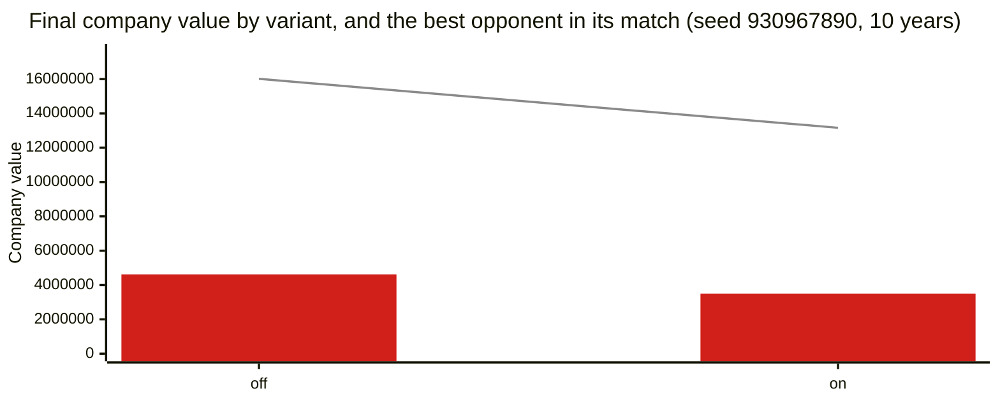
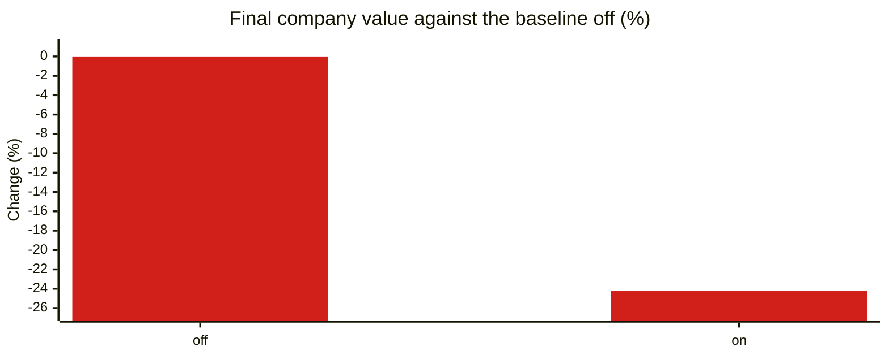
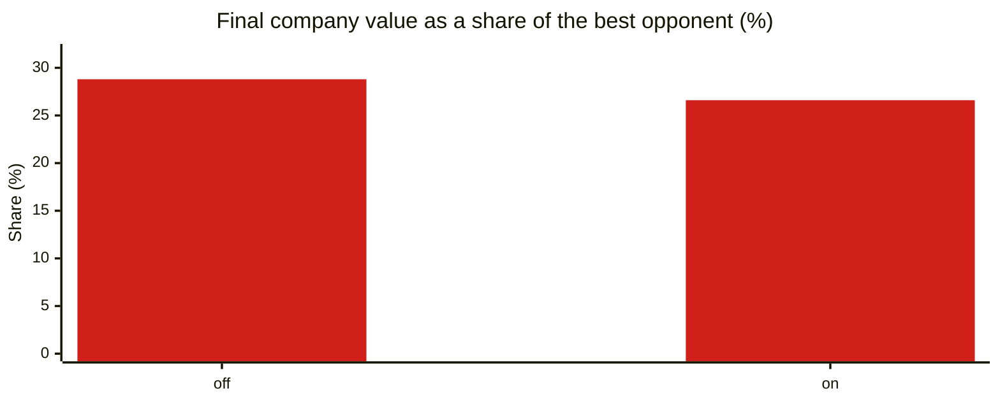
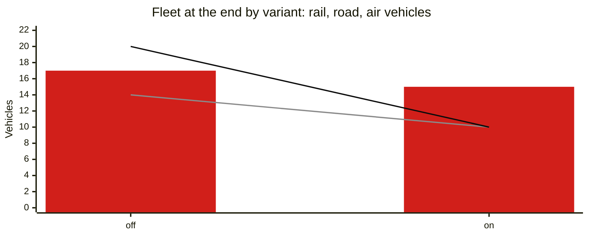

# ablation-20261119T083455-seed930967890

Derived from its .json by `tools/research/ai-battle/battle.py ablate --write`; do not edit.

One local match per variant of PrismaticAI against AAAHogEx, AdmiralAI, seed 930967890, 10 years from 1960, at `9a4375502c`. Each value is the variant's last quarterly referee sample. One seed: a direction, not a verdict.

| Variant | Value | vs first | Vehicles | Rail | Road | Air | Squirrel errors | Settings |
|---|---|---|---|---|---|---|---|---|
| off | 4,620,322 | +0.0% | 51 | 17 | 14 | 20 | 0 | `rail_double=0` |
| on | 3,501,074 | -24.2% | 35 | 15 | 10 | 10 | 0 | `rail_double=1` |

<!-- ablation-charts:begin -->
<!-- derived from ablation-20261119T083455-seed930967890.json by `battle.py render`; `battle.py check` fails when it is stale -->

Highest final value: off (+0.0% against off); lowest: on (-24.2%). Spread between them: 32.0% of the lowest, on one seed (930967890).

<!-- ablation-charts:end -->
