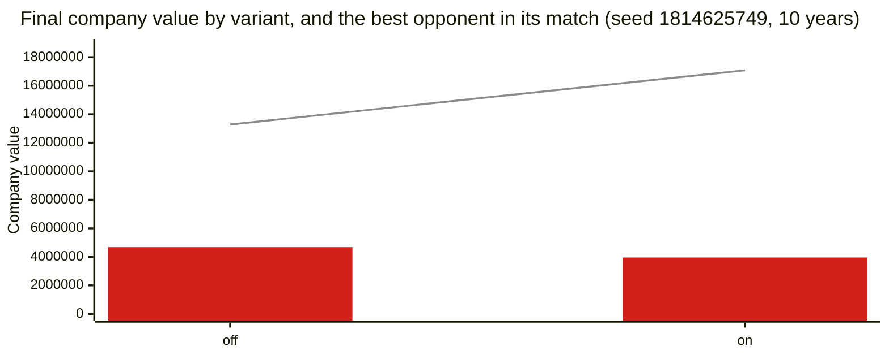
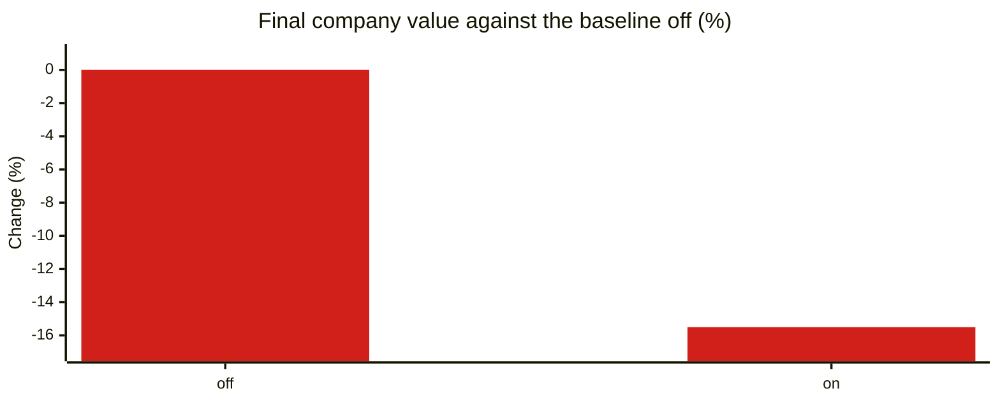
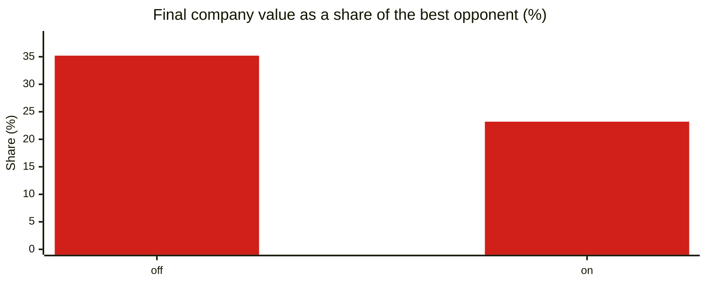
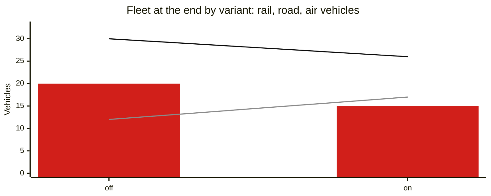

# ablation-20261119T083459-seed1814625749

Derived from its .json by `tools/research/ai-battle/battle.py ablate --write`; do not edit.

One local match per variant of PrismaticAI against AAAHogEx, AdmiralAI, seed 1814625749, 10 years from 1960, at `9a4375502c`. Each value is the variant's last quarterly referee sample. One seed: a direction, not a verdict.

| Variant | Value | vs first | Vehicles | Rail | Road | Air | Squirrel errors | Settings |
|---|---|---|---|---|---|---|---|---|
| off | 4,679,708 | +0.0% | 62 | 20 | 12 | 30 | 0 | `rail_double=0` |
| on | 3,955,350 | -15.5% | 58 | 15 | 17 | 26 | 0 | `rail_double=1` |

<!-- ablation-charts:begin -->
<!-- derived from ablation-20261119T083459-seed1814625749.json by `battle.py render`; `battle.py check` fails when it is stale -->

Highest final value: off (+0.0% against off); lowest: on (-15.5%). Spread between them: 18.3% of the lowest, on one seed (1814625749).

<!-- ablation-charts:end -->
