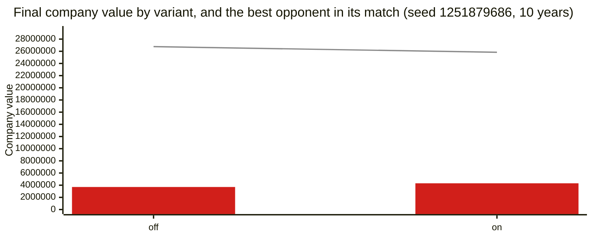
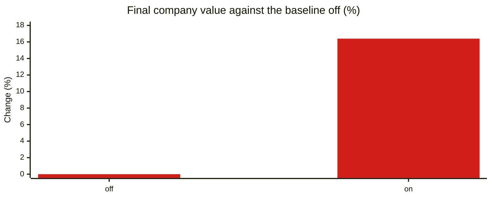
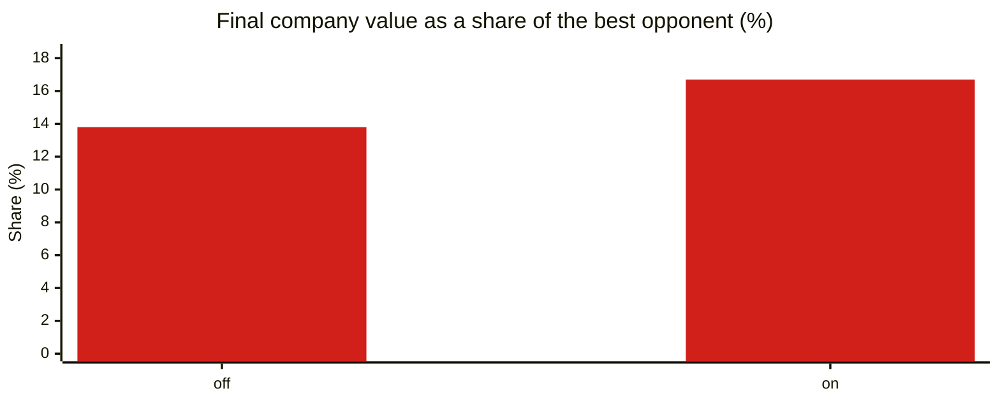
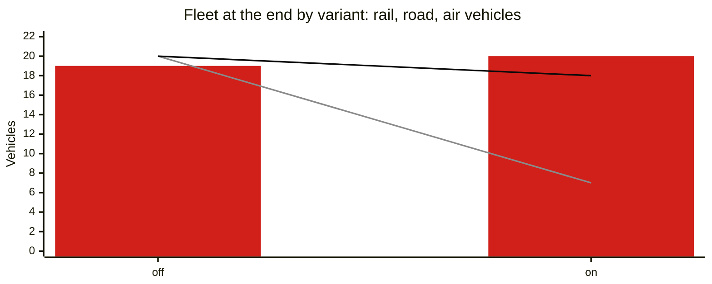

# ablation-20261119T083502-seed1251879686

Derived from its .json by `tools/research/ai-battle/battle.py ablate --write`; do not edit.

One local match per variant of PrismaticAI against AAAHogEx, AdmiralAI, seed 1251879686, 10 years from 1960, at `9a4375502c`. Each value is the variant's last quarterly referee sample. One seed: a direction, not a verdict.

| Variant | Value | vs first | Vehicles | Rail | Road | Air | Squirrel errors | Settings |
|---|---|---|---|---|---|---|---|---|
| off | 3,705,692 | +0.0% | 59 | 19 | 20 | 20 | 0 | `rail_double=0` |
| on | 4,313,470 | +16.4% | 45 | 20 | 7 | 18 | 0 | `rail_double=1` |

<!-- ablation-charts:begin -->
<!-- derived from ablation-20261119T083502-seed1251879686.json by `battle.py render`; `battle.py check` fails when it is stale -->

Highest final value: on (+16.4% against off); lowest: off (+0.0%). Spread between them: 16.4% of the lowest, on one seed (1251879686).

<!-- ablation-charts:end -->
