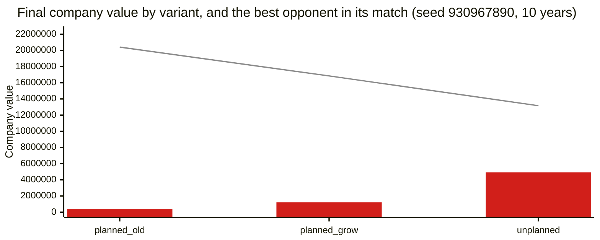
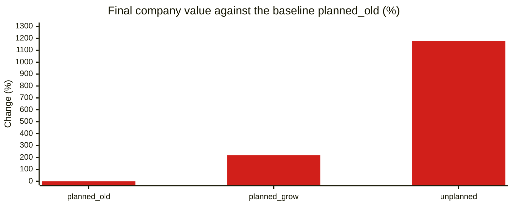
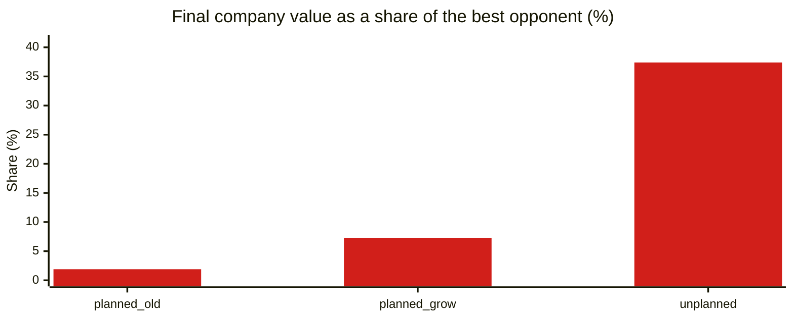
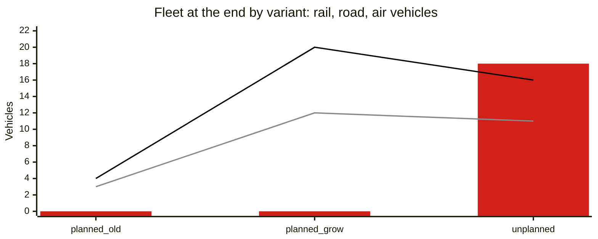

# ablation-20261119T094204-seed930967890

Derived from its .json by `tools/research/ai-battle/battle.py ablate --write`; do not edit.

One local match per variant of PrismaticAI against AAAHogEx, AdmiralAI, seed 930967890, 10 years from 1960, at `26d86c75f5` (tree dirty). Each value is the variant's last quarterly referee sample. One seed: a direction, not a verdict.

| Variant | Value | vs first | Vehicles | Rail | Road | Air | Squirrel errors | Settings |
|---|---|---|---|---|---|---|---|---|
| planned_old | 384,722 | +0.0% | 7 | 0 | 3 | 4 | 0 | `air_a=0,air_b=1,autopilot=0` |
| planned_grow | 1,226,502 | +218.8% | 32 | 0 | 12 | 20 | 0 | `air_a=0,air_b=1` |
| unplanned | 4,917,401 | +1178.2% | 45 | 18 | 11 | 16 | 0 | `autopilot=1` |

<!-- ablation-charts:begin -->
<!-- derived from ablation-20261119T094204-seed930967890.json by `battle.py render`; `battle.py check` fails when it is stale -->

Highest final value: unplanned (+1178.2% against planned_old); lowest: planned_old (+0.0%). Spread between them: 1178.2% of the lowest, on one seed (930967890).

<!-- ablation-charts:end -->
