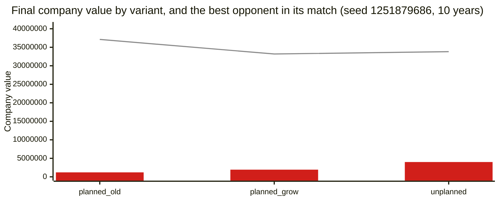
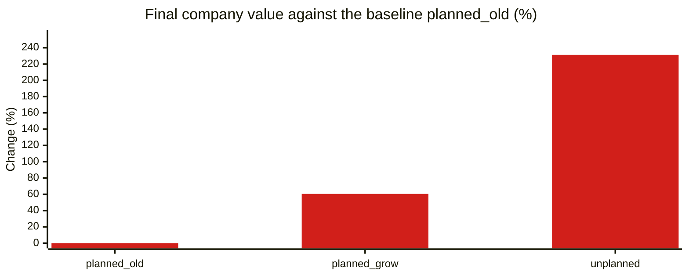
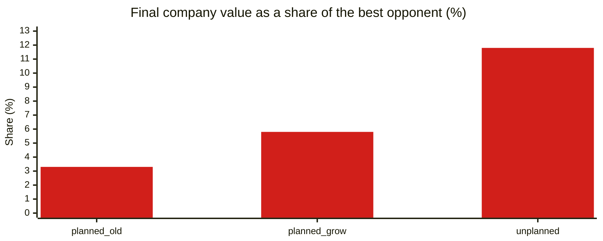
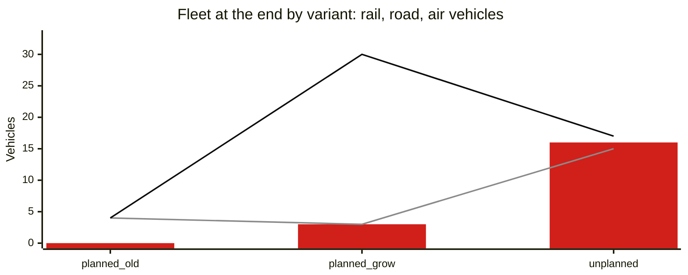

# ablation-20261119T094213-seed1251879686

Derived from its .json by `tools/research/ai-battle/battle.py ablate --write`; do not edit.

One local match per variant of PrismaticAI against AAAHogEx, AdmiralAI, seed 1251879686, 10 years from 1960, at `26d86c75f5` (tree dirty). Each value is the variant's last quarterly referee sample. One seed: a direction, not a verdict.

| Variant | Value | vs first | Vehicles | Rail | Road | Air | Squirrel errors | Settings |
|---|---|---|---|---|---|---|---|---|
| planned_old | 1,207,427 | +0.0% | 8 | 0 | 4 | 4 | 0 | `air_a=0,air_b=1,autopilot=0` |
| planned_grow | 1,937,495 | +60.5% | 36 | 3 | 3 | 30 | 0 | `air_a=0,air_b=1` |
| unplanned | 4,001,061 | +231.4% | 48 | 16 | 15 | 17 | 0 | `autopilot=1` |

<!-- ablation-charts:begin -->
<!-- derived from ablation-20261119T094213-seed1251879686.json by `battle.py render`; `battle.py check` fails when it is stale -->

Highest final value: unplanned (+231.4% against planned_old); lowest: planned_old (+0.0%). Spread between them: 231.4% of the lowest, on one seed (1251879686).

<!-- ablation-charts:end -->
