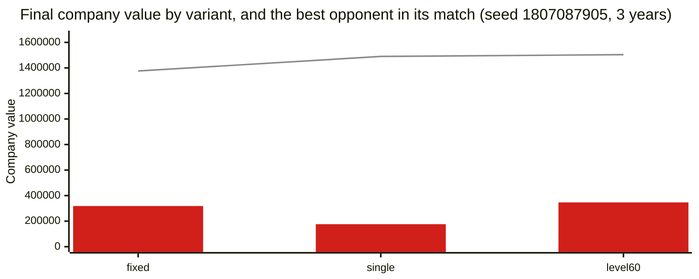
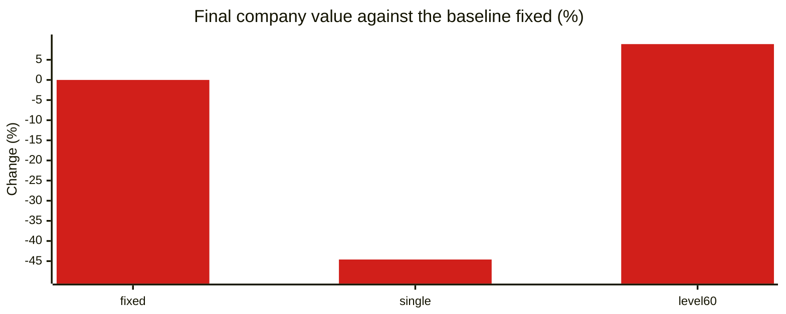
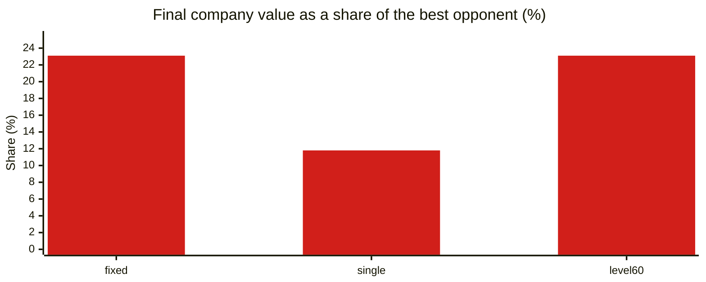
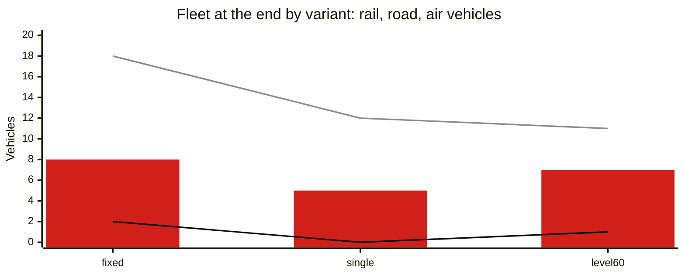

# ablation-20261119T131147-seed1807087905

Derived from its .json by `tools/research/ai-battle/battle.py ablate --write`; do not edit.

One local match per variant of PrismaticAI against LuDiAI AfterFix, CivilAI, AdmiralAI, AAAHogEx, seed 1807087905, 3 years from 1960, at `19582376f6`. Each value is the variant's last quarterly referee sample. One seed: a direction, not a verdict.

| Variant | Value | vs first | Vehicles | Rail | Road | Air | Squirrel errors | Settings |
|---|---|---|---|---|---|---|---|---|
| fixed | 318,482 | +0.0% | 28 | 8 | 18 | 2 | 0 | `` |
| single | 176,278 | -44.6% | 17 | 5 | 12 | 0 | 0 | `rail_double=0` |
| level60 | 346,805 | +8.9% | 19 | 7 | 11 | 1 | 0 | `air_level_max=60` |

<!-- ablation-charts:begin -->
<!-- derived from ablation-20261119T131147-seed1807087905.json by `battle.py render`; `battle.py check` fails when it is stale -->

Highest final value: level60 (+8.9% against fixed); lowest: single (-44.6%). Spread between them: 96.7% of the lowest, on one seed (1807087905).

<!-- ablation-charts:end -->
