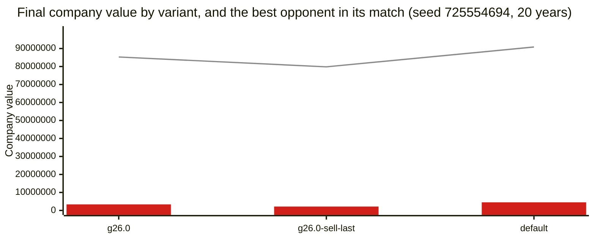
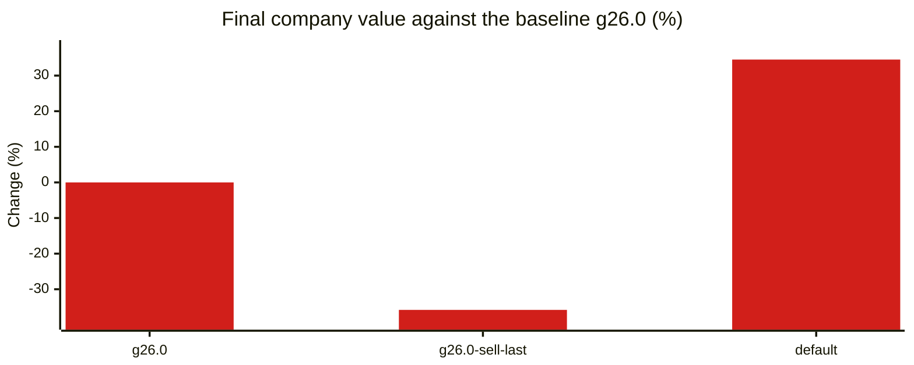
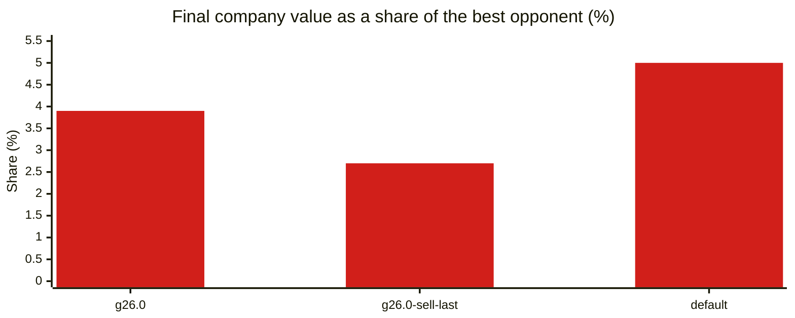
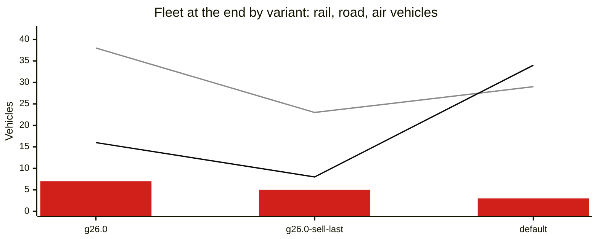

# ablation-20261119T140023-seed725554694

Derived from its .json by `tools/research/ai-battle/battle.py ablate --write`; do not edit.

One local match per variant of PrismaticAI against CivilAI, AdmiralAI, AAAHogEx, LuDiAI AfterFix, seed 725554694, 20 years from 1960, at `59d0582b42`. Each value is the variant's last quarterly referee sample. One seed: a direction, not a verdict.

| Variant | Value | vs first | Vehicles | Rail | Road | Air | Squirrel errors | Settings |
|---|---|---|---|---|---|---|---|---|
| g26.0 | 3,353,348 | +0.0% | 61 | 7 | 38 | 16 | 0 | `aggressiveness=20,air_add_waiting=20,air_full_load=0,air_max_tiles=380,air_planes=1,air_routes_max=5,air_towns=25,cash_reserve=20000,catchment_stops=6,intercity=1,invest_air_cap=4,invest_borrow=1,invest_min=50,invest_ppv_div=4,invest_road_cap=10,line_budget=30000,max_routes=18,own_lines=20,rail_twin_max=16,self_steward=1,statue_money=1800` |
| g26.0-sell-last | 2,153,134 | -35.8% | 36 | 5 | 23 | 8 | 0 | `aggressiveness=20,air_add_waiting=20,air_full_load=0,air_max_tiles=380,air_planes=1,air_routes_max=5,air_towns=25,cash_reserve=20000,catchment_stops=6,intercity=1,invest_air_cap=4,invest_borrow=1,invest_min=50,invest_ppv_div=4,invest_road_cap=10,line_budget=30000,max_routes=18,own_lines=20,rail_twin_max=16,self_steward=1,statue_money=1800,air_keep_last=0` |
| default | 4,509,983 | +34.5% | 66 | 3 | 29 | 34 | 0 | `` |

<!-- ablation-charts:begin -->
<!-- derived from ablation-20261119T140023-seed725554694.json by `battle.py render`; `battle.py check` fails when it is stale -->

Highest final value: default (+34.5% against g26.0); lowest: g26.0-sell-last (-35.8%). Spread between them: 109.5% of the lowest, on one seed (725554694).

<!-- ablation-charts:end -->
