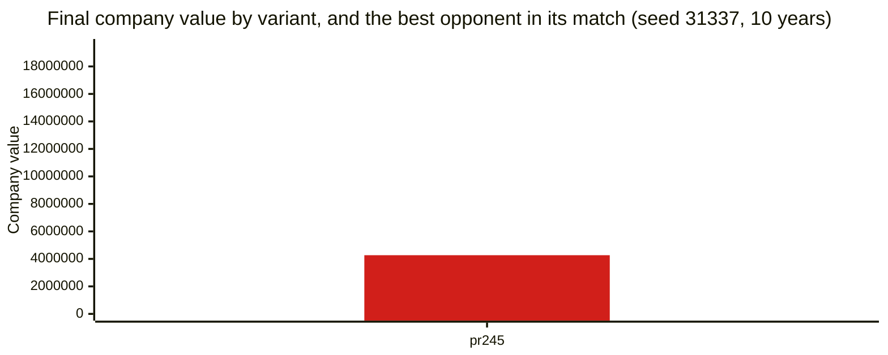
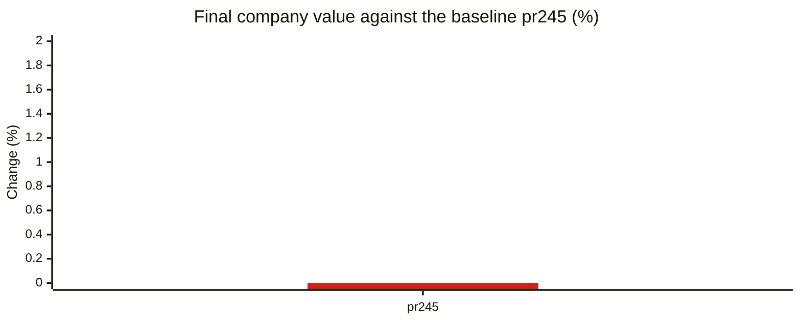
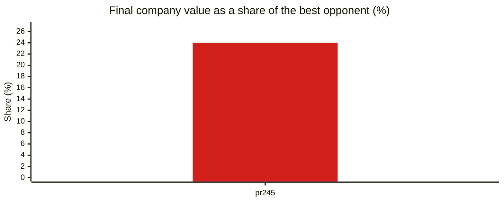
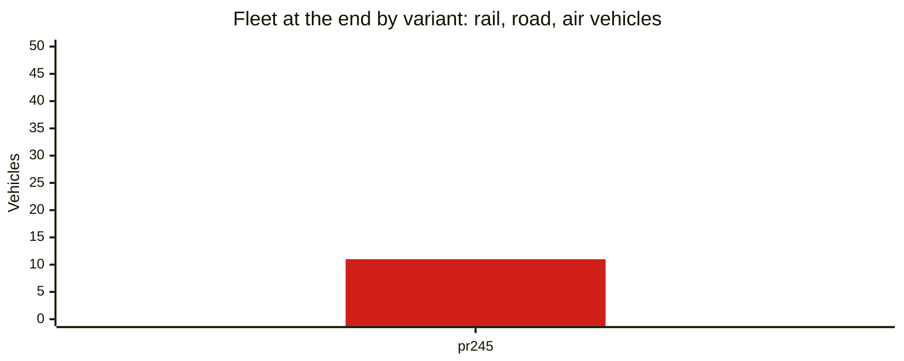

# ablation-20261123T010626-seed31337-pr245

Derived from its .json by `tools/research/ai-battle/battle.py ablate --write`; do not edit.

One local match per variant of PrismaticAI against AAAHogEx, LuDiAI AfterFix, CivilAI, AdmiralAI, NoCAB, DictatorAI, SimpleAI, seed 31337, 10 years from 1950, at `cf3b9ba6a6`. Each value is the variant's last quarterly referee sample. One seed: a direction, not a verdict.

Imported after the run from its kept log `pr245.log` (sha256 `3360caa96817aac8`), binary `20261122-master-gfdc13851cf`, by `tools/research/strategy-surfaces import`; the run's exit status was not kept. Evaluation of PR #245 (fix/prismatic-trainless-lines) before it merged (openttd-36): the live game's settings against the 7 BaNaNaS AIs of the owner's live game, 10 years from 1950.

| Variant | Value | vs first | Vehicles | Rail | Road | Air | Squirrel errors | Settings |
|---|---|---|---|---|---|---|---|---|
| pr245 | 4,267,949 | +0.0% | 60 | 11 | 4 | 45 | 0 | `aggressiveness=80,air_add_waiting=90,air_full_load=0,air_grow_money=0,air_keep_last=1,air_level_max=20,air_level_once=1,air_level_step=8,air_max_tiles=440,air_planes=5,air_reuse=1,air_routes_max=2,air_towns=35,cash_reserve=5000,catchment_stops=4,intercity=1,invest_air_cap=10,invest_borrow=1,invest_min=50,invest_ppv_div=6,invest_road_cap=12,line_budget=30000,max_routes=30,own_fail_pause=4,own_lines=4,rail_twin_max=10,self_steward=1,statue_money=0` |

<!-- ablation-charts:begin -->
<!-- derived from ablation-20261123T010626-seed31337-pr245.json by `battle.py render`; `battle.py check` fails when it is stale -->

Highest final value: pr245 (+0.0% against pr245); lowest: pr245 (+0.0%). Spread between them: 0.0% of the lowest, on one seed (31337).

<!-- ablation-charts:end -->
