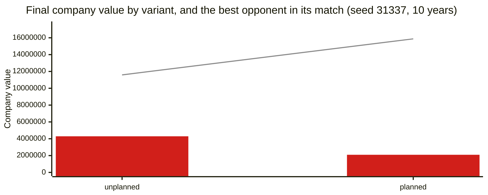
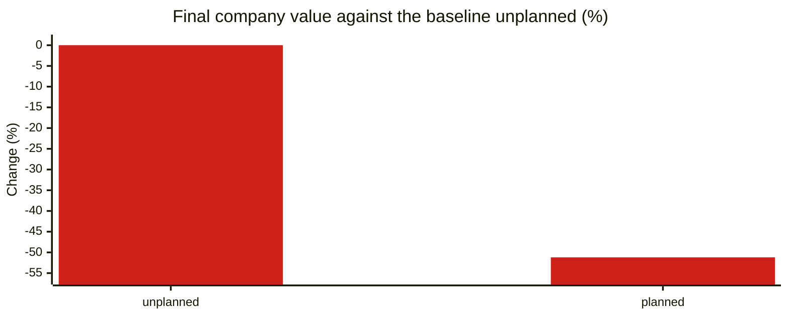
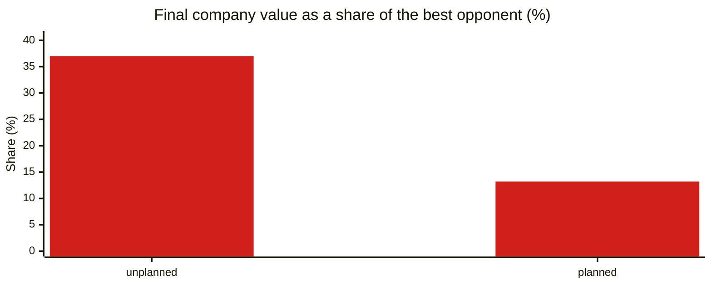
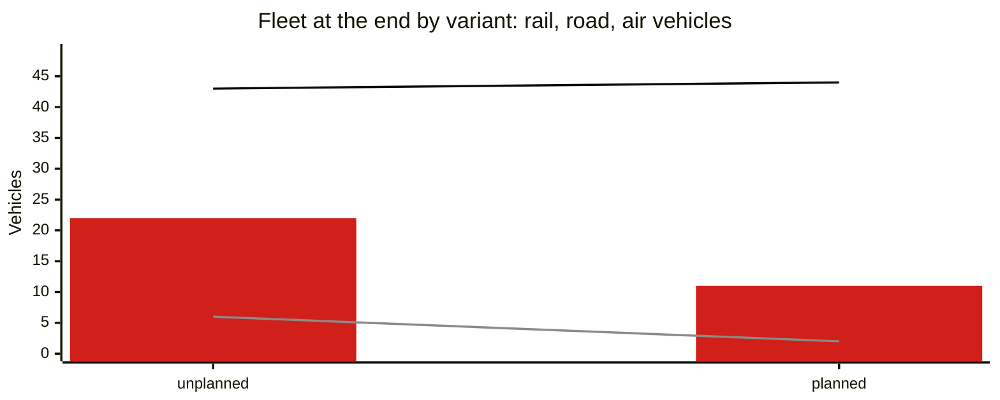

# ablation-20261125T124527-seed31337

Derived from its .json by `tools/research/ai-battle/battle.py ablate --write`; do not edit.

One local match per variant of PrismaticAI against AAAHogEx, LuDiAI AfterFix, CivilAI, AdmiralAI, NoCAB, DictatorAI, SimpleAI, seed 31337, 10 years from 1950, at `eb0d839ce0`. Each value is the variant's last quarterly referee sample. One seed: a direction, not a verdict.

| Variant | Value | vs first | Vehicles | Rail | Road | Air | Squirrel errors | Settings |
|---|---|---|---|---|---|---|---|---|
| unplanned | 4,291,757 | +0.0% | 71 | 22 | 6 | 43 | 0 | `aggressiveness=80,air_add_waiting=90,air_full_load=0,air_grow_money=0,air_keep_last=1,air_level_max=20,air_level_once=1,air_level_step=8,air_max_tiles=440,air_planes=5,air_reuse=1,air_routes_max=2,air_towns=35,cash_reserve=5000,catchment_stops=4,intercity=1,invest_air_cap=10,invest_borrow=1,invest_min=50,invest_ppv_div=6,invest_road_cap=12,line_budget=30000,max_routes=30,own_fail_pause=4,own_lines=4,rail_twin_max=10,self_steward=1,statue_money=0` |
| planned | 2,095,865 | -51.2% | 57 | 11 | 2 | 44 | 0 | `aggressiveness=80,air_add_waiting=90,air_full_load=0,air_grow_money=0,air_keep_last=1,air_level_max=20,air_level_once=1,air_level_step=8,air_max_tiles=440,air_planes=5,air_reuse=1,air_routes_max=2,air_towns=35,cash_reserve=5000,catchment_stops=4,fr10_cargo=1,fr10_from=37,fr10_to=1,fr2_cargo=1,fr2_from=29,fr2_to=39,fr3_cargo=3,fr3_from=33,fr3_to=26,fr4_cargo=1,fr4_from=36,fr4_to=13,fr5_cargo=8,fr5_from=9,fr5_to=6,fr6_cargo=6,fr6_from=24,fr6_to=5,fr7_cargo=8,fr7_from=15,fr7_to=11,fr8_cargo=8,fr8_from=12,fr8_to=11,fr9_cargo=3,fr9_from=8,fr9_to=16,fr_cargo=1,fr_from=0,fr_to=1,intercity=1,invest_air_cap=10,invest_borrow=1,invest_min=50,invest_ppv_div=6,invest_road_cap=12,line_budget=30000,max_routes=30,own_fail_pause=4,own_lines=4,rail_a=1,rail_after=5,rail_b=3,rail_twin_max=10,self_steward=1,statue_money=0` |

<!-- ablation-charts:begin -->
<!-- derived from ablation-20261125T124527-seed31337.json by `battle.py render`; `battle.py check` fails when it is stale -->

Highest final value: unplanned (+0.0% against unplanned); lowest: planned (-51.2%). Spread between them: 104.8% of the lowest, on one seed (31337).

<!-- ablation-charts:end -->
