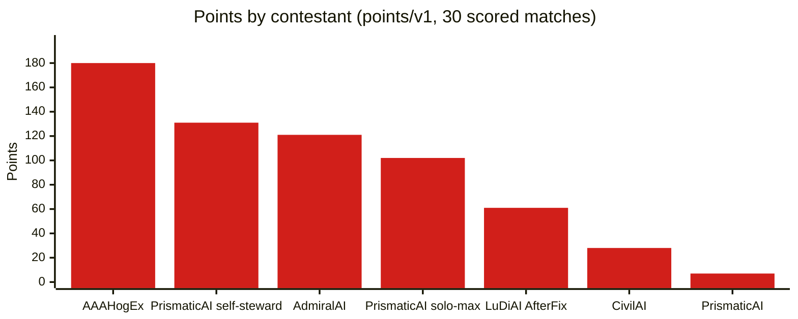
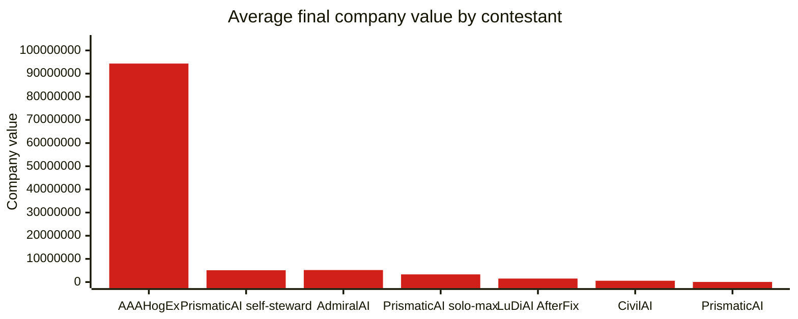
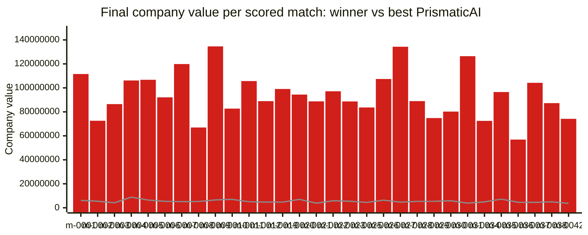
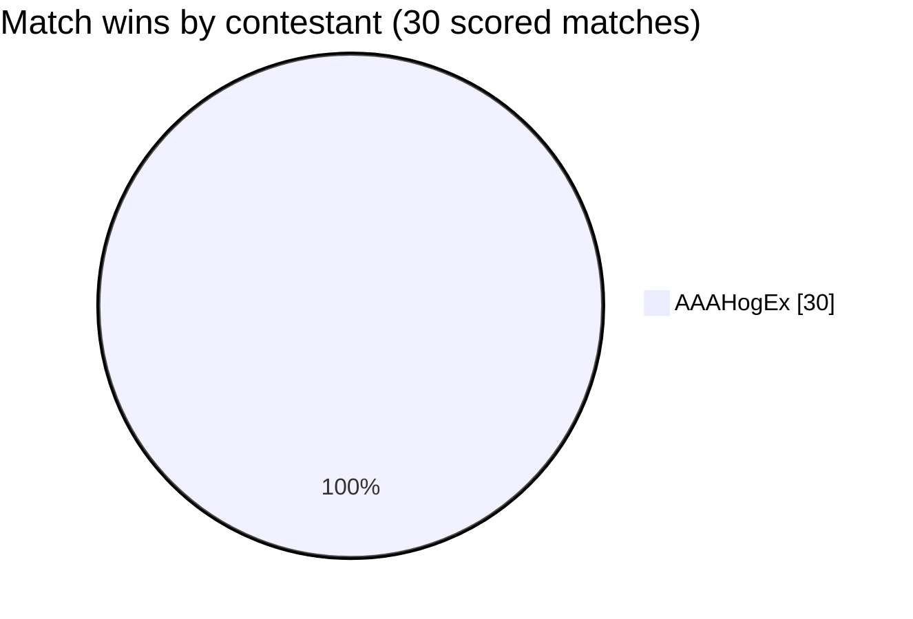
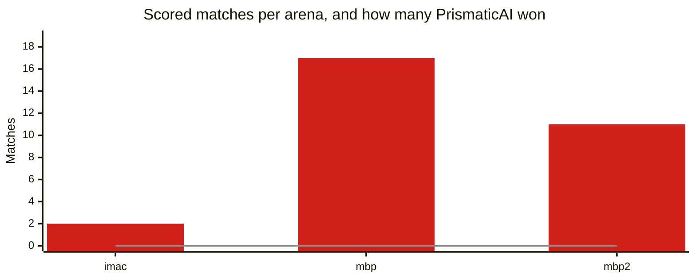

# battle-20261119T053541-155d18ea

Derived from `battle-20261119T053541-155d18ea.json` by `tools/research/ai-battle/battle.py report`; do not edit.

- Edition `155d18ea50071e72`: PrismaticAI and referee at `ba51ba6022d349361ea54335363070d0a03b7baa`, base set `opengfx-8.0.tar`
- 20-year free-for-all from 1960, map 256x256 temperate, breakdowns 1
- 30 scored match(es) on `imac` (20260724-prismatic-mcp-server-m64d95df5ae), `mbp` (20261119-master-mb9cd0de81a, 20261119-master-mba51ba6022), `mbp2` (20261119-master-g9750b3f946), `ubuntu` (20261119-master-gdf18ce8801)
- Replays: 1 of 2 identical to their original on another arena

| # | Contestant | Played | Wins | Points | Avg rank | Avg final value | Squirrel errors | Matches with anomalies |
|---|---|---|---|---|---|---|---|---|
| 1 | AAAHogEx | 30 | 30 | 180 | 1.0 | 94.3 M | 0 | 0 |
| 2 | PrismaticAI self-steward | 30 | 0 | 131 | 2.63 | 5.1 M | 0 | 8 |
| 3 | AdmiralAI | 30 | 0 | 121 | 2.97 | 5.2 M | 0 | 5 |
| 4 | PrismaticAI solo-max | 30 | 0 | 102 | 3.6 | 3.3 M | 0 | 30 |
| 5 | LuDiAI AfterFix | 30 | 0 | 61 | 4.97 | 1.5 M | 0 | 2 |
| 6 | CivilAI | 30 | 0 | 28 | 6.07 | 566.2 k | 0 | 3 |
| 7 | PrismaticAI | 30 | 0 | 7 | 6.77 | 42.8 k | 0 | 1 |

<!-- battle-charts:begin -->
<!-- derived from battle-20261119T053541-155d18ea.json by `battle.py render`; `battle.py check` fails when it is stale -->

<!-- battle-charts:end -->

| Seed | Original | Replay | Arenas | Identical |
|---|---|---|---|---|
| 1251879686 | m-0001 | m-0024 | mbp / mbp2 | yes |
| 930967890 | m-0002 | m-0032 | mbp / imac | NO |

| Match | Arena | Seed | Winner | Value | Last | Anomalies |
|---|---|---|---|---|---|---|
| m-0001 | mbp | 1251879686 | AAAHogEx | 111.6 M | PrismaticAI | PrismaticAI solo-max: fleet_drop:23->12 |
| m-0002 | mbp | 930967890 | AAAHogEx | 72.6 M | PrismaticAI | PrismaticAI self-steward: fleet_drop:24->15; PrismaticAI solo-max: fleet_drop:20->10 |
| m-0003 | mbp | 1814625749 | AAAHogEx | 86.5 M | CivilAI | PrismaticAI solo-max: fleet_drop:25->10; PrismaticAI self-steward: fleet_drop:32->20; LuDiAI AfterFix: fleet_drop:45->11; CivilAI: fleet_drop:25->2 |
| m-0004 | mbp | 397755790 | AAAHogEx | 106.2 M | PrismaticAI | AdmiralAI: fleet_drop:167->110; PrismaticAI solo-max: fleet_drop:25->8 |
| m-0005 | imac | 852521374 | AAAHogEx | 106.7 M | CivilAI | PrismaticAI solo-max: fleet_drop:26->11 |
| m-0006 | imac | 622201523 | AAAHogEx | 92.1 M | PrismaticAI | PrismaticAI solo-max: fleet_drop:25->12 |
| m-0007 | mbp2 | 1791605593 | AAAHogEx | 119.9 M | PrismaticAI | PrismaticAI solo-max: fleet_drop:27->17 |
| m-0008 | mbp2 | 1016335253 | AAAHogEx | 67.0 M | PrismaticAI | AdmiralAI: fleet_drop:162->108; PrismaticAI solo-max: fleet_drop:24->11 |
| m-0009 | mbp2 | 1182050720 | AAAHogEx | 134.6 M | PrismaticAI | PrismaticAI solo-max: fleet_drop:23->13 |
| m-0010 | mbp2 | 644316239 | AAAHogEx | 82.7 M | PrismaticAI | PrismaticAI solo-max: fleet_drop:28->15 |
| m-0011 | mbp2 | 1005694260 | AAAHogEx | 105.7 M | PrismaticAI | PrismaticAI self-steward: fleet_drop:28->19; PrismaticAI solo-max: fleet_drop:27->11 |
| m-0012 | mbp2 | 542166871 | AAAHogEx | 89.0 M | PrismaticAI | PrismaticAI solo-max: fleet_drop:22->15; CivilAI: fleet_drop:18->12 |
| m-0013 | ubuntu | 1566354715 | AAAHogEx | 0 | PrismaticAI solo-max | - |
| m-0014 | ubuntu | 1738814815 | AAAHogEx | 0 | PrismaticAI solo-max | - |
| m-0015 | ubuntu | 700686639 | AAAHogEx | 0 | PrismaticAI solo-max | - |
| m-0016 | ubuntu | 478346528 | AAAHogEx | 0 | PrismaticAI solo-max | - |
| m-0019 | mbp | 1538202881 | AAAHogEx | 99.1 M | PrismaticAI | PrismaticAI self-steward: fleet_drop:29->20; PrismaticAI solo-max: fleet_drop:19->9 |
| m-0020 | mbp | 415608858 | AAAHogEx | 94.4 M | CivilAI | PrismaticAI self-steward: fleet_drop:33->23; PrismaticAI solo-max: fleet_drop:32->15 |
| m-0021 | mbp | 1623305058 | AAAHogEx | 88.8 M | CivilAI | PrismaticAI solo-max: fleet_drop:22->11; PrismaticAI self-steward: fleet_drop:24->12 |
| m-0022 | mbp | 589628189 | AAAHogEx | 97.2 M | PrismaticAI | AdmiralAI: fleet_drop:146->100; PrismaticAI solo-max: fleet_drop:22->8 |
| m-0023 | mbp | 1987023718 | AAAHogEx | 88.7 M | PrismaticAI | PrismaticAI solo-max: fleet_drop:22->10; AdmiralAI: fleet_drop:51->26 |
| m-0024 (replay) | mbp2 | 1251879686 | AAAHogEx | 111.6 M | PrismaticAI | PrismaticAI solo-max: fleet_drop:23->12 |
| m-0025 | mbp2 | 898469763 | AAAHogEx | 83.7 M | PrismaticAI | PrismaticAI solo-max: fleet_drop:23->9 |
| m-0026 | mbp2 | 194341801 | AAAHogEx | 107.4 M | PrismaticAI | PrismaticAI solo-max: fleet_drop:26->12 |
| m-0027 | mbp | 1112431946 | AAAHogEx | 134.3 M | PrismaticAI | PrismaticAI solo-max: fleet_drop:28->8 |
| m-0028 | mbp2 | 431109973 | AAAHogEx | 89.0 M | CivilAI | PrismaticAI solo-max: fleet_drop:22->10 |
| m-0029 | mbp | 864970882 | AAAHogEx | 74.8 M | CivilAI | PrismaticAI solo-max: fleet_drop:19->9; CivilAI: fleet_drop:10->6 |
| m-0030 | mbp | 1201871748 | AAAHogEx | 80.2 M | PrismaticAI | PrismaticAI solo-max: fleet_drop:26->9; PrismaticAI self-steward: fleet_drop:25->13; PrismaticAI: no_vehicles |
| m-0031 | mbp2 | 822940995 | AAAHogEx | 126.4 M | PrismaticAI | PrismaticAI solo-max: fleet_drop:27->11; PrismaticAI self-steward: fleet_drop:22->14; LuDiAI AfterFix: fleet_drop:69->39 |
| m-0032 (replay) | imac | 930967890 | AAAHogEx | 93.0 M | CivilAI | PrismaticAI self-steward: fleet_drop:25->15; PrismaticAI solo-max: fleet_drop:22->10; CivilAI: no_vehicles |
| m-0034 | mbp | 1503674030 | AAAHogEx | 72.5 M | PrismaticAI | PrismaticAI solo-max: fleet_drop:23->10 |
| m-0035 | mbp2 | 1937674649 | AAAHogEx | 96.5 M | PrismaticAI | AdmiralAI: fleet_drop:227->124; PrismaticAI solo-max: fleet_drop:24->11 |
| m-0036 | mbp | 1710584728 | AAAHogEx | 56.9 M | CivilAI | PrismaticAI solo-max: fleet_drop:20->6 |
| m-0037 | mbp | 700804041 | AAAHogEx | 104.2 M | PrismaticAI | PrismaticAI solo-max: fleet_drop:27->15 |
| m-0038 | mbp | 2798290 | AAAHogEx | 87.3 M | PrismaticAI | PrismaticAI solo-max: fleet_drop:27->12 |
| m-0042 | mbp | 373397060 | AAAHogEx | 74.2 M | PrismaticAI | PrismaticAI solo-max: fleet_drop:23->10 |
