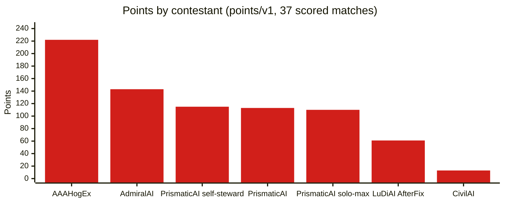
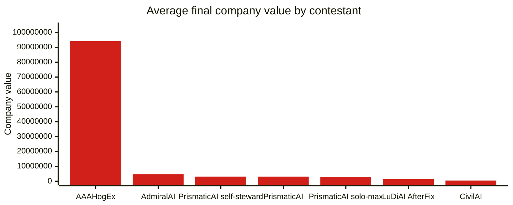
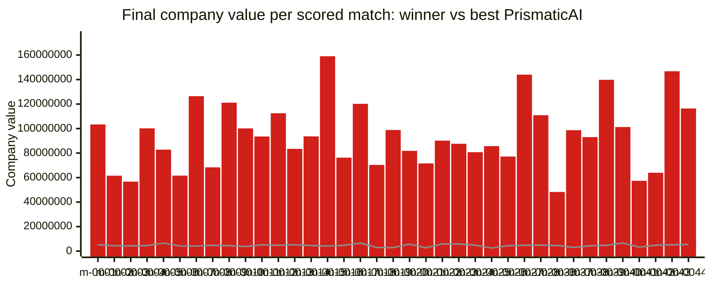
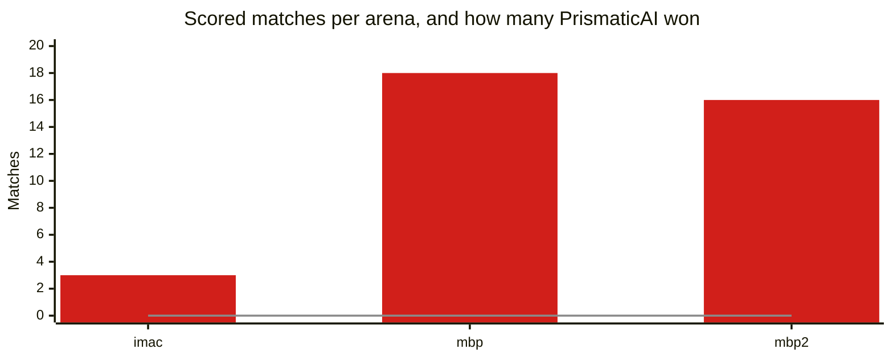

# battle-20261119T054742-91a72662

Derived from `battle-20261119T054742-91a72662.json` by `tools/research/ai-battle/battle.py report`; do not edit.

- Edition `91a726628e57de21`: PrismaticAI and referee at `df1e05e7d80c160ef3111d99a6fd62b642d99651`, base set `opengfx-8.0.tar`
- 20-year free-for-all from 1960, map 256x256 temperate, breakdowns 1
- 37 scored match(es) on `imac` (20260724-prismatic-mcp-server-m64d95df5ae), `mbp` (20261119-master-mf87e1d279c), `mbp2` (20261119-master-g9750b3f946)
- Replays: 0 of 0 identical to their original on another arena

| # | Contestant | Played | Wins | Points | Avg rank | Avg final value | Squirrel errors | Matches with anomalies |
|---|---|---|---|---|---|---|---|---|
| 1 | AAAHogEx | 37 | 37 | 222 | 1.0 | 94.2 M | 0 | 0 |
| 2 | AdmiralAI | 37 | 0 | 143 | 3.14 | 4.6 M | 0 | 3 |
| 3 | PrismaticAI self-steward | 37 | 0 | 115 | 3.89 | 3.1 M | 0 | 30 |
| 4 | PrismaticAI | 37 | 0 | 113 | 3.95 | 3.1 M | 0 | 20 |
| 5 | PrismaticAI solo-max | 37 | 0 | 110 | 4.03 | 2.9 M | 0 | 35 |
| 6 | LuDiAI AfterFix | 37 | 0 | 61 | 5.35 | 1.5 M | 0 | 0 |
| 7 | CivilAI | 37 | 0 | 13 | 6.65 | 468.4 k | 7405 | 6 |

<!-- battle-charts:begin -->
<!-- derived from battle-20261119T054742-91a72662.json by `battle.py render`; `battle.py check` fails when it is stale -->

<!-- battle-charts:end -->

| Match | Arena | Seed | Winner | Value | Last | Anomalies |
|---|---|---|---|---|---|---|
| m-0001 | mbp | 1251879686 | AAAHogEx | 103.3 M | LuDiAI AfterFix | PrismaticAI solo-max: fleet_drop:26->12; PrismaticAI self-steward: fleet_drop:19->9; PrismaticAI: fleet_drop:17->10 |
| m-0002 | mbp | 930967890 | AAAHogEx | 61.5 M | CivilAI | PrismaticAI: fleet_drop:25->14; PrismaticAI solo-max: fleet_drop:18->11; PrismaticAI self-steward: fleet_drop:23->6 |
| m-0003 | mbp | 1814625749 | AAAHogEx | 56.7 M | CivilAI | PrismaticAI solo-max: fleet_drop:22->14 |
| m-0004 | mbp | 397755790 | AAAHogEx | 100.2 M | CivilAI | PrismaticAI solo-max: fleet_drop:33->10; PrismaticAI self-steward: fleet_drop:26->17; PrismaticAI: fleet_drop:22->9 |
| m-0005 | mbp | 852521374 | AAAHogEx | 82.8 M | PrismaticAI solo-max | PrismaticAI: fleet_drop:27->17; PrismaticAI solo-max: fleet_drop:21->10 |
| m-0006 | mbp | 622201523 | AAAHogEx | 61.6 M | LuDiAI AfterFix | PrismaticAI: fleet_drop:27->13; PrismaticAI self-steward: fleet_drop:26->11; PrismaticAI solo-max: fleet_drop:23->8 |
| m-0007 | mbp | 1791605593 | AAAHogEx | 126.4 M | LuDiAI AfterFix | PrismaticAI solo-max: fleet_drop:29->10; PrismaticAI self-steward: fleet_drop:29->19; PrismaticAI: fleet_drop:27->13 |
| m-0008 | mbp | 1016335253 | AAAHogEx | 68.3 M | CivilAI | PrismaticAI self-steward: fleet_drop:27->14; PrismaticAI solo-max: fleet_drop:26->10; CivilAI: fleet_drop:51->27 |
| m-0009 | mbp | 1182050720 | AAAHogEx | 121.1 M | PrismaticAI | PrismaticAI self-steward: fleet_drop:31->20; PrismaticAI solo-max: fleet_drop:33->10 |
| m-0010 | imac | 644316239 | AAAHogEx | 100.1 M | LuDiAI AfterFix | PrismaticAI self-steward: fleet_drop:29->17; PrismaticAI solo-max: fleet_drop:21->11; PrismaticAI: fleet_drop:19->7 |
| m-0011 | imac | 1005694260 | AAAHogEx | 93.5 M | PrismaticAI | CivilAI: squirrel_errors:3874 |
| m-0012 | imac | 542166871 | AAAHogEx | 112.5 M | CivilAI | PrismaticAI: fleet_drop:29->20; PrismaticAI solo-max: fleet_drop:24->12; PrismaticAI self-steward: fleet_drop:23->11 |
| m-0013 | mbp2 | 1566354715 | AAAHogEx | 83.4 M | CivilAI | PrismaticAI solo-max: fleet_drop:24->11 |
| m-0014 | mbp2 | 1738814815 | AAAHogEx | 93.6 M | CivilAI | PrismaticAI self-steward: fleet_drop:23->12; PrismaticAI: fleet_drop:25->17; PrismaticAI solo-max: fleet_drop:21->5 |
| m-0015 | mbp2 | 700686639 | AAAHogEx | 159.0 M | CivilAI | PrismaticAI solo-max: fleet_drop:32->14; PrismaticAI self-steward: fleet_drop:29->14; PrismaticAI: fleet_drop:30->18; CivilAI: squirrel_errors:3531 |
| m-0016 | mbp2 | 478346528 | AAAHogEx | 76.3 M | CivilAI | PrismaticAI solo-max: fleet_drop:31->14 |
| m-0017 | mbp2 | 145339768 | AAAHogEx | 120.2 M | AdmiralAI | PrismaticAI: fleet_drop:27->17; PrismaticAI self-steward: fleet_drop:27->15; AdmiralAI: fleet_drop:51->34 |
| m-0018 | mbp2 | 202210594 | AAAHogEx | 70.3 M | CivilAI | PrismaticAI solo-max: fleet_drop:32->6; PrismaticAI: fleet_drop:19->8; PrismaticAI self-steward: fleet_drop:23->7 |
| m-0019 | mbp2 | 1538202881 | AAAHogEx | 98.8 M | CivilAI | PrismaticAI solo-max: fleet_drop:21->7; PrismaticAI: fleet_drop:21->12; PrismaticAI self-steward: fleet_drop:19->10 |
| m-0020 | mbp2 | 415608858 | AAAHogEx | 81.8 M | CivilAI | PrismaticAI self-steward: fleet_drop:28->16; PrismaticAI solo-max: fleet_drop:22->9 |
| m-0021 | mbp2 | 1623305058 | AAAHogEx | 71.5 M | CivilAI | PrismaticAI self-steward: fleet_drop:21->11; PrismaticAI solo-max: fleet_drop:22->12; CivilAI: no_vehicles |
| m-0022 | mbp2 | 589628189 | AAAHogEx | 90.1 M | PrismaticAI self-steward | PrismaticAI solo-max: fleet_drop:18->7; PrismaticAI self-steward: fleet_drop:19->9 |
| m-0023 | mbp2 | 1987023718 | AAAHogEx | 87.6 M | CivilAI | PrismaticAI: fleet_drop:20->13; PrismaticAI solo-max: fleet_drop:18->7 |
| m-0024 | mbp2 | 1978581656 | AAAHogEx | 80.7 M | CivilAI | PrismaticAI self-steward: fleet_drop:31->16; PrismaticAI solo-max: fleet_drop:22->11 |
| m-0025 | mbp2 | 898469763 | AAAHogEx | 85.7 M | CivilAI | PrismaticAI self-steward: fleet_drop:25->14; PrismaticAI solo-max: fleet_drop:22->12; PrismaticAI: fleet_drop:23->9 |
| m-0026 | mbp2 | 194341801 | AAAHogEx | 77.2 M | CivilAI | PrismaticAI solo-max: fleet_drop:26->11; AdmiralAI: fleet_drop:113->67; CivilAI: fleet_drop:21->10 |
| m-0027 | mbp2 | 1112431946 | AAAHogEx | 144.0 M | CivilAI | PrismaticAI solo-max: fleet_drop:28->14; PrismaticAI: fleet_drop:31->17; PrismaticAI self-steward: fleet_drop:25->17 |
| m-0028 | mbp2 | 431109973 | AAAHogEx | 110.9 M | CivilAI | PrismaticAI solo-max: fleet_drop:28->12; PrismaticAI self-steward: fleet_drop:27->17; PrismaticAI: fleet_drop:22->12 |
| m-0036 | mbp | 1710584728 | AAAHogEx | 48.3 M | CivilAI | PrismaticAI solo-max: fleet_drop:24->12; PrismaticAI self-steward: fleet_drop:29->17 |
| m-0037 | mbp | 700804041 | AAAHogEx | 98.7 M | CivilAI | PrismaticAI self-steward: fleet_drop:25->17; PrismaticAI solo-max: fleet_drop:27->10; PrismaticAI: fleet_drop:20->13 |
| m-0038 | mbp | 2798290 | AAAHogEx | 93.0 M | LuDiAI AfterFix | PrismaticAI self-steward: fleet_drop:24->13; PrismaticAI solo-max: fleet_drop:23->8; CivilAI: fleet_drop:61->41 |
| m-0039 | mbp | 557130425 | AAAHogEx | 139.8 M | CivilAI | PrismaticAI solo-max: fleet_drop:25->8; PrismaticAI self-steward: fleet_drop:23->14; AdmiralAI: fleet_drop:364->229 |
| m-0040 | mbp | 978315542 | AAAHogEx | 101.2 M | CivilAI | PrismaticAI solo-max: fleet_drop:27->17; PrismaticAI self-steward: fleet_drop:20->12 |
| m-0041 | mbp | 1131845159 | AAAHogEx | 57.4 M | CivilAI | PrismaticAI solo-max: fleet_drop:22->11; PrismaticAI self-steward: fleet_drop:22->14; PrismaticAI: fleet_drop:19->11 |
| m-0042 | mbp | 373397060 | AAAHogEx | 63.9 M | CivilAI | PrismaticAI self-steward: fleet_drop:25->16; PrismaticAI solo-max: fleet_drop:22->12 |
| m-0043 | mbp | 1510845497 | AAAHogEx | 146.8 M | AdmiralAI | PrismaticAI solo-max: fleet_drop:21->10; PrismaticAI self-steward: fleet_drop:20->13 |
| m-0044 | mbp | 1419691949 | AAAHogEx | 116.4 M | CivilAI | PrismaticAI solo-max: fleet_drop:27->12; PrismaticAI self-steward: fleet_drop:24->15; PrismaticAI: fleet_drop:27->16 |
