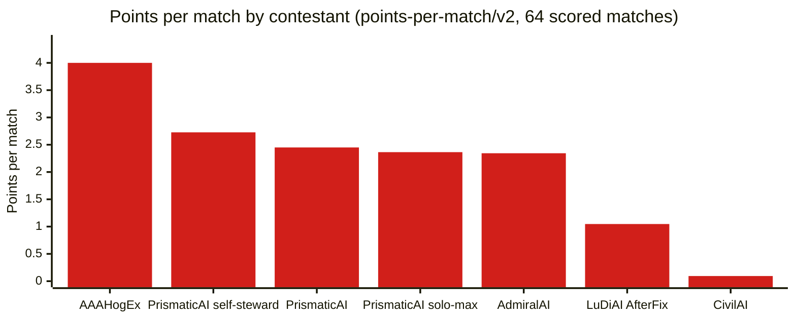
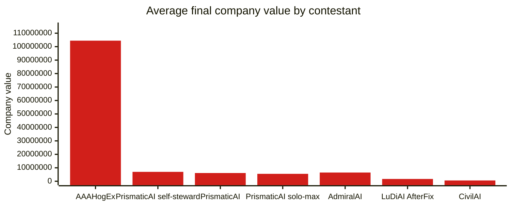
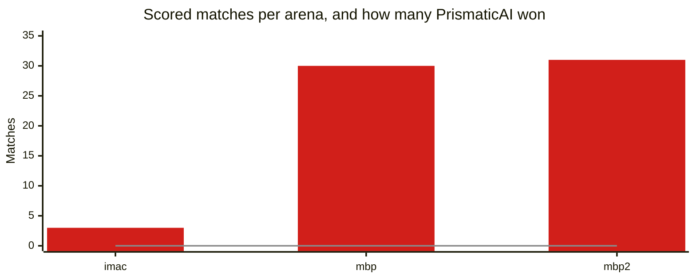

# battle-20261119T060827-361b802f

Derived from `battle-20261119T060827-361b802f.json` by `tools/research/ai-battle/battle.py report`; do not edit.

- Edition `361b802f523018f4`: PrismaticAI and referee at `bd98bbad736035c3bd7478ebec1accc1230455dc`, base set `opengfx-8.0.tar`
- 20-year free-for-all from 1960, map 256x256 temperate, breakdowns 1
- 64 scored match(es) on `imac` (20260724-prismatic-mcp-server-m64d95df5ae), `mbp` (20261119-master-m82c3c2fc0b), `mbp2` (20261119-master-gdf1e05e7d8)
- Replays: 4 of 4 identical to their original on another arena

| # | Contestant | Played | Wins | Points | Points/match | Avg rank | Avg final value | Squirrel errors | Matches with anomalies |
|---|---|---|---|---|---|---|---|---|---|
| 1 | AAAHogEx | 64 | 64 | 256 | 4.0 | 1.0 | 104.5 M | 0 | 0 |
| 2 | PrismaticAI self-steward | 22 | 0 | 60 | 2.727 | 2.27 | 7.0 M | 0 | 11 |
| 3 | PrismaticAI | 20 | 0 | 49 | 2.45 | 2.55 | 6.1 M | 0 | 6 |
| 4 | PrismaticAI solo-max | 22 | 0 | 52 | 2.364 | 2.64 | 5.5 M | 0 | 22 |
| 5 | AdmiralAI | 64 | 0 | 150 | 2.344 | 2.66 | 6.5 M | 0 | 5 |
| 6 | LuDiAI AfterFix | 64 | 0 | 67 | 1.047 | 3.95 | 1.7 M | 0 | 1 |
| 7 | CivilAI | 64 | 0 | 6 | 0.094 | 4.91 | 582.4 k | 3750 | 10 |

```mermaid
---
config:
  xyChart:
    width: 900
    height: 360
  themeVariables:
    xyChart:
      plotColorPalette: "#d11f1a, #8a8a8a, #0b0b0b, #ece4d6"
---
xychart-beta
    title "Final company value per scored match: winner vs best PrismaticAI"
    x-axis ["m-0001", "m-0002", "m-0003", "m-0004", "m-0005", "m-0006", "m-0007", "m-0008", "m-0009", "m-0010", "m-0011", "m-0012", "m-0013", "m-0014", "m-0015", "m-0016", "m-0017", "m-0018", "m-0019", "m-0020", "m-0021", "m-0022", "m-0023", "m-0024", "m-0025", "m-0026", "m-0027", "m-0028", "m-0036", "m-0037", "m-0038", "m-0039", "m-0040", "m-0041", "m-0042", "m-0043", "m-0044", "m-0045", "m-0046", "m-0047", "m-0049", "m-0050", "m-0051", "m-0052", "m-0053", "m-0054", "m-0055", "m-0057", "m-0058", "m-0059", "m-0060", "m-0061", "m-0062", "m-0063", "m-0065", "m-0066", "m-0067", "m-0068", "m-0069", "m-0070", "m-0071", "m-0073", "m-0074", "m-0077"]
    %% series: Winner | Best PrismaticAI
    %% links: battle-20261119T060827-361b802f.md?col=Match&filter=m-0001 | battle-20261119T060827-361b802f.md?col=Match&filter=m-0002 | battle-20261119T060827-361b802f.md?col=Match&filter=m-0003 | battle-20261119T060827-361b802f.md?col=Match&filter=m-0004 | battle-20261119T060827-361b802f.md?col=Match&filter=m-0005 | battle-20261119T060827-361b802f.md?col=Match&filter=m-0006 | battle-20261119T060827-361b802f.md?col=Match&filter=m-0007 | battle-20261119T060827-361b802f.md?col=Match&filter=m-0008 | battle-20261119T060827-361b802f.md?col=Match&filter=m-0009 | battle-20261119T060827-361b802f.md?col=Match&filter=m-0010 | battle-20261119T060827-361b802f.md?col=Match&filter=m-0011 | battle-20261119T060827-361b802f.md?col=Match&filter=m-0012 | battle-20261119T060827-361b802f.md?col=Match&filter=m-0013 | battle-20261119T060827-361b802f.md?col=Match&filter=m-0014 | battle-20261119T060827-361b802f.md?col=Match&filter=m-0015 | battle-20261119T060827-361b802f.md?col=Match&filter=m-0016 | battle-20261119T060827-361b802f.md?col=Match&filter=m-0017 | battle-20261119T060827-361b802f.md?col=Match&filter=m-0018 | battle-20261119T060827-361b802f.md?col=Match&filter=m-0019 | battle-20261119T060827-361b802f.md?col=Match&filter=m-0020 | battle-20261119T060827-361b802f.md?col=Match&filter=m-0021 | battle-20261119T060827-361b802f.md?col=Match&filter=m-0022 | battle-20261119T060827-361b802f.md?col=Match&filter=m-0023 | battle-20261119T060827-361b802f.md?col=Match&filter=m-0024 | battle-20261119T060827-361b802f.md?col=Match&filter=m-0025 | battle-20261119T060827-361b802f.md?col=Match&filter=m-0026 | battle-20261119T060827-361b802f.md?col=Match&filter=m-0027 | battle-20261119T060827-361b802f.md?col=Match&filter=m-0028 | battle-20261119T060827-361b802f.md?col=Match&filter=m-0036 | battle-20261119T060827-361b802f.md?col=Match&filter=m-0037 | battle-20261119T060827-361b802f.md?col=Match&filter=m-0038 | battle-20261119T060827-361b802f.md?col=Match&filter=m-0039 | battle-20261119T060827-361b802f.md?col=Match&filter=m-0040 | battle-20261119T060827-361b802f.md?col=Match&filter=m-0041 | battle-20261119T060827-361b802f.md?col=Match&filter=m-0042 | battle-20261119T060827-361b802f.md?col=Match&filter=m-0043 | battle-20261119T060827-361b802f.md?col=Match&filter=m-0044 | battle-20261119T060827-361b802f.md?col=Match&filter=m-0045 | battle-20261119T060827-361b802f.md?col=Match&filter=m-0046 | battle-20261119T060827-361b802f.md?col=Match&filter=m-0047 | battle-20261119T060827-361b802f.md?col=Match&filter=m-0049 | battle-20261119T060827-361b802f.md?col=Match&filter=m-0050 | battle-20261119T060827-361b802f.md?col=Match&filter=m-0051 | battle-20261119T060827-361b802f.md?col=Match&filter=m-0052 | battle-20261119T060827-361b802f.md?col=Match&filter=m-0053 | battle-20261119T060827-361b802f.md?col=Match&filter=m-0054 | battle-20261119T060827-361b802f.md?col=Match&filter=m-0055 | battle-20261119T060827-361b802f.md?col=Match&filter=m-0057 | battle-20261119T060827-361b802f.md?col=Match&filter=m-0058 | battle-20261119T060827-361b802f.md?col=Match&filter=m-0059 | battle-20261119T060827-361b802f.md?col=Match&filter=m-0060 | battle-20261119T060827-361b802f.md?col=Match&filter=m-0061 | battle-20261119T060827-361b802f.md?col=Match&filter=m-0062 | battle-20261119T060827-361b802f.md?col=Match&filter=m-0063 | battle-20261119T060827-361b802f.md?col=Match&filter=m-0065 | battle-20261119T060827-361b802f.md?col=Match&filter=m-0066 | battle-20261119T060827-361b802f.md?col=Match&filter=m-0067 | battle-20261119T060827-361b802f.md?col=Match&filter=m-0068 | battle-20261119T060827-361b802f.md?col=Match&filter=m-0069 | battle-20261119T060827-361b802f.md?col=Match&filter=m-0070 | battle-20261119T060827-361b802f.md?col=Match&filter=m-0071 | battle-20261119T060827-361b802f.md?col=Match&filter=m-0073 | battle-20261119T060827-361b802f.md?col=Match&filter=m-0074 | battle-20261119T060827-361b802f.md?col=Match&filter=m-0077
    y-axis "Company value" 0 --> 180000000
    bar [124139004, 56635966, 63190278, 129250503, 103029871, 69516402, 141512093, 80443234, 126334538, 116957957, 128018444, 136356617, 88681977, 96270219, 141181950, 92925286, 143245576, 73105577, 96780000, 100688664, 64287056, 95143953, 121746019, 108243415, 85819941, 98819572, 115215342, 127348783, 76780058, 112642232, 67386788, 118025370, 113000122, 63508227, 97782407, 144484568, 109990459, 79761126, 112775105, 163357585, 101919678, 89840060, 149046967, 115274255, 70795269, 112718256, 119691713, 95668357, 118304217, 149564034, 78645895, 122344182, 83574312, 79577490, 153813759, 49572122, 118668686, 110393492, 100641928, 104003267, 77744903, 100798881, 96696805, 101330534]
    line [4650286, 6380448, 4801565, 6114125, 6502269, 5394605, 5887795, 5070042, 8944111, 5545653, 5550641, 2351813, 6334129, 7440289, 4296186, 5174454, 5792293, 925241, 4560521, 10298237, 3611008, 4672449, 5550281, 7871989, 5687466, 5542900, 8173348, 6293189, 9570857, 6945706, 10619678, 10523389, 4003664, 7662315, 5022033, 4888146, 6516505, 4233966, 4308222, 7450298, 6845188, 5800770, 3089746, 4545221, 4695257, 7811757, 4227776, 6906377, 6433469, 6878486, 6535230, 5864299, 7577360, 6336379, 8241018, 7125620, 5312367, 7065512, 8763530, 7483115, 7602570, 5515710, 7655411, 7733152]
```

<!-- battle-charts:begin -->
<!-- derived from battle-20261119T060827-361b802f.json by `battle.py render`; `battle.py check` fails when it is stale -->

<!-- battle-charts:end -->

| Seed | Original | Replay | Arenas | Identical |
|---|---|---|---|---|
| 1566354715 | m-0013 | m-0048 | mbp2 / mbp | yes |
| 1251879686 | m-0001 | m-0056 | mbp / mbp2 | yes |
| 1738814815 | m-0014 | m-0064 | mbp2 / mbp | yes |
| 700686639 | m-0015 | m-0072 | mbp2 / mbp | yes |

| Match | Arena | Seed | Winner | Value | Last | Anomalies |
|---|---|---|---|---|---|---|
| m-0001 | mbp | 1251879686 | AAAHogEx | 124.1 M | CivilAI | PrismaticAI solo-max: fleet_drop:25->15 |
| m-0002 | mbp | 930967890 | AAAHogEx | 56.6 M | CivilAI | PrismaticAI self-steward: fleet_drop:30->19 |
| m-0003 | mbp | 1814625749 | AAAHogEx | 63.2 M | CivilAI | - |
| m-0004 | mbp | 397755790 | AAAHogEx | 129.3 M | CivilAI | PrismaticAI solo-max: fleet_drop:34->17; CivilAI: fleet_drop:12->6 |
| m-0005 | mbp | 852521374 | AAAHogEx | 103.0 M | LuDiAI AfterFix | AdmiralAI: fleet_drop:147->100; CivilAI: squirrel_errors:3750 |
| m-0006 | mbp | 622201523 | AAAHogEx | 69.5 M | CivilAI | - |
| m-0007 | mbp | 1791605593 | AAAHogEx | 141.5 M | CivilAI | PrismaticAI solo-max: fleet_drop:34->14; CivilAI: fleet_drop:29->14 |
| m-0008 | mbp | 1016335253 | AAAHogEx | 80.4 M | CivilAI | PrismaticAI self-steward: fleet_drop:29->18 |
| m-0009 | mbp | 1182050720 | AAAHogEx | 126.3 M | CivilAI | - |
| m-0010 | imac | 644316239 | AAAHogEx | 117.0 M | CivilAI | PrismaticAI solo-max: fleet_drop:33->9 |
| m-0011 | imac | 1005694260 | AAAHogEx | 128.0 M | CivilAI | PrismaticAI self-steward: fleet_drop:30->17 |
| m-0012 | imac | 542166871 | AAAHogEx | 136.4 M | LuDiAI AfterFix | PrismaticAI: fleet_drop:26->17 |
| m-0013 | mbp2 | 1566354715 | AAAHogEx | 88.7 M | CivilAI | PrismaticAI solo-max: fleet_drop:27->16 |
| m-0014 | mbp2 | 1738814815 | AAAHogEx | 96.3 M | CivilAI | PrismaticAI self-steward: fleet_drop:39->27; CivilAI: fleet_drop:41->18 |
| m-0015 | mbp2 | 700686639 | AAAHogEx | 141.2 M | CivilAI | - |
| m-0016 | mbp2 | 478346528 | AAAHogEx | 92.9 M | CivilAI | PrismaticAI solo-max: fleet_drop:29->14 |
| m-0017 | mbp2 | 145339768 | AAAHogEx | 143.2 M | CivilAI | PrismaticAI self-steward: fleet_drop:36->25 |
| m-0018 | mbp2 | 202210594 | AAAHogEx | 73.1 M | CivilAI | PrismaticAI: fleet_drop:16->10; CivilAI: fleet_drop:42->26 |
| m-0019 | mbp2 | 1538202881 | AAAHogEx | 96.8 M | CivilAI | PrismaticAI solo-max: fleet_drop:29->16 |
| m-0020 | mbp2 | 415608858 | AAAHogEx | 100.7 M | CivilAI | PrismaticAI self-steward: fleet_drop:43->30 |
| m-0021 | mbp2 | 1623305058 | AAAHogEx | 64.3 M | CivilAI | PrismaticAI: fleet_drop:30->15 |
| m-0022 | mbp2 | 589628189 | AAAHogEx | 95.1 M | CivilAI | PrismaticAI solo-max: fleet_drop:26->15 |
| m-0023 | mbp2 | 1987023718 | AAAHogEx | 121.7 M | CivilAI | PrismaticAI self-steward: fleet_drop:30->15 |
| m-0024 | mbp2 | 1978581656 | AAAHogEx | 108.2 M | CivilAI | - |
| m-0025 | mbp2 | 898469763 | AAAHogEx | 85.8 M | CivilAI | PrismaticAI solo-max: fleet_drop:26->12 |
| m-0026 | mbp2 | 194341801 | AAAHogEx | 98.8 M | CivilAI | - |
| m-0027 | mbp2 | 1112431946 | AAAHogEx | 115.2 M | CivilAI | CivilAI: fleet_drop:60->34 |
| m-0028 | mbp2 | 431109973 | AAAHogEx | 127.3 M | CivilAI | PrismaticAI solo-max: fleet_drop:28->17 |
| m-0036 | mbp | 1710584728 | AAAHogEx | 76.8 M | CivilAI | AdmiralAI: fleet_drop:81->22 |
| m-0037 | mbp | 700804041 | AAAHogEx | 112.6 M | CivilAI | PrismaticAI solo-max: fleet_drop:31->13 |
| m-0038 | mbp | 2798290 | AAAHogEx | 67.4 M | CivilAI | CivilAI: fleet_drop:79->54 |
| m-0039 | mbp | 557130425 | AAAHogEx | 118.0 M | CivilAI | - |
| m-0040 | mbp | 978315542 | AAAHogEx | 113.0 M | CivilAI | PrismaticAI solo-max: fleet_drop:29->12 |
| m-0041 | mbp | 1131845159 | AAAHogEx | 63.5 M | CivilAI | CivilAI: fleet_drop:66->27 |
| m-0042 | mbp | 373397060 | AAAHogEx | 97.8 M | CivilAI | - |
| m-0043 | mbp | 1510845497 | AAAHogEx | 144.5 M | CivilAI | PrismaticAI solo-max: fleet_drop:26->14 |
| m-0044 | mbp | 1419691949 | AAAHogEx | 110.0 M | CivilAI | PrismaticAI self-steward: fleet_drop:33->19 |
| m-0045 | mbp2 | 1232613255 | AAAHogEx | 79.8 M | CivilAI | - |
| m-0046 | mbp2 | 1880593676 | AAAHogEx | 112.8 M | CivilAI | PrismaticAI solo-max: fleet_drop:30->15 |
| m-0047 | mbp2 | 183461550 | AAAHogEx | 163.4 M | CivilAI | - |
| m-0048 (replay) | mbp | 1566354715 | AAAHogEx | 88.7 M | CivilAI | PrismaticAI solo-max: fleet_drop:27->16 |
| m-0049 | mbp2 | 169339905 | AAAHogEx | 101.9 M | CivilAI | PrismaticAI solo-max: fleet_drop:28->16 |
| m-0050 | mbp2 | 501512348 | AAAHogEx | 89.8 M | AdmiralAI | PrismaticAI self-steward: fleet_drop:40->23 |
| m-0051 | mbp2 | 1110349149 | AAAHogEx | 149.0 M | CivilAI | PrismaticAI: fleet_drop:21->14; CivilAI: fleet_drop:66->34 |
| m-0052 | mbp2 | 1407755339 | AAAHogEx | 115.3 M | CivilAI | PrismaticAI solo-max: fleet_drop:26->11 |
| m-0053 | mbp2 | 1264484531 | AAAHogEx | 70.8 M | CivilAI | - |
| m-0054 | mbp2 | 1910910772 | AAAHogEx | 112.7 M | CivilAI | - |
| m-0055 | mbp2 | 64276349 | AAAHogEx | 119.7 M | CivilAI | PrismaticAI solo-max: fleet_drop:28->14 |
| m-0056 (replay) | mbp2 | 1251879686 | AAAHogEx | 124.1 M | CivilAI | PrismaticAI solo-max: fleet_drop:25->15 |
| m-0057 | mbp2 | 377297703 | AAAHogEx | 95.7 M | CivilAI | AdmiralAI: fleet_drop:212->125 |
| m-0058 | mbp | 1598458936 | AAAHogEx | 118.3 M | CivilAI | PrismaticAI solo-max: fleet_drop:27->11 |
| m-0059 | mbp | 318743311 | AAAHogEx | 149.6 M | CivilAI | - |
| m-0060 | mbp2 | 1968229012 | AAAHogEx | 78.6 M | CivilAI | PrismaticAI: fleet_drop:23->15 |
| m-0061 | mbp2 | 378285723 | AAAHogEx | 122.3 M | CivilAI | PrismaticAI solo-max: fleet_drop:28->15 |
| m-0062 | mbp | 133918145 | AAAHogEx | 83.6 M | CivilAI | AdmiralAI: fleet_drop:206->140 |
| m-0063 | mbp | 751802737 | AAAHogEx | 79.6 M | CivilAI | - |
| m-0064 (replay) | mbp | 1738814815 | AAAHogEx | 96.3 M | CivilAI | PrismaticAI self-steward: fleet_drop:39->27; CivilAI: fleet_drop:41->18 |
| m-0065 | mbp | 798992613 | AAAHogEx | 153.8 M | CivilAI | PrismaticAI self-steward: fleet_drop:37->25; LuDiAI AfterFix: fleet_drop:89->44 |
| m-0066 | mbp | 1409843336 | AAAHogEx | 49.6 M | CivilAI | PrismaticAI: fleet_drop:32->20 |
| m-0067 | mbp | 1864413330 | AAAHogEx | 118.7 M | CivilAI | PrismaticAI solo-max: fleet_drop:27->13 |
| m-0068 | mbp2 | 1990002070 | AAAHogEx | 110.4 M | CivilAI | - |
| m-0069 | mbp2 | 460626426 | AAAHogEx | 100.6 M | CivilAI | - |
| m-0070 | mbp | 839121556 | AAAHogEx | 104.0 M | LuDiAI AfterFix | PrismaticAI solo-max: fleet_drop:30->16; CivilAI: fleet_drop:82->57 |
| m-0071 | mbp | 1778967953 | AAAHogEx | 77.7 M | LuDiAI AfterFix | - |
| m-0072 (replay) | mbp | 700686639 | AAAHogEx | 141.2 M | CivilAI | - |
| m-0073 | mbp | 1848099965 | AAAHogEx | 100.8 M | CivilAI | PrismaticAI solo-max: fleet_drop:27->13 |
| m-0074 | mbp | 344503261 | AAAHogEx | 96.7 M | LuDiAI AfterFix | PrismaticAI self-steward: fleet_drop:37->23 |
| m-0077 | mbp | 178952092 | AAAHogEx | 101.3 M | CivilAI | AdmiralAI: fleet_drop:115->65 |
