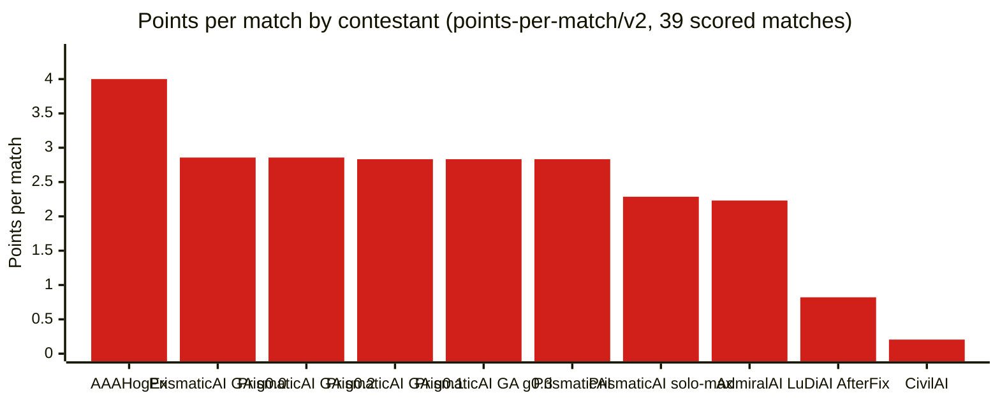
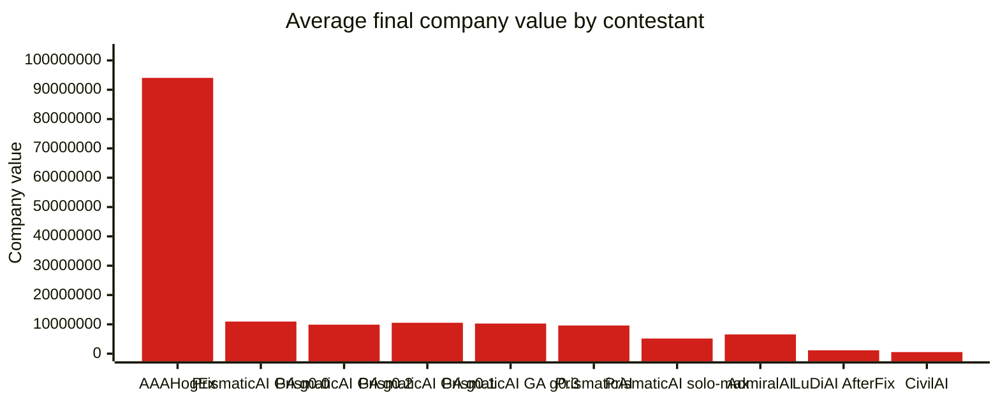
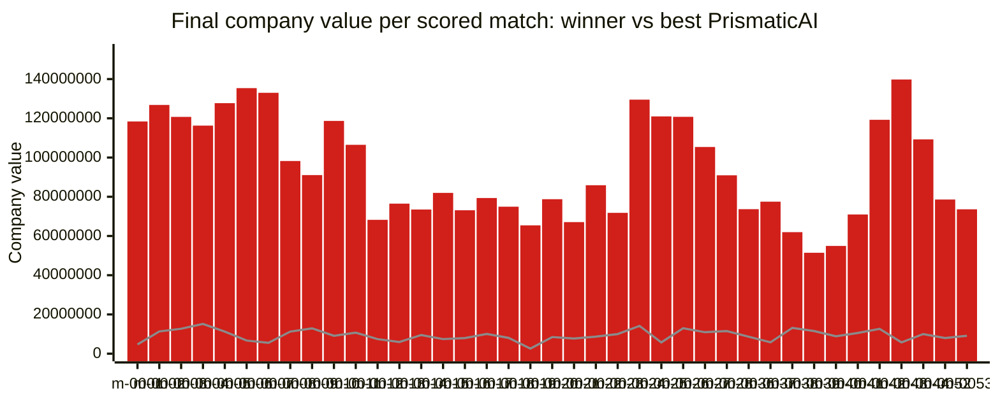
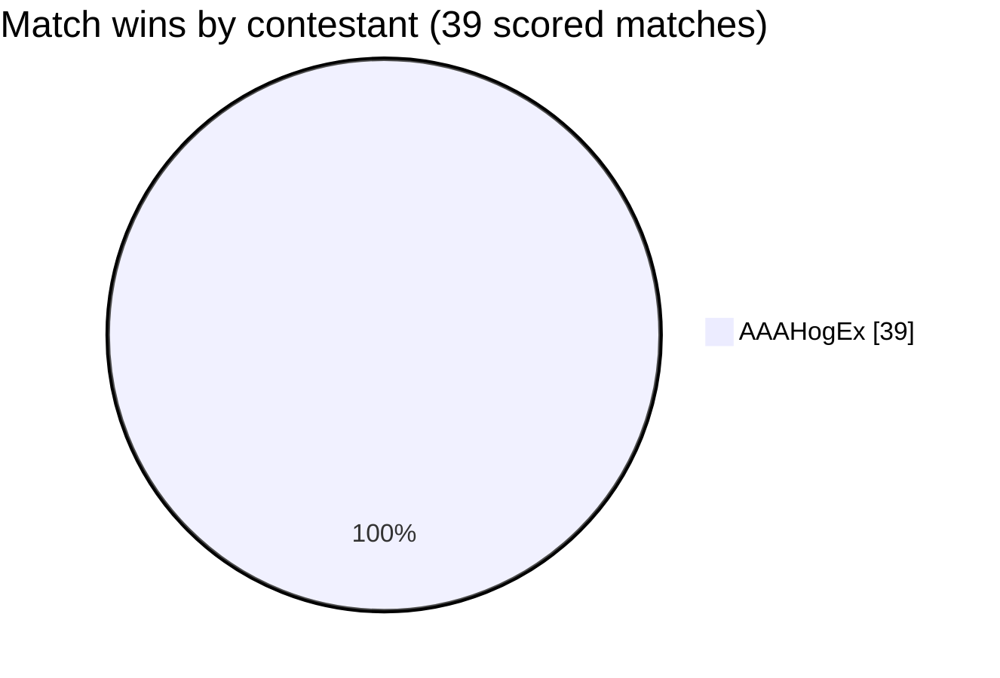
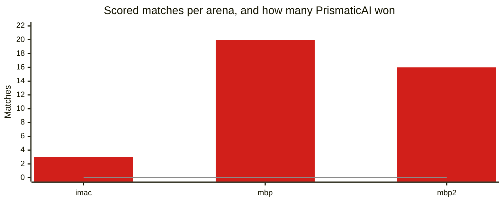

# battle-20261119T064443-39bd2399

Derived from `battle-20261119T064443-39bd2399.json` by `tools/research/ai-battle/battle.py report`; do not edit.

- Edition `39bd23991fcfbd41`: PrismaticAI and referee at `e19ade47bded73203d1cb75604326fe8ab972e34`, base set `opengfx-8.0.tar`
- 20-year free-for-all from 1960, map 256x256 temperate, breakdowns 1
- 39 scored match(es) on `imac` (20261119-master-gdf1e05e7d8), `mbp` (20261119-master-m42528010af, 20261119-master-me19ade47bd), `mbp2` (20261119-master-gdf1e05e7d8)
- Replays: 0 of 0 identical to their original on another arena

| # | Contestant | Played | Wins | Points | Points/match | Avg rank | Avg final value | Squirrel errors | Matches with anomalies |
|---|---|---|---|---|---|---|---|---|---|
| 1 | AAAHogEx | 39 | 39 | 156 | 4.0 | 1.0 | 94.0 M | 0 | 0 |
| 2 | PrismaticAI GA g0.0 | 7 | 0 | 20 | 2.857 | 2.14 | 11.0 M | 0 | 1 |
| 3 | PrismaticAI GA g0.2 | 7 | 0 | 20 | 2.857 | 2.14 | 9.9 M | 0 | 0 |
| 4 | PrismaticAI GA g0.1 | 6 | 0 | 17 | 2.833 | 2.17 | 10.5 M | 0 | 0 |
| 5 | PrismaticAI GA g0.3 | 6 | 0 | 17 | 2.833 | 2.17 | 10.3 M | 0 | 0 |
| 6 | PrismaticAI | 6 | 0 | 17 | 2.833 | 2.17 | 9.6 M | 0 | 1 |
| 7 | PrismaticAI solo-max | 7 | 0 | 16 | 2.286 | 2.71 | 5.2 M | 0 | 7 |
| 8 | AdmiralAI | 39 | 0 | 87 | 2.231 | 2.77 | 6.6 M | 0 | 6 |
| 9 | LuDiAI AfterFix | 39 | 0 | 32 | 0.821 | 4.18 | 1.1 M | 0 | 4 |
| 10 | CivilAI | 39 | 0 | 8 | 0.205 | 4.79 | 547.8 k | 3825 | 9 |

<!-- battle-charts:begin -->
<!-- derived from battle-20261119T064443-39bd2399.json by `battle.py render`; `battle.py check` fails when it is stale -->

<!-- battle-charts:end -->

| Match | Arena | Seed | Winner | Value | Last | Anomalies |
|---|---|---|---|---|---|---|
| m-0001 | mbp | 1237256277 | AAAHogEx | 118.4 M | CivilAI | PrismaticAI solo-max: fleet_drop:52->20 |
| m-0002 | mbp | 1237256277 | AAAHogEx | 126.8 M | CivilAI | - |
| m-0003 | mbp | 1237256277 | AAAHogEx | 120.7 M | CivilAI | - |
| m-0004 | mbp | 1237256277 | AAAHogEx | 116.3 M | LuDiAI AfterFix | LuDiAI AfterFix: fleet_drop:78->49 |
| m-0005 | mbp | 1237256277 | AAAHogEx | 127.7 M | CivilAI | AdmiralAI: fleet_drop:233->163 |
| m-0006 | mbp | 1251879686 | AAAHogEx | 135.4 M | CivilAI | CivilAI: fleet_drop:68->33 |
| m-0007 | mbp | 1251879686 | AAAHogEx | 133.0 M | LuDiAI AfterFix | PrismaticAI solo-max: fleet_drop:42->18 |
| m-0008 | mbp | 1251879686 | AAAHogEx | 98.2 M | LuDiAI AfterFix | LuDiAI AfterFix: fleet_drop:48->20 |
| m-0009 | mbp | 1251879686 | AAAHogEx | 91.1 M | CivilAI | CivilAI: fleet_drop:57->26 |
| m-0010 | imac | 1251879686 | AAAHogEx | 118.7 M | CivilAI | - |
| m-0011 | imac | 1251879686 | AAAHogEx | 106.5 M | CivilAI | AdmiralAI: fleet_drop:256->150 |
| m-0012 | imac | 930967890 | AAAHogEx | 68.2 M | CivilAI | - |
| m-0013 | mbp2 | 930967890 | AAAHogEx | 76.5 M | CivilAI | PrismaticAI solo-max: fleet_drop:36->16; CivilAI: fleet_drop:45->30 |
| m-0014 | mbp2 | 930967890 | AAAHogEx | 73.5 M | CivilAI | AdmiralAI: fleet_drop:273->186 |
| m-0015 | mbp2 | 930967890 | AAAHogEx | 82.0 M | CivilAI | - |
| m-0016 | mbp2 | 930967890 | AAAHogEx | 73.1 M | CivilAI | CivilAI: fleet_drop:48->24 |
| m-0017 | mbp2 | 930967890 | AAAHogEx | 79.4 M | LuDiAI AfterFix | LuDiAI AfterFix: fleet_drop:48->8 |
| m-0018 | mbp2 | 1814625749 | AAAHogEx | 74.9 M | CivilAI | - |
| m-0019 | mbp2 | 1814625749 | AAAHogEx | 65.4 M | CivilAI | PrismaticAI solo-max: fleet_drop:38->21 |
| m-0020 | mbp2 | 1814625749 | AAAHogEx | 78.8 M | CivilAI | PrismaticAI GA g0.0: fleet_drop:94->63 |
| m-0021 | mbp2 | 1814625749 | AAAHogEx | 67.1 M | CivilAI | CivilAI: fleet_drop:26->18 |
| m-0022 | mbp2 | 1814625749 | AAAHogEx | 85.9 M | CivilAI | - |
| m-0023 | mbp2 | 1814625749 | AAAHogEx | 71.8 M | LuDiAI AfterFix | - |
| m-0024 | mbp2 | 397755790 | AAAHogEx | 129.5 M | LuDiAI AfterFix | AdmiralAI: fleet_drop:179->125 |
| m-0025 | mbp2 | 397755790 | AAAHogEx | 121.0 M | CivilAI | PrismaticAI solo-max: fleet_drop:41->20 |
| m-0026 | mbp2 | 397755790 | AAAHogEx | 120.8 M | CivilAI | - |
| m-0027 | mbp2 | 397755790 | AAAHogEx | 105.4 M | CivilAI | CivilAI: fleet_drop:43->24 |
| m-0028 | mbp2 | 397755790 | AAAHogEx | 90.9 M | CivilAI | CivilAI: fleet_drop:81->54 |
| m-0036 | mbp | 622201523 | AAAHogEx | 73.7 M | LuDiAI AfterFix | PrismaticAI: fleet_drop:61->39; CivilAI: fleet_drop:52->35 |
| m-0037 | mbp | 622201523 | AAAHogEx | 77.5 M | CivilAI | AdmiralAI: fleet_drop:239->162; PrismaticAI solo-max: fleet_drop:39->15 |
| m-0038 | mbp | 622201523 | AAAHogEx | 62.0 M | LuDiAI AfterFix | LuDiAI AfterFix: fleet_drop:53->33 |
| m-0039 | mbp | 622201523 | AAAHogEx | 51.4 M | CivilAI | - |
| m-0040 | mbp | 622201523 | AAAHogEx | 54.9 M | CivilAI | CivilAI: squirrel_errors:3825 |
| m-0041 | mbp | 622201523 | AAAHogEx | 71.0 M | CivilAI | AdmiralAI: fleet_drop:154->95 |
| m-0042 | mbp | 1791605593 | AAAHogEx | 119.2 M | CivilAI | - |
| m-0043 | mbp | 1791605593 | AAAHogEx | 139.8 M | CivilAI | PrismaticAI solo-max: fleet_drop:38->14 |
| m-0044 | mbp | 1791605593 | AAAHogEx | 109.3 M | CivilAI | - |
| m-0052 | mbp | 1016335253 | AAAHogEx | 78.6 M | CivilAI | - |
| m-0053 | mbp | 1016335253 | AAAHogEx | 73.6 M | CivilAI | - |
