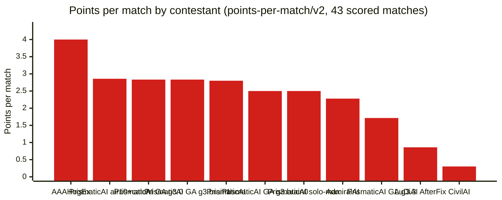
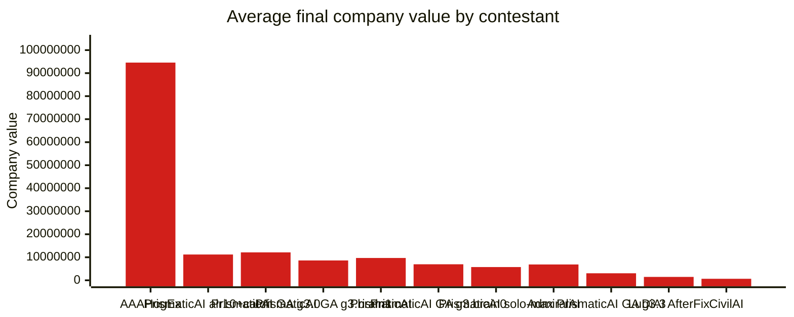
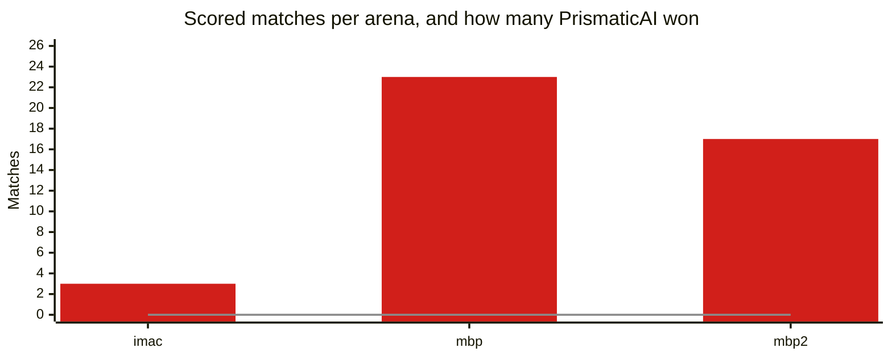

# battle-20261119T072805-76e7404c

Derived from `battle-20261119T072805-76e7404c.json` by `tools/research/ai-battle/battle.py report`; do not edit.

- Edition `76e7404cc8781ed5`: PrismaticAI and referee at `f3b937c7ede4e8217e291abc19a8523e05933eea`, base set `opengfx-8.0.tar`
- 20-year free-for-all from 1960, map 256x256 temperate, breakdowns 1
- 43 scored match(es) on `imac` (20261119-master-gdf1e05e7d8), `mbp` (20261119-master-m55328bdb56), `mbp2` (20261119-master-gdf1e05e7d8)
- Replays: 1 of 1 identical to their original on another arena

| # | Contestant | Played | Wins | Points | Points/match | Avg rank | Avg final value | Squirrel errors | Matches with anomalies |
|---|---|---|---|---|---|---|---|---|---|
| 1 | AAAHogEx | 43 | 43 | 172 | 4.0 | 1.0 | 94.6 M | 0 | 1 |
| 2 | PrismaticAI air10+catch | 7 | 0 | 20 | 2.857 | 2.14 | 11.2 M | 0 | 0 |
| 3 | PrismaticAI GA g3.0 | 6 | 0 | 17 | 2.833 | 2.17 | 12.1 M | 0 | 0 |
| 4 | PrismaticAI GA g3.brain1 | 6 | 0 | 17 | 2.833 | 2.17 | 8.6 M | 0 | 0 |
| 5 | PrismaticAI | 5 | 0 | 14 | 2.8 | 2.2 | 9.7 M | 0 | 2 |
| 6 | PrismaticAI GA g3.brain0 | 6 | 0 | 15 | 2.5 | 2.5 | 7.0 M | 0 | 0 |
| 7 | PrismaticAI solo-max | 6 | 0 | 15 | 2.5 | 2.5 | 5.7 M | 0 | 6 |
| 8 | AdmiralAI | 43 | 0 | 98 | 2.279 | 2.72 | 6.9 M | 0 | 2 |
| 9 | PrismaticAI GA g3.3 | 7 | 0 | 12 | 1.714 | 3.29 | 3.0 M | 0 | 0 |
| 10 | LuDiAI AfterFix | 43 | 0 | 37 | 0.86 | 4.14 | 1.5 M | 0 | 4 |
| 11 | CivilAI | 43 | 0 | 13 | 0.302 | 4.7 | 647.8 k | 0 | 9 |

```mermaid
---
config:
  xyChart:
    width: 900
    height: 360
  themeVariables:
    xyChart:
      plotColorPalette: "#d11f1a, #8a8a8a, #0b0b0b, #ece4d6"
---
xychart-beta
    title "Final company value per scored match: winner vs best PrismaticAI"
    x-axis ["m-0001", "m-0002", "m-0003", "m-0004", "m-0005", "m-0006", "m-0007", "m-0008", "m-0009", "m-0010", "m-0011", "m-0012", "m-0013", "m-0014", "m-0015", "m-0016", "m-0017", "m-0018", "m-0019", "m-0020", "m-0021", "m-0022", "m-0023", "m-0024", "m-0025", "m-0026", "m-0027", "m-0028", "m-0036", "m-0037", "m-0038", "m-0039", "m-0040", "m-0041", "m-0042", "m-0043", "m-0044", "m-0045", "m-0054", "m-0055", "m-0062", "m-0065", "m-0067"]
    %% series: Winner | Best PrismaticAI
    %% links: battle-20261119T072805-76e7404c.md?col=Match&filter=m-0001 | battle-20261119T072805-76e7404c.md?col=Match&filter=m-0002 | battle-20261119T072805-76e7404c.md?col=Match&filter=m-0003 | battle-20261119T072805-76e7404c.md?col=Match&filter=m-0004 | battle-20261119T072805-76e7404c.md?col=Match&filter=m-0005 | battle-20261119T072805-76e7404c.md?col=Match&filter=m-0006 | battle-20261119T072805-76e7404c.md?col=Match&filter=m-0007 | battle-20261119T072805-76e7404c.md?col=Match&filter=m-0008 | battle-20261119T072805-76e7404c.md?col=Match&filter=m-0009 | battle-20261119T072805-76e7404c.md?col=Match&filter=m-0010 | battle-20261119T072805-76e7404c.md?col=Match&filter=m-0011 | battle-20261119T072805-76e7404c.md?col=Match&filter=m-0012 | battle-20261119T072805-76e7404c.md?col=Match&filter=m-0013 | battle-20261119T072805-76e7404c.md?col=Match&filter=m-0014 | battle-20261119T072805-76e7404c.md?col=Match&filter=m-0015 | battle-20261119T072805-76e7404c.md?col=Match&filter=m-0016 | battle-20261119T072805-76e7404c.md?col=Match&filter=m-0017 | battle-20261119T072805-76e7404c.md?col=Match&filter=m-0018 | battle-20261119T072805-76e7404c.md?col=Match&filter=m-0019 | battle-20261119T072805-76e7404c.md?col=Match&filter=m-0020 | battle-20261119T072805-76e7404c.md?col=Match&filter=m-0021 | battle-20261119T072805-76e7404c.md?col=Match&filter=m-0022 | battle-20261119T072805-76e7404c.md?col=Match&filter=m-0023 | battle-20261119T072805-76e7404c.md?col=Match&filter=m-0024 | battle-20261119T072805-76e7404c.md?col=Match&filter=m-0025 | battle-20261119T072805-76e7404c.md?col=Match&filter=m-0026 | battle-20261119T072805-76e7404c.md?col=Match&filter=m-0027 | battle-20261119T072805-76e7404c.md?col=Match&filter=m-0028 | battle-20261119T072805-76e7404c.md?col=Match&filter=m-0036 | battle-20261119T072805-76e7404c.md?col=Match&filter=m-0037 | battle-20261119T072805-76e7404c.md?col=Match&filter=m-0038 | battle-20261119T072805-76e7404c.md?col=Match&filter=m-0039 | battle-20261119T072805-76e7404c.md?col=Match&filter=m-0040 | battle-20261119T072805-76e7404c.md?col=Match&filter=m-0041 | battle-20261119T072805-76e7404c.md?col=Match&filter=m-0042 | battle-20261119T072805-76e7404c.md?col=Match&filter=m-0043 | battle-20261119T072805-76e7404c.md?col=Match&filter=m-0044 | battle-20261119T072805-76e7404c.md?col=Match&filter=m-0045 | battle-20261119T072805-76e7404c.md?col=Match&filter=m-0054 | battle-20261119T072805-76e7404c.md?col=Match&filter=m-0055 | battle-20261119T072805-76e7404c.md?col=Match&filter=m-0062 | battle-20261119T072805-76e7404c.md?col=Match&filter=m-0065 | battle-20261119T072805-76e7404c.md?col=Match&filter=m-0067
    y-axis "Company value" 0 --> 168000000
    bar [138380025, 121212308, 152802370, 128360914, 128131045, 125368351, 112144195, 107661591, 106872389, 125957454, 119599291, 117938254, 126451273, 73704996, 83609496, 74899148, 86204810, 53268868, 53759306, 84650501, 71234784, 61351926, 69346448, 70804061, 56840573, 62137792, 64129407, 108638880, 106588341, 105843272, 112868195, 98497736, 91367121, 102652423, 55749943, 58119394, 55123079, 44607145, 90763462, 133162316, 71553559, 135595039, 118784893]
    line [5991647, 19524918, 19088722, 8123062, 9562179, 3009746, 5747745, 4309850, 7996794, 9750988, 2374410, 8819828, 2638337, 9586265, 7005207, 5291602, 11705385, 2318562, 5810855, 3857390, 7445189, 3782674, 9615890, 9020186, 6400111, 6596534, 2051777, 15571987, 8164611, 10978669, 13265622, 13200233, 11959120, 7228167, 10083753, 5200267, 13668980, 9897475, 8928928, 1721620, 808880, 11307158, 9295408]
```

<!-- battle-charts:begin -->
<!-- derived from battle-20261119T072805-76e7404c.json by `battle.py render`; `battle.py check` fails when it is stale -->

<!-- battle-charts:end -->

| Seed | Original | Replay | Arenas | Identical |
|---|---|---|---|---|
| 1251879686 | m-0013 | m-0064 | mbp2 / mbp | yes |

| Match | Arena | Seed | Winner | Value | Last | Anomalies |
|---|---|---|---|---|---|---|
| m-0001 | mbp | 1237256277 | AAAHogEx | 138.4 M | CivilAI | PrismaticAI solo-max: fleet_drop:54->22 |
| m-0002 | mbp | 1237256277 | AAAHogEx | 121.2 M | LuDiAI AfterFix | CivilAI: fleet_drop:82->52 |
| m-0003 | mbp | 1237256277 | AAAHogEx | 152.8 M | CivilAI | - |
| m-0004 | mbp | 1237256277 | AAAHogEx | 128.4 M | CivilAI | - |
| m-0005 | mbp | 1237256277 | AAAHogEx | 128.1 M | CivilAI | - |
| m-0006 | mbp | 1237256277 | AAAHogEx | 125.4 M | CivilAI | - |
| m-0007 | mbp | 1251879686 | AAAHogEx | 112.1 M | CivilAI | PrismaticAI: fleet_drop:46->32 |
| m-0008 | mbp | 1251879686 | AAAHogEx | 107.7 M | LuDiAI AfterFix | PrismaticAI solo-max: fleet_drop:36->20 |
| m-0009 | mbp | 1251879686 | AAAHogEx | 106.9 M | CivilAI | CivilAI: fleet_drop:103->72 |
| m-0010 | imac | 1251879686 | AAAHogEx | 126.0 M | CivilAI | - |
| m-0011 | imac | 1251879686 | AAAHogEx | 119.6 M | CivilAI | - |
| m-0012 | imac | 1251879686 | AAAHogEx | 117.9 M | CivilAI | LuDiAI AfterFix: fleet_drop:32->19 |
| m-0013 | mbp2 | 1251879686 | AAAHogEx | 126.5 M | CivilAI | - |
| m-0014 | mbp2 | 930967890 | AAAHogEx | 73.7 M | CivilAI | CivilAI: fleet_drop:45->19 |
| m-0015 | mbp2 | 930967890 | AAAHogEx | 83.6 M | CivilAI | PrismaticAI solo-max: fleet_drop:37->13; CivilAI: fleet_drop:33->22 |
| m-0016 | mbp2 | 930967890 | AAAHogEx | 74.9 M | CivilAI | - |
| m-0017 | mbp2 | 930967890 | AAAHogEx | 86.2 M | CivilAI | - |
| m-0018 | mbp2 | 930967890 | AAAHogEx | 53.3 M | LuDiAI AfterFix | CivilAI: fleet_drop:62->34 |
| m-0019 | mbp2 | 930967890 | AAAHogEx | 53.8 M | CivilAI | AAAHogEx: fleet_drop:354->236; CivilAI: fleet_drop:13->7 |
| m-0020 | mbp2 | 930967890 | AAAHogEx | 84.7 M | LuDiAI AfterFix | - |
| m-0021 | mbp2 | 1814625749 | AAAHogEx | 71.2 M | LuDiAI AfterFix | LuDiAI AfterFix: fleet_drop:51->26 |
| m-0022 | mbp2 | 1814625749 | AAAHogEx | 61.4 M | CivilAI | PrismaticAI solo-max: fleet_drop:41->15; CivilAI: fleet_drop:23->8 |
| m-0023 | mbp2 | 1814625749 | AAAHogEx | 69.3 M | CivilAI | - |
| m-0024 | mbp2 | 1814625749 | AAAHogEx | 70.8 M | CivilAI | - |
| m-0025 | mbp2 | 1814625749 | AAAHogEx | 56.8 M | LuDiAI AfterFix | - |
| m-0026 | mbp2 | 1814625749 | AAAHogEx | 62.1 M | CivilAI | - |
| m-0027 | mbp2 | 1814625749 | AAAHogEx | 64.1 M | CivilAI | - |
| m-0028 | mbp2 | 397755790 | AAAHogEx | 108.6 M | CivilAI | PrismaticAI: fleet_drop:101->62 |
| m-0036 | mbp | 852521374 | AAAHogEx | 106.6 M | CivilAI | PrismaticAI solo-max: fleet_drop:53->17; AdmiralAI: fleet_drop:509->306; CivilAI: fleet_drop:32->18 |
| m-0037 | mbp | 852521374 | AAAHogEx | 105.8 M | LuDiAI AfterFix | - |
| m-0038 | mbp | 852521374 | AAAHogEx | 112.9 M | LuDiAI AfterFix | - |
| m-0039 | mbp | 852521374 | AAAHogEx | 98.5 M | LuDiAI AfterFix | LuDiAI AfterFix: fleet_drop:25->17 |
| m-0040 | mbp | 852521374 | AAAHogEx | 91.4 M | LuDiAI AfterFix | - |
| m-0041 | mbp | 852521374 | AAAHogEx | 102.7 M | CivilAI | - |
| m-0042 | mbp | 622201523 | AAAHogEx | 55.7 M | CivilAI | LuDiAI AfterFix: fleet_drop:36->1 |
| m-0043 | mbp | 622201523 | AAAHogEx | 58.1 M | CivilAI | PrismaticAI solo-max: fleet_drop:39->11 |
| m-0044 | mbp | 622201523 | AAAHogEx | 55.1 M | LuDiAI AfterFix | AdmiralAI: fleet_drop:211->137 |
| m-0045 | mbp2 | 622201523 | AAAHogEx | 44.6 M | CivilAI | - |
| m-0054 | mbp | 1791605593 | AAAHogEx | 90.8 M | CivilAI | - |
| m-0055 | mbp | 1791605593 | AAAHogEx | 133.2 M | AdmiralAI | - |
| m-0062 | mbp | 1016335253 | AAAHogEx | 71.6 M | PrismaticAI GA g3.3 | - |
| m-0064 (replay) | mbp | 1251879686 | AAAHogEx | 126.5 M | CivilAI | - |
| m-0065 | mbp | 1182050720 | AAAHogEx | 135.6 M | CivilAI | CivilAI: fleet_drop:29->17 |
| m-0067 | mbp | 1182050720 | AAAHogEx | 118.8 M | CivilAI | - |
